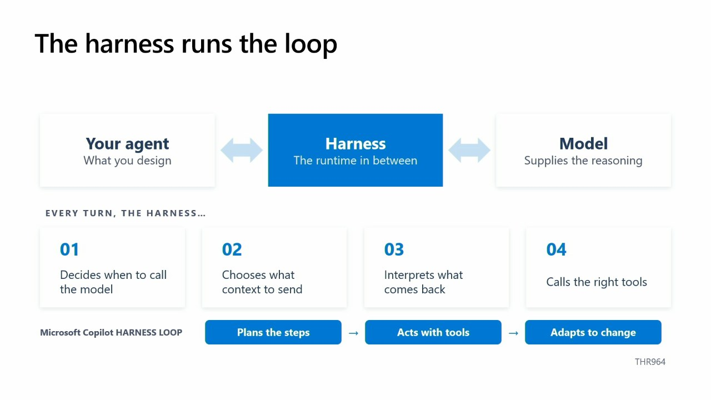
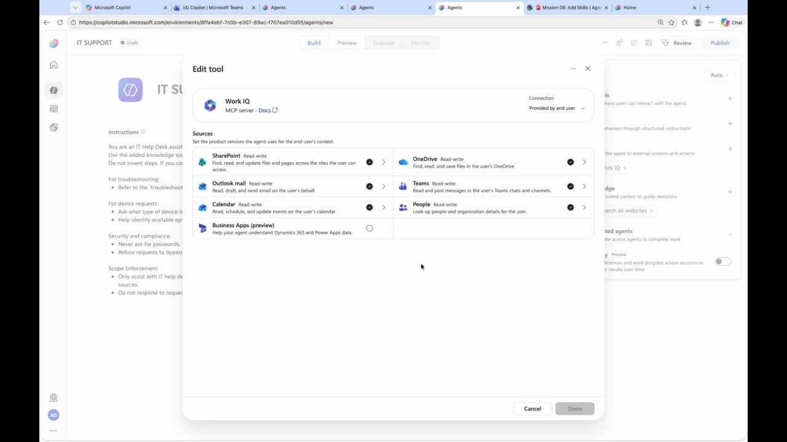
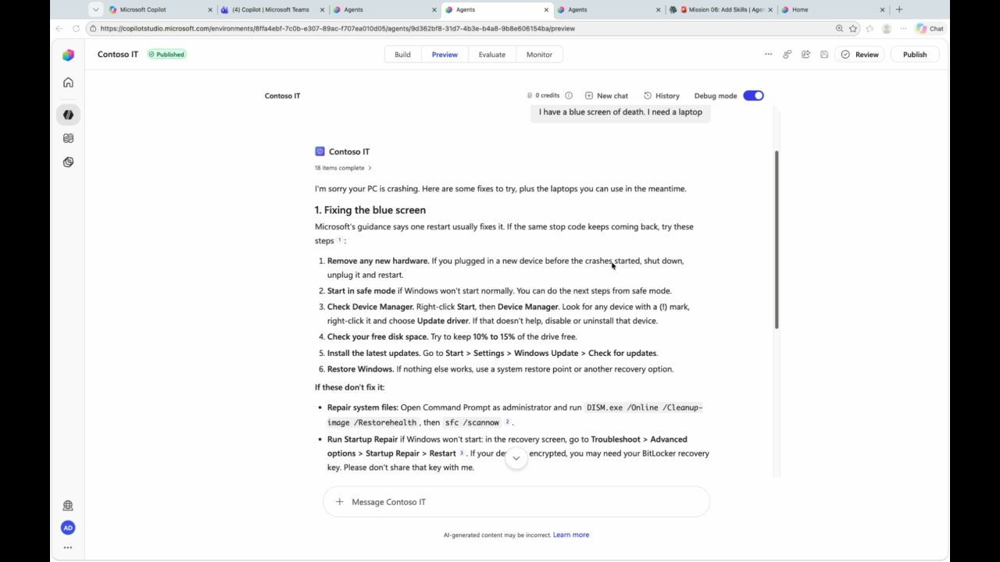
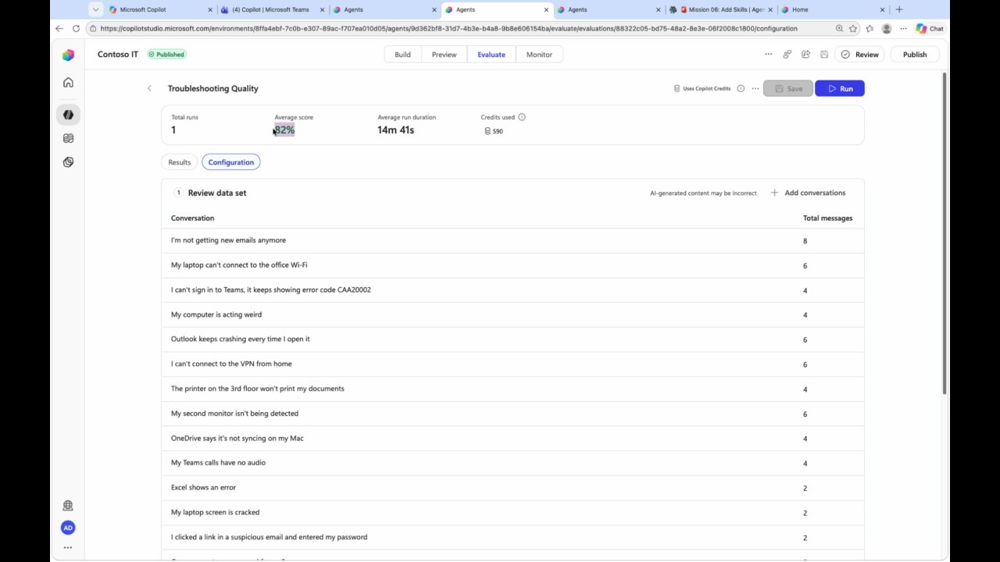

## #runtime-loop-and-harnesses 01 / Runtime Loop & Three Harnesses :: 运行时变革：为什么智能体与多模型之间需要全新 Harness || Runtime Shift: Why an Agent Needs a Planning Harness Between Design and Model

过去在 Copilot Studio 中搭建智能体默认采用标准内核（Standard Harness）：制作者必须提前预测用户意图，在“话题（Topics）”画布里逐条编写追问节点、工具调用顺序与异常分支 [1]。这种前置脚本化模式在面对固定核验流程时尚可应付，但一旦进入真实的复杂业务现场——例如员工询问“我需要申请一台新电脑”，系统不仅要核实设备是否满足每 4 年一次的换新窗口，还要在接口超时或条件不符时临时改写方案——手工穷举所有潜在断点便成了最沉重的工程负担 [1][2]。 || Building agents in Copilot Studio historically meant working inside the **Standard harness**, where makers predicted user intents and scripted every follow-up question, branch, and action inside Topics up front [1]. While pre-scripted trees handle rigid checklists, real enterprise requests—such as checking whether a laptop request falls inside a 4-year hardware refresh window and recovering gracefully if a backend lookup throws an error—make pre-wiring every breaking point unsustainable [1][2].

April Dunnam 在开场明确界定了破局关键：**执行内核（Harness）是处于制作者设计层（指令、知识、工具）与底层推理大模型（支持多个 GPT 与 Anthropic 模型实例）之间的运行时引擎** [1][2]。在每一轮交互中，Microsoft Copilot Harness 依次完成四项核心调度：01 裁决何时调用大模型、02 挑选发往模型的最小必要上下文、03 解析模型返回结果、04 精准触发对应工具 [1][2]。更核心的跃迁在于其**评估与重规划（Evaluate & Re-Plan）闭环**——内核在调用工具后不会盲目终止，而是主动校验当前输出是否真正满足终端用户诉求；若工具报错或结果未达预期，内核当场生成新计划自适应恢复，彻底免除了手工编写容错分支的繁琐工作 [1][2]。 || Opening THR964, April Dunnam pinpointed the architectural pivot: **the harness is the runtime sitting between what you design in your agent and the underlying model supplying reasoning** (supporting multiple GPT and Anthropic model instances) [1][2]. On every turn, the Microsoft Copilot harness executes four steps: deciding when to call the model, choosing what context to send, interpreting what comes back, and calling the right tools [1][2]. Its defining advantage is the **evaluation and re-planning loop**: after acting, the runtime checks whether the output actually satisfies the user's goal and dynamically formulates a recovery plan if a tool errors out or returns incomplete data [1][2].

:::figure { src: "./media/thr964-harness-architecture.figure.json", title: "Microsoft Copilot Harness 三层运行时闭环与五大构建模块架构 || Microsoft Copilot Harness Three-Tier Runtime Loop & Five Building Blocks" }
图 1：THR964 揭示的智能体运行时全貌——顶层分离恒定指令、按需挂载的技能与受控知识源；中层由内核驱动多模型规划、上下文裁剪与异常重规划；底层协同连接器、确定性工作流与内置安全代码沙盒闭环交付 [1][2]。 || Figure 1: Full THR964 runtime architecture—separating concise instructions, on-demand skills, and scoped grounding at the top; driving multi-model planning, context assembly, and self-evaluation in the middle; and orchestrating connectors, deterministic workflows, and the Python sandbox underneath [1][2].
:::

为了避免团队把所有场景一刀切地塞进同一种模式，Copilot Studio 目前并列提供三套针对不同负载调优的执行内核 [1][2]：**Standard Harness** 严格遵循预设话题与规则，适合固定核验步骤的密码重置；**Customer Conversation Harness** 专为网页聊天与电话语音联络中心优化，原生内置平滑转接人工坐席链路；而本场聚焦的 **Microsoft Copilot Harness** 则面向重度逻辑推理、跨系统多步拆解的企业级复杂流程 [1][2]。下方交互导览台集成了 THR964 官方 24 分钟点播视频流、高清封面与五幕逐分钟实录索引 [1][2]： || Rather than forcing one runtime onto every workload, Copilot Studio offers three specialized harnesses [1][2]: **Standard** for rule-based structured flows like password resets, **Customer Conversation** optimized for contact-center voice and web chat with human escalation, and **Microsoft Copilot** for reasoning-heavy, multi-step processes [1][2]. The interactive theater below pairs the official 24-minute Medius stream with timestamped walkthroughs of all five session chapters [1][2]:

:::sandbox { id: "thr964-video-theater", canvas: false, script: "./thr964-theater.js", style: "./thr964-theater.css", title: "THR964 官方点播视频与五幕时间戳导览台 || THR964 Official On-Demand Stream & Five-Chapter Timestamp Theater", desc: "切换运行时原理、五大积木、实机搭建收权、新旧内核蓝屏同题对决与 82% 单元评测五大章节，支持在页内直接唤起微软官方 Medius 点播流。 || Switch across Runtime Loop, Five Building Blocks, Live Work IQ Scoping, BSOD A/B Comparison, and 82% Automated Evals, or launch the embedded Medius video player." }
纯静态点播与议题导览沙盒：内置 THR964 官方高清封面、五段逐分钟实录摘要及官方视频与实战营直链。 || Pure static session theater featuring the official THR964 HD cover, five timestamped transcript digests, and direct Medius and Agent Academy links.
:::

## #five-building-blocks 02 / Five Building Blocks :: 五大构建积木：动态技能卸载、刚柔并济工作流与内置 Python 沙盒 || Five Building Blocks: Dynamic Skills, Deterministic Workflows, and the Python Sandbox

为什么新内核能在提升工具调用准确率的同时把净词元（Net Token）消耗降下来 [1]？答案在于它将智能体工程拆解为职责正交的五大构建模块：**指令（Instructions）、技能（Skills）、工具（Tools）、工作流（Workflows）与安全沙盒（Sandbox）**[1][2]。过去制作者不得不把所有业务规程硬塞进同一段巨型系统提示词，导致每一轮日常寒暄或简单查询都要重复吞入数千词元；而在新架构下，主指令只需用平实语言声明对所有会话恒定成立的目标、语气与越界禁区 [1][3]。 || How does the Microsoft Copilot harness improve tool-calling accuracy while lowering net token consumption [1]? It decomposes agent design into five orthogonal building blocks: **Instructions, Skills, Tools, Workflows, and Sandbox** [1][2]. Previously, makers stuffed every operational SOP into one monolithic prompt ingested on every turn; now, **Instructions** stay short and hold only the goal, tone, and scope boundaries that remain true for every user interaction [1][3].

重复性的领域专业规程（Know-how）则被剥离进 **Skills（技能）**[1][3]。每项技能本质上是一份轻量级 Markdown 文本说明，也可附带演示文稿模板等资源包与可执行脚本，单个智能体最多可挂载 **50 项技能**[1][3]。内核仅在用户提问命中技能描述时才动态将其拉入当前上下文——当员工仅咨询四年期设备换新时，系统绝不会浪费词元去加载冗长的故障排查技能 [1]。 || Repeatable domain procedures move into **Skills**—modular Markdown files (optionally bundling resource templates and scripts), with up to **50 skills** supported per agent [1][3]. Because the harness loads a skill dynamically based on its description only when relevant, a user asking about a hardware refresh never pays the context-window tax of loading troubleshooting manuals [1].

  <article class="thr964-media-card" data-present-surface="unframed">
    

      
    

    

      THR964 官方课件实拍 · 01:55
      <h4 data-zh="The Harness Runs the Loop：每轮四步调度与自愈闭环" data-en="The Harness Runs the Loop: Four-Step Turn Execution">The Harness Runs the Loop：每轮四步调度与自愈闭环</h4>
      
连接制作者设计与底层推理模型，按序执行调用裁决、上下文装配、结果解析与精准工具触发，驱动规划—行动—自适应循环 [1][2]。

    

  </article>
  <article class="thr964-media-card" data-present-surface="unframed">
    

      
    

    

      THR964 实机演示截帧 · 10:12
      <h4 data-zh="默认挂载 Work IQ MCP 服务与细粒度读写权限收窄" data-en="Default Work IQ MCP Tool & Per-Workload Scope Controls">默认挂载 Work IQ MCP 服务与细粒度读写权限收窄</h4>
      
开箱打通 SharePoint、OneDrive、邮件、Teams、日历、人员与商业应用数据，支持按子服务一键降级只读或彻底关闭 [1][2]。

    

  </article>

在行动与控制层，**Tools（工具）**复用完整的 Power Platform 连接器生态与专为智能体交互优化的模型上下文协议（MCP）服务端点，让智能体跨业务数据库与第三方系统执行增删改查，且无需像旧版那样手工雕琢触发提示词 [1][4]。对于绝不允许大模型临场自由发挥的合规审批或固定财务步骤，制作者可将智能体与确定性 **Workflows（工作流）**双向组合——既能从智能体内部调用工作流，也能在工作流节点中唤醒智能体 [1]。而新内核独有的第五块积木 **Sandbox（安全沙盒）**，则在智能体内部直接开辟了一块受控隔离区，无需额外部署外部容器即可原位编写并运行 Python 代码，结合技能内的企业模板包一键完成复杂数值测算、统计绘图或生成定制 PowerPoint 汇报课件 [1][2]。 || For real-world action, **Tools** tap into the entire Power Platform connector ecosystem alongside agent-optimized Model Context Protocol (MCP) servers for database CRUD operations without tedious trigger phrasing [1][4]. Where strict procedural compliance is non-negotiable, makers pair open-ended agent reasoning with deterministic **Workflows**—calling a workflow from an agent or invoking an agent inside a workflow [1]. Finally, the unique **Sandbox** primitive provides a built-in secure environment to write and execute Python code inline—crunching calculations, plotting charts, or populating a packaged PowerPoint template without external infrastructure [1][2].

:::figure { src: "./media/thr964-harness-selection-quadrant.figure.json", title: "Copilot Studio 三大执行内核与混合资产选型象限 || Copilot Studio Three Harnesses & Process Asset Selection Quadrant" }
图 2：基于 THR964 选型准则绘制的工程决策象限——告别全量指令硬塞与无护栏全网裸搜，按推理复杂度匹配标准内核、对客会话内核以及融合动态技能与确定性流的新一代 Copilot 内核 [1][2]。 || Figure 2: Engineering selection quadrant from THR964—matching workflow reasoning complexity and determinism across Standard, Customer Conversation, and Microsoft Copilot harnesses while avoiding monolithic prompt bloat [1][2].
:::

## #live-build-and-ab-test 03 / Live Build & Head-to-Head Test :: 实机搭建与同题对决：15 分钟构建 IT 支持智能体并完胜旧版内核 || Live Build & A/B Showdown: Crafting an IT Concierge and Outperforming Standard Topics

在占据半场篇幅的实机演示中，April Dunnam 打开 `copilotstudio.microsoft.com` 从空白页新建企业内部技术支持智能体（`IT Support` / `Contoso IT`），直观展示了最小权限收窄与复合意图推理的完整工程细节 [1][2]： || Dedicating the second half of THR964 to a live build at `copilotstudio.microsoft.com`, April Dunnam assembled an enterprise IT help desk agent from scratch and placed it head-to-head against an equivalent Standard-harness build [1][2]:

:::flow { title: "实机演练：从最小权限收窄到“蓝屏+换机”复合诉求对决的四步闭环 || Four-Step Live Walkthrough: From Least-Privilege Setup to Compound BSOD Triage" }
1. **精简主指令与禁区护栏 || Concise Scope & Refusal Instructions** — 主指令仅声明“企业技术支持助手”角色定位、将排障路由至专属技能、对换机请求收集需求并匹配可用机型，同时明确写入安全合规红线（严禁索要密码或一次性验证码，严禁回答超出技术支持范畴的无关提问）[1][2]。 || Defines role, routing placeholders, and explicit security guardrails—never request passwords or one-time codes, and refuse out-of-scope queries [1][2].
2. **Work IQ 子域降权与知识白名单 || Work IQ Least-Privilege & Domain Allowlist** — 新建智能体默认挂载以终端用户身份鉴权的 **Work IQ** 工具（覆盖文档库、网盘、邮件、聊天、日历、人员与商业应用）；April 现场演示将“人员（People）”权限收窄为只读、直接取消勾选不需要的 Outlook 邮件，并关闭默认开启的“搜索全部网站”开关，将外部公开知识严格锁定在 `support.microsoft.com` 与 `learn.microsoft.com/troubleshoot` 官方域名内 [1][2]。 || Narrows default Work IQ MCP access (setting People to read-only and unchecking Outlook) while turning off unrestricted web search in favor of `support.microsoft.com` and `learn.microsoft.com/troubleshoot` [1][2].
3. **上传五步排障 Markdown 技能 || Uploading the 5-Step Markdown Skill** — 点击添加预置的 `troubleshooting-procedure` 技能包，凭借清晰描述驱动运行时动态挂载；技能正文规定依次执行“单问题聚焦澄清—重启与服务状态等无损诊断—带原始链接的分步修复—提供 1 至 2 条备选路径—累计 2 至 3 条路径失败后附带症状摘要升级工单”五步规程 [1][2]。 || Uploads `troubleshooting-procedure`, encoding five structured phases: single-question clarification, non-destructive diagnostics, cited step-by-step fixes, 1–2 alternatives, and ticket escalation after 2–3 failed paths [1][2].
4. **开启 Debug 模式对决复合提问 || Debug-Mode Compound Prompt A/B Test** — 输入同时包含故障排障与资产申领的一句话复合诉求：`I have a blue screen of death. I need a laptop`（我遇到蓝屏死机了，需要一台新笔记本）[1][2]。新内核实时展示思维链并跑完 **18 项底层步骤**：先共情确认崩溃故障，按序给出拔除外设、进入安全模式、检查设备管理器、保留 **10% 至 15%** 可用磁盘空间、系统更新及管理员运行 `DISM.exe /Online /Cleanup-image /Restorehealth` 与 `sfc /scannow`（同时提醒切勿在对话中泄露 BitLocker 恢复密钥），最后兜底列出若排障无效可申领的备选笔记本清单 [1][2]。 || Sends the dual-intent prompt *"I have a blue screen of death. I need a laptop"* in Debug mode (`18 items complete`): the new harness delivers 6 cited BSOD steps (`10%–15%` free disk check, `DISM` + `sfc /scannow`, and a BitLocker safety reminder) before presenting available replacement laptops [1][2].
:::

为了把新旧两代运行时的工程差异钉死，April 当场切入在 **Standard Harness** 下用同等知识源搭建的对照版智能体，并输入一模一样的蓝屏换机复合提问 [1]。对照实验暴露出两大硬伤：其一，标准内核没有动态技能机制，所有排障步骤被迫全量塞入主指令，导致员工每发一句话都要在上下文窗口里全额重算一遍词元，多轮对话成本高企；其二，由于缺乏动态规划循环，标准内核必须依赖预先手绘的多个独立话题去硬匹配“查 SharePoint 设备列表”和“提交换机申请”，面对单句双意图提问当场顾此失彼——既未能严格执行分步排障规程，也彻底漏掉了对笔记本申领诉求的响应 [1]。 || Switching immediately to a parallel IT help desk agent built on the legacy **Standard harness** with the exact same prompt exposed two structural bottlenecks [1]. First, without Skills, all troubleshooting instructions sat permanently inside the main prompt—re-ingesting full context and burning extra tokens on every back-and-forth turn. Second, lacking a dynamic planning loop, the Standard agent relied on separate pre-scripted SharePoint topics for listing and requesting hardware; confronted with two intents in one sentence, it failed to follow the step-by-step troubleshooting rubric and completely ignored the laptop request [1].

  <article class="thr964-media-card" data-present-surface="unframed">
    

      
    

    

      THR964 实机演示截帧 · 16:12
      <h4 data-zh="Debug 模式下拆解“蓝屏+换机”双意图（18 项动作完成）" data-en="Debug Mode Resolving Compound BSOD + Laptop Prompt (18 Steps)">Debug 模式下拆解“蓝屏+换机”双意图（18 项动作完成）</h4>
      
自动触发排障技能与官方站点检索，先输出 6 步修复与 DISM/SFC 命令及 BitLocker 安全提醒，再衔接备选机型 [1][2]。

    

  </article>
  <article class="thr964-media-card" data-present-surface="unframed">
    

      
    

    

      THR964 实机演示截帧 · 20:03
      <h4 data-zh="Evaluate 面板：多轮对话自动化单元评测斩获 82% 均分" data-en="Evaluate Tab: Multi-Turn Automated Unit Test Scoring 82%">Evaluate 面板：多轮对话自动化单元评测斩获 82% 均分</h4>
      
批量运行涵盖收不到邮件、Wi-Fi 断连、Teams 报错 CAA20002 等多轮测试集，耗时 14 分 41 秒、消耗 590 积分输出量化体检单 [1][2]。

    

  </article>

## #evaluate-publish-academy 04 / Evaluate, Publish & NextGen Academy :: 质量门禁与交付演进：82% 单元评测、全渠道嵌入与一句话建站预览 || Quality Gate & Delivery: 82% Automated Evals, Omnichannel Rollout, and Prompt-to-Agent

智能体告别硬编码分支后，上线前的确定性质量门禁如何保障 [1]？除了在 `Preview` 面板开启调试模式做单点抽查，Copilot Studio 原生内置了充当“智能体单元测试框架”的 **Evaluate（评测）**与线上观测 **Monitor（监控）**双闭环 [1][2]。在实机演示的 `Troubleshooting Quality` 评测集中，April 预置了覆盖收不到新邮件（8 轮消息）、无线网断连（6 轮）、登录报错 CAA20002（4 轮）、外接显示器失灵（6 轮）及误点钓鱼链接（2 轮）等十余组真实多轮对话 [1][2]。评测引擎逐项检验智能体是否先追问受影响设备与报错信息，而非盲目抛出修复命令 [1][2]。 || Once makers replace scripted topic trees with autonomous reasoning, how do teams verify production quality [1]? Beyond interactive spot checks in `Preview`, Copilot Studio pairs pre-deployment unit testing in **Evaluate** with post-launch telemetry in **Monitor** [1][2]. In her `Troubleshooting Quality` evaluation suite, April loaded multi-turn test cases covering missing Outlook mail (8 messages), office Wi-Fi drops (6 messages), Teams error `CAA20002` (4 messages), monitor detection (6 messages), and phishing clicks (2 messages) [1][2]. Each test grades whether the agent asks focused diagnostic follow-ups instead of jumping straight to a fix [1][2].

| 架构与工程维度 || Engineering Dimension | Standard Harness（旧版标准话题内核） || Standard Harness (Legacy Topic Engine) | Microsoft Copilot Harness（新一代规划内核） || Microsoft Copilot Harness (New Planning Runtime) |
|------|------|------|
| 对话控制与异常恢复 || Flow Control & Recovery | 必须在 Topics 中预先穷举意图分支与容错路径，未命中分支即断链 [1] || Pre-scripted topic branches and manual error wiring up front [1] | 仅声明终局目标；运行时执行规划—行动—自检重规划，工具报错自动改写恢复 [1][2] || Goal-driven Plan-Act-Evaluate-Replan loop with built-in error adaptation [1][2] |
| 专业规程与词元效率 || Domain Know-How & Tokens | 无技能分层，全量规程塞入主指令，每轮对话重复消耗上下文窗口词元 [1] || Monolithic instructions re-ingested on every conversational turn [1] | 支持多达 **50 项** Markdown 技能按需动态加载，主指令精简，净词元占用显著降低 [1][3] || Up to **50** dynamic Markdown skills loaded on cue for lower net token usage [1][3] |
| 数据工具与代码执行 || Data, Actions & Compute | 手工配置连接器触发词与多话题存取 SharePoint 列表，无内置代码环境 [1] || Verbose tool descriptions and manual multi-topic SharePoint wiring [1] | 默认集成可降权的 **Work IQ**、连接器与 MCP、确定性工作流互调及内置 **Python 沙盒** [1][2] || Configurable **Work IQ** MCP, connectors, bidirectional Workflows & **Python Sandbox** [1][2] |
| 质量评测与多端发布 || Testing, Telemetry & Channels | 依赖人工逐条点击对话抽测，复合提问（如蓝屏+换机）易漏判次要诉求 [1] || Manual spot testing; drops secondary intents on compound prompts [1] | 内置 **Evaluate** 多轮单元评测（实测 **82%** 得分并支持导出）、**Monitor** 会话穿透与 Teams/网页嵌入 [1][2] || Automated **Evaluate** unit suites (**82%** demo score, exportable), **Monitor** & Teams/embed rollout [1][2] |

在演示现场，首轮自动化评测运行耗时 **14 分 41 秒**、消耗 **590 点 Copilot Credits**，最终跑出 **82%** 的平均通过分——这一量化信号立刻提示制作者在正式发布前导出测试集深挖剩余 18% 的失分对话 [1][2]。验证达标后，只需在部署面板一键勾选 **Microsoft 365 与 Teams**（员工随即能在 Teams 内直接唤醒 `IT Concierge` 处理“电脑太慢怎么修”等模糊提问），或提取标准 **Embed 嵌入代码**挂载至企业公共门户与自研应用中；上线后的每日活跃用户数、会话成功率、平均对话时长及单次会话问答明细则全部汇聚至 `Monitor` 标签页集中巡检 [1][2]。 || Live on stage, the evaluation run completed in **14m 41s** using **590 Copilot Credits** and returned an **82%** average score—immediately signaling where to inspect and refine failing cases (with full test-set export) prior to launch [1][2]. Publishing then takes two clicks: either deploy natively to **Microsoft 365 and Teams** (surfacing `IT Concierge` immediately for vague end-user asks like *"how do I fix my computer? It's slow"*) or copy the generated **embed code** for any external website or custom app, while `Monitor` tracks daily active users, success rates, average chat duration, and individual session transcripts [1][2].

演讲收尾处，April 还披露了两项加速制作者上手的关键动向 [1][2]：其一，访问预览环境 `copilotstudio.preview.microsoft.com` 已支持**纯自然语言一句话生成完整智能体**——只需输入“我需要一个企业技术支持智能体”，平台便会自动起草指令、按需拆出技能并匹配候选工具供制作者微调；其二，微软倡导团队同步开源上线了免费动手实验营 **Copilot Studio Agent Academy**（包含面向初学者的 Recruit、中级进阶 Operative，以及涵盖 DocuSign MCP 与自定义 MCP 集成的 Special Ops 独立实验），其中专门针对新内核打造的 **11 关实战闯关路径**现已在 `https://aka.ms/agent-academy/recruit-nextgen` 全面开放 [1][5]。 || Closing the session, April highlighted two accelerators for makers [1][2]. First, `copilotstudio.preview.microsoft.com` now previews **natural-language agent scaffolding**, where a single prompt (*"I need an IT help desk agent"*) drafts instructions, skills, and candidate tools automatically. Second, her team released free hands-on training through the **Copilot Studio Agent Academy**—spanning beginner *Recruit*, intermediate *Operative*, and targeted *Special Ops* labs (such as DocuSign MCP and custom MCP integrations)—with an **11-mission Microsoft Copilot harness path** live at `https://aka.ms/agent-academy/recruit-nextgen` [1][5].

## 参考资料：官方一手信源与实战实验营 || References: Official Primary Sources & Hands-On Labs

1. **April Dunnam (Microsoft Ignite 2026 THR964 Video & Transcript)** — https://ignite.microsoft.com/en-US/sessions/1787856592220001EVen-1791588108990001CPQG | 《Copilot Studio unlocked: The new Microsoft Copilot harness for makers》25 分钟官方剧场实录与中英双语 WebVTT 逐字稿（2026-11-18） || Official 25-minute theater session page and bilingual WebVTT transcripts (Nov 18, 2026)
2. **April Dunnam (THR964 Official Medius On-Demand Stream)** — https://medius.microsoft.com/Embed/video-nc/ad58b43f-c354-4f99-a64c-b13cd6c7132a | THR964 微软官方 Medius 点播视频流（涵盖四步内核架构课件、Work IQ 权限配置、蓝屏换机新旧内核对比与 82% 自动化评测实录） || Official Microsoft Medius embedded video stream capturing all stage slides and live Copilot Studio walkthroughs
3. **Microsoft Copilot Studio Documentation (Agents, Skills & Harnesses)** — https://learn.microsoft.com/en-us/microsoft-copilot-studio/ | Microsoft Copilot Studio 官方技术文档：指令边界设计、Markdown 技能挂载（上限 50 项）、多模型选择与自动化评测指南 || Official documentation covering instructions, dynamic skills, multi-model orchestration, and evaluation test sets
4. **Microsoft Learn Troubleshooting & Support Grounding Reference** — https://learn.microsoft.com/troubleshoot | THR964 实机演示中作为受信任外部知识白名单挂载的微软官方排障文档库（配合 `https://support.microsoft.com`） || Official Microsoft troubleshooting knowledge base configured as an allowed grounding domain during the THR964 live build
5. **Copilot Studio Agent Academy: Recruit NextGen (11 Hands-On Missions)** — https://aka.ms/agent-academy/recruit-nextgen | April Dunnam 团队出品的 Microsoft Copilot Harness 免费 11 关动手实验营（含 Recruit、Operative 进阶课程与 MCP Special Ops 专项实验） || Free 11-mission hands-on learning path built by April Dunnam's advocacy team covering setup through badge completion
