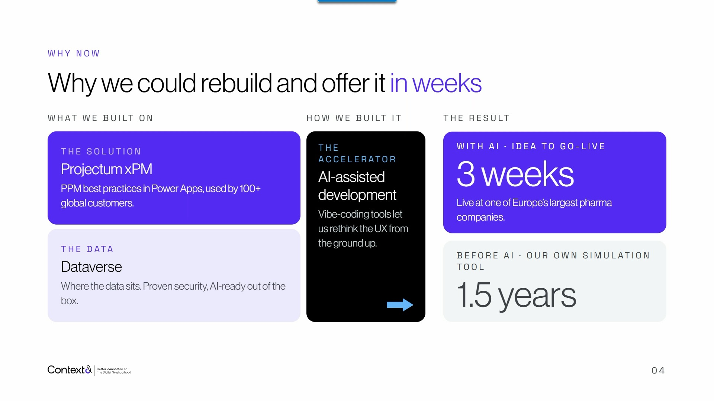
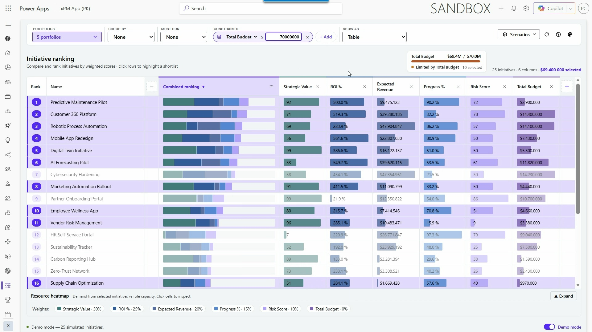
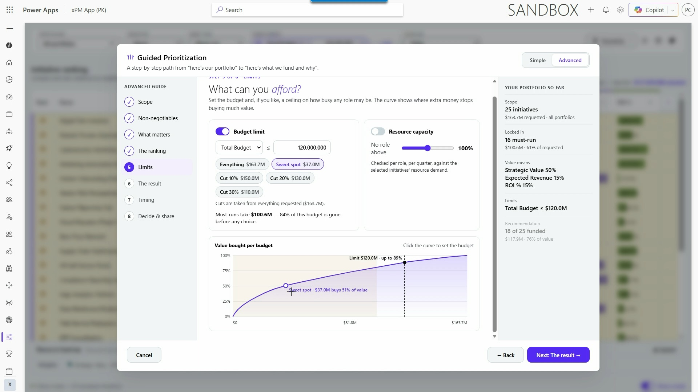
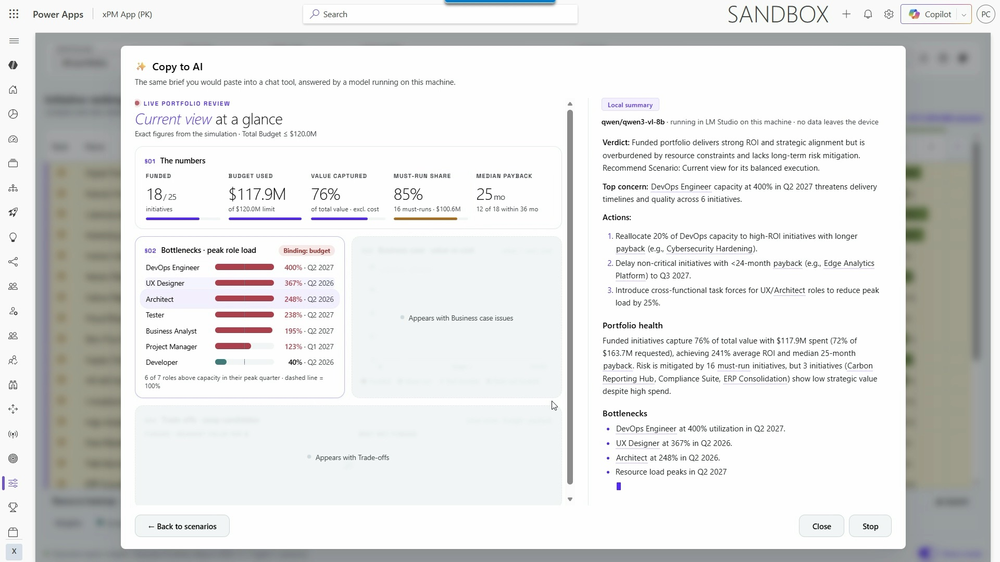

## #beyond-three-tool-loop 01 / Beyond the Three-Tool Loop :: 破局二十年沉疴：为什么传统三工具循环撑不起高频动荡期的资本配置 || Breaking a 20-Year Bottleneck: Why the Three-Tool Reporting Loop Fails Under Volatility

项目组合管理（Project Portfolio Management，简称组合管理）的核心命题二十一年来从未改变：企业手握有限资金与专业人力，究竟该押注哪批项目才能换回最大战略与财务回报 [1][2]？过去五年间，绝大多数大型组织依赖一套看似标准却高度割裂的三步手工链路：左侧用 Power BI 充当只读仪表盘审视既成事实，中间把项目台账从 Dataverse 导出到 Excel 电子表格反复涂改试算，右侧再将阶段性结论手工誊写进 PowerPoint 呈报管理委员会 [1][2]。一旦关税税率起伏、地缘局势震荡或大模型词元（Token）账单飙升打破原有假设，项目办团队下周一就得推倒重来 [1][2]。 || Project portfolio management has chased one core question for over 21 years: given finite capital and scarce specialist capacity, which initiatives deserve funding to maximize return [1][2]? Over the past five years, most enterprises relied on a fragmented three-tool ritual—viewing read-only history in Power BI, dumping Dataverse tables into Excel to tweak scenarios offline, and manually formatting PowerPoint decks for steering committees [1][2]. Whenever tariffs shift, geopolitical shocks hit ROI, or unbudgeted AI token burn escalates mid-week, portfolio teams must restart the entire manual cycle from scratch [1][2].

自称“并非职业程序员”的微软 MVP Peter Kestenholz 在今年 4 月接到了丹麦最大制药企业的紧急诉求，要求彻底终结这种离线搬运 [1][2]。Context& 团队此前曾耗费整整 **1.5 年**研发过一代假设分析产品；而这一次，Peter 仅与另一位同事搭档，在服务全球 **100 余家企业**的成熟模型驱动应用 `Projectum xPM` 与 Dataverse 底座之上，借助 AI 辅助编码（Vibe Coding）从零重构前端交互层 [1][5]。他直接截取 Power BI 中经典的表格排序器、环形图与资源热力图画面交给编码模型，在模型驱动应用内生成原生 **HTML Web Resource（网页资源）**[3]，仅用 **3 周时间**便让整套实时推演工作台在欧洲头部药企正式上线 [1][2]。 || Tasked in April with fixing this bottleneck for Denmark's largest pharmaceutical company, Microsoft MVP Peter Kestenholz—who candidly notes he is not a pro developer—took a radically different path [1][2]. Whereas Context& previously spent **1.5 years** building an earlier simulation product, Peter and one colleague built atop **Dataverse** and their battle-tested model-driven Power App (`Projectum xPM`, used by **100+ global customers**) using AI-assisted vibe coding [1][5]. By screenshotting proven Power BI custom visuals (table sorters, donut charts, heatmaps) and prompting AI to recreate them inside a model-driven **HTML web resource** [3], the two-person team went from first request to live production in **3 weeks** [1][2].

:::figure { src: "./media/thr977-ppm-reasoning-architecture.figure.json", title: "Context& 推理型项目组合管理三层工程架构（Dataverse + HTML Web 资源 + 双模 AI） || Context& Reasoning-First PPM Architecture: Dataverse, HTML Web Resource & Dual-Mode AI" }
图 1：THR977 生产级架构拆解——底层由 Dataverse 统一收口千级项目基线与行级安全角色；中层通过模型驱动 Power App 承载毫秒级内存推演、8 步引导向导与亚秒级简报引擎；顶层按用户自由切换本机断网 LM Studio 或云端 Copilot 评审并将结论存回方案 [1][2]。 || Figure 1: Production architecture unpacked in THR977—Dataverse anchors live baselines and row-level security at the bottom; a model-driven HTML web resource powers in-memory simulation, 8-step guided prioritization, and sub-second PowerPoint generation in the middle; and per-user local or cloud AI persists verdicts at the top [1][2].
:::

这套架构一次性兑现了五大业务闭环：**01 随时提问（Ask）**、**02 多维建模（Model）**、**03 路径引导（Guidance）**、**04 双模评审（Assess）** 与 **05 同源出报（Share）**[1][2]。下方点播导览台集成了 THR977 官方 21 分钟高清实录与五幕关键操作时间戳索引 [1][2]： || This unified canvas delivers five connected capabilities—**Ask, Model, Guidance, Assess, and Share**—without ever leaving Power Apps [1][2]. Explore the official 21-minute Medius stream and five timestamped walkthrough chapters in the interactive theater below [1][2]:

:::sandbox { id: "thr977-video-theater", canvas: false, script: "./thr977-theater.js", style: "./thr977-theater.css", title: "官方点播视频与五幕时间戳导览台 || Official On-Demand Stream & Five-Chapter Timestamp Theater", desc: "切换三工具破局、千级项目实时沙盘、3,700 万美元有效前沿甜点、本机断网模型评审与 3 周 38 次发布复盘，支持页内直接加载微软官方 Medius 点播流。 || Switch across Legacy Loop Shift, 1,000-Project Live Simulator, 37.0M Frontier Curve, Offline Local Model Verdict, and 38-Release Production Lessons, or launch the embedded Medius player." }
纯静态点播与议题导览沙盒：内置 THR977 官方高清封面、五段逐分钟实录摘要及官方视频与技术文档直链。 || Pure static session theater featuring the official THR977 HD cover, five timestamped transcript digests, and direct Medius and Power Apps documentation links.
:::

## #live-whatif-and-frontier 02 / Live What-If & Frontier Curve :: 千级项目毫秒级沙盘：从 USD 70M 硬约束寻优到 USD 37M 有效前沿甜点 || 1,000-Project Live Simulation: From USD 70M Budget Caps to the USD 37M Frontier Sweet Spot

登录模型驱动应用后，系统首先呈现千人千面的实时欢迎页与标准 Dataverse 业务表单——涵盖财务预算成本中心网格、资源计划以及直观暴露排期延误（如管委会原批二季度启动却滑落至三季度执行）的甘特图 [1][2]。Peter 强调团队早已不再纠结“谁家的甘特图最好看”，只要把各业务线项目数据统一收口进 Dataverse，真正的推理魔法便在下方的自定义模拟画布中展开 [1][2]。 || Logging into the model-driven app reveals a user-tailored live welcome page alongside standard Dataverse forms—housing financial cost-center grids, resource plans, and Gantt timelines that expose schedule slippage into Q3 [1][2]. Rather than debating who builds the prettiest Gantt chart, Context& treats Dataverse as the unified collection backbone so interactive portfolio reasoning can take over inside the embedded HTML simulator [1][2].

  <article class="thr977-media-card" data-present-surface="unframed">
    

      
    

    

      THR977 官方课件实拍 · 02:55
      <h4 data-zh="Why Now：从 1.5 年自研周期压缩至 3 周药企投产" data-en="Why Now: Compressing 1.5 Years into a 3-Week Pharma Go-Live">Why Now：从 1.5 年自研周期压缩至 3 周药企投产</h4>
      
立足服务全球 100+ 企业的 Projectum xPM 与开箱安全的 Dataverse 底座，借力 AI 辅助开发彻底重塑前端推演交互体验 [1][2]。

    

  </article>
  <article class="thr977-media-card" data-present-surface="unframed">
    

      
    

    

      THR977 实机演示截帧 · 09:08
      <h4 data-zh="内存级无损约束寻优：USD 70M 上限锁定 10 项高优工程" data-en="In-Memory Constraint Solver: USD 70M Cap Selecting Top 10 Initiatives">内存级无损约束寻优：USD 70M 上限锁定 10 项高优工程</h4>
      
不污染生产库表，动态拉取战略价值（30%）、投资回报率（25%）与预期营收（20%）列归一化排序，在 USD 70.0M 红线内精准配出 USD 69.4M 组合 [1][2]。

    

  </article>

在包含 5 个子组合、25 项演示工程（生产环境实测 **1,000 个项目**依然毫秒级响应）的推演画布上，管理者勾选任意项目或沿时间轴拖拽起止季度时，所有变更仅驻留在内存沙盘中而不会贸然写回生产库，底部的季度角色产能热力图则同步标红人力冲突格 [1][2]。面对全部申报高达 **USD 163.7M** 的总盘子，只要在约束栏输入 **USD 70.0M** 预算上限，系统瞬间依据综合排名筛出最优的 **10 个立项组合**（累计耗资 **USD 69.4M**）[1][2]。点击加号还能随时把 Dataverse 表里的净现值（NPV）、回收月数或客诉降幅等任意数值与货币字段拉入评分面板；哪怕为不同维度随手赋予 `4`、`10`、`7` 等原始分，引擎也会自动按 **100%** 权重归一化，同时允许管理层置顶前 5 项合规必选工程（Must-Runs）[1][2]。 || Even across **1,000 Dataverse projects**, toggling initiatives or dragging start dates forward updates quarterly role heatmaps instantaneously in memory without overwriting production records [1][2]. Facing **USD 163.7M** in total requested spend across 25 demo initiatives, typing a **USD 70.0M** budget constraint immediately isolates the optimal **10 initiatives (USD 69.4M)** [1][2]. Clicking `+` surfaces any numeric or currency column stored in Dataverse—such as NPV, payback months, or risk reduction—automatically normalizing custom point weights (like `4`, `10`, and `7`) to **100%** while respecting top-pinned executive **must-runs** [1][2].

当项目规模达到上千个时，高管显然不可能坐在屏幕前逐行点选 [1]。为此团队专门打造了面向大型组合的 **8 步引导式优先级向导（Guided Prioritization）**，并实现了无需任何后台工作流的亚秒级董事会简报直出 [1][2]： || Because executives managing 1,000 initiatives cannot click rows one by one, Context& built an **8-step Guided Prioritization** wizard paired with zero-Flow board report generation [1][2]:

:::flow { title: "8 步引导式决策与亚秒级高管简报：从千级项目筛选到 USD 37.0M 价值甜点洞察 || 8-Step Guided Prioritization & Sub-Second Deck Export: Pinpointing the USD 37.0M Sweet Spot" }
1. **锁定纳入范围与在途必选项 || Scope & Non-Negotiable Must-Runs** — 第 1 至 2 步先勾选本次纳入推演的子组合（背景列表实时联动过滤），随后圈定不可砍掉的刚性承诺：既可保留管理层钦点项目，也可一键将“所有已启动在建项目”设为必选基底，仅对剩余增量资金做取舍 [1][2]。 || Steps 1–2 filter target sub-portfolios in real time and lock non-negotiables—including executive mandates or every initiative already in flight [1][2].
2. **五大预设导向与成对权重比较 || Preset Value Profiles & Pairwise Comparison** — 第 3 至 4 步告别冗长的指标拉锯战，直接提供战略优先（Strategy First）、增长、财务回报、动量与均衡五套预设模板；若需深度定制，可开启源自经典 Project Server 时代的**两两成对比较（Head-to-Head Pairwise Comparison）**，即时展示各项目相对基线上升 5 位或下调 2 位的排序变化 [1][2]。 || Steps 3–4 offer five preset decision profiles (*Strategy First, Growth, Financial Return, Momentum, Balanced*) plus classic head-to-head pairwise driver comparison, immediately highlighting rank shifts (+5 or -2 positions) against baseline [1][2].
3. **有效前沿曲线揭穿 USD 37.0M 甜点 || Frontier Curve Exposing the USD 37.0M Sweet Spot** — 第 5 至 6 步绘制预算与角色负荷上限（如单角色峰值不超过 `100%`）下的投资有效前沿：曲线清晰揭示在 **USD 163.7M** 全量诉求或 **USD 120.0M** 拟定预算之外，仅花 **USD 37.0M** 的甜点位（Sweet Spot）即可斩获超过 **50%** 的总识别价值；为追逐剩余不到一半价值而额外砸下逾亿美元，直观暴露出“缺的不是预算而是优质项目创意”[1][2]。 || Steps 5–6 plot the investment frontier against budget (USD 120.0M) and role ceilings (`100%`): revealing a **USD 37.0M sweet spot** that captures over half of total value, whereas spending up to **USD 163.7M** burns massive capital on low-yield tail ideas [1][2].
4. **产能错峰、词元第四维与半秒直出简报 || Capacity Phasing, Token Trade-Offs & Sub-Second Deck** — 第 7 至 8 步评估排期平移以抚平人力波峰（Peter 前瞻指出“拿 **100 万美元采购模型词元替代人工工时**”即将成为组合管理第四维）；随后点击 `Executive Report`，系统无需 Power Automate 流程也无需实时跑大模型，**不到 0.5 秒**即可把精确指标填入企业既有 **7 页 PowerPoint 管委会模板**预览下载，彻底省去以往每份定制报告 **2 至 3 周**的开发工作量 [1][2]。 || Steps 7–8 weigh timeline shifts (plus emerging **1.0M token vs. human labor** trade-offs) before clicking `Executive Report`—populating a **7-slide PowerPoint** deck deterministically in **under 0.5 seconds** with zero Power Automate flows, replacing 2–3 weeks of manual report engineering [1][2].
:::

## #sovereign-local-and-cloud-ai 03 / Sovereign Local & Cloud AI :: 本云双模推理实战：断网本机 LM Studio 揪出 400% 产能爆表与零锁定云端协同 || Dual-Mode Reasoning in Action: Air-Gapped LM Studio Verdicts vs. Zero-Lock-In Cloud Briefs

把推演引擎交付给欧洲跨国药企时，团队撞上了一道极为现实的地缘与合规红线：客户一方面严禁将未公开的核心研发组合方案发往外部公有云大模型，另一方面又拒绝被单一智能体供应商锁死，要求员工能自由选用公司准入的任意对话助手 [1][2]。尽管身为 Copilot Studio 领域的微软 MVP，Peter 没有教条地把所有逻辑硬塞进单一云端智能体，而是设计了一套务实的“按用户切换本云双模推理”机制 [1][2]。 || Deploying to major European enterprises surfaced two strict sovereignty and procurement constraints: sensitive portfolio scenarios could not be sent to external cloud AI providers, yet business users also wanted freedom to use whichever approved chat assistant their organization standardized on without single-agent lock-in [1][2]. Despite being a Copilot Studio MVP, Peter deliberately avoided locking scenarios inside one proprietary agent, engineering a pragmatic **per-user local and cloud dual-mode workflow** instead [1][2].

  <article class="thr977-media-card" data-present-surface="unframed">
    

      
    

    

      THR977 实机演示截帧 · 12:48
      <h4 data-zh="Guided Prioritization：USD 37.0M 甜点对比 USD 163.7M 全量诉求" data-en="Guided Prioritization: USD 37.0M Sweet Spot vs. USD 163.7M Total Ask">Guided Prioritization：USD 37.0M 甜点对比 USD 163.7M 全量诉求</h4>
      
前沿曲线标示追加资金边际收益骤降拐点，辅以削减 10%/20%/30% 快捷档位与单角色季度产能 100% 警戒线核验 [1][2]。

    

  </article>
  <article class="thr977-media-card" data-present-surface="unframed">
    

      
    

    

      THR977 实机演示截帧 · 16:20
      <h4 data-zh="断网本机 LM Studio 评审：实时生成看板并捕获 400% 过载" data-en="Offline LM Studio Verdict: Live Dashboard & 400% DevOps Overload">断网本机 LM Studio 评审：实时生成看板并捕获 400% 过载</h4>
      
在本机运行 qwen/qwen3-vl-8b（数据零出境），左屏同步渲染 18/25 立项、USD 117.9M 支出与 76% 价值捕获，右屏输出风险裁决与 3 项调配行动 [1][2]。

    

  </article>

在演示的第一条路径中，Peter 点击 `Copy to AI` 并切入本地模式——他随身携带的 **128GB 内存**笔记本上正通过 **LM Studio** 运行轻量级开源模型 `qwen/qwen3-vl-8b`，即便彻底拔掉网线也能独立推理 [1][2]。针对预算上限 **USD 120.0M** 的推演方案，本机模型在左屏实时绘出健康度看板：**18/25** 个立项工程共耗资 **USD 117.9M**、捕获 **76%** 总价值（其中 **16 项必选工程**占去 **USD 100.6M** 即 **85%** 份额，平均投资回报率 **241%**，中位回收期 **25 个月**）[1][2]。模型同时检出 **7 类核心角色中有 6 类在峰值季度超载**，其中 **DevOps 工程师在 Q2 2027 负荷飙至 400%**，交互设计师与架构师在 Q2 2026 分别达 **367%** 与 **248%** [1][2]。右屏则同步写出审计裁决，点名碳核算中心、合规套件与企业资源规划整合三项工程“高投入低战略价值”，并给出调拨 20% 运维产能、顺延边缘分析平台至 Q3 2027 及组建跨职能突击队压降 25% 峰值负荷三条建议，随场景一并归档回 Dataverse [1][2]。 || Selecting the local option first, Peter ran `qwen/qwen3-vl-8b` inside **LM Studio** on his **128GB RAM** laptop—executing completely offline with zero data leaving the device [1][2]. Evaluating the **USD 120.0M** budget scenario, the local model built a live visual dashboard on the left: **18/25** funded initiatives spend **USD 117.9M** and capture **76%** of total value at **241%** average ROI and **25-month** median payback, with **16 must-runs** consuming **USD 100.6M (85%)** [1][2]. It simultaneously flagged **6 of 7 roles overloaded** in their peak quarter, led by **DevOps Engineers at 400% in Q2 2027**, UX Designers at **367%**, and Architects at **248%** [1][2]. On the right, it drafted a structured Verdict calling out three high-spend, low-value initiatives (*Carbon Reporting Hub, Compliance Suite, ERP Consolidation*) alongside three concrete capacity-reallocation actions, saving the review directly back to Dataverse [1][2].

而在允许使用公有云助手的第二条路径中，用户只需勾选 `Ignite demo`、`Scenario 1` 与 `Scenario 2` 等多个对比方案并点击 `Copy to Copilot`，系统即刻将预设分析提示词与完整的多方案 Markdown 数据长表写入剪贴板 [1][2]。无需配置繁琐的数据源挂载（Grounding）或维护定制智能体，直接切入标准版 **Microsoft 365 Copilot**（或企业批准的任意大模型门户）按下粘贴回车，即可展开跨方案前沿对比，甚至顺手追问一句将其直接转成演示文稿 [1][2]。 || When cloud AI is permitted, selecting multiple saved scenarios (*Ignite demo, Scenario 1, Scenario 2*) and clicking `Copy to Copilot` immediately generates a self-contained **Markdown brief** bundling engineered system prompts with full scenario data tables on the clipboard [1][2]. Users simply paste into out-of-the-box **Microsoft 365 Copilot**—or any enterprise-approved chatbot—with zero custom grounding or agent plumbing required [1][2].

:::figure { src: "./media/thr977-ppm-frontier-quadrant.figure.json", title: "企业项目组合管理工具演进与投资有效前沿选型象限 || Enterprise PPM Tooling Evolution & Investment Frontier Selection Quadrant" }
图 2：基于 THR977 实证经验凝练的组合管理演进象限——摆脱左下角三工具离线搬运与右下角 USD 163.7M 盲目堆砌低效尾端项目，依托 Dataverse 权限底座与本云双模推理直达右上角价值靶心 [1][2]。 || Figure 2: Portfolio governance quadrant synthesized from THR977—escaping manual Excel/PowerPoint loops and USD 163.7M diminishing-return overspend to reach Dataverse-governed live simulation and dual-mode AI reasoning [1][2].
:::

## #hyper-agile-production-rules 04 / Hyper-Agile Production Rules :: 三周 38 次发布的工程铁律：关键用户日清验证、安全随数而行与平民化构建配方 || 38 Releases in 3 Weeks: Daily User Validation, Data-Following Security, and the Maker Playbook

为什么两人的非专职开发小队能在短短三周内向严苛的欧洲制药龙头交付生产级核心系统，且累计推出 **38 个正式迭代版本**（工作日高峰达**日均 5 次发布**）[1][2]？Peter 在收官复盘中将传统报表链路与新一代推理工作台做了全维度对照，并提炼出三条可复用的生产级铁律 [1][2]： || How did a two-person non-pro-dev team ship **38 releases in 3 weeks** (roughly **5 releases per day**) into production at a top-tier pharmaceutical enterprise [1][2]? Closing THR977, Peter contrasted the legacy reporting stack against the new reasoning engine and distilled three non-negotiable production rules [1][2]:

| 工程与治理维度 || Engineering & Governance Dimension | 传统三工具割裂模式（Power BI + Excel + PPT） || Legacy Three-Tool Loop (BI + Excel + PPT) | 新一代推理型组合工作台（Dataverse + HTML + 双模 AI） || Reasoning-First PPM Engine (Dataverse + HTML + Dual AI) |
|------|------|------|
| 推演响应与方案寻优 || Simulation Speed & Optimization | Power BI 只读看历史；导出 Excel 离线改数，千级项目排期平移与多约束联调极度耗时 [1][2] || Read-only BI visuals; manual Excel dumps stall on 1,000-project timeline shifts [1][2] | 内存级无损试算支持 **1,000+ 项目**毫秒级响应；8 步向导自动绘制 **USD 37.0M** 价值甜点曲线 [1][2] || Sub-second in-memory simulation on **1,000+ projects**; 8-step wizard reveals **USD 37.0M** frontier sweet spot [1][2] |
| 高管汇报制作周期 || Board Deck Turnaround | 每次假设变动需人工重绘图表，以往每套定制自动化报表需耗费 **2 至 3 周**开发流程 [1][2] || Rebuilt manually per scenario or required **2–3 weeks** of custom Power Automate work per report [1][2] | 免 Power Automate 流与免运行时推理，点击后 **不到 0.5 秒**直出 **7 页**原生企业模板 PowerPoint [1][2] || Zero Automate flows and zero runtime LLM latency—downloads **7-slide** branded PPTX in **<0.5s** [1][2] |
| 数据主权与模型自由度 || Sovereignty & Model Choice | 强绑单一云端通道易触碰欧洲药企数据出境红线，或完全沦为无智能辅助的纯手工计算 [1][2] || Single-cloud lock-in triggers strict EU data-egress blocks or leaves planners with zero AI [1][2] | 按用户切换本机断网 **LM Studio**（如 `qwen3-vl-8b`）或一键导出 **Markdown** 粘贴至标准 M365 Copilot [1][2] || Per-user offline **LM Studio** (`qwen3-vl-8b`) for zero egress, or one-click **Markdown** brief to M365 Copilot [1][2] |
| 权限治理与交付敏捷度 || Security RBAC & Release Pace | 离线电子表格一旦邮件流转即脱离行级权限管控；传统自研模拟器耗费 **1.5 年**研发周期 [1][2] || Exported spreadsheets immediately lose RBAC; pre-AI custom simulation tool took **1.5 years** [1][2] | **安全随数而行**自动继承 Dataverse 角色权限；2 人依托业务日清反馈实现 **3 周 38 次发布**上线 [1][2] || **Security follows the data** via Dataverse RBAC; 2 builders shipped **38 releases in 3 weeks** [1][2] |

第一条铁律是**关键用户每日高频实测（Validate with key users daily）**：当 AI 辅助编码能让人“早上画草图、一小时后交出可运行版本”时，软件构建本身不再是瓶颈，业务方关键用户能否全程驻场并即时反馈才决定了日均 5 次发布能否不跑偏 [1][2]。第二条铁律是**让安全跟随数据（Let security follow the data）**：把自研 HTML 交互页作为 Web 资源直接架设在 Dataverse 模型驱动应用之上，所有推演场景天然继承 Dataverse 行级安全角色——即便把模拟器链接直接发给无权限同事，对方也绝无可能看到或模拟自己权限范围之外的任何敏感项目，从而彻底解放制作者的创新手脚 [1][3][4]。第三条铁律则是**把本地推理选择权交给每位用户（Offer a local LLM, per user）**，同时鼓励每位业务专家立刻行动起来：去挑出平时在 Power BI 或 Excel 里最顺手的视图截张图，借力 AI 编码将其挂载到自家的 Power Apps 与 Dataverse 之上亲手试炼下一次效率跃迁 [1][2]。 || First, **validate with key users daily**: when vibe coding turns a morning sketch into working software an hour later, business availability for rapid testing sets the pace of delivery [1][2]. Second, **let security follow the data**: hosting vibe-coded HTML web resources inside a model-driven Power App ensures every scenario automatically inherits **Dataverse security roles** [3][4]—if a colleague lacks permission to view underlying initiatives, sharing the simulator link exposes nothing unauthorized [1][4]. Third, **offer a per-user local LLM toggle** alongside portable Markdown exports to respect strict sovereignty boundaries, empowering any domain expert to screenshot their favorite Power BI or Excel visual and vibe-code interactive reasoning directly atop Power Apps and Dataverse [1][2].

## 参考资料：官方一手信源与核心底座文档 || References: Official Primary Sources & Platform Documentation

1. **Peter Kestenholz (Microsoft Ignite 2026 Video & Transcript)** — https://ignite.microsoft.com/en-US/sessions/1787856594216001EjZ4-1791588088168001CIec | 《From Reports to Reasoning: Reinventing Project Portfolio Management with Power Apps》官方剧场专场主页与中英双语逐字稿（2026-11-17） || Official theater session catalog entry and bilingual transcripts (Nov 17, 2026)
2. **Peter Kestenholz (Official Medius On-Demand Stream)** — https://medius.microsoft.com/Embed/video-nc/6698b423-5f75-40a3-bfe3-c8b8c181d8bf | 微软官方 Medius 点播视频流（完整收录三工具痛点课件、3 周对比 1.5 年实证、3,700 万美元有效前沿曲线、0.5 秒直出 PowerPoint 与本机模型评审实录） || Official Microsoft Medius video stream capturing all Context& slides and live Projectum xPM Power Apps demonstrations
3. **Microsoft Power Apps Documentation (Webpage HTML Web Resources)** — https://learn.microsoft.com/en-us/power-apps/maker/model-driven-apps/webpage-html-web-resources | 模型驱动 Power Apps 中构建与内嵌 HTML Web 资源的官方工程规范与上下文数据访问指南 || Official engineering guide for embedding custom interactive HTML/JavaScript web resources inside model-driven Power Apps
4. **Microsoft Dataverse Security Documentation (Role-Based Security Concepts)** — https://learn.microsoft.com/en-us/power-platform/admin/wp-security-cds | Microsoft Dataverse 基于角色与记录级安全模型官方文档（支撑 THR977“让安全随数据而行”无越权推演底座） || Role-based and row-level security architecture in Dataverse ensuring custom web resources inherit strict data access boundaries
5. **Context& / Projectum xPM Enterprise Portfolio Management** — https://www.projectum.com/xpm | THR977 演示所基于的 Power Platform 企业级项目组合管理解决方案主页（已服务全球 100+ 大型企业客户） || Official product overview for Projectum xPM built natively on Microsoft Power Apps and Dataverse
