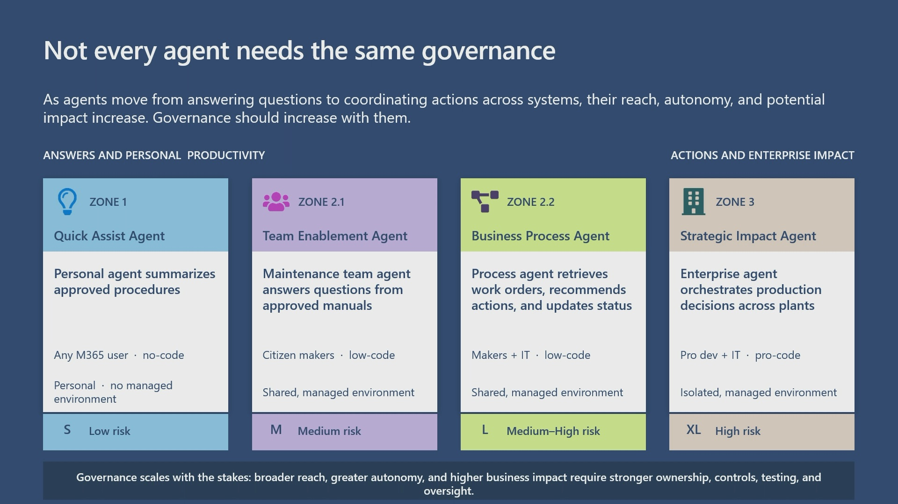
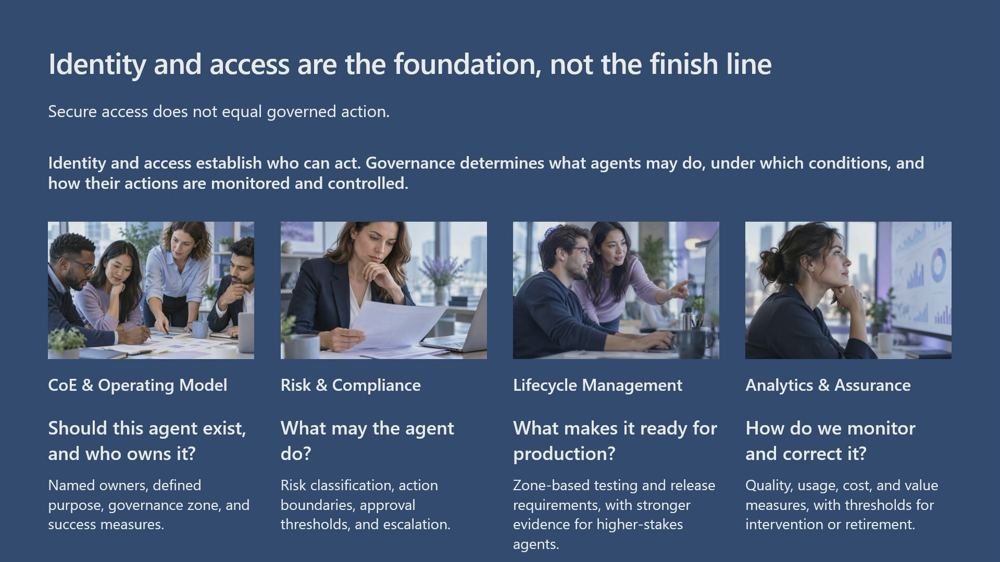
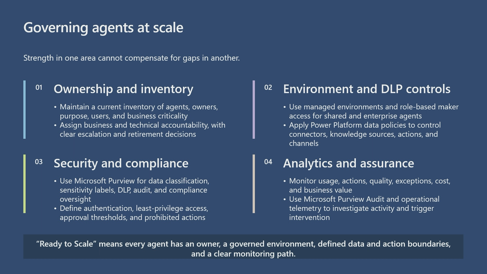
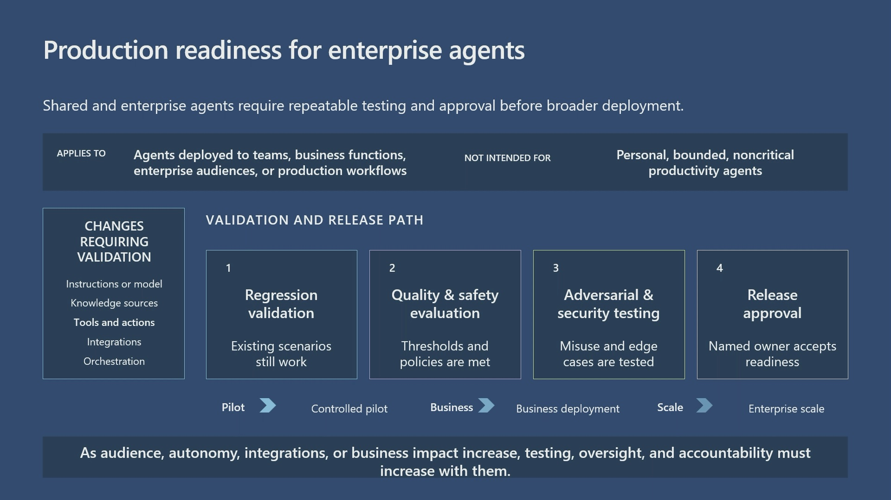

## #stakes-and-zones 01 / Risk-Proportional Zones :: 破除“线性升级迷思”：从问答理解到系统写回的四分区治理模型 || Breaking the Graduation Myth: Four Governance Zones from Answers to Autonomous Write-Back

许多企业在规划智能体路线图时，习惯把“聊天问答 → Agent Builder → Copilot Studio → 专业代码研发”当成一条逐级晋升的单行道 [1]。Tiffany Songvilay 在 THR981 开场便纠正了这一误判：智能体不是非要向上“毕业”的阶梯，而是按职责直接落位在不同的业务象限；真正决定治理强度的标尺，是它停留在只读问答，还是跨越到了自主改写外部业务系统 [1][2]。 || Many enterprises mistakenly treat Chat, Agent Builder, Copilot Studio, and pro-code development as a mandatory graduation ladder [1]. Opening THR981, Tiffany Songvilay dismantled that assumption: agents are not built to graduate up a single track, and governance intensity depends on whether an agent merely answers prompts or actively mutates external systems of record [1][2].

顺着官方第一页能力演进模型拆解，智能体的动作边界可分为三级跃迁 [1][2]：第一级是**理解与问答（Understand / Answers）**，围绕固定文档源解释规程并回答提问，本质近似早期的低风险问答机器人，仅在挂载敏感数据源时才需抬升管控；第二级是**分析与建议（Recommend / Decisions）**，以内置的 Researcher 或 Analyst 智能体为代表，依赖 Microsoft IQ 自动抓取用户未显式喂入的组织上下文，生成优劣势剖析报告与决策建议 [1][2]。一旦跨入第二级，非结构化数据治理的陈年旧账就会集中暴露——不仅要求提前配齐敏感度标签并锚定唯一真实信源，还会撞上一条极易被忽视的工程硬约束：**Agent Builder 无法穿透超过 2 层的数据目录层级** [1]。过去合规与档案团队习惯将文件深埋在多级原地目录中，如今则必须仿照早年迁入 SharePoint Online 时的做法，重新扁平化目录结构并将上下文集中收拢至同一区域 [1]。第三级则是**自主行动与结果交付（Act / Outcomes）**，智能体不再止步于读取企业资源计划或客户关系管理系统，而是直接向核心账本发起写回操作、调用外部工具并触发下游工作流，此时治理重心必须从单纯的身份与数据读取扩展至写回权限与动作熔断 [1][2]。 || Following Microsoft's capability spectrum, agent behavior progresses across three distinct stakes [1][2]. **Understand (Answers)** explains information from fixed sources like a low-risk chatbot unless sensitive records are attached. **Recommend (Decisions)**—exemplified by built-in Researcher and Analyst agents—relies on Microsoft IQ to gather implicit organizational context, draft SWOT analyses, and propose next steps [1][2]. Entering this second tier immediately exposes longstanding unstructured data debt: teams must apply sensitivity labels, establish a single source of truth, and confront a hard architectural limit—**Agent Builder cannot traverse more than two levels inside a data hierarchy** [1]. Whereas legacy records management kept files buried in deep in-place folders, grounding context cleanly now requires flattening and centralizing SharePoint structures [1]. Finally, **Act (Outcomes)** shifts from reading enterprise resource planning or customer relationship data to writing back into live systems and initiating work, demanding strict action boundaries alongside identity controls [1][2].

:::figure { src: "./media/thr981-governance-zones-quadrant.figure.json", title: "THR981 四分区智能体风险分级与治理护栏强度象限 || THR981 Four-Zone Agent Risk Classification & Governance Rigor Matrix" }
图 1：对照 THR981 官方四分区模型绘制的风险—护栏映射矩阵——从个人零代码效率助手（Zone 1，S 级低风险）到跨工厂自主编排生产决策的战略级智能体（Zone 3，XL 级高风险），受众广度与系统写回深度每前进一步，环境隔离、数据防泄漏与测试签批要求同步抬升；右下角警示了全员混跑在默认环境且缺失责任人的高危反模式 [1][2]。 || Figure 1: Risk-versus-governance quadrant mapping THR981's four official zones—from personal no-code Quick Assist (Zone 1, S Low Risk) to cross-plant Strategic Impact orchestration (Zone 3, XL High Risk)—contrasted against the ungoverned anti-pattern of ownerless agents in the Default environment [1][2].
:::

下方导览台集成了 THR981 官方 25 分钟点播视频流、官方逐字稿直链以及按演讲实录锚定的五段核心时间轴，点击顶部章节标签即可切换核对各段架构论点与原话细节 [1][2]： || The interactive theater below pairs the official 25-minute Medius stream and downloadable transcript with five timestamped walkthroughs mapped directly to the live talk [1][2]:

:::sandbox { id: "thr981-video-theater", canvas: false, script: "./thr981-session.js", style: "./thr981-session.css", title: "THR981 官方点播视频与五段核心议题时间轴导览 || THR981 Official On-Demand Stream & Five-Chapter Timestamp Navigator", desc: "按时间轴切换查阅风险跃迁、四大治理分区、卓越中心分诊、环境围栏与生产发布五段实录摘要，支持页内加载官方 Medius 播放器。 || Switch across the five timestamped chapters, load the embedded Microsoft Medius player on demand, or download the official transcript." }
纯静态点播与议题导览沙盒：内置 THR981 官方高清封面图、五段精确到秒的实录提要及官方视频与逐字稿直链。 || Pure static session theater featuring the official THR981 HD cover, five timestamped chapter digests, and direct stream/transcript links.
:::

在全场观众举起手机拍照的核心胶片中，微软将上述风险光谱固化为四个清晰的治理分区 [1][2]： || In the centerpiece slide of the session, Microsoft crystallizes this spectrum into four actionable governance zones [1][2]:

| 治理分区与风险定级 || Governance Zone & Risk Tier | 官方典型场景示例 || Canonical Slide Scenario | 构建角色与开发范式 || Maker Persona & Modality | 运行环境与准入控制水位 || Environment & Governance Posture |
|------|------|------|------|
| **Zone 1：Quick Assist Agent**（S · 低风险） || **Zone 1: Quick Assist Agent** (S · Low Risk) | 个人助手汇总已获批的标准作业规程；现阶段大量同类需求正转向团队共享的 Workspaces [1][2] || Personal agent summarizes approved procedures; many personal Q&A needs now shift to shared Workspaces [1][2] | 任意 M365 员工 · 零代码（提示词定时调度或 Agent Builder）[1][2] || Any M365 user · No-code (scheduled prompts or Agent Builder) [1][2] | 独立个人生产力环境（非托管重型环境），连接器策略仅放行 M365 内部数据源，无需前置立项审批 [1][2] || Personal productivity environment locked to M365 resources only; no formal intake required [1][2] |
| **Zone 2.1：Team Enablement Agent**（M · 中风险） || **Zone 2.1: Team Enablement Agent** (M · Medium Risk) | 设备维护团队共享智能体，基于核准维修手册回答一线排障提问并提供建议 [1][2] || Maintenance team agent answers troubleshooting questions from approved manuals [1][2] | 公民开发者与业务先锋（Champions）· 低代码（发放 Copilot Studio 许可）[1][2] || Citizen makers & Champions · Low-code (targeted Copilot Studio licenses) [1][2] | 共享托管环境；启动准入登记、核查手册数据卫生并强制绑定实名业务责任人 [1][2] || Shared managed environment; triggers intake registration, data hygiene checks, and named owner assignment [1][2] |
| **Zone 2.2：Business Process Agent**（L · 中高风险） || **Zone 2.2: Business Process Agent** (L · Med-High Risk) | 业务流程智能体跨系统调取工单、推荐处置动作并回写更新工单状态 [1][2] || Process agent retrieves work orders, recommends actions, and writes back status updates [1][2] | 业务创作者 + IT 工程师协同 · 低代码与受控连接器集成 [1][2] || Makers + IT partnership · Low-code touching legacy systems and custom connectors [1][2] | 共享托管环境并严格执行开发、测试、生产三态隔离，按环境粒度收紧数据防泄漏策略 [1][2] || Shared managed environment enforcing Dev/Test/Prod separation and environment-scoped connector policies [1][2] |
| **Zone 3：Strategic Impact Agent**（XL · 高风险） || **Zone 3: Strategic Impact Agent** (XL · High Risk) | 企业级自主智能体跨多座工厂协同编排生产排程与供应链决策 [1][2] || Enterprise autonomous agent orchestrates production decisions across multiple plants [1][2] | 专业研发团队 + IT · 专业代码构建（周期长达数月并伴随深度变革管理）[1][2] || Pro-dev + IT · Pro-code engineering taking months alongside organizational change management [1][2] | 独立隔离托管环境；全套安全红队测试、最小权限审计与实名责任人正式签署放行 [1][2] || Isolated managed environment requiring adversarial testing, Purview oversight, and executive owner sign-off [1][2] |

## #coe-intake-and-outcomes 02 / CoE Operating Model & Outcome KPIs :: 身份认证只是起点：用卓越中心分诊替代“拿着智能体锤子找钉子” || Identity Is Not the Finish Line: CoE Intake Triage Over Vanity Metrics

打通单点登录与身份权限只解决了“谁能访问”，远未回答“智能体获准在何种条件下执行哪些动作、越界时如何熔断纠偏” [1][2]。当企业从个人试用迈向 Zone 2.2 与 Zone 3 规模化部署时，第一个组织架构拷问便是：**谁来把守准入立项（Intake Process）的第一道关口？** Tiffany 给出的答案是组建专门的**卓越中心（Center of Excellence，简称 CoE）**，而不是把所有审批单甩给中央 IT 部门——因为核心 IT 团队正忙于攻坚耗时数月的 Zone 3 专业代码智能体，一旦让 IT 兼任全员立项裁判，必然造成严重的创新拥堵 [1]。 || Establishing single sign-on and identity access proves who can log in, not whether an agent's autonomous actions are governed [1][2]. As organizations scale into Zone 2.2 and Zone 3, the immediate organizational question is who runs the intake gate. Songvilay argues forcefully that a **Center of Excellence (CoE)**—not central IT—must own intake triage, because IT engineers are already stretched building complex Zone 3 pro-code agents and quickly become a bottleneck if forced to review every citizen request [1].

  <article class="thr981-media-card" data-present-surface="unframed">
    

      
    

    

      THR981 官方演讲实录画面 · 07:04
      <h4 data-zh="微软四分区治理光谱：从个人效率（S）到战略影响（XL）" data-en="Not Every Agent Needs the Same Governance: Zones 1 to 3">微软四分区治理光谱：从个人效率（S）到战略影响（XL）</h4>
      
按受众范围、自主性与业务影响将智能体精准锚定在四个风险分区，匹配差异化的创作者角色与托管环境边界 [1][2]。

    

  </article>
  <article class="thr981-media-card" data-present-surface="unframed">
    

      
    

    

      THR981 官方演讲实录画面 · 13:15
      <h4 data-zh="安全访问不等于受控行动：CoE 运营与四维审视框架" data-en="Identity Is the Foundation, Not the Finish Line: Four Intake Questions">安全访问不等于受控行动：CoE 运营与四维审视框架</h4>
      
围绕“是否该存在且谁负责”、“允许做什么”、“何时具备投产条件”与“如何监控纠偏”构建完整准入闭环 [1][2]。

    

  </article>

在实际运作中，个人零代码场景无需提前走立项流程；只有当业务人员需要新增连接器、触碰跨部门共享手册或请求研发支援时，才触发 CoE 准入分诊，逐一回答四道核心审视问题 [1][2]： || Users experimenting in personal boundaries do not need upfront paperwork; CoE intake activates the moment makers request new connectors, shared team grounding, or engineering help, walking every proposal through four gating questions [1][2]:

1. **存在性与选型裁决（Should this agent exist, and who owns it?）**：正如早年企业把一切需求都往 SharePoint 里塞，如今不少团队拿着“智能体”这把新锤子看什么流程都像钉子 [1]。CoE 首要职责是剔除伪需求——评估该场景是否直接用协作空间（Workspaces）、Cowork 协同流、标准 Power Platform 自动化或既有 SharePoint 工作流就能更轻量地解决，同时为确需立项的智能体指定实名责任人与离职交接预案 [1][2]。 || **Existence & Tooling Triage**: Just as teams once treated SharePoint as a hammer for every nail, organizations now reflexively label every workflow an agent [1]. CoE triage filters out requests better served by Workspaces, Cowork, Power Platform flows, or SharePoint automation, while binding approved concepts to a named owner and an employee-departure succession plan [1][2].
2. **动作正负面清单（What may the agent do—and NOT do?）**：除了定义业务目标，更关键的是划清禁止触碰的数据红线、单点登录跨系统委托边界、人工审批阈值与异常升级路径，据此核定风险等级并分派给公民开发者（配发先锋网络培训）或专业开发队列 [1][2]。 || **Action Boundaries & Risk Classification**: Beyond listing desired capabilities, CoE explicitly documents prohibited actions, cross-system single sign-on requirements, and human approval thresholds before routing the build to citizen Champions or pro-code teams [1][2].
3. **类软件产品生命周期（What makes it ready for production?）**：像管理正式软件应用一样定义智能体的“完成标准（Definition of Done）”与周期性复审节点，确保上线数月后依然符合企业合规基线 [1][2]。 || **Application Lifecycle Rigor**: Treat agents like durable software products with explicit production-readiness criteria and scheduled re-evaluation checkpoints so live agents do not drift out of compliance [1][2].
4. **告别虚荣调用量，锚定真实商业结果（How do we monitor and measure business outcomes?）**：Tiffany 在现场直言，必须立即停止单靠“对话调用次数”评判智能体价值——面对真金白银的许可与算力投入，“每天帮员工节省 15 分钟”的个人效率说辞早已无法打动管理层 [1]。准入阶段就必须写入可量化的业务结果指标，例如部署新员工入职引导智能体后，直接追踪**新员工流失率（Attrition Rate）是否显著下降**，并预设触发人工干预或下线退役的阈值 [1][2]。 || **Business Outcomes Over Usage Vanity**: Songvilay urged attendees to stop judging agents by raw usage counts—"saving 15 minutes a day" no longer justifies real licensing dollars [1]. Intake must lock in measurable business outcomes, such as tracking whether an onboarding agent measurably lowers employee **attrition rates**, paired with hard thresholds for intervention or retirement [1][2].

## #four-pillars-at-scale 03 / Four Scale Governance Pillars :: 规模化治理四大支柱：打通 Agent 365 视野、告别默认环境裸奔与跨管理员协同 || Governing Agents at Scale: Agent 365 Inventory, Exiting Default Environments, and Purview

官方第四页胶片点出了一条极具警示意味的工程定律：**单一维度的强管控，绝无法弥补其他维度的治理缺口（Strength in one area cannot compensate for gaps in another）** [2]。要让智能体达到真正的“可规模化就绪（Ready to Scale）”状态，资产台账、环境隔离、合规安全与遥测审计四大支柱必须咬合成闭环 [1][2]。 || Microsoft's scale-governance slide underscores a blunt operational truth: **strength in one area cannot compensate for gaps in another** [2]. Reaching "Ready to Scale" requires four mutually reinforcing pillars—ownership inventory, environment controls, security compliance, and assurance telemetry—operating in lockstep [1][2].

:::figure { src: "./media/thr981-governance-operating-architecture.figure.json", title: "企业级 Copilot 智能体治理闭环：CoE 准入分诊、四维控制面与生产放行架构 || Enterprise Copilot Agent Governance Architecture: CoE Triage, Control Plane & Release Gates" }
图 2：THR981 端到端治理架构——顶层由卓越中心完成存在性分诊、实名责任人绑定与双层知识目录扁平化；中层联动 Agent 365 台账、托管环境连接器隔离与 Microsoft Purview 敏感标签审计；底层对五类核心变更强制执行三联测试与责任人签批放行 [1][2][3][4]。 || Figure 2: End-to-end THR981 governance architecture connecting CoE intake triage and 2-level SharePoint data flattening at the top, Agent 365 + Managed Environments + Microsoft Purview in the control plane, and the five-trigger, four-gate release pipeline underneath [1][2][3][4].
:::

围绕这四大支柱，THR981 给出了极具实操锋芒的落地处方 [1][2]： || Across these four pillars, Songvilay highlighted concrete operational fixes for the most common enterprise blind spots [1][2]:

- **支柱 01 · 实名所有权与 Agent 365 台账授权**：“没有责任人，就没有智能体，句号（You do not have an owner, you do not have an agent. Period.）” [1]。每一位责任人都必须对底层数据源合法性、敏感信息暴露风险以及读写范围负全责 [1]。尽管 **Agent 365** 让全租户智能体盘点变得轻而易举，但现实痛点在于负责日常治理的 CoE 成员往往拿不到管理中心视野；企业必须打破权限孤岛，将 Agent 365 台账访问权正式授予 CoE 团队，消除单靠中央 IT 排队的瓶颈 [1][3]。 || **01 Ownership & Agent 365 Access**: *"You do not have an owner, you do not have an agent. Period."* [1] Every agent requires named business and technical accountability covering data sources, sensitivity exposure, and read/write scope [1][2]. While **Agent 365** streamlines inventory tracking, governance teams often lack admin portal access—organizations must grant CoE members direct visibility into Agent 365 rather than bottlenecking everything through central IT [1][3].
- **支柱 02 · 托管环境隔离与连接器防泄漏围栏**：如果全公司仍挤在默认的 `Default` 环境中构建智能体，请立即叫停 [1]。重蹈当年 Power Platform 缺乏环境规划的覆辙会让权限边界彻底失守：哪怕预算有限只新建一个独立环境，也应先划出专门的**个人生产力智能体环境（Personal Productivity Environment）**，通过环境级数据防泄漏（DLP）策略将其可用连接器严格锁死在 Microsoft 365 内部数据源；而面向专业研发与跨系统集成的智能体，则在配置完备的开发、测试、生产（Dev / Test / Prod）托管环境中按需放开全量业务连接器——一旦开发态调试出错，随时重置开发环境而不伤及生产账本 [1][2][5]。 || **02 Managed Environments & Connector DLP**: If makers are still building agents inside the `Default` environment, stop immediately [1]. Even creating a single dedicated **Personal Productivity Environment** lets admins apply environment-level Data Loss Prevention (DLP) policies restricting connectors strictly to Microsoft 365 data, while pro-code teams get broader connector access inside structured **Dev, Test, and Production** managed environments where a broken build can be safely reset [1][2][5].
- **支柱 03 & 04 · Microsoft Purview 合规联动与复合管理员角色**：在安全合规与运行保障层面，引入 **Microsoft Purview** 落实数据分类、敏感度标签、最小权限认证及操作审计日志（Purview Audit），持续追踪异常报错、运行成本与业务产出 [1][2][4]。由于智能体天然横跨身份、应用环境与文档库，CoE 团队内部最好配置 2 至 3 名具备跨栈管理权限的专职人员（协同覆盖 Entra 身份、Power Platform 环境以及 SharePoint 站点管理），并与 Purview 合规专员常态化合署办公 [1]。 || **03 & 04 Microsoft Purview Oversight & Cross-Stack Roles**: Wire **Microsoft Purview** for sensitivity labeling, least-privilege enforcement, and Purview Audit investigations alongside cost and quality telemetry [1][2][4]. Because agent governance spans multiple silos, Songvilay recommends equipping two or three CoE specialists with composite admin roles across Entra, Power Platform environments, and SharePoint in close partnership with Purview compliance leads [1].

## #production-readiness 04 / Enterprise Production Readiness :: 视系统指令如“公司章程”：五类变更强制重验与四道放行门禁 || Production Readiness at Scale: Treating Instructions Like Articles of Incorporation

许多高价值智能体都始于十几人的小范围试点（Pilot），但当管理层决定将其推广至业务部门乃至全企业时，如何科学判定它已具备规模化投产资格？THR981 压轴胶片明确划定了适用边界：这套生产就绪规范专门约束面向团队、业务职能、全员受众或生产工作流的共享与企业级智能体（不强加给受限的个人非关键效率助手）[1][2]。 || High-value agents typically start as small pilots, raising a critical question when leadership wants to scale them enterprise-wide: what proves an agent is production-ready? THR981's closing framework applies specifically to agents deployed to teams, business functions, or production workflows—explicitly exempting bounded, noncritical personal productivity helpers [1][2].

  <article class="thr981-media-card" data-present-surface="unframed">
    

      
    

    

      THR981 官方演讲实录画面 · 18:09
      <h4 data-zh="规模化治理四支柱：单一长板无法弥补其他短板" data-en="Governing Agents at Scale: Four Interlocking Pillars">规模化治理四支柱：单一长板无法弥补其他短板</h4>
      
汇聚所有权台账、托管环境与连接器策略、Microsoft Purview 敏感标签合规以及审计遥测，定义“可规模化就绪”标准 [1][2]。

    

  </article>
  <article class="thr981-media-card" data-present-surface="unframed">
    

      
    

    

      THR981 官方演讲实录画面 · 21:55
      <h4 data-zh="企业级智能体生产就绪路径：五类变更重测与四关签批" data-en="Production Readiness Path: Five Triggers & Four Validation Gates">企业级智能体生产就绪路径：五类变更重测与四关签批</h4>
      
指令或模型、知识源、工具动作、集成与多智能体编排任一变动均触发四阶验证，由实名责任人签字后阶梯推广 [1][2]。

    

  </article>

在日常运维中，创作者最容易犯的侥幸错误是在生产环境顺手“微调两句提示词”或“新挂一个文档库” [1]。Tiffany 对此提出了一个令人印象深刻的工程比喻——**把企业级智能体的系统指令（Instructions）当成“公司章程（Articles of Incorporation）”来敬畏**：你不会隔三差五随意涂改公司章程，一旦因正当业务理由修改，就必须退回开发与测试环境走完完整验证 [1]。官方胶片列明了**五类强制触发重新验证的变更（Changes Requiring Validation）**：① **指令或底层模型（Instructions or model）**变更；② **知识源（Knowledge sources）**增删（须由值得高度信任的内部测试员在类生产测试环境实测权限边界，确保万一意外撞见越权敏感数据时不会外泄）；③ **工具与动作（Tools and actions）**调整；④ **外部系统集成（Integrations）**变动；⑤ **多智能体编排（Orchestration）**——尤其是主控编排器调度多个子智能体协同作业时，权限与行为组合复杂度呈指数级放大 [1][2]。 || Makers frequently underestimate seemingly minor tweaks like editing a prompt inline or attaching one extra SharePoint library [1]. Songvilay likened an enterprise agent's system **instructions** to corporate **Articles of Incorporation**: you change them deliberately for sound business reasons, and even a simple instruction edit must return to Dev and Test environments for re-validation [1]. Microsoft's readiness matrix defines **five change classes requiring mandatory validation**: (1) **Instructions or model**, (2) **Knowledge sources**, (3) **Tools and actions**, (4) **Integrations**, and (5) **Orchestration** [1][2]. Knowledge changes should be verified in production-like Test environments by **trusted testers** who can safely flag accidental sensitive-data exposure, while multi-agent orchestrators compound cross-system blast radius [1][2].

:::flow { title: "企业级智能体从变更触发到全企规模化推广的四阶放行门禁 || Four-Stage Validation & Release Pipeline from Change Trigger to Enterprise Scale" }
1. **关卡 1 · 回归验证（Regression Validation） || Gate 1 · Regression Validation** — 在开发与类生产测试环境中重跑核心业务基线用例，验证指令、底层模型或新增知识源调整后，原有高频场景依然稳定达标且未引入行为退化 [1][2]。 || Verify inside Dev and production-like Test environments that existing scenarios continue working reliably after instruction, model, or knowledge updates [1][2].
2. **关卡 2 · 质量与安全评估（Quality & Safety Evaluation） || Gate 2 · Quality & Safety Evaluation** — 核验回答准确度、敏感度标签继承、最小权限边界与连接器防泄漏策略全部符合组织合规红线，迈入**受控试点（Controlled Pilot）**阶段 [1][2]。 || Confirm accuracy thresholds, Purview sensitivity policies, and connector guardrails are satisfied as the agent enters a **Controlled Pilot** [1][2].
3. **关卡 3 · 对抗与安全测试（Adversarial & Security Testing） || Gate 3 · Adversarial & Security Testing** — 针对恶意诱导、越权读写及跨智能体编排极端边缘用例开展红队对抗测试，通过后放行至**业务部门级部署（Business Deployment）** [1][2]。 || Stress-test misuse vectors, prompt abuse, and multi-agent orchestration edge cases before expanding into **Business Deployment** [1][2].
4. **关卡 4 · 实名责任人发布签批（Release Approval → Enterprise Scale） || Gate 4 · Named Owner Sign-Off → Enterprise Scale** — 由登记在册的实名业务责任人正式签署就绪确认书（确认智能体实际表现与立项初衷完全一致），最终获准推向**全企业规模化运行（Enterprise Scale）** [1][2]。 || Require the named agent owner to formally sign off that behavior matches design intent prior to unlocking full **Enterprise Scale** [1][2].
:::

正如 Tiffany 在结语中所言，智能体治理并没有发明陌生的计算机科学概念——软件工程生命周期、环境隔离、数据防泄漏与责任人制度早已存在多年；与其焦虑“公司里的智能体是不是已经太多了”，不如立即建起个人生产力隔离环境、跑通卓越中心准入分诊，按风险水位把最严密的测试与签批精力聚焦在真正改写核心业务的智能体之上 [1][2]。 || As Songvilay concluded, governing Copilot agents invents no alien discipline—application lifecycle management, environment walls, data policies, and accountable ownership are proven engineering fundamentals [1]. Rather than panicking over raw agent counts, enterprises regain control by exiting the Default environment, empowering a cross-functional CoE, and scaling governance rigor proportionally with business stakes [1][2].

## 参考资料：官方一手信源与工程规范 || References: Official Primary Sources & Engineering Guides

1. **Tiffany Songvilay (Microsoft Ignite 2026 Video & Transcript)** — https://ignite.microsoft.com/en-US/sessions/1787856594825001EWii-1791588109215001CiD2 | 《Essential Insights for Governing Copilot Agents》25 分钟剧场专场官方点播页与双语演讲实录（2026-11-18） || Official 25-minute theater session page, bilingual captions, and word-for-word transcript (Nov 18, 2026)
2. **Tiffany Songvilay (THR981 Official Medius On-Demand Stream & Framework Slides)** — https://medius.microsoft.com/Embed/video-nc/74e31d7d-f39f-4eda-9e48-03869722f24f | THR981 官方内嵌高清点播流与五页微软智能体治理架构胶片（01:44 能力光谱、07:04 四分区矩阵、13:15 CoE 运营模型、18:09 规模化四支柱、21:55 生产就绪度路径） || Official Medius HD video stream capturing Microsoft's five core agent governance slides
3. **Microsoft 365 Admin Center & Agent 365 Governance Documentation** — https://learn.microsoft.com/en-us/microsoft-365/admin/manage/manage-copilot-agents-integrated-apps | 微软官方智能体注册表、所有权台账与生命周期管理指南 || Official Microsoft documentation on managing Copilot agent inventory, owners, and lifecycle controls
4. **Microsoft Purview Data Security & Compliance for Microsoft Copilot** — https://learn.microsoft.com/en-us/purview/ai-microsoft-purview | 使用 Microsoft Purview 为 Copilot 与智能体实施敏感度标签、数据防泄漏与审计调查 || Official guide on sensitivity labels, DLP, and Purview Audit oversight for Copilot and agents
5. **Microsoft Copilot Studio & Power Platform Managed Environments Security** — https://learn.microsoft.com/en-us/microsoft-copilot-studio/security-and-governance | Copilot Studio 托管环境策略、开发测试生产隔离与连接器级数据策略规范 || Official engineering reference for Managed Environments, ALM isolation, and connector data policies
