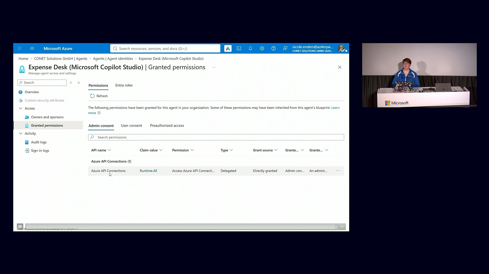
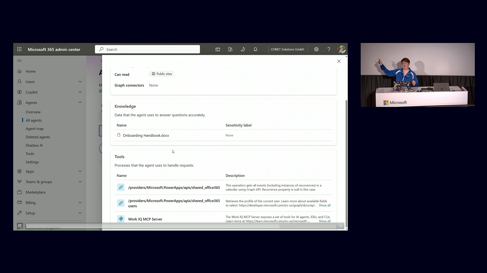
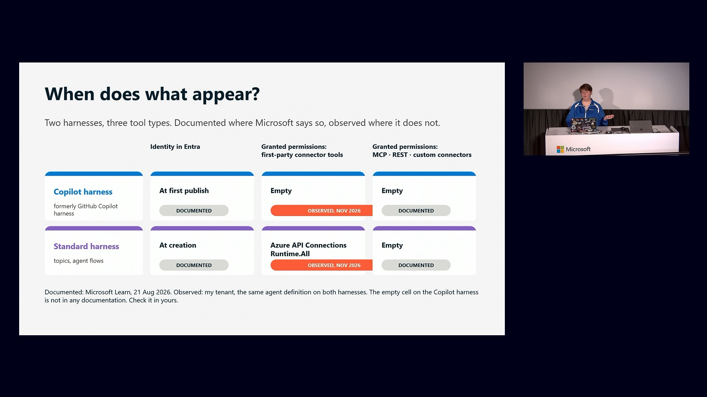
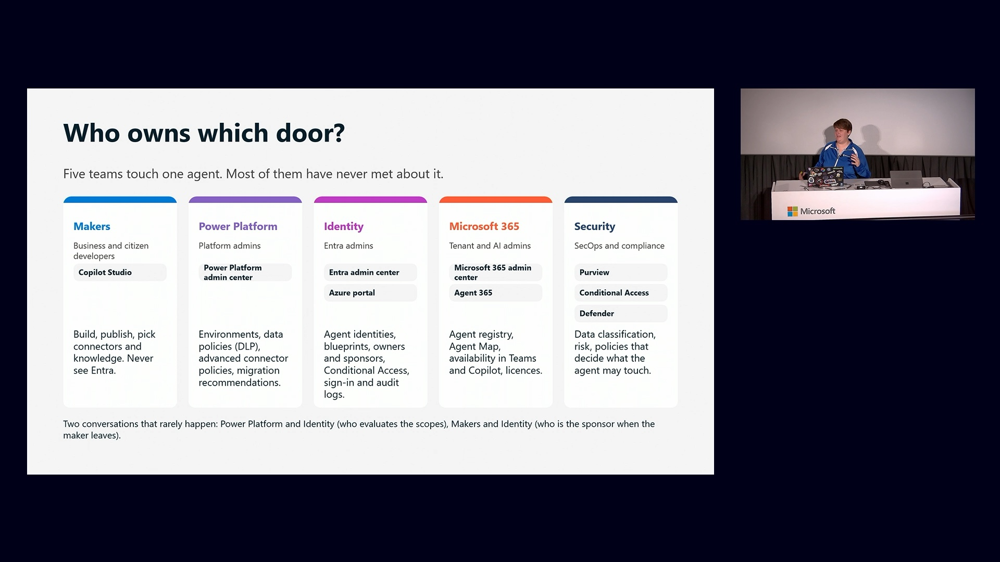

## #mandatory-principal 01 / Mandatory Principal Shift :: 点击发布按钮的那一刻，你在租户里“录用”了谁？ || Who Did You Just Hire? The July 2026 Mandatory Agent Principal Shift

业务人员在 Microsoft Copilot Studio 中点击“发布（Publish）”时，往往以为自己只是上线了一个对话机器人 [1]。自 2026 年 7 月微软正式强制推行智能体身份机制以来，每一次创建或发布动作都会在企业租户后台注册一个一等公民级别的 **Microsoft Entra 智能体身份（Agent ID）**，而且在 Copilot Studio、Entra 管理中心与 Microsoft 365 管理中心的任何屏幕上，系统都不会再询问“是否需要为该智能体分配身份” [1][2]。 || Makers clicking **Publish** inside Microsoft Copilot Studio often assume they are merely shipping a conversational helper [1]. Since Microsoft made **Entra Agent ID** mandatory in July 2026, building or publishing an agent silently provisions a first-class security principal inside the tenant—and across Copilot Studio, the Entra admin center, and the Microsoft 365 admin center, no screen ever asks whether that identity should exist [1][2].

德国 conet Deutschland GmbH 首席开发工程师、连续七届微软 MVP 得主 Nicole Enders 在 THR992 开场抛出了一个尖锐的管理追问：既然每个智能体都已经成了拥有连接器范围、条件访问策略与独立生命周期的安全主体，管理员真正看清它能触达哪些业务数据了吗 [1]？为了验证官方文档之外的真实租户表现，她设计了一组严格控制变量的对照实验——在同一租户内使用同一份 Word 手册、挂载完全相同的两项办公连接器操作，分别基于 **Copilot 底座（原 GitHub Copilot 底座）**与**标准底座（Standard Harness）**构建两款员工服务智能体，并全程在三个管理门户间切换追踪底层变化 [1][2]。 || Opening THR992, conet Deutschland GmbH Lead Developer and seven-time Microsoft MVP Nicole Enders posed a direct operational question: now that every agent is a security principal with connector scopes, Conditional Access, and a lifecycle, do administrators actually know what theirs can reach [1]? To test live tenant behavior against official documentation, she ran a controlled experiment—attaching the exact same Word handbook and two Microsoft 365 connector actions to one agent on the **Copilot harness** (formerly the GitHub Copilot harness) and a second agent on the **standard harness**, tracing both across three admin portals [1][2].

:::figure { src: "./media/agent-principal-governance-architecture.figure.json", title: "Copilot Studio 智能体主体生命周期与三门户协同治理架构 || Copilot Studio Agent Principal Lifecycle & Three-Portal Governance Architecture" }
图 1：THR992 全链路治理拓扑——顶层对比 Copilot 底座、标准底座与 2025 存量机器人的身份生成入口；中层依托 Microsoft Entra 单一蓝图、创建者保荐人、连接器权限列表与条件访问引擎实施令牌级管控；底层联合 Microsoft 365 管理中心（Agent 365）、Power Platform 数据策略与 Purview 敏感交互审计构成完整防线 [1][2][5]。 || Figure 1: End-to-end THR992 governance topology—contrasting Copilot harness, standard harness, and 2025 legacy entry points at the top; enforcing single-blueprint inheritance, sponsor binding, connector scopes, and Conditional Access inside Microsoft Entra in the middle; and uniting Agent 365, Power Platform DLP, and Purview sensitivity auditing below [1][2][5].
:::

下方交互导览台集成了 THR992 官方 Medius 点播视频流、完整英文逐字稿下载入口与五段核心议程的精确时间戳，点击顶部胶囊按钮即可按时间轴检视双底座实机核查细节 [1]： || The interactive session theater below pairs the official THR992 Medius video stream and downloadable transcript with five timestamped walkthrough chapters across the 30-minute talk [1]:

:::sandbox { id: "thr992-video-theater", canvas: false, script: "./thr992-session.js", style: "./thr992-session.css", title: "THR992 官方点播视频与三门户实机核验时间轴导览 || THR992 Official On-Demand Stream & Three-Portal Timestamp Navigator", desc: "按时间轴切换双底座草稿对照、发布后权限盲区、五团队治理分工与周一四步清查法，支持页面内直接加载微软官方点播播放器。 || Switch across draft creation timing, post-publish scope gaps, five-team ownership, and the Monday four-step audit, or load the embedded Microsoft Medius player." }
纯静态点播与议题导览沙盒：内置 THR992 官方 1080p 高清封面、五段分章摘要及官方点播与逐字稿直链。 || Pure static session theater featuring the official THR992 1080p cover, five timestamped chapter digests, and direct video and transcript links.
:::

## #dual-harness-walkthrough 02 / Live Walkthrough: Two Harnesses, Three Portals :: 实机对照：同配置双智能体在三个管理门户中的真实落差 || Live Walkthrough: Building Two Identical Agents Across Three Portals

Nicole Enders 首先在 Copilot Studio 中使用 Copilot 底座新建了员工入职助手 **Onboarding Buddy**，上传预先准备的入职指南文档 `Onboarding Handbook.docx`，并挂载两项高频办公工具：用于拉取当前员工基本资料的 Office 365 用户档案操作（`Get my profile`），以及用于检查入职会议安排的 Outlook 365 日历视图操作（`Get calendar view of events`）[1]。保存全部草稿配置后，她立即切入 Azure 门户内的 Microsoft Entra 智能体身份列表刷新按时间倒序排查——此时列表中空无一物，Onboarding Buddy 在草稿阶段并未触发任何身份创建动作 [1]。 || Nicole Enders starts in Copilot Studio by building an employee helper named **Onboarding Buddy** on the Copilot harness, uploading `Onboarding Handbook.docx` and attaching two everyday tools: `Get my profile` from the Office 365 Users connector and `Get calendar view of events` from Office 365 Outlook [1]. After saving the draft configuration, she switches straight to `Agents -> Agent identities` in Microsoft Entra and sorts newest first—finding no identity entry at all while Onboarding Buddy remains unpublished [1].

紧接着，她退回 Copilot Studio 首页第三项略显隐蔽的标准入口，基于标准底座创建了报销助手 **Expense Desk** [1]。两款智能体的配置体验已有明显分野：标准底座要求先输入名称立项，随后进入多标签页工作区（右侧附带实时测试窗格，且知识库文档上传后会显示明确的解析进度条；添加每项工具时还会弹出独立的业务名称与描述确认页，帮助模型靠清晰的元数据选对工具而不必把规则全塞进系统提示词）[1]。为 Expense Desk 挂载完全相同的两项工具后且尚未点击发布，再次刷新 Entra 智能体身份列表时，差异当场显现：**同样处于草稿模式，标准底座的 Expense Desk 已经铸造出完整的 Entra Agent ID，而 Copilot 底座的 Onboarding Buddy 依然不存在** [1][2]。 || Returning to Copilot Studio's slightly tucked-away standard option, she creates a second agent—**Expense Desk**—on the standard harness [1]. Even the authoring flow differs: standard harness creation names and provisions the shell up front, replaces the right-hand setup pane with tabbed configuration plus a live test chat, displays explicit document-processing status, and opens a dedicated tool metadata screen after selecting each connector [1]. With both identical tools attached and both agents still in **Draft** mode, refreshing Microsoft Entra reveals the first major divergence: **Expense Desk already owns an Entra Agent ID at creation, whereas Onboarding Buddy still has none** [1][2].

点开草稿态 Expense Desk 的身份详情页可以看到，构建者本人（Nicole Enders）已被自动绑定为该智能体的**保荐人（Sponsor）**，直接对智能体后续生命周期负责；同时页面显示其归属于全租户所有 Copilot Studio 智能体共同继承的唯一**智能体身份蓝图（Agent Identity Blueprint）**，但此时的已授予权限（`Granted permissions`）与活动日志均为空白 [1][2]。 || Inspecting Expense Desk's draft identity blade shows maker Nicole Enders automatically assigned as **Sponsor**—accountable for its lifecycle—alongside the single **Agent Identity Blueprint** shared by every Copilot Studio agent in the tenant, while `Granted permissions` and activity logs remain empty prior to publication [1][2].

  <article class="thr992-media-card" data-present-surface="unframed">
    

      
    

    

      THR992 实机演示截帧 · 15:15
      <h4 data-zh="Entra 已授予权限页：两项 M365 工具聚合成单行记录" data-en="Entra Granted Permissions: Two M365 Tools Aggregated into One Line">Entra 已授予权限页：两项 M365 工具聚合成单行记录</h4>
      
标准底座 Expense Desk 发布后，Granted permissions 仅写入一条 Azure API Connections（Runtime.All），而同期发布的 Copilot 底座权限栏完全为空 [1][2]。

    

  </article>
  <article class="thr992-media-card" data-present-surface="unframed">
    

      
    

    

      THR992 实机演示截帧 · 18:35
      <h4 data-zh="M365 管理中心 Agent 365：穿透检视知识库与底层工具路径" data-en="M365 Admin Center (Agent 365): Direct Visibility into Knowledge & Raw APIs">M365 管理中心 Agent 365：穿透检视知识库与底层工具路径</h4>
      
无需登录 Copilot Studio，全局管理员即可在 Data & tools 页直接看清 Onboarding Handbook.docx、shared_office365users 接口路径与 Work IQ MCP 服务 [1][5]。

    

  </article>

真正令人意外的现象发生在两款智能体双双点击 **Publish** 发布上线之后 [1]： || The sharpest surprise arrives right after clicking **Publish** on both agents [1]:

- **Copilot 底座首次现身但权限留白 || Copilot Harness Appears with Empty Scopes**：发布完成后刷新 Entra（无论从 Azure 门户进入还是使用独立的 Entra 管理中心，两侧菜单与功能完全一致），Onboarding Buddy 终于生成了自己的 Entra Agent ID，但其 `Granted permissions` 栏依然空空如也，完全看不到刚刚绑定的用户档案与日历工具 [1]。 || Refreshing Entra (identical across both the Azure portal blade and the standalone Entra admin center) confirms Onboarding Buddy finally received its Agent ID upon publish—yet its `Granted permissions` tab remains completely blank despite carrying two active tools [1].
- **标准底座将第一方连接器合并为单行 || Standard Harness Collapses First-Party Connectors**：切到已发布的 Expense Desk 详情页，`Granted permissions` 从零变为 **1 条记录**——并非两项工具对应两条记录，而是统一显示为 `Azure API Connections`（权限值 `Runtime.All`）[1][2]。只要智能体调用的都属于 Microsoft 365 核心连接器操作，Entra 就会将其折叠进这一条聚合授权；只有挂载第三方 Power Platform 连接器时才会逐个生成独立条目 [1][2]。 || Opening published Expense Desk reveals **one** new permission row rather than two: `Azure API Connections` (`Runtime.All`) [1][2]. Whenever an agent uses first-party Microsoft 365 core actions, Entra consolidates them under that single runtime entry, only splitting out separate rows when makers attach third-party Power Platform connectors [1][2].
- **Agent 365 补齐内容与工具路径透视 || Agent 365 Bridges the Visibility Gap**：最后切入 Microsoft 365 管理中心的 `Agents -> All agents`（即 **Agent 365** 清单，其中 Copilot 底座正常同步了自定义图标，标准底座暂未同步图标）[1]。管理员无需打开 Copilot Studio，即可在 `Data & tools` 页直读 `Onboarding Handbook.docx` 敏感度标签、底层连接器路径（如 `/providers/Microsoft.PowerApps/apis/shared_office365users`）与 `Work IQ MCP Server` [1][5]。切入 `Security` 页还能联动 Microsoft Purview 审查敏感数据交互记录或一键 **Block** 封禁异常主体 [1][5]。 || Switching to `Agents -> All agents` in the Microsoft 365 admin center (**Agent 365**) shows the Copilot harness syncing its custom icon while the standard harness omits it [1]. Without ever opening Copilot Studio, global admins inspect `Onboarding Handbook.docx` and raw connector paths like `/providers/Microsoft.PowerApps/apis/shared_office365users` plus `Work IQ MCP Server` under `Data & tools` [1][5]. The `Security` tab also surfaces Purview sensitive data interactions alongside a one-click **Block** control [1][5].

## #three-words-and-matrix 03 / Three Concepts & The Visibility Matrix :: 三个必知安全概念与官方文档未写明的可见性矩阵 || Three Essential Security Primitives & The Undocumented Visibility Matrix

走出实机演示后，Nicole Enders 将智能体身份治理浓缩为每个团队都必须掌握的三个核心原语——**蓝图（Blueprint）**、**连接器范围（Connector Scopes）**与**条件访问（Conditional Access）** [1][2][3]。蓝图是 Entra 铸造智能体身份的唯一模板：Copilot Studio 在单个租户内共享同一个蓝图对象，它既承载默认的拥有者与保荐人规则，也是管理员一次性下发全局策略、自动覆盖当前及未来所有新建智能体的锚点 [1][2]。 || Stepping back from the live portals, Nicole Enders distills agent identity governance into three non-negotiable primitives: **Blueprint**, **Connector scopes**, and **Conditional Access** [1][2][3]. The **Blueprint** is Entra's identity template—Copilot Studio uses exactly one blueprint across all its agents in a tenant, carrying owner/sponsor defaults and giving administrators a single object where one policy covers every current and future agent [1][2].

第二个原语**连接器范围**很容易被误读为细粒度操作边界 [1]：写在 Entra `Granted permissions` 里的条目只代表该智能体“**可调用哪个连接器（may call）**”，而非“**允许执行哪一个具体增删改动作（may do）**”——真正的动作级放行与阻断仍由 Power Platform 数据策略（DLP）裁决 [1]。第三个原语**条件访问**则充当发放令牌前的规则引擎：如今智能体身份已能直接作为条件访问策略目标，但由于背后没有人类操作员，既无法弹窗要求多因素认证（MFA），也不存在终端设备合规校验；截至宣讲时，面向智能体身份唯一生效的规则是在 Teams 渠道中执行的“**存在风险即阻断（block if risky）**” [1][3]。 || Second, **Connector scopes** record which connectors an agent *may call* when published—not which granular actions it *may do*, which remains the job of Power Platform data policies (DLP) [1]. Third, **Conditional Access** evaluates conditions before issuing tokens: agent identities can now be targeted directly, though with no human behind the prompt there is no MFA prompt or device compliance check—leaving **“block if risky”** enforced in Teams as today's active rule [1][3].

  <article class="thr992-media-card" data-present-surface="unframed">
    

      
    

    

      THR992 讲者课件画面 · 21:05
      <h4 data-zh="双底座 × 三类工具：官方文档与 2026 年 11 月实测对照表" data-en="Two Harnesses × Three Tool Types: Documented vs. Nov 2026 Observed">双底座 × 三类工具：官方文档与 2026 年 11 月实测对照表</h4>
      
标准底座新建即生成身份并披露连接器范围，但 MCP、REST 与自定义连接器在双底座下均留白，且 Copilot 底座连第一方权限也未写入 [1][2]。

    

  </article>
  <article class="thr992-media-card" data-present-surface="unframed">
    

      
    

    

      THR992 讲者课件画面 · 22:15
      <h4 data-zh="谁掌管哪扇门：触碰同一个智能体的五个职能团队" data-en="Who Owns Which Door? Five Teams Touching One Agent">谁掌管哪扇门：触碰同一个智能体的五个职能团队</h4>
      
五个角色各自守着不同门户，最常缺失的是 Power Platform 与身份团队核对权限范围、以及构建者离职时的保荐人交接机制 [1]。

    

  </article>

将微软官方 Learn 文档（2026 年 8 月 21 日版）与 Nicole 在自家生产租户的实机测试放在一起比对，就能看清为什么仅盯住单一后台会产生严重漏判 [1][2]： || Placing Microsoft Learn documentation (dated August 21, 2026) side by side with Nicole's November 2026 tenant observations clarifies why relying on Entra's permissions blade alone leaves blind spots [1][2]:

| 核验维度 || Governance Dimension | Copilot 底座（原 GitHub Copilot） || Copilot Harness (Formerly GitHub Copilot) | 标准底座（Standard Harness） || Standard Harness | 2025 存量旧版智能体 || 2025 Legacy Bot (Pre-Rollout) |
|------|------|------|------|
| Entra 身份类型与位置 || Entra Principal & Location | **Entra Agent ID**（`Agents -> Agent identities`）[1][2] || **Entra Agent ID** (`Agents -> Agent identities`) [1][2] | **Entra Agent ID**（`Agents -> Agent identities`）[1][2] || **Entra Agent ID** (`Agents -> Agent identities`) [1][2] | 传统 **Application ID**（位于 `Enterprise applications` 带标签）[1] || Legacy **Application ID** (`Enterprise applications` with tag) [1] |
| 身份铸造触发时机 || Identity Provisioning Trigger | **首次发布时（At first publish）**——官方已记录 [1][2] || **At first publish** (Documented) [1][2] | **新建命名时（At creation）**——草稿态即存在 [1][2] || **At creation** while still in draft (Documented) [1][2] | 历史创建，新建入口已彻底关闭 [1] || Historical only; can no longer be built in 2026 [1] |
| 蓝图继承与保荐人 || Blueprint & Maker Sponsor | 共享唯一蓝图 + 自动绑定创建者保荐人 [1] || Shared Blueprint + Maker bound as Sponsor [1] | 共享唯一蓝图 + 自动绑定创建者保荐人 [1] || Shared Blueprint + Maker bound as Sponsor [1] | **无蓝图、无保荐人**（离职易成孤儿应用）[1] || **None** (no Blueprint or lifecycle Sponsor) [1] |
| 第一方连接器权限显示 || Granted Permissions: 1P Connectors | **空白（Empty）**——2026 年 11 月实测未写入文档 [1] || **Empty** (Observed Nov 2026; undocumented) [1] | 聚合成单条 `Azure API Connections (Runtime.All)`（话题与流同理）[1][2] || Single `Azure API Connections (Runtime.All)` row [1][2] | 无连接器范围挂载 [1] || None attached [1] |
| MCP / REST / 自定义连接器 || Granted Permissions: MCP & Custom | **空白（Empty）**——官方文档已注明不展示 [1][2] || **Empty** (Documented) [1][2] | **空白（Empty）**——官方文档已注明不展示 [1][2] || **Empty** (Documented) [1][2] | 无连接器范围挂载 [1] || None attached [1] |
| 条件访问与审计日志 || Conditional Access & Audit Trail | 纳入范围（Teams 高风险阻断）+ Agent ID 事件流 [1][3] || In scope (Teams risk block) + Agent ID events [1][3] | 纳入范围（Teams 高风险阻断）+ Agent ID 事件流 [1][3] || In scope (Teams risk block) + Agent ID events [1][3] | **不在智能体策略范围内**，仅记传统服务主体日志 [1] || **Out of scope** for Agent CA; service principal logs [1] |

正因权限拼图分散在不同底座与后台，单个智能体实际上横跨了**五个很少坐在一起开会的团队** [1]。一线**构建者（Makers）**只看得到 Copilot Studio，从未见过 Entra 界面；**Power Platform 管理员**掌管环境、数据策略、高级连接器策略与迁移建议；**Entra 身份管理员**把控蓝图、拥有者与保荐人、条件访问及登录审计日志 [1]。与此同时，**Microsoft 365 与智能体管理员**依托 Agent 365 清单与图形化 **Agent Map（智能体拓扑图）**巡检工具调用风险与许可证，**安全合规团队**则在 Purview 与 Defender 中制定数据分级防线 [1][5]。Nicole 特别提醒企业补齐两场常年缺位的对话：一是 Power Platform 与身份团队联合评估连接器范围，二是构建者与身份团队明确“当创建智能体的员工离职时，谁来接任保荐人” [1]。 || Because no single blade shows the whole truth, one agent spans **five teams that rarely meet** [1]. **Makers** build inside Copilot Studio without seeing Entra, while **Power Platform admins** govern environments and data policies [1]. **Entra Identity admins** own blueprints, sponsors, and Conditional Access. Meanwhile, **Microsoft 365 admins** watch Agent 365 and the visual **Agent Map**, and **Security & Compliance** enforces Purview classifications and Defender rules [1][5]. Closing the gap requires two conversations organizations routinely skip: Power Platform and Identity jointly reviewing connector scopes, plus Makers and Identity defining who inherits the **Sponsor** role when an employee leaves [1].

## #legacy-agents-and-monday 04 / Legacy 2025 Agents & Monday Checklist :: 存量智能体处置（重建 / 迁移 / 等待）、智能体账户前瞻与周一四步清查 || Legacy 2025 Agents, Upcoming Agent Accounts, and Your Monday Four-Step Plan

除了今天新建的主体，几乎每家企业租户里还躺着一批去年（2025 年强制切换前）上线的存量智能体——例如演示中的旧版 **Onboarding Bot** [1]。如果打开 Copilot Studio 的 `Settings -> Advanced -> Metadata` 查看元数据标签，或者去 Entra 排查就会发现：2025 年构建的旧智能体只有传统 `Application ID`，藏在 Entra 的**企业应用（Enterprise applications）**列表下，既没有蓝图与保荐人，也无法挂载连接器范围或纳入智能体条件访问策略 [1][4]。 || Alongside newly minted principals, most tenants still run legacy agents built in 2025 before the rollout—like Nicole's older **Onboarding Bot** [1]. Checking `Settings -> Advanced -> Metadata` in Copilot Studio or hunting inside Microsoft Entra reveals a stark contrast: a 2025 bot holds only a traditional `Application ID` under **Enterprise applications**, with no blueprint, no sponsor, no connector scopes, and zero coverage under agent Conditional Access [1][4].

:::figure { src: "./media/thr992-governance-coverage-comparison.figure.json", title: "Copilot Studio 三代智能体架构在 6 项核心治理检查点上的覆盖率对比 || Governance Coverage Across Three Agent Generations Over 6 Core Tenant Checkpoints" }
图 2：基于本场实机核验的 6 项治理控制点（智能体身份、唯一蓝图继承、保荐人归属、连接器范围显示、条件访问覆盖、Agent 365 深度透视）量化对比。2025 存量机器人仅占 1/6（16.7%），Copilot 底座与挂载模型上下文协议工具的智能体因权限栏留白处于 5/6（83.3%），结合 Agent 365 工具视图与 Power Platform 数据策略即可达成 6/6（100%）治理闭环 [1][2][5]。 || Figure 2: Quantitative coverage across the session's six governance checkpoints. Legacy 2025 bots satisfy just 1 of 6 controls (16.7%). Published Copilot harness and protocol-tool agents reach 5 of 6 (83.3%) due to empty Entra scope blades, while pairing Entra with Agent 365 and Power Platform data policies completes 6 of 6 (100%) visibility [1][2][5].
:::

面对这些存量旧智能体，翻阅微软当前公开资料居然会读到**三种并存的处置答案** [1][4]： || Administrators consulting Microsoft's own portals today encounter **three competing answers** for legacy bots [1][4]:

1. **彻底重建（Recreate · Entra 文档 2026-06-15 口径） || Recreate (Entra Docs, `ms.date` 2026-06-15)** — 早期 Entra 官方文档维持 6 月以来的口径，指出无就地升级路径，需重新创建新智能体、重配工具知识并退役旧服务主体；虽然工作量较大，但对于早期试水堆砌、架构陈旧的复杂旧机器人而言，趁机重构往往更干净 [1][2]。 || Early Entra docs state no in-place path exists—build a fresh agent, reconfigure tools, and retire the old service principal, which still makes sense when cleaning up sprawling early prototypes [1][2].
2. **预览版就地迁移（Migrate · Copilot Studio 预览能力，8 月 24 日开放自助） || In-Place Preview Migrate (Copilot Studio Self-Service Since Aug 24, 2026)** — Copilot Studio 文档提供了预览版就地迁移开关，迁移后客户端 ID（Client ID）保持不变、已发布渠道继续正常解析且附带回滚机制；但预览期若遇迁移异常，仍可能退回手工重建 [1][4]。 || Copilot Studio offers an in-place preview migration preserving the Client ID and live channel bindings with rollback support, letting teams pilot upgrades on their own schedule [1][4].
3. **等待后台自动迁移（Wait · 消息中心 MC1478488，9 月启动） || Wait for Automatic Migration (Message Center `MC1478488`, Active Since Sept 2026)** — 微软消息中心通告 `MC1478488` 已于 2026 年 9 月启动存量智能体自动后台迁移且未设明确截止日；通告虽写着“无需操作（No action required）”，底下却紧跟着**八项迁移后验证步骤**——若被动等待微软在未知时间点自动切换，一旦触发权限报错或业务中断，运维团队只能仓促救火 [1][4]。 || Message Center post `MC1478488` began automatic background migrations in September 2026 with no published end date—pairing “No action required” with **eight post-migration validation steps**, which means waiting passively risks unexpected Monday outages [1][4].

在规划存量盘点的同时，下一波架构演进已经抵达 [1][6]。其一是关联专场 BRK261 深入拆解的**智能体账户（Agent Accounts，路线图编号 Roadmap 570430，此前曾称 Agent Users，目标 2026 年 11 月正式商用）**，让持久化智能体直接拥有独立的 Microsoft 365 账户、专属邮箱、Teams 在线状态与 Office 文档访问权 [1][6]。其二是面向智能体账户预览开放的**细粒度条件访问控制杆**（新增设备、网络与执行环境校验，而普通智能体身份现阶段仍仅限风险评估与阻断），配合 2026 年 8 月上线的 **Agent 365** 构成全域治理底座 [1][5][6]。 || Even before teams finish counting legacy bots, three upcoming capabilities shift the baseline again [1][6]. First, **Agent accounts** (**Roadmap 570430**, formerly called *agent users* and targeting general availability in November 2026) give persistent agents their own Microsoft 365 account, mailbox, Teams presence, and Office access [1][6]. Second, **new Conditional Access levers** preview device, network, and execution environment checks for agent accounts while standard agent identities retain risk-and-block [1][3]. Third, unified **Agent 365** fleet observability has anchored tenant-wide governance since August 2026 [1][5].

:::flow { title: "周一回到工位即可执行的租户智能体四步核查法（THR992 行动清单） || Four-Step Monday Morning Tenant Audit for Today's & Last Year's Agents" }
1. **第一步（针对新建智能体）：定位 Entra 主体 || Check 1 (Today's Agents): Locate Entra Agent Principals** — 打开 `Entra -> Agents -> Agent identities` 清单，核实近期上线的 Copilot Studio 智能体是否均已落盘（注意：未发布的 Copilot 底座草稿与 2025 年存量旧智能体不会出现在此处）[1]。 || Open `Entra -> Agents -> Agent identities` to verify newly built principals are registered, keeping in mind unpublished Copilot-harness drafts and 2025 legacy bots will not appear here [1].
2. **第二步（针对新建智能体）：交叉核对连接器权限与数据策略 || Check 2 (Today's Agents): Cross-Check Permissions & Data Policies** — 逐一检视智能体身份下的接口权限，并同步在 Agent 365 的 `Data & tools` 页与 Power Platform 数据策略中双向对账（填补 Copilot 底座留白与 `Runtime.All` 聚合盲区，管住具体允许执行的连接器动作）[1][2]。 || Inspect Entra permissions alongside Agent 365's `Data & tools` view and Power Platform data policies together so aggregated `Runtime.All` rows and blank custom scopes never hide real connector reach [1][2].
3. **第三步（针对去年存量）：按专属标签清点旧企业应用 || Check 3 (Last Year's Agents): Count Tagged Enterprise Apps** — 进入 Entra `Enterprise applications` 视图，筛选带有 `AgentCreatedBy:CopilotStudio` 标签的传统服务主体，摸清租户内究竟还存留多少台无保荐人、无条件访问保护的旧版智能体 [1]。 || Filter `Enterprise applications` by the `AgentCreatedBy:CopilotStudio` tag to get an exact count of legacy 2025 service principals operating outside Agent ID governance [1].
4. **第四步（针对去年存量）：逐台拍板路径并接入离职流程 || Check 4 (Last Year's Agents): Pilot Migration & Bind Leaver Workflows** — 在微软后台自动迁移触达前，先为每台旧智能体指定明确的拥有者与保荐人，按业务关键度在“就地预览迁移、保留观察、直接封禁淘汰”间做出决断，并将智能体保荐人正式写入企业员工**入转调离（Joiner-Mover-Leaver）**管理制度 [1][4]。 || Assign explicit owners and sponsors first, choose between preview migration, holding, or blocking before automatic migration runs, and embed agent sponsorship into your HR **joiner-mover-leaver** workflow [1][4].
:::

## 参考资料：官方一手信源与工程规范 || References: Official Primary Sources & Engineering Guides

1. **Nicole Enders (Microsoft Ignite 2026 THR992 Video & Transcript)** — https://ignite.microsoft.com/en-US/sessions/1787856596548001Euhx-1791588214960001CKMK | 《Every agent is a principal now. Do you know what yours can reach?》官方剧场专场点播实录（`https://medius.microsoft.com/Embed/video-nc/1de00190-3e6a-40e0-8c56-832593cdb25f`）与完整双语 WebVTT 演讲字幕（2026-11-20） || Official Ignite 2026 Theater recording, Medius stream, and verbatim WebVTT transcripts (Nov 20, 2026)
2. **Microsoft Learn — Manage Microsoft Entra Agent IDs & App Registration Authentication** — https://learn.microsoft.com/en-us/entra/agent-id/ | 微软官方智能体身份架构、单一蓝图继承、创建者保荐人及连接器权限说明文档（THR992 引用之 2026-08-21 修订版） || Official Microsoft Learn documentation on Entra Agent IDs, blueprints, sponsors, and connector authentication (Aug 21, 2026 update cited in THR992)
3. **Microsoft Learn — Target Agent Identities in Microsoft Entra Conditional Access** — https://learn.microsoft.com/en-us/entra/identity/conditional-access/ | 面向智能体身份的条件访问策略配置与风险阻断规则说明（THR992 引用之 2026-07-31 发布、2026-09-30 修订版） || Conditional Access targeting and risk-based blocking policies for non-human agent principals (Jul 31 / Sep 30, 2026 updates)
4. **Microsoft Copilot Studio Documentation & Message Center MC1478488** — https://learn.microsoft.com/en-us/microsoft-copilot-studio/ | Copilot Studio 存量智能体自助预览迁移指南（2026-08-24）及消息中心 `MC1478488` 自动迁移与八步核验通告（2026-09） || Self-service preview migration guidance and Message Center `MC1478488` automatic legacy migration rollout notes
5. **Microsoft 365 Admin Center — Agent 365 Inventory & Agent Map** — https://learn.microsoft.com/en-us/microsoft-365/admin/ | Microsoft 365 管理中心全局智能体注册表（Agent 365）、工具 API 透视、Purview 敏感交互审计与拓扑风险视图指南 || Enterprise governance documentation for Agent 365 inventory, tool API inspection, Purview sensitivity auditing, and Agent Map
6. **Matt Hidinger & Evan Lew (Microsoft Ignite 2026 BRK261 & Roadmap 570430)** — https://www.microsoft.com/en-us/microsoft-365/roadmap?id=570430 | THR992 关联专场《From tool to teammate: Persistent agents for shared processes in Copilot Studio》与 Microsoft 365 智能体账户路线图（570430） || Companion session BRK261 on persistent Copilot Studio teammates and Microsoft 365 Roadmap ID 570430 for Agent Accounts
