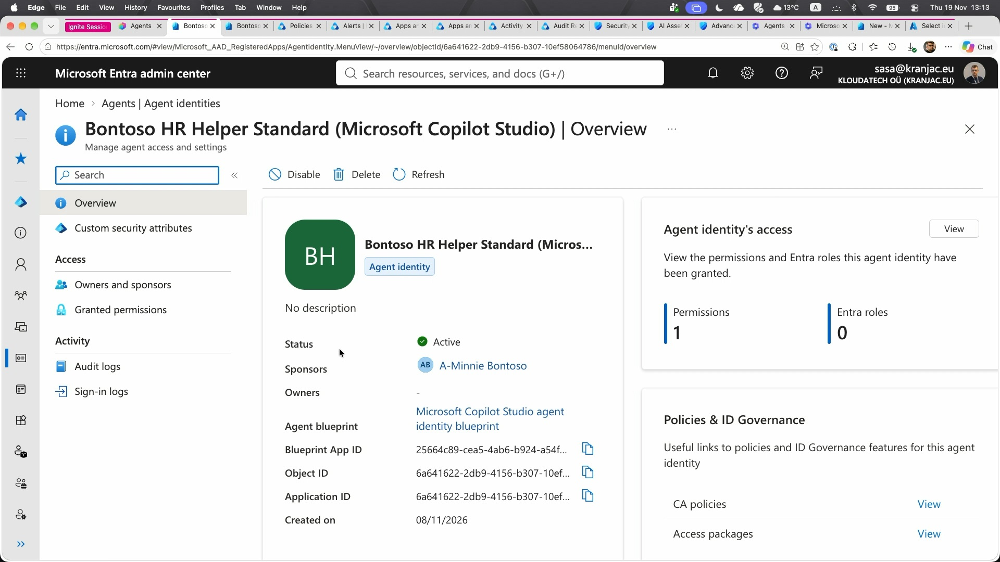
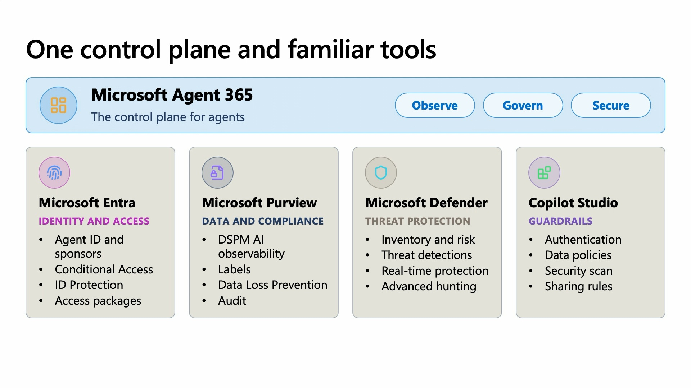
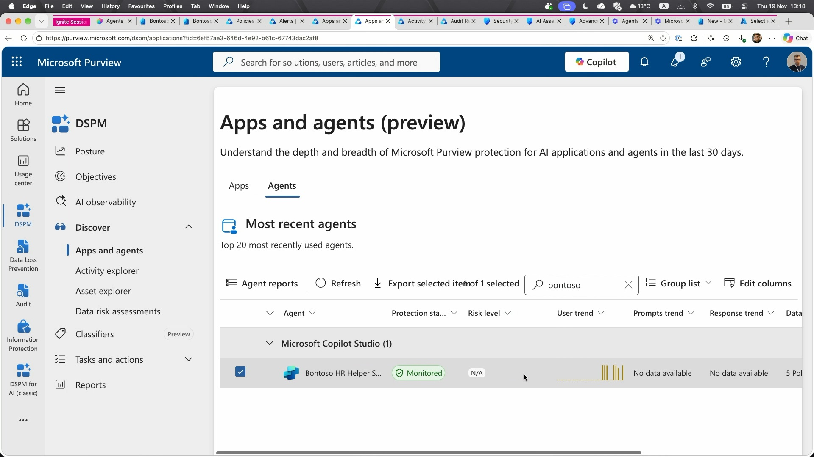
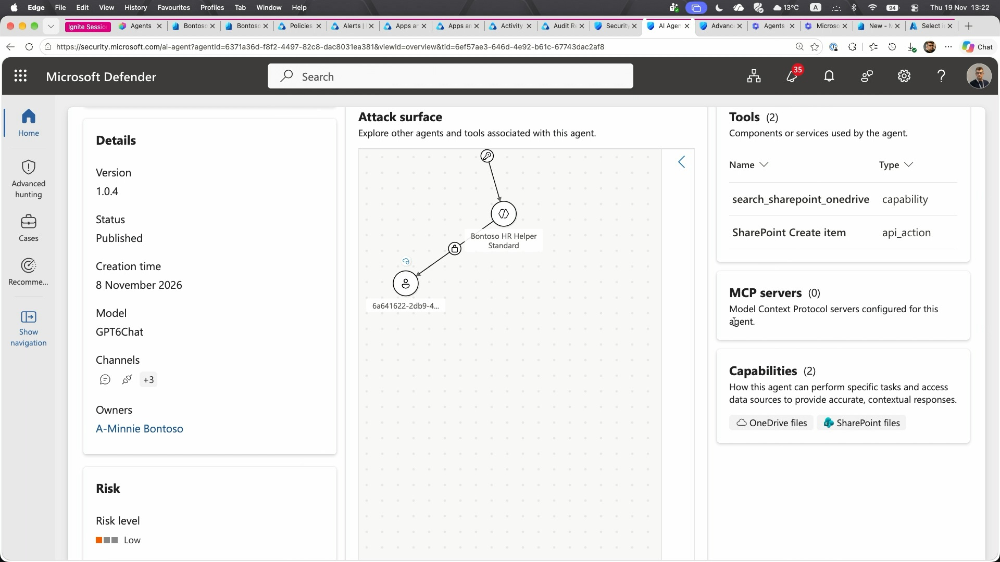

## #four-questions-seven-steps 01 / Four Questions & Seven Steps :: 四大安全拷问与七步演进：为什么过度共享是智能体时代的头号隐患 || Four Burning Questions & Seven Steps: Why Oversharing Haunts Enterprise Agents

安全团队在放行企业智能体进入生产网之前，必须先回答四个基础问题 [1]。第一是**可见性（Visibility）**：租户里究竟跑着 1 个、1,000 个还是 10,000 个未经审批或无人认领的智能体？第二是**权限归属（Privileges）**：智能体是否遵循最小权限原则，出事后哪位人类员工为此负责？第三是**过度共享（Oversharing）**：智能体是否会把提问者原本无权查阅的敏感档案直接吐进聊天窗口？第四是**运行安全（Safety）**：恶意提示词注入是否会篡改智能体目标并劫持其挂载的工具 [1][6]？ || Security architects must answer four foundational questions before scaling enterprise agents [1]. First comes **Visibility**: does the tenant host 1, 1,000, or 10,000 unapproved or ownerless agents? Second comes **Privileges**: does each agent enforce least privilege, and which human answers for its actions? Third comes **Oversharing**: can a prompt expose sensitive records the requester should never see? Fourth comes **Safety**: can injected instructions hijack the agent's goal or weaponize its bound tools [1][6]?

在现场幻灯片中，Sasha Kranjac 将这四道业务追问直接映射到 **OWASP 2026 智能体应用十大安全风险**的前三位 [1][6]。排在榜首的是智能体目标劫持（`ASI01`），紧随其后的是工具滥用与利用（`ASI02`），第三项则是身份与权限滥用（`ASI03`）[1][6]。他特别点明了一个常被企业误判的因果关系——智能体并不是过度共享的制造者，真正的病根是潜伏在企业 SharePoint 文档库中长达数年的宽泛权限技术债（例如对全员开放读取），而高效的智能体检索只是第一次用聚光灯把这项隐蔽坏习惯照得全员皆知 [1]。 || On stage in THR994, Sasha Kranjac mapped those four operational blind spots straight onto the top three entries of the **OWASP Top 10 for Agentic Applications for 2026** [1][6]. First comes Agent Goal Hijack (`ASI01`), followed by Tool Misuse and Exploitation (`ASI02`), and Identity and Privilege Abuse (`ASI03`) [1][6]. He also drew a sharp causal distinction: AI agents did not invent oversharing. Legacy SharePoint libraries configured with broad *Everyone except external users* access have carried that technical debt for years; conversational agents simply spotlight the hidden exposure in seconds [1].

:::figure { src: "./media/thr994-trusted-agent-control-planes.figure.json", title: "企业智能体信任架构：四大安全与治理控制面（THR994 · Bontoso 实战） || Enterprise Agent Trust Architecture: Four Security & Governance Control Planes (THR994)" }
图 1：THR994 演示的四重纵深防御拓扑——顶层在 Copilot Studio 中约束认证与委托动作，中层依托 Entra 隔离身份与责任人、Purview 阻断机密文档进入推理流、Defender 测绘攻击面并运行狩猎查询，底层由 Agent 365 汇总全租户资产清册与影子 AI [1][3]。 || Figure 1: Defense-in-depth topology demonstrated in THR994—scoping auth and delegated tools in Copilot Studio on top, enforcing Entra identity/sponsors, Purview DLP blocks, and Defender KQL hunting in the middle, and unifying tenant inventory inside Microsoft Agent 365 underneath [1][3].
:::

为了在 25 分钟内直观展示如何把一个裸奔原型改造成可信数字员工，议题围绕虚构企业 **Bontoso** 搭建了一条“**一个智能体、七个步骤、四个控制面**”的演进主线：从业务部门构建发布（Create），依次推进至确立专属身份（Identify）、摸清访问边界（Understand access）、保护敏感数据（Protect data）、检测异常风险（Detect risk）、实施规模治理（Govern），最终达成可审计的企业级信任（Trust）[1]。下方交互导览台完整集成了本场官方点播视频流、高清录播直链与五幕实机操作时间轴，点击上方章节标签即可切换核验各阶段证据 [1][2]： || To show how an organization turns a raw prototype into a trusted digital coworker within 25 minutes, THR994 traces fictional company **Bontoso** across **one agent, seven steps, and four control planes**: *Create → Identify → Understand access → Protect data → Detect risk → Govern → Trust* [1]. The interactive theater below pairs the official Microsoft Medius on-demand player and HD recording link with a five-chapter timestamped walkthrough [1][2]:

:::sandbox { id: "thr994-video-theater", canvas: false, script: "./thr994-session.js", style: "./thr994-session.css", title: "THR994 官方点播视频与五幕安全加固时间轴导览 || THR994 Official On-Demand Stream & Five-Act Security Walkthrough", desc: "切换四大拷问、Entra 专属身份、Purview 防泄漏、Defender 狩猎与 Agent 365 控制面五大时间节点，支持页内直接加载微软官方 Medius 播放器。 || Switch across the five timestamped chapters—4 Questions, Entra Agent ID, Purview DLP/DSPM, Defender Hunting, and Agent 365—or launch the embedded Microsoft Medius stream." }
纯静态议题点播导览沙盒：内置 THR994 官方高清封面、逐分钟实机配置摘要及微软官方点播与录播直链。 || Pure static session theater featuring the official THR994 HD cover, timestamped admin-portal digests, and direct Medius video links.
:::

## #bontoso-leak-entra 02 / Salary Leak & Entra Agent ID :: 2027 薪酬泄漏复现与第一透镜：在 Microsoft Entra 解耦人机身份并锁定责任人 || The 2027 Salary Leak & Lens 01: Separating Human and Agent Identities in Microsoft Entra

实机演示从 Bontoso 人力资源部门在 Copilot Studio 中搭建并发布至 Teams 与 Copilot Chat 的员工问答助手 **`Bontoso HR Helper Standard`**（版本号 `1.0.4`）切入 [1]。日常使用中，员工询问育儿假天数或是否需要提前申请时，智能体会给出规范解答；当员工需要登记休假记录时，智能体会先在聊天窗弹窗征求用户同意，获批后调用委托工具代用户在 SharePoint 列表中新建条目 [1]。 || The live walkthrough opens with **`Bontoso HR Helper Standard`** (version `1.0.4`), an HR assistant built in Copilot Studio and published to Microsoft Teams and Copilot Chat [1]. On routine policy questions such as parental leave allowances or advance-notice rules, the agent answers cleanly; when logging a leave request, it prompts the employee for explicit consent before invoking a delegated action to write a SharePoint list item [1].

隐患爆发在知识库挂载环节 [1]：该助手关联了公司的 **Bontoso HR Hub** 文档库，库中混放着常规规章与标有“高度机密（Highly Confidential）”的《2027 年薪酬评审方案（`2027 Compensation Review`）》，且该文档库因历史遗留问题对全员（Everyone except external users）开放了读取权限 [1]。当员工 Mickey 在对话窗口输入 `What are the salary bands?` 时，智能体毫无阻碍地检索并返回了完整的 2027 年拟定各职级薪酬区间表 [1]。表面上看，Mickey 本人具备该 SharePoint 站点的访问权，直接点开源文件也能读到数字；但从安全架构视角审视，任何能与该智能体对话的员工都会借由这条过度共享通道把机密薪酬一览无余，更致命的是传统方案往往把人类身份与智能体身份混为一谈 [1][4]。 || Trouble surfaces inside the agent's knowledge configuration [1]. The assistant connects to the **Bontoso HR Hub** SharePoint library, which mixes general handbooks with a *Highly Confidential* `2027 Compensation Review` spreadsheet exposed via legacy *Everyone except external users* permissions [1]. When employee Mickey asks `What are the salary bands?`, the agent immediately extracts and displays the proposed 2027 salary bands [1]. Although Mickey personally holds SharePoint access to open that file directly, routing confidential tables through a broadly shared conversational agent turns quiet permission sprawl into instant org-wide exposure—and conflates the human user with the autonomous software entity [1][4].

<div class="thr994-media-grid">
  <article class="thr994-media-card" data-present-surface="unframed">
    <div class="thr994-media-frame">
      
    </div>
    <div class="thr994-media-body">
      <span class="thr994-media-badge" data-zh="THR994 实机演示截帧 · 09:25" data-en="THR994 Live Demo Frame · 09:25">THR994 实机演示截帧 · 09:25</span>
      <h4 data-zh="Microsoft Entra 智能体专属身份与责任人面板" data-en="Microsoft Entra Agent Identity & Sponsor Overview">Microsoft Entra 智能体专属身份与责任人面板</h4>
      <p data-zh="展示 Bontoso HR Helper Standard 独立的 Object/App ID（6a641622-...）、蓝图归属、人类责任人 A-Minnie Bontoso，以及直通条件访问与访问包的治理入口 [1][4]。" data-en="Surfaces dedicated Object/App ID (6a641622-...), Copilot Studio blueprint metadata, human sponsor A-Minnie Bontoso, and direct links to Conditional Access and access packages [1][4].">展示 Bontoso HR Helper Standard 独立的 Object/App ID（6a641622-...）、蓝图归属、人类责任人 A-Minnie Bontoso，以及直通条件访问与访问包的治理入口 [1][4]。</p>
    </div>
  </article>
  <article class="thr994-media-card" data-present-surface="unframed">
    <div class="thr994-media-frame">
      
    </div>
    <div class="thr994-media-body">
      <span class="thr994-media-badge is-accent" data-zh="THR994 现场架构原图 · 21:20" data-en="THR994 Stage Slide · 21:20">THR994 现场架构原图 · 21:20</span>
      <h4 data-zh="一个控制面与四套熟悉工具的协同分工" data-en="One Agent 365 Control Plane Across Four Familiar Tools">一个控制面与四套熟悉工具的协同分工</h4>
      <p data-zh="由 Microsoft Agent 365 统筹观测、治理与安全加固，向下联动 Entra 身份、Purview 数据合规、Defender 威胁防护与 Copilot Studio 内生护栏 [1][3]。" data-en="Microsoft Agent 365 anchors Observe, Govern, and Secure workflows across Entra identity, Purview compliance, Defender threat protection, and Copilot Studio guardrails [1][3].">由 Microsoft Agent 365 统筹观测、治理与安全加固，向下联动 Entra 身份、Purview 数据合规、Defender 威胁防护与 Copilot Studio 内生护栏 [1][3]。</p>
    </div>
  </article>
</div>

打开第一道防御透镜 **Microsoft Entra 管理中心**（`Home > Agents > Agent identities`）即可看到，智能体在 Copilot Studio 中诞生的那一刻便自动获颁独立的 **Entra Agent ID**（演示实例对象与应用标识均为 `6a641622-2db9-4156-b307-10ef58064786`，派生自 `Microsoft Copilot Studio agent identity blueprint` `25664c89-cea5-...`），与员工 Mickey 的个人账号彻底剥离 [1][4]。围绕这一非人类主体，Entra 提供了四项硬核治理抓手： || Opening Lens 01 inside the **Microsoft Entra admin center** (`Home > Agents > Agent identities`) confirms that the moment an agent is created in Copilot Studio, Microsoft mints a dedicated **Entra Agent ID** (`6a641622-2db9-4156-b307-10ef58064786`, backed by blueprint `25664c89-cea5-...`) completely separate from employee Mickey's user object [1][4]. Around this non-human principal, Entra enforces four lifecycle controls:

1. **人类责任人制（Sponsors & Owners）**：每个智能体身份强制关联明确的人类责任人（演示中为 `A-Minnie Bontoso`）负责全生命周期问责；一旦该员工离职导致目录内失去有效责任人，Entra 会立即标记异常，防止无人看管的“僵尸智能体”长期滞留生产环境 [1][4]。 || **Human Sponsor Accountability**: Every agent identity binds to an accountable human sponsor (`A-Minnie Bontoso` in the demo); if that employee leaves the organization, Entra flags the orphaned lifecycle state immediately rather than letting unowned bots linger [1][4].
2. **独立登录与活动日志（Agent Sign-in Logs）**：管理员可按过去 24 小时或 7 天窗口单独筛选智能体自身的认证流水，无须再从海量人类登录事件中大海捞针 [1]。 || **Dedicated Agent Sign-in Logs**: Administrators inspect 24-hour and 7-day authentication trails specific to the agent principal itself [1].
3. **直指智能体的条件访问（Conditional Access for Agents）**：在新建条件访问策略的分配对象（`Users or agents`）中，现已支持直接勾选 `Select agents` 并精准锁定单个智能体（如 `Bontoso HR Helper Standard`）施加零信任准入封锁 [1][4]。 || **Agent-Targeted Conditional Access**: Under `Assignments > Users or agents`, policy authors now select individual agent identities (`Bontoso HR Helper Standard`) to enforce granular Zero Trust access rules [1][4].
4. **身份治理限时访问包（Entitlement Management Access Packages）**：将智能体纳入访问包后，可严格限定其读取特定业务资源的时间窗口，到期自动收回权限 [1][4]。 || **Time-Bound Access Packages**: Including agent identities in Entitlement Management packages time-boxes which corporate repositories an agent can touch [1][4].

## #purview-data-guardrails 03 / Lens 02: Microsoft Purview :: 第二透镜：用 Microsoft Purview 阻断高机密推理并穿透 638 条交互审计 || Lens 02: Blocking Confidential Copilot Processing and Auditing 638 Interactions in Purview

看清身份之后，Bontoso 信息技术团队随即出手修复薪酬泄漏：第二天当 Mickey 再次向同一智能体询问薪酬职级时，原本知无不言的智能体当场拒绝吐出任何机密数字 [1]。这一拦截并非靠粗暴删库或剥夺员工正当工作权限实现，而是通过第二道透镜 **Microsoft Purview** 精准切开了“人类直接读文件”与“智能体代为处理内容”两条通道 [1][5]。 || Once identity boundaries were clear, Bontoso IT closed the leak overnight: when Mickey repeated the exact salary-band prompt the next day, the HR agent refused to return confidential figures [1]. Rather than breaking business workflows by revoking Mickey's legitimate file permissions, IT used Lens 02—**Microsoft Purview**—to separate *direct human file reads* from *automated Copilot content processing* [1][5].

:::flow { title: "实机拆解：Microsoft Purview 四层数据防泄漏与可观测闭环 || Four-Stage Data Protection & AI Observability Loop in Microsoft Purview" }
1. **敏感度标签驱动防泄漏阻断（DLP for Copilot） || Sensitivity-Label DLP Block on Copilot Processing** — 管理员在 Purview 数据防泄漏（Data Loss Prevention）中创建针对 **Copilot Chat 与 Copilot Cowork** 全域生效的规则：一旦待处理文档命中 `Confidential` 或 `Highly Confidential` 敏感度标签，立即执行 **`Restrict Copilot from processing content`（禁止 Copilot 处理该内容）** 动作 [1][5]。如此一来，具备权限的 Mickey 仍可前往 SharePoint 手工打开薪酬表格开展本职工作，但智能体再也无法抓取该文件向其他无关人员扩散 [1]。 || Admins deploy a Purview DLP rule scoped to **Copilot Chat and Copilot Cowork**: whenever targeted content carries a `Confidential` or `Highly Confidential` label, the action **`Restrict Copilot from processing content`** fires [1][5]. Authorized staff like Mickey can still open the spreadsheet directly in SharePoint, while the agent is blocked from ingesting or repeating sensitive compensation rows in chat [1].
2. **防泄漏告警实时溯源（DLP Alerts） || Real-Time DLP Alert Triage** — 每次拦截触发都会自动生成结构化防泄漏告警单，完整记录策略命中时间、触发用户、发生位置以及受影响实体明细，供合规专员第一时间复盘 [1]。 || Every blocked attempt raises a structured DLP alert capturing the timestamp, user identity, surface location, matched policy, and impacted entities [1].
3. **新版数据安全态势管理（DSPM Apps & Agents） || Modern DSPM Apps and Agents View** — 随着旧版两个传统模块逐步退役，新版 Purview DSPM 推出专设的 **`Apps and agents (preview)`** 面板，默认列出最近活跃度最高的 **Top 20 智能体**近 30 天的保护覆盖深度、风险等级以及提示词与响应趋势；切入 **Activity Explorer（活动资源管理器）** 更可逐条穿透交互类别、敏感信息类型（SIT）、委托发起人（User participant）以及可点击直达的受访资源链接 [1][5]。 || Replacing legacy blades, Purview DSPM's **`Apps and agents (preview)`** view tracks 30-day protection breadth across the **Top 20 most recently used agents**; drilling into **Activity Explorer** exposes AI interaction categories, sensitive info types, acting-on-behalf-of user participants, and clickable URLs of accessed files [1][5].
4. **全量交互取证审计（Purview Audit） || Forensic CopilotInteraction Audit Trail** — 在 Purview Audit 异步检索中查询 2026 年 11 月 4 日至 11 月 19 日的 `CopilotInteraction` 工作负载，系统返回多达 **638 条**精确交互审计记录，单条日志完整保留智能体名称、蓝图标识（Agent blueprint ID）、宿主平台、用户账号与客户端源 IP 地址 [1]。 || Running an Audit search for `CopilotInteraction` from November 4 to November 19, 2026 returned **638 forensic records**, each logging the agent name, Agent blueprint ID, app host, user ID, and client IP address [1].
:::

<div class="thr994-media-grid">
  <article class="thr994-media-card" data-present-surface="unframed">
    <div class="thr994-media-frame">
      
    </div>
    <div class="thr994-media-body">
      <span class="thr994-media-badge" data-zh="THR994 实机演示截帧 · 13:55" data-en="THR994 Live Demo Frame · 13:55">THR994 实机演示截帧 · 13:55</span>
      <h4 data-zh="Purview DSPM：近 30 天智能体保护深度与 Top 20 榜单" data-en="Purview DSPM: 30-Day Agent Protection & Top 20 Inventory">Purview DSPM：近 30 天智能体保护深度与 Top 20 榜单</h4>
      <p data-zh="在 Apps and agents 视图集中检视 Copilot Studio 智能体的受监控状态（Monitored）、关联策略数（5 Policies）及提示词与响应趋势 [1][5]。" data-en="Tracks Monitored status, 5 active protection policies, and prompt/response trends for Bontoso HR Helper Standard inside DSPM [1][5].">在 Apps and agents 视图集中检视 Copilot Studio 智能体的受监控状态（Monitored）、关联策略数（5 Policies）及提示词与响应趋势 [1][5]。</p>
    </div>
  </article>
  <article class="thr994-media-card" data-present-surface="unframed">
    <div class="thr994-media-frame">
      
    </div>
    <div class="thr994-media-body">
      <span class="thr994-media-badge" data-zh="THR994 实机演示截帧 · 17:45" data-en="THR994 Live Demo Frame · 17:45">THR994 实机演示截帧 · 17:45</span>
      <h4 data-zh="Microsoft Defender：智能体工具与 MCP 攻击面画像" data-en="Microsoft Defender: AI Agent Attack Surface & Tool Posture">Microsoft Defender：智能体工具与 MCP 攻击面画像</h4>
      <p data-zh="单屏透视智能体版本 1.0.4、底层模型、挂载的 2 项 SharePoint 读写工具、0 个 MCP 服务端点以及当前风险评级（Low）[1][7]。" data-en="Surfaces version 1.0.4, model metadata, 2 bound SharePoint tools (search_sharepoint_onedrive &amp; SharePoint Create item), 0 MCP servers, and Low risk posture [1][7].">单屏透视智能体版本 1.0.4、底层模型、挂载的 2 项 SharePoint 读写工具、0 个 MCP 服务端点以及当前风险评级（Low）[1][7]。</p>
    </div>
  </article>
</div>

## #defender-and-agent365 04 / Lenses 03 & 04: Defender & Agent 365 :: 第三与第四透镜：Defender 高级威胁狩猎与 Agent 365 全域控制面 || Lenses 03 & 04: Threat Hunting in Defender and Fleet Governance in Agent 365

封堵静态数据泄漏只是前半场；一旦智能体遭遇外部提示词注入、工具链越权调用或配置篡改，安全运营中心（SOC）必须具备秒级侦测与溯源能力 [1][7]。在第三道透镜 **Microsoft Defender** 中开启智能体防护开关（Enable agent protection）后，平台会自动汇聚全租户智能体交互遥测并生成攻击面拓扑图 [1]。点开 `Bontoso HR Helper Standard` 详情页，安全分析师可直观核验其发布日期（2026 年 11 月 8 日）、当前版本 `1.0.4`、挂载的两项具体能力工具（只读检索 `search_sharepoint_onedrive` 与写操作动作 `SharePoint Create item`）、已接入的外部模型上下文协议服务端点数量（`MCP servers: 0`）以及综合风险水位 [1]。 || Preventing static data leaks solves only half the problem; if an agent faces prompt injection, tool misuse, or configuration drift, Security Operations Center (SOC) analysts need runtime detection and forensic hunting [1][7]. Once **agent protection** is enabled in Lens 03 (**Microsoft Defender**), Defender builds a live attack-surface inventory for every AI agent [1]. Opening `Bontoso HR Helper Standard` reveals its November 8, 2026 creation date, version `1.0.4`, exact bound tools (`search_sharepoint_onedrive` capability plus `SharePoint Create item` API action), configured MCP servers (`0`), and overall posture risk [1].

更重要的是，智能体产生的所有配置变更与运行轨迹都会沉淀进 **Advanced Hunting（高级威胁狩猎）** 数据底座，绝不凭空蒸发 [1]。Sasha 在现场切入 `AzureSentinelSK` 工作区，演示了利用全新开放的 **`AgentsInfo`** 架构表在 **0.939 秒**内盘点全部 Copilot Studio 智能体最新快照并关联安全告警的标准 Kusto 查询语句（KQL）[1][7]： || Crucially, agent configuration snapshots and runtime telemetry persist inside **Advanced Hunting** rather than evaporating after chat sessions close [1]. Switching to workspace `AzureSentinelSK`, Sasha executed a live Kusto Query Language (KQL) hunt against the **`AgentsInfo`** schema table—returning 10 Copilot Studio agent records in **0.939 seconds** ready to correlate with `AlertEvidence` and `BehaviorInfo` [1][7]:

```kusto
// AgentsInfo - Contains inventory and configuration details for AI agents,
// including agent identity, platform, ownership, and metadata.
// Review agent posture, identify risky or misconfigured agents, and correlate with alerts.
AgentsInfo
| summarize arg_max(Timestamp, *) by AgentId
| where Platform == "Copilot Studio"
| project AgentId, Name, Platform, Description, EntraAgentID, Channels
```

当企业智能体规模从单个部门试点扩张至成百上千个数字同事时，第四道透镜——位于 **Microsoft 365 管理中心（`admin.cloud.microsoft`）** 的 **Microsoft Agent 365** 便成为统筹全局的总控台 [1][3]。在左侧导航栏的 `Agents` 节点下，信息技术管理员可一站式切换 `Overview`、`All agents`、`Agent map`、`Deleted agents`、`Shadow AI` 与 `Tools` 六大治理视图，逐一审查 `Bontoso HR Helper Standard` 的连接渠道、完整系统提示词指令（Instructions）、运行环境属性以及允许触达数据与工具的具体用户名单 [1][3]。 || As deployments expand from a single HR pilot to hundreds or thousands of digital coworkers, Lens 04—**Microsoft Agent 365** inside the **Microsoft 365 admin center** (`admin.cloud.microsoft`)—serves as the fleet-wide control plane [1][3]. Under the `Agents` navigation node, tenant administrators move across `Overview`, `All agents`, `Agent map`, `Deleted agents`, `Shadow AI`, and `Tools` to audit `Bontoso HR Helper Standard`'s active channels, full system instructions, environment properties, and authorized user roster [1][3].

:::figure { src: "./media/thr994-agent-trust-maturity.figure.json", title: "企业智能体信任成熟度象限：从过度共享隐患到受控数字员工（THR994） || Enterprise Agent Trust Maturity: From Oversharing Debt to Trusted Workforce (THR994)" }
图 2：对比四类典型智能体治理状态——Bontoso 通过补齐 Entra 责任人与条件访问、Purview 高机密拦截、Defender 攻击面狩猎以及 Agent 365 全域编目，将最初暴露 2027 薪酬表的脆弱助手推入右上角零信任靶心 [1][3][6]。 || Figure 2: Comparing four governance states—combining Entra sponsor/Conditional Access controls, Purview Confidential DLP blocks, Defender KQL hunting, and Agent 365 inventory moves Bontoso's HR assistant from salary-band exposure into the top-right Zero Trust sweet spot [1][3][6].
:::

## #enterprise-playbook 05 / Enterprise Hardening Matrix :: 企业规模化落地核查表：把防盗门真正反锁上的四维操作指南 || Enterprise Rollout Playbook: Locking the Security Door Before Scaling Fleet-Wide

在 THR994 收尾处，Sasha 用了两个令现场印象深刻的工程比喻回应客户“我们真的需要把这四套工具全开吗”的犹豫：第一，买回一扇带有钢筋骨架与指纹锁的顶级防盗门后，锁不锁门从来不是门厂的责任，而是屋主自己的选择；第二，从飞机上跳下去本身并不需要降落伞——**只有当你打算跳第二次时，才必须背上降落伞** [1]。微软已经将身份、合规、威胁检测与全域编目原语内置进现有许可与管理门户，企业安全架构师的核心任务是在智能体大面积铺开之前按表索骥完成配置闭环 [1][3]： || Closing THR994, Sasha answered hesitant customers asking *“Do we really need all of these controls?”* with two memorable engineering analogies: buying a reinforced steel door with multi-point locks accomplishes nothing if the homeowner leaves it unlocked—and you do not need a parachute to jump out of a plane unless you want to jump twice [1]. Because Microsoft has already wired agent controls into familiar portals, enterprise security teams should execute the four-plane checklist below before scaling agents across business units [1][3]:

| 安全透镜与控制面 || Control Plane & Lens | 解答的核心问题与风险对齐 || Core Question & OWASP Mapping | 必选配置动作与实机核验点 || Mandatory Configuration & Verification Checkpoints |
|------|------|------|
| **Microsoft Entra**（身份与访问） || Identity & Access | 智能体是谁？谁为它担责？（对齐 **ASI03 身份与权限滥用**）[1][4][6] || Who is the agent & who answers for it? (**ASI03**)[1][4][6] | 核验每个智能体具备独立 `Entra Agent ID` 且绑定在职人类责任人（Sponsor）；在条件访问策略中按智能体粒度设卡，并用访问包限制敏感库读取时效 [1][4] || Verify dedicated `Entra Agent ID` + active human Sponsor; target agents in Conditional Access and time-box access via Entitlement Management packages [1][4] |
| **Microsoft Purview**（数据与合规） || Data & Compliance | 智能体被允许看见并使用什么？（封堵**过度共享技术债**）[1][5] || What data may the agent process? (**Oversharing**)[1][5] | 对核心文档库落实 `Confidential` / `Highly Confidential` 标签；启用覆盖 Chat 与 Cowork 的 DLP 阻断策略，定期巡检 DSPM Top 20 智能体与 `CopilotInteraction` 审计日志 [1][5] || Enforce sensitivity labels; enable Purview DLP `Restrict Copilot from processing content`, and review DSPM Top 20 agents plus `CopilotInteraction` audit trails [1][5] |
| **Microsoft Defender**（威胁防护） || Threat Protection | 智能体正在做什么？是否被劫持？（对齐 **ASI01 目标劫持 / ASI02 工具滥用**）[1][6][7] || Is the agent behaving safely? (**ASI01 / ASI02**)[1][6][7] | 开启智能体防护开关，逐一盘点写操作工具（如 `Create item`）与外部 MCP 服务数量；在高级狩猎中固化基于 `AgentsInfo` 表的常态化态势巡检规则 [1][7] || Enable agent protection, audit write-capable tools and MCP servers, and schedule KQL detections joining `AgentsInfo` with alert tables [1][7] |
| **Copilot Studio + Agent 365**（护栏与编目） || Guardrails & Control Plane | 能否安全运行成百上千个智能体？（对齐**全域可见性与影子 AI 治理**）[1][3][8] || Can we govern 1,000+ agents safely? (**Visibility & Shadow AI**)[1][3][8] | 在 Copilot Studio 强制启用企业身份认证、数据策略与自动安全扫描；在 M365 管理中心 Agent 365 统一纳管全量智能体、渠道分布、系统指令与共享规则 [1][3][8] || Enforce Microsoft auth, data policies, and security scans in Copilot Studio; audit All agents, Shadow AI, instructions, and user access in Agent 365 [1][3][8] |

## 参考资料：官方一手信源与安全文档 || References: Official Primary Sources & Security Documentation

1. **Sasha Kranjac (Microsoft Ignite 2026 THR994 Video & Transcript)** — https://ignite.microsoft.com/en-US/sessions/1787856596851001EQ5i-1791588293983001Ce5A | 《Trusting Your AI Workforce: Securing and Governing Enterprise Agents》25 分钟官方录播与英汉双语 WebVTT 逐字稿（2026-11-19） || Official 25-minute theater session recording and bilingual WebVTT transcripts (Nov 19, 2026)
2. **Sasha Kranjac (THR994 Official Medius On-Demand Stream)** — https://medius.microsoft.com/Embed/video-nc/7b98f53c-b97c-436c-8f9e-c72038f4235f | THR994 微软官方内嵌点播流与高清录播媒体源（`7b98f53c-b97c-436c-8f9e-c72038f4235f`） || Official Microsoft Medius embedded video player and high-definition MP4 recording
3. **Microsoft Agent 365 Service Description & Documentation** — https://learn.microsoft.com/microsoft-365/admin/ | THR994 推荐参考：Microsoft Agent 365 正式商用架构与 Microsoft 365 管理中心智能体控制面指南 || Official Microsoft Learn documentation for Microsoft Agent 365 fleet governance in the M365 admin center
4. **Microsoft Entra Agent ID & Conditional Access for Agents** — https://learn.microsoft.com/entra/agent-id | Microsoft Entra 智能体专属身份、人类责任人（Sponsors）、智能体条件访问与身份保护官方技术文档 || Official Microsoft Learn guide to Entra Agent ID, human sponsors, Conditional Access targeting, and ID Protection
5. **Microsoft Purview Data Security Posture Management & Protection** — https://learn.microsoft.com/purview/dspm-for-ai | Microsoft Purview 面向智能体应用的数据安全态势可观测性、敏感度标签防泄漏策略及 `CopilotInteraction` 审计指南 || Official Microsoft Learn reference on Purview data posture observability, Copilot content restrictions, and Audit logs
6. **OWASP Top 10 for Agentic Applications (2026)** — https://genai.owasp.org/ | 开放式应用安全项目发布的 2026 智能体应用十大风险分类（涵盖目标劫持 `ASI01`、工具滥用 `ASI02` 与身份权限滥用 `ASI03`） || GenAI Security Project taxonomy covering Agent Goal Hijack (`ASI01`), Tool Misuse (`ASI02`), and Identity Abuse (`ASI03`)
7. **Microsoft Defender Posture & Threat Detection for Agents** — https://learn.microsoft.com/defender-xdr/ | 在 Microsoft Defender 中发现企业智能体、评估外部工具攻击面态势并使用 `AgentsInfo` 表开展高级狩猎 || Official Microsoft Defender guidance for discovering enterprise agents, assessing tool posture, and hunting via `AgentsInfo`
8. **Copilot Studio Security Scan & Data Policies** — https://learn.microsoft.com/microsoft-copilot-studio/security-and-governance | Copilot Studio 内置身份认证、自动安全扫描、连接器数据策略与共享规则配置规范 || Official Copilot Studio security and governance documentation covering authentication, automated security scans, and data policies
