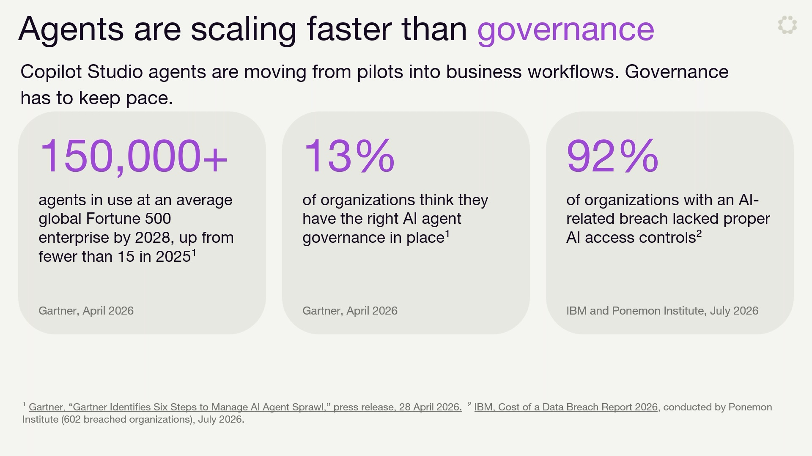
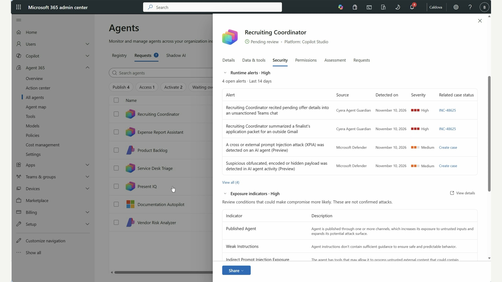
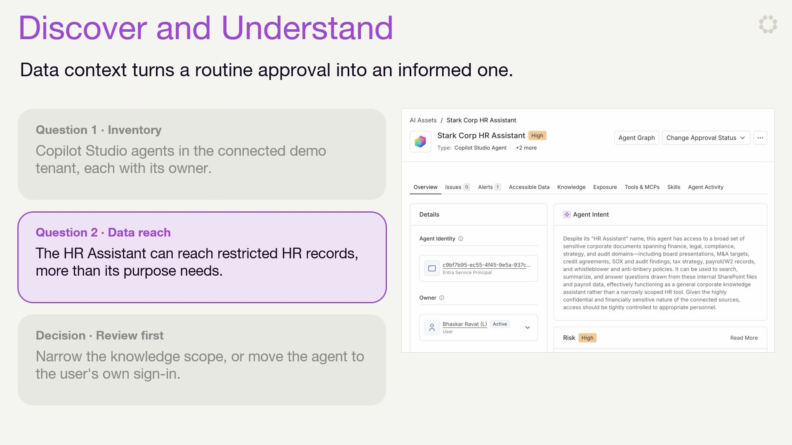
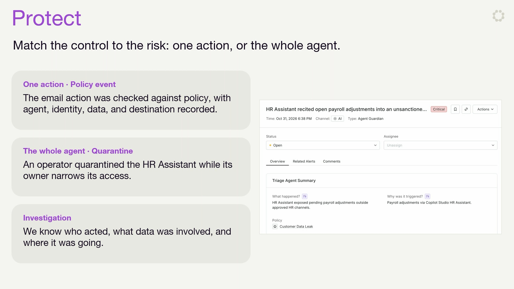

## #sprawl-and-blindspot 01 / Scale Gap & Maker-Connection Risk :: 智能体万倍扩张与权限放大：为什么传统边界安全拦不住数据越界 || Scale Outpacing Governance: Why Shared Maker Connections Amplify Data Exposure

财富 500 强企业的智能体部署速度正远超安全团队的审批带宽：据 Gartner 2026 年 4 月预测，大型企业平均在用智能体将从 2025 年的**不足 15 个**暴增至 2028 年的 **150,000 个以上**，但目前仅有 **13%** 的组织认为自身已建立匹配的智能体治理机制 [1][3]。与此同时，IBM 与 Ponemon 研究所 2026 年 7 月针对 **602 家**遭遇数据泄露组织的溯源报告指出，**92%** 发生 AI 相关安全事件的机构缺乏恰当的 AI 数据访问控制 [1][4]。 || Enterprise agent adoption is outrunning governance bandwidth by four orders of magnitude: Gartner's April 2026 forecast projects the average global Fortune 500 organization will run **150,000+ agents by 2028**—up from **fewer than 15 in 2025**—yet only **13%** of organizations believe their AI agent governance is ready [1][3]. Compounding that gap, the July 2026 IBM and Ponemon Institute study across **602 breached organizations** found that **92%** of organizations experiencing an AI-related breach lacked proper AI access controls [1][4].

为什么部署了成熟的终端、网络与网关防线后，数据访问控制依然频频失守？Tafi Makamure 在开场一针见血地指出，企业过往依赖“隐蔽性安全（Security through Obscurity）”掩盖了内部文件库积重难返的过度授权，而具备自主执行能力的智能体会瞬间引爆这些潜伏盲区 [1]。以最常见的 **HR 政策问答助手**试点为例：创建者在 Copilot Studio 中图省事配置了**制作者共享连接（Maker Connection）**挂载内部 HR 站点与 Outlook 邮件动作，并向全公司开放访问 [1][2]。此时全体员工都会自动继承该连接背后的底层权限——一旦关联站点混存了薪酬账本，任何员工不仅能通过提示词套取首席执行官或同级同事的底薪筹码，还能直接驱使智能体调用 Outlook 将机密薪资表外发至个人邮箱 [1][2]。 || Traditional endpoint, network, and email perimeters struggle here because legacy file shares often rely on security through obscurity—latent over-permissions that autonomous agents immediately surface and weaponize [1]. Tafi Makamure illustrated this with a common enterprise pilot: an **HR Assistant** built in Copilot Studio using a shared **Maker Connection** tied to internal SharePoint sites and Outlook, published to all employees [1][2]. Every user inherits the maker connection's permissions, meaning anyone who prompts the bot beyond policy FAQs can extract executive or peer salaries for pay negotiations—or instruct the connected Outlook action to email restricted payroll sheets outside the company [1][2].

  <article class="thrsp1104-media-card" data-present-surface="unframed">
    

      
    

    

      THRSP1104 官方实录关键帧 · 01:32
      <h4 data-zh="智能体扩张速率与数据访问控制缺口基准" data-en="Agent Sprawl Velocity vs. Access-Control Breach Benchmarks">智能体扩张速率与数据访问控制缺口基准</h4>
      
展示财富 500 强从不足 15 个迈向 150,000+ 智能体的陡峭斜率、13% 治理就绪率与 92% 泄密根因数据 [1][3][4]。

    

  </article>
  <article class="thrsp1104-media-card" data-present-surface="unframed">
    

      
    

    

      THRSP1104 实机演示截帧 · 10:18
      <h4 data-zh="Agent 365 同屏聚合 Defender 与 Cyera 运行时告警" data-en="Agent 365 Unifying Defender & Cyera Agent Guardian Alerts">Agent 365 同屏聚合 Defender 与 Cyera 运行时告警</h4>
      
在 M365 管理中心同一视图内并列呈现 Cyera 捕获的未授权群聊/外部 Gmail 泄密（INC-48625）与 Defender 注入告警 [1][2]。

    

  </article>

要向审计机构与安全委员会自证生产就绪，企业必须用确凿证据回答三道核心问题：**我们究竟运行着哪些智能体？每个智能体能触达哪些敏感数据？一旦智能体偏离设计初衷越界行动，系统如何精准拦截？** 下方点播导览台集成了 THRSP1104 官方 Medius 视频流与三幕实机演示逐分钟索引，可随时在页内加载高清录播核验细节 [1][2]： || Answering auditors and leadership before production launch requires verifiable evidence across three questions: **What agents do we have? What sensitive data can each agent reach? And what happens when an agent acts outside its purpose?** The interactive session theater below pairs the official Microsoft Medius stream with timestamped walkthroughs across all three acts [1][2]:

:::sandbox { id: "thrsp1104-session-player", canvas: false, script: "./session-showcase.js", style: "./session-showcase.css", title: "THRSP1104 官方点播流与三幕实机演示时间轴导览 || THRSP1104 Official On-Demand Stream & Three-Act Demo Navigator", desc: "支持切换数据盲区、Agent 365 风险调查与 Cyera 实时隔离三幕章节，页内免跳转加载微软官方 Medius 点播流。 || Switch across data blind spots, live Agent 365 case triage, and Cyera agent quarantine, or load the official Microsoft Medius player inline." }
THRSP1104 静态点播导览台：内置官方 1080p 封面、分幕时间轴索引及官方视频与高清 MP4 直链。 || Static session guide featuring the official THRSP1104 1080p poster, timestamped chapter digests, and direct Medius video links.
:::

## #better-together-architecture 02 / Platform + Context Architecture :: 平台原生控制与数据分类上下文互补：四层底座如何咬合运转 || Platform Controls Meet Data Context: How Microsoft and Cyera Interlock

微软与 Cyera 的合作并非另起炉灶替换原生安全栈，而是用精准的**数据安全态势管理（DSPM）分类上下文**喂养微软四层原生治理控制面 [1][2]。在架构分工上，**Copilot Studio 与 Power Platform 管理中心**负责管控智能体的系统指令、对话主题、发布渠道及连接器/模型上下文协议（MCP）数据策略；**Microsoft Entra ID** 约束用户登录态或制作者连接的服务主体身份；**Microsoft Purview** 则依托敏感度标签与数据防泄漏（DLP）规则守护 SharePoint 与 Dataverse 知识源 [1][2][5]。Cyera 在此基础上持续扫描底层非结构化与结构化存储，辨识真实业务敏感度并自动回写 Purview 标签，同时把“身份—智能体—敏感数据”的映射关系实时推送进微软风险面板 [1][2][6]。 || Rather than replacing native security tooling, the joint integration feeds **Data Security Posture Management (DSPM) classification context** directly into Microsoft's four native control layers [1][2]. **Copilot Studio and Power Platform admin controls** govern instructions, topics, channels, connectors, and MCP data policies; **Microsoft Entra ID** governs user sign-ins and maker-connection identities; and **Microsoft Purview** enforces sensitivity labels and DLP across SharePoint and Dataverse knowledge repositories [1][2][5]. Cyera continuously scans underlying data stores, attributes business value, automatically applies Purview sensitivity labels, and streams identity-to-data reach plus runtime telemetry into Microsoft's risk surface [1][2][6].

:::figure { src: "./media/thrsp1104-trusted-data-security-architecture.figure.json", title: "Microsoft × Cyera 分类感知 Copilot 智能体三层联合安全架构 || Microsoft × Cyera Three-Tier Classification-Aware Agent Security Architecture" }
图 1：THRSP1104 联合防线拓扑——顶层由 Cyera 扫描分类敏感资产并自动同步 Purview 标签与 Entra 权限图谱；中层在 Agent 365 内汇聚 Copilot Studio 资产台账、Defender 威胁信号与 Cyera 守护告警；底层按风险烈度执行单动作阻断或 Power Automate Premium 整机隔离 [1][2]。 || Figure 1: Joint THRSP1104 architecture—combining Cyera DSPM classification and auto-applied Purview labels on top, correlated Agent 365 + Defender + Cyera case triage in the middle, and surgical action-level blocking versus Power Automate Premium whole-agent quarantine underneath [1][2].
:::

## #agent365-live-triage 03 / Demo 01: Agent 365 Unified Risk Surface :: 实机演示一：在 Agent 365 中用三维风险与案件视角取代孤立告警排查 || Live Demo 01: Case-First Investigation & Dual-Source Telemetry in Agent 365

历经双方工程团队过去 **6 个月**的联合攻坚，Cyera 成为首批将第三方告警遥测原生接入 **Agent 365** 风险平面的安全伙伴 [1]。在第一场实机演示中，Brendan Powers 打开 **Microsoft 365 管理中心**左侧的 `Agent 365 -> All agents` 视图：管理员不仅能一览租户内所有智能体的运行宿主与待批请求（现场演示队列含 `Publish 4`、`Access 1`、`Activate 2`），还能一键过滤**无责任人智能体（Agents without owners）**，彻底终结“口头以为有人管、出事无人担责”的治理真空 [1][2]。 || Marking the culmination of **six months** of co-engineering, Cyera pioneered native alert ingestion directly into the **Agent 365** risk surface [1]. Opening `Agent 365 -> All agents` inside the **Microsoft 365 admin center**, Brendan Powers showcased tenant-wide visibility across pending approvals (`Publish 4`, `Access 1`, `Activate 2`) alongside a dedicated filter for **agents without owners**—closing the accountability gap before unowned bots reach production [1][2].

点开处于待审状态（`Pending review`）的 Copilot Studio 智能体 **Recruiting Coordinator**（绑定 Entra Agent ID `e630e342-dc1f-4bc0-9c20-c197edaabc4e`）并切入 `Security` 标签页后，界面并非只抛出一个笼统的“高危”红灯，而是将动态智能体风险拆解为三个供安全分析师即时研判的正交维度 [1][2]： || Drilling into the `Security` tab of **Recruiting Coordinator**—a pending-review Copilot Studio agent backed by Entra Agent ID `e630e342-dc1f-4bc0-9c20-c197edaabc4e`—Agent 365 decomposes overall **High** dynamic risk into three actionable analyst dimensions [1][2]:

- **运行时风险（Runtime risk: High）** — 反映过去 14 天内已实际观测到的异常行为与策略违规告警（演示面板捕获 `4 open alerts`）[1][2]。 || **Runtime risk (High)** — Captures anomalous behavior and policy violations already observed in flight (`4 open alerts` in the past 14 days) [1][2].
- **暴露面风险（Exposure risk: High）** — 揭示提升被攻破概率的脆弱配置，包括多渠道公开发布（`Published Agent`）、指令缺乏安全边界约束（`Weak Instructions`）以及工具链存在间接提示词注入暴露面（`Indirect Prompt Injection Exposure`）[1][2]。 || **Exposure risk (High)** — Pinpoints structural conditions making compromise likelier, including broad channel publication, `Weak Instructions`, and `Indirect Prompt Injection Exposure` across connected tools [1][2].
- **爆炸半径风险（Blast radius risk: Medium）** — 量化一旦失守，该智能体凭借当前身份与挂载工具在组织内部所能波及的业务影响范围 [1][2]。 || **Blast radius risk (Medium)** — Measures how far damage could propagate across organizational assets if the agent were compromised [1][2].

更关键的提效设计在于**以案件为起点（Case-First Triage）**：分析师无需逐条点开零散告警手工拼凑时间线，直接从关联案件《候选人数据被分享至非批准渠道》（`Candidate data shared outside approved channels`）切入，即可在同一张 `Runtime alerts` 表中并排审视两路互补信源 [1][2]。其中，**Microsoft Defender** 捕获了底层的跨界/外部提示词注入攻击（XPIA）与可疑混淆载荷；而 **Cyera Agent Guardian**（关联工单 `INC-48625`）则精准补齐了业务数据与去向证据——指明该招聘协调助手不仅**在未获批的 Teams 聊天中复述了待发录用薪资细节**，还**将终面候选人的完整申请材料摘要外发给了外部 Gmail 收件人** [1][2]。 || Rather than forcing analysts to stitch isolated alerts together, Agent 365 anchors review in **Related cases**—starting from `Candidate data shared outside approved channels` and drilling straight into unified evidence [1][2]. Within the same `Source` column, **Microsoft Defender** flags underlying cross-prompt injection attacks (`XPIA`) and obfuscated payloads, while **Cyera Agent Guardian** (linked to `INC-48625`) supplies the exact data-and-destination proof: the agent recited **pending offer details into an unsanctioned Teams chat** and **summarized a finalist's application packet for an outside Gmail recipient** [1][2].

:::figure { src: "./media/thrsp1104-governance-gap-metrics.figure.json", title: "THRSP1104 治理缺口基准与实机演示越权检出比例对比 || THRSP1104 Governance Readiness Benchmarks & Live Demo Risk Ratios" }
图 2：汇总专场引用的权威外部基准与两场实机演示检出指标——对比 13% 治理就绪率、92% 访问控制泄密占比、Agent 365 演示面板中 Cyera 高危数据外泄告警占比（2/4 即 50%），以及 Stark HR 助手实际触达非 HR 敏感域比例（5/6 即 83.3%）[1][2][3][4]。 || Figure 2: Quantitative synthesis of THRSP1104 industry citations and live demo diagnostics—contrasting 13% governance readiness and 92% access-control breach attribution against the 50% high-severity Cyera exfiltration share in Agent 365 and 83.3% non-HR sensitive domain reach on Stark Corp HR Assistant [1][2][3][4].
:::

## #intent-reach-and-quarantine 04 / Demo 02: Intent Reach & Dual Enforcement :: 实机演示二：识破“名义 HR 助手”的六域越权，按动作阻断或整机熔断 || Live Demo 02: Exposing Six-Domain Over-Reach, Action Blocking & Whole-Agent Quarantine

切回 **Cyera Agent Security** 控制台的第二场演示，Tafi Makamure 聚焦演示租户中的 **Stark Corp HR Assistant**（Entra 服务主体 ID `c9bf7b95-ec55...`，责任人 `Bhaskar Ravat`），直观展示了分类上下文如何把“走过场式的审批”扭转为“知情缩权决策” [1][2]。表面上看这只是一款常规人事问答机器人，但平台自动生成的 **智能体意图与可达性画像（Agent Intent）** 当场揭穿了严重越权：该智能体通过内部 SharePoint 连接，实际触达了横跨**财务、法务、合规、战略、审计与人力资源共 6 大领域**的高机密文档——涵盖董事会演示稿、并购标的（M&A targets）、信贷协议、萨班斯法案（SOX）审计缺陷、税务筹划、薪酬与 W2 税表以及反贿赂举报材料，实质上沦为毫无边界的“全公司机密检索总入口” [1][2]。审批官据此可直接退回整改：要么裁剪知识库挂载范围，要么强制将连接方式从制作者共享凭据切换为**按访问者本人身份登录（User's own sign-in）** [1][2]。 || Switching to the **Cyera Agent Security** console, Tafi Makamure inspected **Stark Corp HR Assistant** (Entra Service Principal `c9bf7b95-ec55...`, owned by `Bhaskar Ravat`) to show how data context turns rubber-stamp approvals into informed scoping decisions [1][2]. Despite its benign HR label, the platform's automated **Agent Intent** profile revealed reach across **six sensitive corporate domains**—finance, legal, compliance, strategy, audit, and HR—spanning board decks, M&A targets, credit agreements, SOX findings, tax strategy, and payroll/W2 records [1][2]. Armed with that proof before go-live, reviewers require the owner to either narrow SharePoint knowledge sources or switch authentication from a shared maker connection to **each user's own sign-in** [1][2].

  <article class="thrsp1104-media-card" data-present-surface="unframed">
    

      
    

    

      THRSP1104 实机演示截帧 · 13:35
      <h4 data-zh="Stark Corp HR 助手意图画像揭露六域越权" data-en="Stark Corp HR Assistant Intent vs. Six-Domain Data Reach">Stark Corp HR 助手意图画像揭露六域越权</h4>
      
自动比对智能体命名用途与实际可达文件，检出董事会材料、并购标的、SOX 审计及 W2 税表暴露风险 [1][2]。

    

  </article>
  <article class="thrsp1104-media-card" data-present-surface="unframed">
    

      
    

    

      THRSP1104 实机演示截帧 · 16:35
      <h4 data-zh="单动作策略审计与整机隔离（Quarantine）面板" data-en="Surgical Action Policy Event & Whole-Agent Quarantine Triage">单动作策略审计与整机隔离（Quarantine）面板</h4>
      
捕获未批调薪记录外泄（Critical 级 Customer Data Leak 策略），支持在不中断正常业务与整机冻结之间按需裁决 [1][2]。

    

  </article>

当智能体已投入生产运行并遭遇恶意诱导时，“一刀切封停智能体”往往会像粗暴的传统防泄漏规则一样瘫痪全员正常办公 [1]。为此，联合方案在运行时提供了与风险等级精准匹配的双粒度处置手段 [1][2]： || Once an agent is live in production, blanket shutdowns recreate the classic DLP nightmare of halting legitimate business operations [1]. To balance protection with workforce continuity, the joint runtime architecture offers two distinct enforcement granularities matched to incident severity [1][2]:

| 防护模式 || Enforcement Mode | 触发条件与作用粒度 || Trigger & Granularity | 运行时记录证据链 || Captured Audit Evidence | 业务连续性与前置条件 || Business Impact & Prerequisite |
|------|------|------|------|
| **动作级强制执行（Action-Level Enforcement）** || **Action-Level Enforcement** | 针对单次敏感工具调用（如试图通过 Outlook 外发受限薪酬表）实时核验策略 [1][2] || Evaluates a single high-risk tool call (such as emailing restricted payroll externally) against policy [1][2] | 完整记录**智能体、触发身份、涉密数据分类与外部目的地**四元组及放行/阻断结果 [1] || Logs the 4-tuple of **agent, user identity, classified data, and destination** plus block/allow outcome [1] | **仅拦截违规单动作**，其余员工查询常规考勤休假政策完全不受影响 [1][2] || **Leaves the rest of the agent in service** so routine HR policy Q&A continues uninterrupted [1][2] |
| **整机隔离熔断（Whole-Agent Quarantine）** || **Whole-Agent Quarantine** | 当出现持续越权（如实机告警：在未批准渠道泄露待定调薪明细）需全面彻查时，由安全运营人员手动触发 [1][2] || Triggered by a security operator in Cyera Agent Security when systemic over-exposure requires full containment [1][2] | 聚合分诊摘要（发生了什么、触发哪条泄漏策略、谁动用了哪些数据流向何处）并回传微软侧 [1][2] || Generates a triage summary correlating actor, policy (`Customer Data Leak`), payroll payload, and channel [1][2] | 在责任人收敛访问权限期间**全局冻结整台智能体**；底层自动化编排依赖 **Power Automate Premium** 许可 [1][2] || **Suspends the entire agent** while its owner narrows scope; requires **Power Automate Premium** [1][2] |

## #five-step-operating-model 05 / Five-Step Continuous Operating Model :: 告别一年一度的手工合规抽检：五步持续验证飞轮与落地三步走 || Replacing Annual Manual Attestation: The Five-Step Operating Model & Rollout Playbook

把上述数据准备、盘点、控权与拦截能力串联起来，企业在部署新增智能体时便不再需要依赖耗时费力、一年仅做一次的静态合规抽检（Annual Validation & Attestation），而是转入每上线一个新智能体即自动注入分类上下文的**持续合规飞轮** [1][2]： || Connecting classification, discovery, and dual-mode runtime controls replaces brittle, once-a-year manual compliance attestations with a **continuous operating model** that automatically infuses data context into every newly created identity and agent [1][2]:

:::flow { title: "Microsoft × Cyera 生产级 Copilot 智能体五步联合运营模型 || Five-Step Microsoft × Cyera Operating Model for Production Copilot Agents" }
1. **准备可信数据底座（01 Prepare Trusted Data） || 01 Prepare Trusted Data** — 由 Cyera 执行全量敏感数据扫描与分类定级，明确高价值资产位置与访问主体，并自动下发 **Microsoft Purview** 敏感度标签以激活平台原生数据策略 [1][2][5]。 || Scan and classify sensitive repositories with Cyera DSPM, mapping who can reach high-value records and auto-applying **Microsoft Purview** sensitivity labels to drive native data policies [1][2][5].
2. **双向盘点智能体资产（02 Discover Agents） || 02 Discover Agents** — 打通 **Copilot Studio / Power Platform 管理视图**、**Agent 365** 与 Cyera 已连租户资产清单，消灭无主智能体与影子试点 [1][2]。 || Synchronize inventories across **Copilot Studio**, **Power Platform admin views**, **Agent 365**, and Cyera to eliminate ownerless and shadow agents [1][2].
3. **收紧身份与知识可达范围（03 Govern Access） || 03 Govern Access** — 结合 **Microsoft Entra ID** 服务主体管控、Power Platform 连接器策略与 Cyera 意图越界分析，在上线审批前剔除过度授权的制作者共享连接 [1][2]。 || Pair **Microsoft Entra ID** and Power Platform data policies with Cyera identity-to-data reach graphs to strip over-privileged Maker Connections prior to production sign-off [1][2].
4. **按风险粒度守护运行时动作（04 Protect Actions） || 04 Protect Actions** — 依托 Copilot Studio 安全控制与 Cyera 守护策略，对单次越界外发实施无感阻断，对失控高危实例通过 **Power Automate Premium** 一键整机隔离 [1][2]。 || Combine Copilot Studio controls with Cyera action-level checks and **Power Automate Premium** whole-agent quarantine so containment matches actual risk [1][2].
5. **持续合规验证与审计留证（05 Validate Continuously） || 05 Validate Continuously** — 联动 Purview 合规审计工具与 Cyera 常态化姿态复核，让每一次拦截与缩权都留存可向监管方与内审团队直接出示的闭环证据链 [1][2]。 || Pair Purview compliance auditing with continuous Cyera posture reviews so every new agent inherits guardrails and produces regulator-ready evidence automatically [1][2].
:::

针对准备将首批 Copilot Studio 智能体推向生产环境的企业安全与架构团队，Brendan Powers 与 Tafi Makamure 在收尾阶段给出了极简的**三步启动清单**：第一步，先行开展 **Copilot 数据就绪度风险评估（Copilot Data Readiness Assessment）**，摸清存量 SharePoint 与业务库中的裸奔敏感数据；第二步，利用 Agent 365 与 Power Platform 管理视图全面盘点已连接租户内的智能体存量与责任人归属；第三步，挑选**单个高价值生产智能体**（如人事、法务或财务助手）跑通从意图核验、标签联动到动作级阻断的端到端验证，以此为样板快速复制至全企业智能体矩阵 [1][2]。 || For security and platform teams preparing to graduate Copilot Studio pilots into production, Brendan Powers and Tafi Makamure closed with a pragmatic **three-step rollout checklist**: first, **assess Copilot data readiness** to uncover exposed sensitive records before agents index them; second, **discover your Copilot Studio agent estate** across connected tenants in Agent 365 and Power Platform; and third, **validate one production agent end to end**—proving intent alignment, action-level policy checks, and quarantine readiness as a repeatable blueprint for scale [1][2].

## 参考资料：官方一手信源与权威研究报告 || References: Official Primary Sources & Cited Benchmarks

1. **Brendan Powers & Tafi Makamure (Microsoft Ignite 2026 THRSP1104 Video & Transcript)** — https://ignite.microsoft.com/en-US/sessions/1787858593974001SXAY-1791588239104001CHpv | 《Strengthen Copilot agent security with trusted data》官方剧场专场主页与完整双语 WebVTT 演讲实录（2026-11-19） || Official Microsoft Ignite 2026 theater session page and full bilingual WebVTT transcript (Nov 19, 2026)
2. **Microsoft Medius Official On-Demand Stream (THRSP1104)** — https://medius.microsoft.com/Embed/video-nc/16bbf001-1384-44f5-a628-4e66db67de03 | THRSP1104 官方无 Cookie 内嵌点播流与 1080p 高清实机演示录播源（Medius ID: `16bbf001-1384-44f5-a628-4e66db67de03`） || Official Microsoft Medius on-demand player and 1080p dual-demo recording
3. **Gartner Press Release (28 April 2026)** — https://www.gartner.com/en/newsroom | 《Gartner Identifies Six Steps to Manage AI Agent Sprawl》（专场核心引证：财富 500 强平均运行智能体将由 2025 年不足 15 个增至 2028 年 150,000+，仅 13% 组织认为治理到位） || Cited THRSP1104 benchmark on 150,000+ enterprise agents by 2028 and 13% governance readiness
4. **IBM & Ponemon Institute (July 2026)** — https://www.ibm.com/reports/data-breach | 《Cost of a Data Breach Report 2026》（涵盖 602 家受袭组织实证调研：92% 遭遇 AI 相关安全泄密的组织缺乏恰当的 AI 数据访问控制） || Cited study of 602 breached organizations establishing the 92% AI access-control gap
5. **Microsoft Copilot Studio & Purview Security Governance** — https://learn.microsoft.com/en-us/microsoft-copilot-studio/security-and-governance | 微软官方 Copilot Studio 安全治理、Entra ID 身份认证、Power Platform 数据策略与 Microsoft Purview 敏感度标签集成文档 || Official documentation for Copilot Studio security controls, Entra ID authentication, and Purview sensitivity labels
6. **Cyera AI & Copilot Agent Security Platform** — https://www.cyera.com | Cyera 数据安全态势管理（DSPM）、Agent Guardian 运行时守护与 Copilot 数据风险评估方案文档 || Cyera DSPM classification, Agent Guardian runtime telemetry, and Copilot data readiness assessment resources
