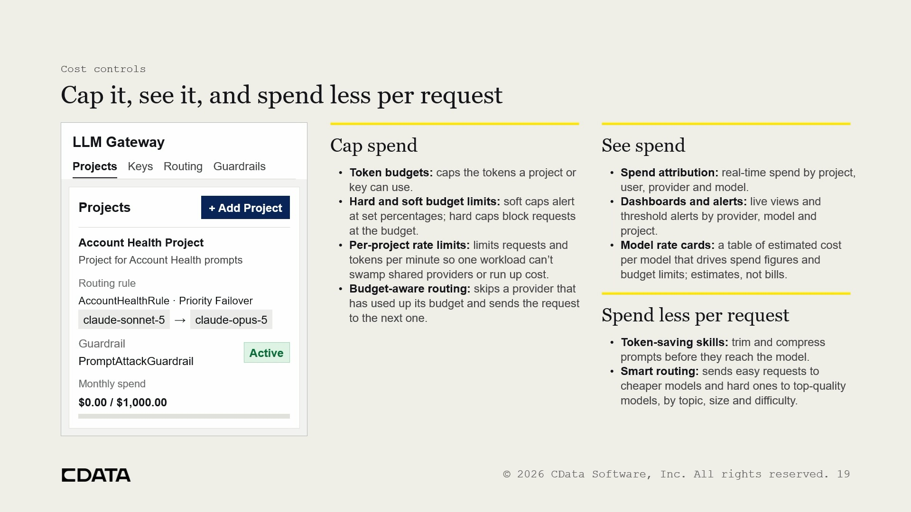
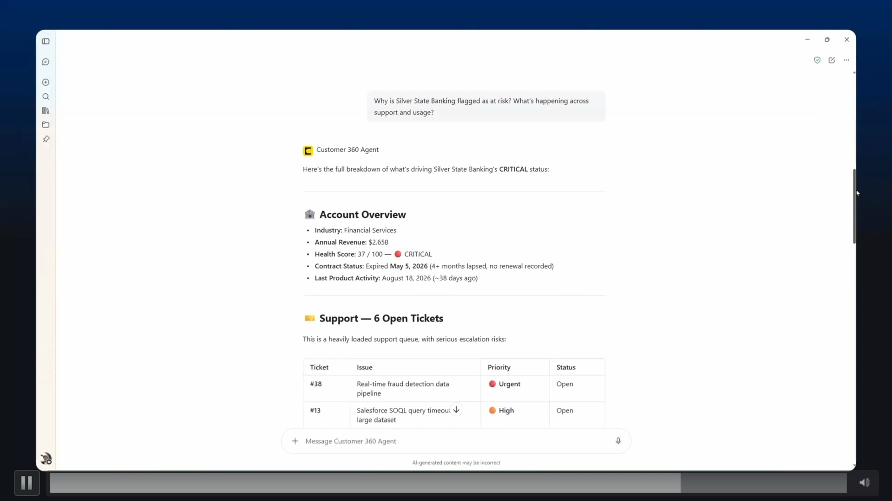
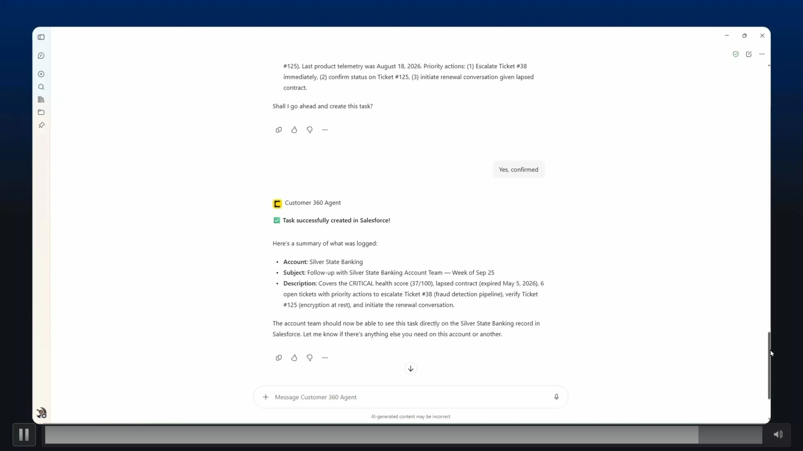
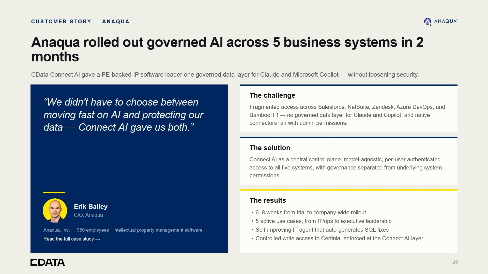

## #cross-estate-architecture 01 / Beyond the Microsoft Estate :: 跨生态数据鸿沟：把治理从智能体入口向下贯通至单条记录 || Bridging Both Worlds: Extending Governance from Agent Front Doors Down to Records

企业在 Copilot Studio 中构建业务智能体时，微软生态内部的一体化底座已相当完备：Work IQ 为 Microsoft 365 文档、沟通脉络与 Dataverse 提供原生组织上下文，Agent 365 则集中接管智能体的注册发现、安全姿态与运行可观测性 [1][2]。真正的摩擦出现在智能体迈出微软版图的那一刻。真实生产流程几乎总是横跨 SAP、Salesforce、Zendesk、ServiceNow、NetSuite 与 Snowflake 等外部异构记录系统；若仅停留在智能体入口层做审批，底层连接器一旦退回共享管理员账号或裸露全量库表，越权读取与误写事故便难以避免 [1][2]。 || Inside the Microsoft ecosystem, Copilot Studio makers already benefit from tight architectural integration: Work IQ grounds agents in Microsoft 365, Dynamics 365, and Dataverse context, while Agent 365 handles discovery, security posture, and observability [1][2]. Friction surfaces the moment an agent must reach beyond the Microsoft estate into heterogeneous systems like SAP, Salesforce, Zendesk, ServiceNow, NetSuite, and Snowflake. Front-door agent governance alone cannot prevent over-privileged queries or accidental mutations if underlying connectors rely on shared admin credentials or expose raw database schemas [1][2].

Rahul Pahuja 在开场直接给出了破局原则：治理绝不能止步于智能体层，必须一路向下延伸至外部数据层与单条业务记录 [1]。作为 Copilot Studio 内置的官方认证连接器，CData Connect AI Gateway 允许制作者直接通过标准每用户 OAuth 流程接入网关，即插即用调用历经十余年企业级打磨的 **350 余款**实时读写连接器，覆盖主流客户关系、企业资源计划、财务人力及云端数仓 [1][2]。 || Opening THRSP1119, Rahul Pahuja stated the core architectural rule plainly: governance cannot stop at the agent layer—it must extend all the way down to the data and record layer [1]. Certified natively inside Copilot Studio, CData Connect AI Gateway lets makers authenticate per user via OAuth and tap **350+ enterprise connectors** hardened over more than a decade across CRM, ERP, finance, HR, and cloud data warehouses [1][2].

:::figure { src: "./media/connect-ai-governed-architecture.figure.json", title: "Copilot Studio 结合 CData Connect AI Gateway 的三层受控读写与审计架构 || Three-Tier Governed Read/Write & Audit Architecture with Copilot Studio and CData Connect AI" }
图 1：THRSP1119 全栈架构——顶层由 Copilot Studio、Work IQ 与 Agent 365 负责对话编排与入口治理；中层由 CData Connect AI 网关统筹多模型预算路由、Power BI / Snowflake 语义图谱与收敛工具包；底层按调用者自身权限跨 350+ 数据源执行联邦读取与人工确认回写，并将四维日志实时流式推送至安全信息与事件管理平台 [1][2]。 || Figure 1: Three-tier THRSP1119 architecture—combining Copilot Studio, Work IQ, and Agent 365 at the orchestration tier; enforcing model routing, PBIX/Snowflake semantic graphs, and scoped toolkits in CData Connect AI; and executing caller-scoped reads, human-confirmed writes, and real-time SIEM audit streaming across 350+ enterprise sources [1][2].
:::

在这座连接“微软内部生态”与“外部异构系统”的单一网关内部，四项核心能力协同运转 [1][2]：最上方是支持自带模型的路由与预算网关，可按策略分发至闭源旗舰模型或开放权重模型；中间是执行身份透传与策略校验的集中控制面，以及吸收外部业务口径的 **Context Engine**（上下文引擎）；最下方则是支持实时双向读写的虚拟数据层 [1][2]。下方交互导览台集成了 THRSP1119 官方 19 分钟点播视频流、官方字幕讲稿直链与五个核心章节的逐分钟索引 [1]： || Between every agent and external enterprise system, Connect AI consolidates four architectural layers [1][2]: a bring-your-own-model routing and cost gateway on top, a centralized identity and policy control plane, a **Context Engine** carrying business semantics and schemas on every request, and a live read/write virtual data layer underneath [1][2]. Explore the official 19-minute recording and five timestamped chapters in the interactive theater below [1]:

:::sandbox { id: "thrsp1119-video-theater", canvas: false, script: "./thrsp1119-session.js", style: "./thrsp1119-session.css", title: "THRSP1119 官方点播视频与五章实录时间轴导览 || THRSP1119 Official On-Demand Stream & Five-Chapter Timestamp Navigator", desc: "按时间轴切换架构解析、CData Labs 三项定量研究、网关预算控制、Silver State Banking 实机演示与 Anaqua 案例，支持页内直接加载官方点播播放器。 || Switch across architecture, CData Labs benchmarks, LLM FinOps controls, the live Silver State Banking demo, and the Anaqua case study, or load the embedded Medius player." }
纯静态点播与议题导览沙盒：内置 THRSP1119 官方高清封面、五段分章实录摘要及官方点播流与讲稿直链。 || Pure static session theater featuring the official THRSP1119 HD cover, five timestamped chapter digests, and direct video and transcript links.
:::

## #cdata-labs-benchmarks 02 / CData Labs Quantitative Studies :: 三项实验室硬核实测：用服务端语义与派生视图破解准确率与词元账单 || Three CData Labs Benchmarks: Compounding Accuracy, 178x Model Spread, and 93% Token Savings

要让企业放心把智能体推向全员生产，既要答得准，又要把单次推理成本压进可控区间——即同时做到“每次请求少花词元”与“每个词元单价更低” [1][3]。Rahul Pahuja 在现场公布了 **CData Labs** 围绕跨源企业查询开展的三项对照基准测试，测试任务要求智能体同时横跨 **Salesforce**（客户与商机）、**Zendesk**（售后工单）与 **Snowflake**（产品使用遥测），回答诸如“找出健康状况恶化且使用量下滑的高优客户”等高复杂度关联问题 [1][3]。 || Scaling enterprise agents requires a compounding economic equation: spending fewer tokens per request while paying less for every token without sacrificing answer quality [1][3]. Rahul Pahuja shared three **CData Labs** benchmark studies evaluating complex multi-source prompts across **Salesforce** (accounts and opportunities), **Zendesk** (support tickets), and **Snowflake** (product usage telemetry)—such as identifying high-priority accounts suffering declining usage and poor health [1][3].

第一项 **准确率差距研究**（The 25% Accuracy Gap）将 CData 统一平台与集成平台即服务、客户关系管理原生接口及数仓提供商的同类连接服务同台对比 [1][3]。实测显示，其他服务商的回答准确率停留在 **65%–75%** 区间，而 CData Connect AI 达到了 **98.5%**，领先幅度约 **25 个百分点** [1][3]。差距根源在于：当查询涉及多表过滤、跨系统主键关联或特定字段的枚举值业务含义时，普通接口仅返回裸字段名，迫使大模型盲猜；而 CData 的连接层原生感知表结构与枚举语义，并由内置数据处理引擎在服务端直接完成跨源联合计算 [1][3]。 || In **Study 1 (The 25% Accuracy Gap)**, CData benchmarked Connect AI against MCP implementations from iPaaS, CRM, and data warehouse vendors [1][3]. Competing providers scored between **65% and 75%**, whereas Connect AI reached **98.5% accuracy**—an advantage of roughly **25 percentage points** [1][3]. Generic servers falter when queries require multi-filter logic, cross-system joins, or cryptic field enumerations; Connect AI embeds schema semantics directly into standard tools and executes cross-source joins inside its server-side data processing engine [1][3].

:::figure { src: "./media/cdata-labs-efficiency-benchmarks.figure.json", title: "CData Labs 三项跨源基准测试：查询准确率、成本降幅与词元效率实测对比 || CData Labs Multi-Source Benchmarks: Accuracy Lead, Cost Reduction & Token Efficiency" }
图 2：CData Labs 三项实验室数据汇总——跨源复杂查询准确率达 98.5%（对比行业 65%–75%）；借助服务端跨源派生视图将单次正确回答成本从 `$0.16` 降至 `$0.01`（降幅 93.8%，跨模型成本比达 178 倍）；在同模型概率路由测试中将单次词元消耗从 914K 削减至 87K（节省 93%），任务正确率从 36% 跃升至 83% [1][3]。 || Figure 2: Summary of CData Labs studies—98.5% cross-source accuracy vs. 65%–75% industry baselines; per-run cost reduced from `$0.16` to `$0.01` (93.8% drop across a 178x model cost spread) via derived views; and token consumption cut by 93% (914K down to 87K tokens/run) while lifting task accuracy from 36% to 83% [1][3].
:::

第二项 **178 倍成本跨度研究**（The 178x Cost Spread）验证了“确定性架构杠杆”对模型选型的解放作用 [1][3]。团队在网关内预先构建了横跨 Salesforce、Zendesk 与 Snowflake 三套系统的预连接 **派生视图**（Derived Views）与专用领域工具，将繁重的关联聚合卸载至数据处理引擎确定性执行 [1][3]。结果显示，即便是轻量的开放权重模型 **Mistral Small**，也能产出与昂贵前沿大模型完全一致的准确答案，跨模型单次成本跨度高达 **178 倍**，实测单次查询开销从 **`$0.16`** 直接压降至 **`$0.01`**——模型选型从此简化为纯粹的成本与延迟权衡 [1][3]。 || **Study 2 (The 178x Cost Spread)** proved how deterministic architectural levers decouple answer quality from frontier model pricing [1][3]. By defining pre-joined **Derived Views** and custom domain tools across Salesforce, Zendesk, and Snowflake inside the data processing engine, an open-weight **Mistral Small** model produced the exact same accurate result as top-tier frontier models—spanning a **178x** cost spread and dropping per-run cost from **`$0.16` to `$0.01`** [1][3].

第三项 **93% 词元节省研究**（The 93% Token Savings）则固定使用同一款大模型，纯粹考察开放式概率探索路径下的词元损耗 [1][3]。面对相同业务背景，传统连接网关每次运行平均消耗 **914K 词元**，且任务正确率仅为 **36%**；切换至配备按需上下文注入与服务端计算的 Connect AI Gateway 后，单次消耗骤降至 **87K 词元**（整整节省 **93%**），工具调用次数缩减至原先的 **1/10**，而任务完成正确率反而大幅攀升至 **83%** [1][3]。 || **Study 3 (The 93% Token Savings)** held the underlying LLM constant to isolate probabilistic token efficiency [1][3]. Where a standard MCP gateway burned **914K tokens per run** and answered only **36%** of tasks correctly, Connect AI Gateway served context on demand and executed computations server-side—finishing in **87K tokens per run** (**93% savings**) with **1/10 the tool calls** and **83% task accuracy** [1][3].

## #prompt-lifecycle-and-finops 03 / Prompt Lifecycle & LLM FinOps :: 提示词六步受控链路与成本护栏：在网关前门锁住预算、路由与安全 || Six-Step Life of a Prompt & LLM FinOps: Capping Spend, Routing Failover, and Blocking Attacks

为什么同一套架构能兼顾高准确率与严苛合规？Rahul Pahuja 用“一条提示词的六步生命周期（Life of a Prompt）”拆解了网关从前门到源端的逐跳控制机制 [1]： || Why do context and governance travel together instead of fighting each other? Rahul Pahuja traced a single user question through six governed hops from front door to source record [1]:

:::flow { title: "CData Connect AI 提示词六步全栈受控生命周期 || Six-Step Governed Life of a Prompt Across Connect AI" }
1. **携带真实身份提问（01 Prompt） || Authenticated User Question (01 Prompt)** — 业务用户在 Copilot Studio 智能体界面发起自然语言提问，智能体通过每用户 OAuth 令牌向网关透传当前调用者的真实企业身份，杜绝共用后台特权账号 [1]。 || A user asks an agent a question; per-user OAuth passes the caller's actual enterprise identity into the platform rather than a shared service account [1].
2. **模型路由与预算拦截（02 Gateway） || Model Routing & Cost Gate (02 Gateway)** — 请求率先抵达网关层，按预设项目规则匹配目标大模型与工具集，同时实时校验词元速率限制、项目剩余预算及提示词注入风险 [1]。 || The gateway routes the request to the designated model and toolset while enforcing per-minute rate limits, project budgets, and prompt-attack guardrails [1].
3. **身份与策略绑定（03 Governance） || Identity & Policy Attachment (03 Governance)** — 集中治理面解析该用户名下获批访问的连接凭据与受控工作区策略，明确界定本次会话“允许读哪些对象、能否执行回写” [1]。 || Centralized governance binds who is asking and what connections and CRUD operations their credentials permit [1].
4. **字段与业务语义挂载（04 Context Engine） || Schema & Semantic Enrichment (04 Context Engine)** — 上下文引擎按需注入关联表结构、Power BI / dbt 指标口径与枚举字典，确保模型在发起工具调用前准确理解每个字段与数值的业务定义 [1]。 || The Context Engine attaches relevant table schemas, PBIX/dbt metric definitions, and business glossaries on demand [1].
5. **调用者权限源端执行（05 Virtual Data Layer） || Caller-Scoped Live Execution (05 Virtual Data Layer)** — 虚拟数据层携带调用者自身权限下沉至外部业务系统执行实时跨源读取或受控写入，不绕过源端原有行级与对象级访问控制 [1]。 || The virtual data layer executes live reads or writes at the source strictly under the caller's own permissions [1].
6. **有据答复与全量留痕（06 Source System & Audit） || Grounded Answer & SIEM Logging (06 Source & Audit)** — 经真实数据锚定的答复返回给智能体，沿途每一次模型推理、工具调用与底层查询均写入集中审计日志并支持实时推送安全运营中心 [1]。 || Grounded answers return to the user while every LLM, tool, and SQL call is recorded for SIEM streaming [1].
:::

在企业尤为关心的成本治理面板（LLM Gateway）中，管理员围绕“封顶（Cap spend）、看清（See spend）、单次省钱（Spend less per request）”构建三道防线 [1]。系统支持为每个业务项目或密钥设定词元预算与每分钟请求/词元速率上限，防止失控循环拖垮共享配额；软上限按百分比触发告警，硬上限则在触线瞬间阻断请求或通过预算感知路由自动切往备用模型供应商 [1]。 || Inside the **LLM Gateway** console, cost governance operates across three pillars: **Cap spend**, **See spend**, and **Spend less per request** [1]. Admins enforce token budgets and per-minute rate limits per project so runaway loops cannot swamp shared providers; soft caps fire threshold alerts while hard caps block over-budget calls or trigger budget-aware failover [1].

  <article class="thrsp1119-media-card" data-present-surface="unframed">
    

      
    

    

      THRSP1119 官方课件实拍 · Slide 19
      <h4 data-zh="LLM Gateway 项目级预算封顶、模型容灾路由与防注入护栏" data-en="LLM Gateway Project Spend Caps, Priority Failover & Prompt Guardrails">LLM Gateway 项目级预算封顶、模型容灾路由与防注入护栏</h4>
      
实拍展示为客服团队创建的 Account Health Project：配置 claude-sonnet-5 至 claude-opus-5 优先级故障切换路由、启用 PromptAttackGuardrail 防护，并将月度开销硬性封顶于 &#36;1,000.00 [1]。

    

  </article>

如上方官方课件第 19 页实拍所示，演示团队为客户体验部门专门设立了 `Account Health Project`，配置 `AccountHealthRule` 优先级故障转移策略（主用 `claude-sonnet-5`，异常时无缝切换至 `claude-opus-5`），开启主动防提示词攻击护栏（`PromptAttackGuardrail`），并将该用户群的月度总支出上限锁定为 **`$1,000.00`**；同时配合词元压缩技能与按题目难度分流的智能路由，在推理前自动瘦身提示词体积 [1]。 || As captured in Slide 19 above, the customer-experience team's `Account Health Project` pairs priority failover (`claude-sonnet-5` to `claude-opus-5`) with an active `PromptAttackGuardrail` and a **`$1,000.00`** monthly spend cap—while token-saving skills compress prompts and smart routing steers simpler queries to lower-cost models [1].

## #live-demo-account-health 04 / Live Demo: Account Health & Governed Write :: 实机演练：承接 Power BI 语义模型，诊断 37 分高危客户并安全回写 Salesforce || Live Demo: Carrying Power BI Semantics Forward to Diagnose a 37/100 Account and Write Back to Salesforce

进入全场核心实机演示环节，Rahul Pahuja 展示了如何将传统静态的 Power BI 客服工单看板升级为具备跨源推理与受控行动力的 Copilot Studio **Customer 360 Agent** [1]。演示从 **Context Editor**（上下文编辑器）起步：团队无需在每套聊天工具里从零手写业务规则，而是直接导入现成的 **Power BI（PBIX）语义模型**、**dbt** 模型或 **Snowflake 语义视图** [1][2]。向导自动扫描 Snowflake 底层表结构并生成一份结构清晰的 **Markdown** 语义文档（辅以平台内建的客户健康度业务词汇表），数据工程师可随时在线审阅修订，并通过 `search_context` 工具供智能体按需检索 [1]。 || Moving into the live walkthrough, Rahul Pahuja transformed a static Power BI support dashboard into an action-capable **Customer 360 Agent** in Copilot Studio [1]. Inside the **Context Editor**, instead of rebuilding business logic in isolated silos, teams import existing **Power BI (PBIX)** files, **dbt** projects, or **Snowflake Semantic Views** [1][2]. A wizard auto-generates an editable **Markdown** context file alongside an Account Health glossary that the agent queries dynamically via a `search_context` tool [1].

紧接着，团队通过 **Toolkits**（受控工具包）与 **Virtual Schemas**（虚拟模式）严格收敛暴露给 Copilot Studio 的操作表面积 [1]。该工具包没有向大模型敞开数百张原始表，而是仅勾选暴露与客户健康度强相关的少量虚拟对象（Salesforce 客户与商机、Zendesk 工单、Snowflake 同步遥测）并逐项设定增删改查（CRUD）权限，最终向 Copilot Studio 精准映射出 4 个专用领域工具：`get_account_health_score`、`get_account_health_signals`、`get_account_details` 以及唯一具备写权限的 `create_salesforce_task` [1]。 || Next, **Toolkits** and **Virtual Schemas** lock down the agent's exposed surface area [1]. Rather than exposing hundreds of raw CRM and warehouse tables, admins scope object-level CRUD permissions to a curated subset of Salesforce, Zendesk, and Snowflake assets—exposing four targeted domain tools inside Copilot Studio: `get_account_health_score`, `get_account_health_signals`, `get_account_details`, and a single governed write action, `create_salesforce_task` [1].

  <article class="thrsp1119-media-card" data-present-surface="unframed">
    

      
    

    

      THRSP1119 实机演示截帧 · 跨三源诊断
      <h4 data-zh="Customer 360 智能体精准定位 37/100 危急账户根因" data-en="Customer 360 Agent Pinpoints 37/100 Critical Account Drivers">Customer 360 智能体精准定位 37/100 危急账户根因</h4>
      
跨 Salesforce、Zendesk 与 Snowflake 实时汇总 Silver State Banking（年营收 &#36;2.65B）：健康分 37/100（低于阈值 40）、合同于 2026-05-05 逾期超 4 个月、末次产品活跃停留在 8 月 18 日，且积压 #38 实时反欺诈管线等 6 张高危工单 [1]。

    

  </article>
  <article class="thrsp1119-media-card" data-present-surface="unframed">
    

      
    

    

      THRSP1119 实机演示截帧 · 受控回写
      <h4 data-zh="人工确认授权与 Salesforce 跟进任务受控回写" data-en="Human-in-the-Loop Approval & Governed Salesforce Task Creation">人工确认授权与 Salesforce 跟进任务受控回写</h4>
      
因健康分低于 40 分阈值，智能体主动列出三项优先处置建议并请求人工批准；用户输入 Yes, confirmed 后，通过受控写工具在 Salesforce 客户记录下创建跟进任务且全链路落盘可查 [1]。

    

  </article>

当演示者在 Copilot Studio 测试窗询问“为什么 Silver State Banking 被标为风险账户？售后与产品使用侧发生了什么？”时，智能体依次调用受控工具，当场输出有据可查的全景诊断 [1]。该金融服务客户年营收达 **`$2.65B`**，当前综合健康分跌至 **37 / 100**（CRITICAL 危急，低于 40 分预警线）；合同已于 **2026 年 5 月 5 日** 到期（逾期逾 4 个月未续签），Snowflake 末次产品遥测停留在 **2026 年 8 月 18 日**（静默约 38 天）[1]。售后队列更是积压了 **6 张未结工单**，包括紧急优先级的 **#38 实时反欺诈数据管线故障**、高优先级的 **#13 大数据集查询超时**以及静态加密相关的 **#125 工单** [1]。 || When prompted in Copilot Studio—*"Why is Silver State Banking flagged as at risk? What's happening across support and usage?"*—the agent synthesizes live evidence across all three systems [1]. The **`$2.65B`** financial-services account sits at a **37 / 100 CRITICAL** health score (below the **40** threshold). Its contract expired on **May 5, 2026** (4+ months lapsed) and last Snowflake telemetry occurred on **August 18, 2026** (~38 days idle) [1]. Meanwhile, **6 open tickets** sit in the queue, led by Urgent **Ticket #38** (real-time fraud detection pipeline), High-priority **Ticket #13** (SOQL query timeout), and **Ticket #125** (encryption at rest) [1].

由于健康分跌破 40 分阈值，智能体自动拟定三步处置方案（立即升级 #38 工单、核实 #125 加密工单进展、重启逾期合同续约谈判），并在执行写入前主动停顿询问：*“是否允许立即创建该跟进任务？”* [1]。待业务代表明确回复 `Yes, confirmed` 后，智能体方才调用 `create_salesforce_task` 将主题为 `Follow-up with Silver State Banking Account Team - Week of Sep 25` 的任务精准写入 Salesforce 对应客户档案；与此同时，Connect AI 后台的查询日志、审计日志、大模型日志与工具日志完整记录了调用者邮箱、执行耗时（如 Snowflake 查询 `3694 ms`）及受影响记录，支持实时流式对接企业安全审计平台 [1]。 || Because 37 falls below the 40-point threshold, the agent outlines three priority actions and explicitly asks permission before mutating any record: *"Shall I go ahead and create this task?"* [1]. Only after the user replies `Yes, confirmed` does `create_salesforce_task` log `Follow-up with Silver State Banking Account Team - Week of Sep 25` onto the Salesforce account—while Connect AI's unified Query, Audit, LLM, and MCP logs capture the exact user identity, SQL execution (`3694 ms`), and affected rows for real-time SIEM ingestion [1].

## #anaqua-case-and-playbook 05 / Customer Case Study: Anaqua :: 客户投产实证：Anaqua 如何在 6–8 周内跨五套核心系统规模化上线受控 AI || Production Proof: How Anaqua Rolled Out Governed AI Across Five Enterprise Systems in 6–8 Weeks

演讲收尾阶段，Rahul Pahuja 分享了知识产权管理软件领军企业 **Anaqua**（员工规模约 **950 人**）的真实生产落地案例 [1][4]。在引入集中网关前，Anaqua 内部同时存在使用 **Claude** 与 **Microsoft Copilot Studio** 的异构用户群，业务数据分散在 **Salesforce、NetSuite、Zendesk、Azure DevOps 与 BambooHR** 五套核心系统中；更棘手的是，原有原生连接器普遍以管理员高权限运行，安全团队无法在不牺牲数据隔离的前提下放行大规模使用 [1][4]。 || Closing the session, Rahul Pahuja highlighted intellectual-property software leader **Anaqua** (~**950 employees**) [1][4]. Anaqua faced a classic multi-agent enterprise bottleneck: business groups split across **Claude** and **Microsoft Copilot Studio** needed live access to five core systems—**Salesforce, NetSuite, Zendesk, Azure DevOps, and BambooHR**—yet native connectors ran with broad admin privileges and lacked a unified governance layer [1][4].

  <article class="thrsp1119-media-card" data-present-surface="unframed">
    

      
    

    

      THRSP1119 官方课件实拍 · Slide 22 客户案例
      <h4 data-zh="Anaqua 跨五大业务系统 6–8 周全公司投产实录" data-en="Anaqua Production Rollout Across 5 Systems in 6–8 Weeks">Anaqua 跨五大业务系统 6–8 周全公司投产实录</h4>
      
Anaqua 首席信息官 Erik Bailey 评价：“我们不必在快速推进 AI 与保护核心数据之间二选一——Connect AI 让我们两者兼得。”团队实现 5 大活跃业务场景投产与对 Certinia 的受控写入 [1][4]。

    

  </article>

通过将 CData Connect AI 部署为跨模型中央控制平面，Anaqua 实现了与底层系统静态管理员权限解耦的每用户实名认证访问 [1][4]。团队仅用 **6–8 周**（约 2 个月）便完成了从概念验证（POC）到全公司范围的正式投产，同步跑通从 IT 运维到高管决策的 **5 个活跃生产场景**——其中不仅包含能够自主生成 SQL 修复脚本的自进化 IT 运维智能体，还在网关层严格执行了对专业服务自动化系统 **Certinia** 的受控回写 [1][4]。下表总结了企业在架构设计与落地阶段可直接复用的四项核心控制杠杆 [1][2]： || Deploying CData Connect AI as a model-agnostic control plane gave Anaqua per-user authenticated access across all five systems without loosening security [1][4]. The team moved from trial to company-wide production in **6–8 weeks**, launching **5 active use cases** spanning executive leadership, a self-improving IT agent that auto-generates SQL fixes, and controlled write-back into **Certinia** [1][4]. The table below summarizes the four architectural levers teams can apply immediately [1][2]:

| 架构控制维度 || Architectural Lever | 传统直连痛点 || Unmanaged Connector Pitfall | THRSP1119 受控网关方案 || Connect AI Governed Pattern | 实测工程收益 || Verified Engineering Impact |
|------|------|------|------|
| 跨生态业务语义 || Cross-Estate Semantics | 业务定义锁死在单一报表工具，大模型盲猜枚举与关联键 [1] || Definitions trapped in BI silos; models guess joins and enums [1] | 导入 Power BI PBIX、dbt 与 Snowflake 视图生成集中可编辑 Markdown 上下文 [1][2] || Import PBIX, dbt & Snowflake views into centralized Markdown context [1][2] | 跨源查询准确率提升至 **98.5%**（领先约 25 个百分点）[1][3] || Lifts multi-source accuracy to **98.5%** (+25 pp lead) [1][3] |
| 跨源计算与模型路由 || Cross-Source Joins & Routing | 将海量原始表行塞入上下文窗口，依赖昂贵旗舰模型硬算 [1][3] || Dumping raw rows into prompts; forcing expensive frontier models [1][3] | 在服务端构建跨源预连接派生视图（Derived Views）与优先级故障转移路由 [1][3] || Pre-join via server-side Derived Views + priority model failover [1][3] | **178 倍**成本跨度（单次 **`$0.16` → `$0.01`**），节省 **93%** 词元 [1][3] || **178x** cost spread (**`$0.16` → `$0.01`**/run) & **93%** token savings [1][3] |
| 智能体写入权限边界 || Agent Write-Back Scope | 原生连接器共用管理员凭据，暴露全量表增删改风险 [1][4] || Shared admin credentials exposing broad table mutation risks [1][4] | 每用户 OAuth 鉴权 + Scoped Toolkits 收敛工具面 + 人工确认后执行受控回写 [1] || Per-user OAuth + Scoped Toolkits + human-confirmed write-back [1] | 安全执行 Salesforce 跟进任务与 Certinia 生产回写 [1][4] || Safe production writes into Salesforce & Certinia [1][4] |
| 预算刹车与合规审计 || FinOps & Security Audit | 缺乏部门级费用归因，外部工具调用脱离安全运营中心视野 [1] || Blind spend spikes and unmonitored external tool invocations [1] | 项目级月度硬上限（如 `$1,000`）+ 四维日志实时流式推送 SIEM [1] || Project hard caps (e.g., `$1,000`/mo) + 4-log real-time SIEM export [1] | Anaqua 跨 5 套系统 **6–8 周**通过安全审查全面投产 [1][4] || Anaqua approved and live across 5 systems in **6–8 weeks** [1][4] |

正如 Rahul Pahuja 在总结中所言，真正高性价比且受控的企业 AI 不必建立在推倒重来的定制工程之上：把分散在各业务孤岛里的语义模型收拢进统一的上下文引擎，用收敛工具包与每用户身份管住读写边界，Copilot Studio 智能体就能在确保端到端可审计的前提下，安全、经济地触达企业全量核心业务数据 [1][2]。 || As Rahul Pahuja concluded, enterprise AI can stay fast and cost-effective without sacrificing governance: centralizing business semantics in a shared Context Engine while enforcing per-user CRUD toolkits lets Copilot Studio agents read and act across every system of record with end-to-end auditability [1][2].

## 参考资料：官方一手信源与研究报告 || References: Official Primary Sources & Benchmark Studies

1. **Rahul Pahuja (Microsoft Ignite 2026 THRSP1119 Video & Transcript)** — https://ignite.microsoft.com/en-US/sessions/1787858596220001SjZp-1791588332150001CZvW | 《Extend Copilot Studio agents to securely act on enterprise data》官方专场主页、19 分钟现场实录与双语时间轴字幕（2026-11-19） || Official Ignite 2026 Theater session page, 19-minute live recording, and bilingual WebVTT transcripts (Nov 19, 2026)
2. **Rahul Pahuja (THRSP1119 Official Medius On-Demand Stream)** — https://medius.microsoft.com/Embed/video-nc/8d8bbc36-b706-41d9-890f-d4e29210bbcd | 微软官方 Medius 点播流与官方字幕讲稿归档（`https://medius.microsoft.com/video/asset/Caption/8d8bbc36-b706-41d9-890f-d4e29210bbcd`） || Official Microsoft Medius video stream and downloadable caption transcript archive
3. **CData Labs Research Benchmarks (Accuracy, 178x Cost Spread & 93% Token Efficiency)** — https://www.cdata.com/ai/ | THRSP1119 课件第 14–16 页披露的三项 CData Labs 跨源智能体基准评测与 Connect AI Gateway 架构说明 || CData Connect AI Gateway architecture and CData Labs accuracy, cost-spread, and token-efficiency benchmark studies (Slides 14–16)
4. **Anaqua Enterprise AI Case Study & Microsoft Copilot Studio Connectors** — https://learn.microsoft.com/en-us/microsoft-copilot-studio/ | THRSP1119 课件第 22 页 Anaqua 跨 5 系统投产实证及 Microsoft Copilot Studio 官方连接器与模型上下文协议扩展文档 || Slide 22 Anaqua customer deployment profile and official Microsoft Copilot Studio extensibility documentation
