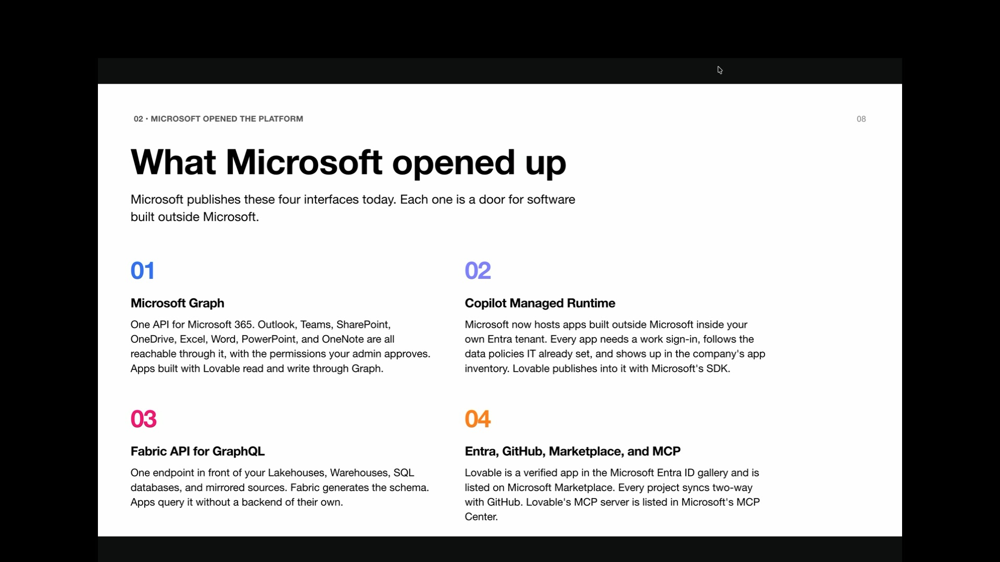
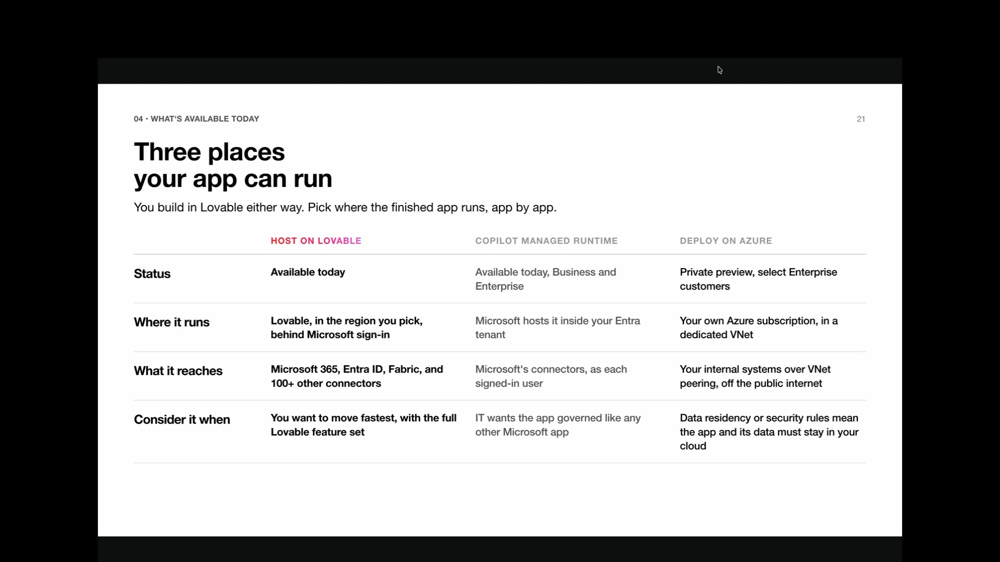
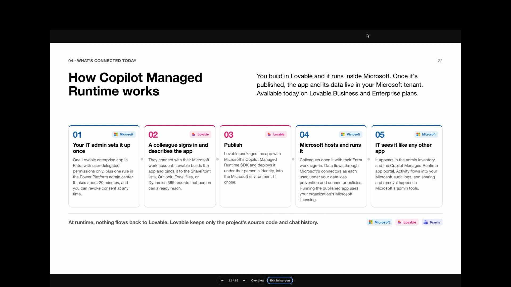
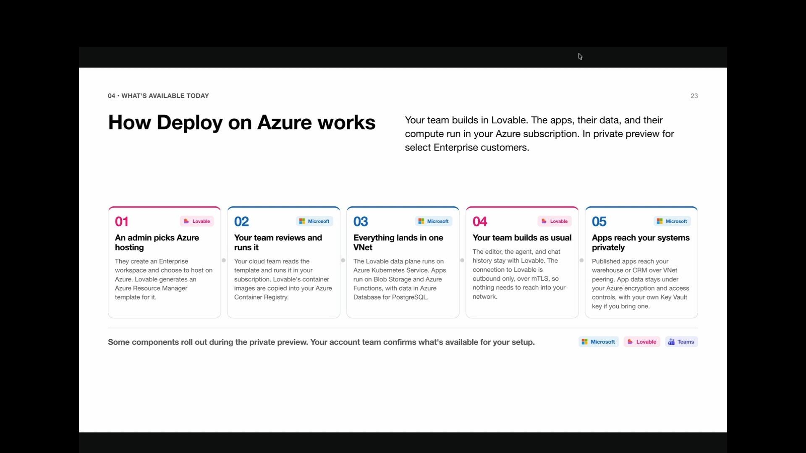

## #platform-doors 01 / Open Platform & Four Interfaces :: 速度与治理不再二选一：单一软件创作层与微软开放的四扇接口 || Speed Without Sacrificing Governance: One Creation Layer and Four Microsoft Doors

企业引入对话式软件生成工具时，安全团队最警惕两件事：脱离管控的外部账号目录与不受控的第三方数据副本 [1][2]。微软托管应用与智能体业务副总裁 David Blyth 在 2026 年 9 月发布 Copilot Managed Runtime 时明确指出：“企业不该被迫在交付速度与合规治理之间二选一。” [1][3] THRSP1155 给出了规模化落地的真实基线：超 **40,000 家企业**已在工作中使用 Lovable，累计创建逾 **7,000 万个项目** [1][2]。标杆客户中，Nursa 在单一工作台支撑 **83,000 名护理代理**协同作业，德国电信（Deutsche Telekom）各业务团队自建了 **3,000 余款内部应用**，Productiv 则将核心产品重构速度提升了 **12 倍**并每年节省超 **100,000 美元** [1][2]。 || Security teams evaluating conversational app builders routinely flag two dealbreakers: shadow user directories and uncontrolled copies of corporate records [1][2]. Launching Copilot Managed Runtime in September 2026, Microsoft VP David Blyth stated plainly: “Enterprises shouldn't have to choose between speed and governance.” [1][3] THRSP1155 grounds that principle in production scale: over **40,000 businesses** now use Lovable at work across **70M+ created projects** [1][2]. Among enterprise deployments, Nursa supports **83,000 agents** from one hub, Deutsche Telekom teams built **3,000+ internal apps**, and Productiv completed a **12x faster** core rebuild saving **$100K+ every year** [1][2].

之所以能让初创公司级别的构建速度通过大型企业的安全审查，关键在于架构定位——企业并没有引入另一套底层业务平台，而是将 Lovable 限定为顶部的**软件创作层（The Creation Layer）**，直接对接微软向外部生态开放的四扇标准接口 [1][2]： || Startups-grade velocity clears enterprise security review because organizations do not adopt a parallel backend platform; instead, Lovable acts strictly as the **software creation layer** plugged into four standard interfaces published by Microsoft [1][2]:

:::figure { src: "./media/lovable-microsoft-architecture.figure.json", title: "Lovable 软件创作层、微软四扇开放接口与三大部署路径全景架构 || Lovable Creation Layer, Four Microsoft Platform Interfaces & Three Hosting Paths" }
图 1：THRSP1155 核心集成拓扑——顶层由 Lovable 提供自然语言构建、工作区安全扫描与真实 React 代码双向同步；中层打通 Microsoft Graph、Fabric GraphQL、Entra 认证目录与官方 MCP 中心；底层支持按应用敏感度分发至 Lovable Cloud、Copilot Managed Runtime 或客户自有 Azure 订阅专属虚拟网络 [1][2][3]。 || Figure 1: End-to-end THRSP1155 topology—combining Lovable's prompt builder, pre-publish scanning, and two-way GitHub React sync on top; bridging Microsoft Graph, Fabric GraphQL, Entra Gallery, and Microsoft MCP Center in the middle; and deploying app-by-app across Lovable Cloud, Copilot Managed Runtime, or a dedicated Azure VNet underneath [1][2][3].
:::

下方交互导览台内嵌了 THRSP1155 官方 19 分钟点播视频流、官方逐字稿直链与五个核心段落的逐秒时间轴，点击上方章节标签即可定位查阅讲者现场拆解与幻灯片实录 [1][2]： || The interactive theater below embeds the official 19-minute Medius on-demand stream, verbatim transcript link, and five timestamped chapter digests from THRSP1155 [1][2]:

:::sandbox { id: "thrsp1155-video-theater", canvas: false, script: "./thrsp1155-session.js", style: "./thrsp1155-session.css", title: "THRSP1155 官方点播视频与五段核心议程时间轴导览 || THRSP1155 Official On-Demand Stream & Five-Chapter Timestamp Navigator", desc: "切换规模实证、四扇开放接口、供应商对账六步流、CMR 20 分钟配置与 Azure 专属网络五大章节，一键加载微软官方点播播放器。 || Switch across enterprise proof, the four Microsoft interfaces, the six-step supplier desk, 20-minute CMR setup, and Deploy on Azure, or launch the embedded Medius player." }
纯静态议题导览沙盒：内置 THRSP1155 官方高清封面、五段演讲时间戳摘要及官方点播流与逐字稿直链。 || Pure static session theater featuring the official THRSP1155 HD cover, five timestamped chapter digests, and direct video/transcript links.
:::

结合现场演示的第八页高清幻灯片（`02. MICROSOFT OPENED THE PLATFORM`），微软向第三方生成应用敞开的四扇大门各司其职 [1][2]：其一，**Microsoft Graph** 作为 Microsoft 365 统一接口，在管理员审批的委托权限范围内连通 Outlook、Teams、SharePoint、OneDrive、Excel、Word、PowerPoint 与 OneNote；其二，**Copilot Managed Runtime** 允许外部构建的单页应用直接托管在企业自有 Entra 租户内，强制要求工作账号登录并纳入公司统一应用资产清单；其三，**Fabric API for GraphQL** 架设在湖仓一体（Lakehouses）、数据仓库（Warehouses）、SQL 数据库及镜像数据源前方自动生成架构，前端应用无需自建后端即可直接查询并回写 Fabric SQL [2][4]；其四，Lovable 已入驻 **Microsoft Entra ID 认证应用库**、**Microsoft Marketplace** 与微软官方 **MCP 中心**，且每个项目均为生产级 React 源码，双向同步至企业自有的 GitHub 仓库供研发工程师随时用 VS Code 与 GitHub Copilot 接力演进 [1][2][5]。 || Captured on Slide 08 (`02. MICROSOFT OPENED THE PLATFORM`), each Microsoft interface unlocks a distinct enterprise boundary [1][2]: **Microsoft Graph** reaches Outlook, Teams, SharePoint, OneDrive, and Office files under admin-approved scopes; **Copilot Managed Runtime** hosts externally authored single-page apps directly inside your Entra tenant inventory; **Fabric API for GraphQL** auto-generates schemas in front of Lakehouses, Warehouses, SQL databases, and mirrored sources so apps query live data and write back to Fabric SQL without custom backends [2][4]; and verified listings across the **Entra ID Gallery**, **Microsoft Marketplace**, and **Microsoft MCP Center** pair with two-way sync of production React code into your own GitHub repository for VS Code and GitHub Copilot handoff [1][2][5].

  <article class="thrsp1155-media-card" data-present-surface="unframed">
    

      
    

    

      THRSP1155 录播实拍幻灯片 · Slide 08
      <h4 data-zh="微软向外部软件开放的四扇标准平台接口" data-en="Four Platform Interfaces Microsoft Opened to External Software">微软向外部软件开放的四扇标准平台接口</h4>
      
通过 Microsoft Graph 读写协同数据、借 Copilot Managed Runtime 托管租户应用、靠 Fabric GraphQL 免后端查数仓，并打通 Entra 目录、GitHub 双向同步与 MCP 中心 [1][2]。

    

  </article>

## #workflow-and-governance 02 / Six-Step Data Flow & Dual Governance :: 实战数据流转与双层治理：以六步供应商对账台为例厘清权责边界 || Data in Motion and Dual Governance: Tracing a Six-Step Supplier Statement Desk

一线财务与法务团队落地内部工具时，往往从最熟悉的邮件与电子表格起步（如法务合同续签看板或财务对账工具），再逐步演进至企业数仓之上 [1]。Malavika 在专场中以财务团队用自然语言构建的**供应商对账工作台（Supplier Statement Desk）**为例，完整追踪了账单全程不离开 Microsoft 365 边界的六步闭环 [1][2]： || Frontline finance and legal teams typically start from familiar inboxes and spreadsheets—such as contract renewal trackers or payable reconciliation desks—before scaling onto enterprise warehouses [1]. Malavika traced a six-step **Supplier Statement Desk** built with Lovable where financial statements never leave the Microsoft 365 boundary [1][2]:

:::flow { title: "供应商对账工作台（Supplier Statement Desk）账单零外流六步闭环 || Six-Step Supplier Statement Desk Flow Keeping Records Inside Microsoft 365" }
1. **账单抵达共享邮箱（Shared Inbox Arrival） || Shared Inbox Arrival** — 外部供应商按既有习惯将月度对账单发送至 Outlook 中的应付账款（Accounts Payable）共享邮箱，业务上游无需改变任何协作方式 [1][2]。 || Suppliers email monthly statements to the existing accounts payable mailbox in Outlook with zero change to external workflows [1][2].
2. **委托权限原位读取（Scoped Mailbox Read） || Scoped Mailbox Read** — 应用通过管理员预先批准的 Outlook 连接器权限代表团队读取邮件内容，全程不将原始附件导出或复制到外部独立存储库 [1][2]。 || The Outlook connector reads mailbox items strictly under admin-approved permissions without exporting or copying statements outside the tenant [1][2].
3. **跨表与数仓交叉核账（Ledger & Warehouse Match） || Ledger & Warehouse Match** — 应用通过 Excel 连接器逐行比对存放在 SharePoint 中的应付账款工作簿，并同步校验 Microsoft Fabric 数据仓库中的历史入账记录 [1][2][4]。 || Each statement line matches automatically against the payables Excel workbook in SharePoint and historical records in the Microsoft Fabric warehouse [1][2][4].
4. **差异发票聚合预警（Exception Queue Flagging） || Exception Queue Flagging** — 未付款项与金额不匹配的异常发票自动归集至同一待办队列，并根据企业财务制度内置分级审批额度阈值 [1][2]。 || Unpaid and mismatched invoices surface in a single exception queue pre-configured with corporate approval limits [1][2].
5. **Teams 频道内本人签批（In-Channel Teams Decision） || In-Channel Teams Decision** — 待审队列实时推送到财务团队日常沟通的 Microsoft Teams 频道，审批人直接从消息卡片唤起应用并以本人微软工作账号登录拍板，无需巡检第二个收件箱 [1][2]。 || Exception cards post straight to the finance Teams channel; approvers open the app from the thread and sign in with their own Microsoft work account [1][2].
6. **单一账本原位回写（In-Place Record Write-Back） || In-Place Record Write-Back** — 审批结果直接原位更新 SharePoint 列表、Excel 工作簿或 Fabric SQL 表；下游无论是用 Power BI 还是桌面 Excel 查阅，看到的始终是同一份实时数字 [1][2]。 || Approved updates write back in place to the SharePoint list, Excel workbook, or Fabric SQL table so Power BI and Excel readers always see one consistent record [1][2].
:::

支撑上述“单一登录、单一数据源（One Sign-In, One Record）”闭环运转的，是一套职责清晰的**双层治理模型（Two Layers of Governance）** [1][2]。微软守住企业身份与底层数据资产边界，Lovable 则管住软件如何被构建、扫描与移交工程团队 [2]： || Underneath this “One Sign-In, One Record” workflow sits a clear **two-layer governance split** [1][2]. Microsoft governs enterprise identity and underlying data policies, while Lovable governs how software is authored, scanned, and handed off to engineering [2]:

:::insight-grid { cols: 2, title: "微软底座与 Lovable 创作层的四维双层治理分工（Slide 18） || Four-Pillar Dual Governance Split Between Microsoft and Lovable (Slide 18)" }
::card Microsoft 01
### 身份与准入控制（Microsoft Governs Identity & Access） || Identity & Access (Governed by Microsoft)
由 Microsoft Entra ID 全权决定谁能登录，连接时强制执行企业既有的条件访问（Conditional Access）与多因素认证（MFA）策略；任何 Microsoft Graph 权限范围均须先经租户管理员审核批准后方可生效 [1][2][5]。 || Microsoft Entra ID controls sign-in, enforcing Conditional Access and MFA on every connection while requiring explicit admin consent for Microsoft Graph scopes [1][2][5].

::card Microsoft 02
### 数据驻留与合规策略（Microsoft Governs Data & Policies） || Data & Policies (Governed by Microsoft)
Microsoft 365 许可权益、租户防数据泄漏（DLP）策略及 Microsoft Fabric 表级权限完全由组织与微软平台设定；应用触达的每一行记录都原位留存在这些既有护栏之内 [1][2]。 || Microsoft 365 licensing, tenant DLP rules, and Fabric table permissions remain defined by your organization—keeping every record an app touches inside existing guardrails [1][2].

::card Lovable 03
### 创作工作区与发布前扫描（Lovable Governs The Build） || The Build Workspace (Governed by Lovable)
管理员使用组织凭据一次性打通微软连接，工作区全面启用 Entra 单点登录、SCIM 自动账号开通与离职回收及全量审计日志，并在每次应用发布前强制运行自动化安全漏洞扫描 [1][2][5]。 || Admins wire Microsoft once; workspaces enforce Entra SSO, SCIM lifecycle provisioning, audit logs, and mandatory automated security scanning prior to publish [1][2][5].

::card Lovable 04
### 应用权限继承与可移交源码（Lovable Governs The Software） || Runtime Scoping & Real Code (Governed by Lovable)
每位员工以本人身份（Sign in as yourself）登录应用，仅能看到自身 SharePoint 权限允许的数据；底层产出带完整版本历史的生产级 React 代码，专业研发团队随时可接管维护 [1][2]。 || Every colleague signs in as themselves—seeing only records their own permissions allow—while producing versioned React code engineers can take over anytime [1][2].
:::

## #three-hosting-paths 03 / Three Hosting Paths & Copilot Managed Runtime :: 逐应用选型矩阵：三大运行环境对比与 Copilot 托管运行时 20 分钟接入 || App-by-App Hosting Choice: Comparing Three Targets and 20-Minute CMR Onboarding

无论最终部署到哪里，业务人员的构建体验始终统一留在 Lovable 中；信息安全与平台团队则可以**按单个应用触达的数据敏感度（App by app）**在三种运行环境之间拍板 [1][2]。除 Deploy on Azure 处于面向部分企业客户的定向私有预览外，包括 Copilot Managed Runtime、Microsoft 365 连接器、Fabric GraphQL、Entra 单点登录与自动配权、GitHub 同步及模型上下文服务目录上架在内的全套能力均已正式可用 [1][2]： || Builders author in Lovable regardless of destination, while security and platform leaders choose where each finished app runs **app by app** based on data sensitivity [1][2]. Everything in the integration portfolio is available today—spanning Copilot Managed Runtime, Microsoft 365 connectors, Fabric GraphQL, Entra single sign-on, GitHub sync, and Model Context Protocol directory listings—except Deploy on Azure, which is in private preview for select Enterprise customers [1][2]:

:::figure { src: "./media/hosting-paths-decision-quadrant.figure.json", title: "企业内部应用三大运行路径与传统开发模式选型象限 || Enterprise Internal App Hosting Paths vs. Legacy Pipelines Decision Matrix" }
图 2：基于 THRSP1155 第 21 页选型准则绘制的决策矩阵——非敏感快速验证可直接托管于 Lovable Cloud；需要纳入微软租户资产清单与防泄漏监管的业务工具直投 Copilot Managed Runtime；触及人力资源（HR）核心库或严格数据驻留红线的工作负载则落地客户自有 Azure 虚拟网络 [1][2]。 || Figure 2: App-by-app decision matrix mapped from THRSP1155 Slide 21—routing fast non-sensitive prototypes to Lovable Cloud, tenant-governed M365 apps to Copilot Managed Runtime, and strict residency or HR/warehouse workloads into a dedicated Azure VNet [1][2].
:::

下表完整还原了第 21 页幻灯片（`Three places your app can run`）对三条路径的官方横向界定 [1][2]： || The table below captures the exact side-by-side boundaries from Slide 21 (`Three places your app can run`) across all three deployment targets [1][2]:

| 评估维度 || Dimension | 路径一：Host on Lovable || Path 1: Host on Lovable | 路径二：Copilot Managed Runtime || Path 2: Copilot Managed Runtime | 路径三：Deploy on Azure || Path 3: Deploy on Azure |
|------|------|------|------|
| 当前可用状态 || Availability | **现已开放（Available today）** || **Available today** | **现已开放（商业版与企业版）** [2][3] || **Available today (Business & Enterprise)** [2][3] | **定向私有预览（部分企业客户）** [1][2] || **Private preview (Select Enterprise)** [1][2] |
| 实际运行位置 || Where It Runs | Lovable 云端（自选区域），前置微软工作账号登录保护 [2] || Lovable Cloud in your chosen region behind Microsoft sign-in [2] | 由微软直接托管在企业自有 **Microsoft Entra 租户内部** [1][2] || Hosted by Microsoft directly inside your **Entra tenant** [1][2] | 企业自有 **Azure 订阅**内的专属虚拟网络（Dedicated VNet）[1][2] || Your own **Azure subscription** inside a dedicated VNet [1][2] |
| 可触达连接范围 || What It Reaches | Microsoft 365、Entra ID、Fabric 以及 100+ 公网第三方连接器 [1][2] || Microsoft 365, Entra ID, Fabric & 100+ external connectors [1][2] | 微软官方连接器体系，严格以每位登录员工本人身份访问 [2][3] || Microsoft connectors executing strictly as each signed-in user [2][3] | 通过虚拟网络对等互连（VNet Peering）私网直连内网系统，完全隔离公网 [1][2] || Internal systems over private VNet peering, off the public internet [1][2] |
| 最佳适用场景 || Consider It When | 追求最快迭代速度、需要全量特性且不触碰高敏内网库 [1][2] || Moving fastest with the full Lovable feature set on non-sensitive data [1][2] | IT 要求像管理原生 Power App 一样统一纳管应用清单与合规策略 [1][2][3] || IT wants the app governed and inventoried like any native Microsoft app [1][2][3] | 数据驻留法规或最高安全红线要求应用、数据库与计算全留自有云 [1][2] || Data residency or InfoSec rules require apps and data to stay in your cloud [1][2] |

为什么 Malavika 将 **Copilot Managed Runtime（CMR）** 称为 IT 管理员最省心的“黄金折中方案（Great middle ground）” [1]？第 22 页幻灯片披露了其底层五步工程机制：管理员只需在 Entra 中注册一个**仅含用户委托权限（User-delegated permissions only）**的 Lovable 企业应用，并在 Power Platform 管理中心添加一条规则，全程仅耗时**约 20 分钟**且随时可一键撤销授权 [1][2]。此后业务同事登录描述诉求并点击发布时，Lovable 调用微软官方 **Copilot Managed Runtime SDK** 将单页 JavaScript 应用直接打包投递至 IT 指定的微软环境中 [1][2][3]。应用上线后复用组织既有的 Microsoft 许可，所有数据读写均以当前登录用户身份流经微软连接器并受租户防泄漏（DLP）策略约束，操作行为实时汇入 Microsoft 审计日志——**在运行态，没有任何业务流量回传至 Lovable**（Lovable 仅保留项目源码与构建聊天记录）[2][3]。 || Why did Malavika highlight **Copilot Managed Runtime (CMR)** as an ideal middle ground for IT admins [1]? As detailed on Slide 22, one-time setup takes **about 20 minutes**—requiring one Lovable enterprise app in Entra with **user-delegated permissions only** plus one rule in the Power Platform admin center, with consent revocable anytime [1][2]. When a maker clicks publish, Lovable packages the single-page JavaScript app via Microsoft's **Copilot Managed Runtime SDK** straight into the designated tenant environment [1][2][3]. Published apps consume existing Microsoft licensing, enforce tenant DLP and connector policies per user, surface in the admin app inventory and audit logs, and guarantee that **at runtime, nothing flows back to Lovable** (which retains only source code and chat history) [2][3].

  <article class="thrsp1155-media-card" data-present-surface="unframed">
    

      
    

    

      THRSP1155 录播实拍幻灯片 · Slide 21
      <h4 data-zh="三大应用运行位置逐项对比矩阵" data-en="Three Places Your App Can Run—App-by-App Matrix">三大应用运行位置逐项对比矩阵</h4>
      
统一在 Lovable 构建，按单个应用的数据边界在 Lovable Cloud、Copilot 托管运行时与 Azure 专属订阅之间切换 [1][2]。

    

  </article>
  <article class="thrsp1155-media-card" data-present-surface="unframed">
    

      
    

    

      THRSP1155 录播实拍幻灯片 · Slide 22
      <h4 data-zh="Copilot Managed Runtime 五步租户托管机制" data-en="How Copilot Managed Runtime Works in Five Steps">Copilot Managed Runtime 五步租户托管机制</h4>
      
管理员约 20 分钟配妥仅委托权限应用，SDK 打包直投 Entra 租户并纳入统一资产清单，运行时零数据回流 Lovable [1][2][3]。

    

  </article>

## #azure-byoc-and-roadmap 04 / Deploy on Azure & Copilot Roadmap :: 客户自有云专属网络与演进路线：把全栈数据面装进 Azure VNet || Deploy on Azure BYOC Architecture and What's Coming Next

当内部应用需要读写核心人力资源（HR）档案、客户关系管理（CRM）主库或受严格属地监管的数据仓库时，企业往往要求预览沙盒、正式应用、数据库与计算节点全部运行在自己的私有企业内网之内 [1][2]。为此，Lovable 推出了客户自有云方案 **Deploy on Azure**（面向部分企业客户开放私有预览），在不改变公民开发者前端对话构建体验的前提下，将整套运行与数据平面下沉至企业自有的 Azure 订阅中 [1][2]： || When internal tools touch sensitive HR records, core CRM systems, or strictly regulated warehouses, security policies often mandate that preview sandboxes, production apps, databases, and compute run entirely inside the corporate network perimeter [1][2]. **Deploy on Azure**—Lovable's bring-your-own-cloud (BYOC) offering in private preview—keeps the citizen-developer authoring UI identical while shifting the entire data and execution plane into your own Azure subscription [1][2]:

1. **生成并审计 ARM 模板（Step 01–02） || Generate & Audit ARM Template (Steps 01–02)** — 管理员创建企业工作区并勾选 Azure 托管后，Lovable 自动生成标准 Azure 资源管理器（ARM）基础设施模板；企业云平台团队在审阅无误后于自有订阅内执行部署，并将所需的容器镜像直接拷贝至客户自有的 **Azure 容器注册表（ACR）** 中 [2]。 || An admin selects Azure hosting on an Enterprise workspace to generate an Azure Resource Manager (ARM) template; your cloud team audits and runs it in your subscription, copying Lovable's container images into your own **Azure Container Registry (ACR)** [2].
2. **专属 VNet 全栈组件落盘（Step 03） || Full-Stack Dedicated VNet Footprint (Step 03)** — 所有运行时基础设施收敛在单一专属虚拟网络（Dedicated VNet）内：Lovable 数据面运行在 **Azure Kubernetes Service（AKS）** 上；采用服务端渲染（SSR）的 **TanStack** 应用将静态资源存放于 **Azure Blob Storage**，动态计算交由 **Azure Functions** 承载，并配套开箱挂载 **Azure Database for PostgreSQL** 持久库 [1][2]。 || Everything lands inside one dedicated VNet: the Lovable data plane runs on **Azure Kubernetes Service (AKS)**, while server-side rendered **TanStack** apps serve static assets from **Azure Blob Storage**, dynamic compute via **Azure Functions**, and relational state on **Azure Database for PostgreSQL** [1][2].
3. **单向出站 mTLS 与私网对等互连（Step 04–05） || Outbound-Only mTLS & Private VNet Peering (Steps 04–05)** — 编辑器界面、构建智能体与聊天记录留在 Lovable 云端，但客户虚拟网络到 Lovable 的控制通道采用**仅出站双向认证传输层加密（Outbound-only mTLS）**，外部公网无需向企业内网打通任何入站端口；已发布应用通过 **VNet 对等互连（VNet Peering）**私网直达内网数仓与业务系统，且支持接入客户自有 **Azure Key Vault** 密钥（BYOK）实施静态加密 [1][2]。 || While the editor, agent, and chat history stay with Lovable, connectivity from your VNet is **outbound-only over mTLS** so nothing reaches inbound into your network; published apps query internal warehouses and CRMs over **VNet peering** under your Azure encryption and optional **Key Vault** customer-managed keys [1][2].

  <article class="thrsp1155-media-card" data-present-surface="unframed">
    

      
    

    

      THRSP1155 录播实拍幻灯片 · Slide 23
      <h4 data-zh="Deploy on Azure 客户自有云（BYOC）五步私网架构" data-en="How Deploy on Azure Works—Private VNet Data Plane">Deploy on Azure 客户自有云（BYOC）五步私网架构</h4>
      
通过 ARM 模板将镜像拷入客户 ACR，在专属 VNet 内拉起 AKS 数据面、Blob 静态存储、Azure Functions 与 PostgreSQL，仅靠单向出站 mTLS 通信并借 VNet Peering 直连核心内网 [1][2]。

    

  </article>

在演讲收尾的第 25 至 26 页幻灯片中，Malavika 披露了正在基于微软既有接口推进的三项下一阶段路线图，并给出了可在本周直接动手的四条落地对标 [1][2]：其一，**让 Copilot 直接调用已发布应用（Apps that Copilot can call）**——由于 Lovable 发布的应用原生支持暴露 MCP 服务端点，将其接入 Copilot Studio 智能体后即可在 Copilot 对话中直接唤起调用；其二，**在 Teams 聊天中直接构建（Build from Teams）**——在频道或私聊中用一句话描述需求即可拿回可交互的应用预览，再无缝切入编辑器深加工；其三，**将 Dataverse 安全角色延伸至 Web 应用（Dynamics 365 for web apps）**——在已跑通托管运行时内连接的基础上，让发布到 Web 端的应用同样继承细粒度 Dataverse 权限规则 [1][2]。对于企业架构师而言，这意味着无需等待漫长的平台改造：今天即可用 Entra ID 统一管控谁能构建与访问，用 Fabric GraphQL 消灭二次导表，并利用 20 分钟就绪的 Copilot Managed Runtime 将积压在安全评审队列里的部门级创意安全推向生产 [1][2][3]。 || Closing on Slides 25 and 26, Malavika previewed three capabilities under exploration atop existing Microsoft interfaces alongside immediate team takeaways [1][2]: **Apps that Copilot can call**—wiring MCP servers already exposed by published Lovable apps into Copilot Studio agents; **Build from Teams**—describing an app inside a Teams chat to receive a live working preview before iterating in Lovable; and **Dynamics 365 for web apps**—extending Dataverse security-role enforcement from Copilot Managed Runtime to web-published apps [1][2]. For enterprise architects, the practical path requires zero re-platforming: centralize builder access in Entra ID today, query one copy of data through Fabric GraphQL without exports, and clear your security-review backlog in 20 minutes with Copilot Managed Runtime [1][2][3].

## 参考资料：官方一手信源与技术文档 || References: Official Primary Sources & Technical Documentation

1. **Malavika Balachandran Tadeusz (Microsoft Ignite 2026 THRSP1155 Video & Transcript)** — https://ignite.microsoft.com/en-US/sessions/1787858601555001SSaX-1791588343927001Cafn | 《Build with Lovable, ship in your Microsoft environment》官方剧场专场录播实录与双语时间轴 WebVTT 字幕（2026-11-20） || Official theater session recording and bilingual WebVTT transcripts (Nov 20, 2026)
2. **THRSP1155 Medius On-Demand Stream & Broadcast Slides (Slides 07–26)** — https://medius.microsoft.com/Embed/video-nc/229a486b-d759-43a2-9f20-839dd231e7ce | 官方高清内嵌点播流与现场投屏幻灯片关键帧（涵盖四扇平台接口、六步供应商对账台、双层治理、三大运行路径及 Deploy on Azure 架构） || Official Medius player stream and captured broadcast slides (`https://medius.microsoft.com/video/asset/Caption/229a486b-d759-43a2-9f20-839dd231e7ce`)
3. **Microsoft Copilot Managed Runtime Overview (Power Platform & Microsoft 365)** — https://learn.microsoft.com/en-us/power-platform/admin/ | 微软托管运行时治理架构：在企业 Entra 租户内安全托管与审计第一方及第三方单页业务应用 || Hosting and governing external and native web apps inside your Microsoft Entra tenant
4. **Microsoft Fabric API for GraphQL Documentation** — https://learn.microsoft.com/en-us/fabric/data-engineering/api-graphql-overview | 基于单一 GraphQL 端点自动生成架构，直接查询 Fabric 湖仓、数据仓库与 SQL 数据库而免除数据导出复制 || Querying Lakehouses, Warehouses, and SQL databases through a unified auto-schema GraphQL endpoint
5. **Microsoft Entra Application Gallery & Automated Provisioning** — https://learn.microsoft.com/en-us/entra/identity/enterprise-apps/ | 企业应用单点登录、条件访问、委托 Graph 权限审批与跨域身份自动生命周期管理规范 || Enterprise single sign-on, Conditional Access, admin-consented Graph scopes, and automated user lifecycle provisioning
