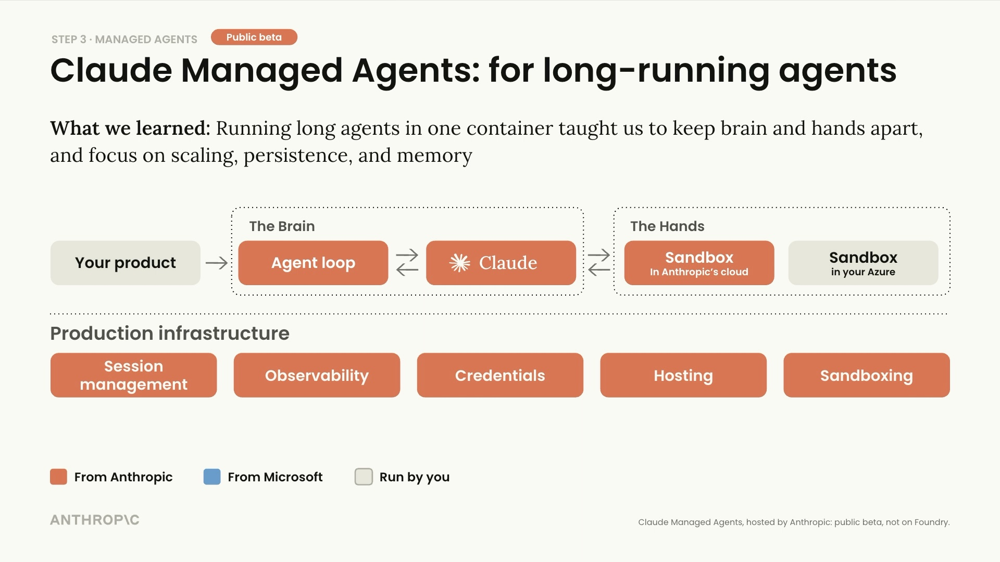
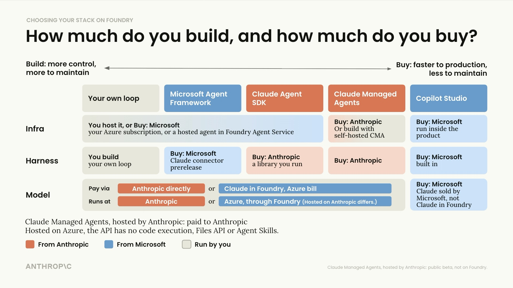
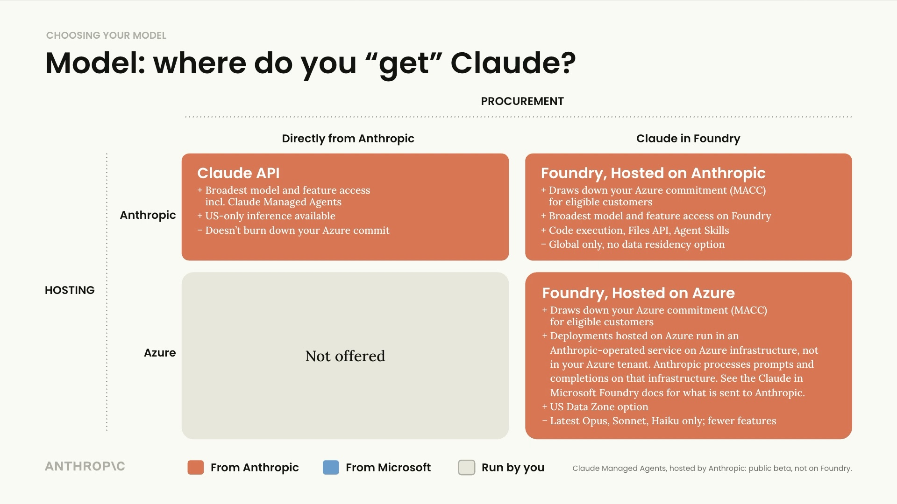
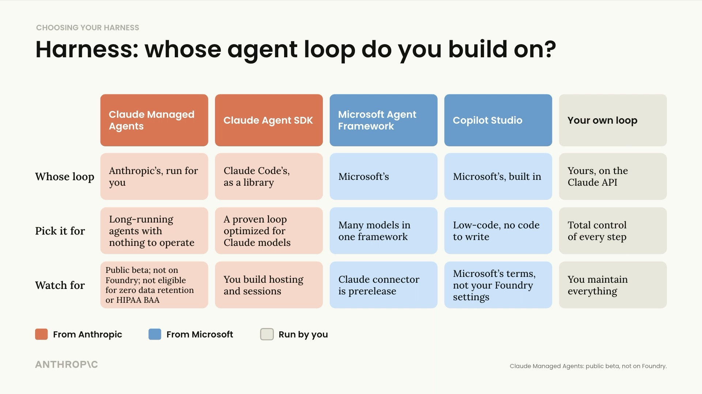

## #capability-leap-three-layers 01 / Act 01: Capability Leap & 3-Layer Stack :: 能力跃迁与三层心智框架：从 49% 到 95% 的指数曲线 || Capability Leap and the Three-Layer Mental Model: Riding the 49% to 95% Curve

智能体的底层定义自 2024 年进入主流以来并未改变：一个大模型在循环中发起工具调用、读取执行结果并决定下一步动作，直到目标完成 [1]。真正发生剧变的是围绕这个循环运转的模型智商与外部作业环境。Maya Nielan 引用真实软件工程基准 **SWE-bench Verified** 指出，2024 年 10 月发布的 `Claude 3.5 Sonnet (new)` 解决率为 **49.0%**；经由 2025 年 5 月 `Opus 4`（**72.5%**）、2025 年 11 月 `Opus 4.5`（**80.9%**）与 2026 年 4 月 `Opus 4.7`（**87.6%**）连续迭代，2026 年 6 月问世的 `Fable 5` 已达到 **95.0%**，在不到两年内逼近基准饱和 [1]： || The core definition of an agent has stayed constant since hitting the mainstream in 2024: a model calling tools in a loop, interpreting results, and deciding its next action until the task is complete [1]. What changed dramatically is everything around that loop—starting with raw model intelligence and execution environments. Citing **SWE-bench Verified** real-world coding tasks, Maya Nielan showed `Claude 3.5 Sonnet (new)` scoring **49.0%** in October 2024, rising through `Opus 4` (**72.5%**, May 2025), `Opus 4.5` (**80.9%**, Nov 2025), and `Opus 4.7` (**87.6%**, Apr 2026) before `Fable 5` reached **95.0%** in June 2026 [1]:

$$
S_{\text{SWE}}(\text{Sonnet 3.5}) = 49.0\% \;\xrightarrow{\;20\text{ months}\;}\; S_{\text{SWE}}(\text{Fable 5}) = 95.0\%, \qquad \Delta S = +46.0\text{ pts}
$$

:::figure { src: "./media/thrsp1157-swebench-capability-leap.figure.json", title: "THRSP1157 官方披露：Claude 模型家族 SWE-bench Verified 真实编码解决率跃迁 || THRSP1157 Benchmark: Claude Family Progression on SWE-bench Verified" }
图 1：还原自 THRSP1157 演讲课件（02:50）——不到两年内 SWE-bench Verified 解决率净增 46 个百分点，同步伴随工具链从桌面操控（2024.10）扩展到代码执行沙盒（2025.05）、Agent Skills（2025.10）、上下文压缩 Compaction（2026.02）、记忆整理 Dreams（2026.05）与动态工作流（2026.10）[1]。 || Figure 1: Reconstructed from THRSP1157 slide data (02:50)—a +46.0-point gain on SWE-bench Verified paired with environment milestones from Computer Use (Oct 2024) to Code Execution (May 2025), Agent Skills (Oct 2025), Compaction (Feb 2026), Dreams (May 2026), and Dynamic Workflows (Oct 2026) [1].
:::

模型变聪明带来了更周密的规划与更强的自主纠错力，但若仅给模型留一个纯文本聊天框，再高的智商也无处施展 [1]。Anthropic 在内部递归自改进（Recursive Self-Improvement）报告中记录了研发形态的四阶演进：2021–2023 年工程师纯靠笔记本手写代码；2023–2025 年借助聊天机器人复制粘贴代码片段；2025–2026 年交由编码智能体独立编写完整文件；而今天，**自主智能体已能自行运行代码并将数小时的工程任务委派给其他 Claude 工作集群协同交付** [1]。为了让企业系统承接这类长程自主负载，Maya 提出了每天与客户对齐选型时的**三层技术栈心智模型** [1]： || Smarter models draft stronger plans and catch more of their own mistakes, yet an agent trapped in a plain chat window remains blind to enterprise systems [1]. Drawing from Anthropic's recursive self-improvement report, Maya traced internal engineering across four eras: writing code manually on laptops (2021–2023), pasting snippets from chatbots (2023–2025), delegating whole files to coding agents (2025–2026), and today's **autonomous agents running code themselves while managing fleets of other Claudes over multi-hour horizons** [1]. Supporting long-horizon work in production requires evaluating three distinct architectural layers [1]:

:::insight-grid { cols: 3, title: "生产级智能体的三层架构决策框架 || The Three-Layer Decision Framework for Production Agents" }
::card 01
### 模型层（Model · 决定智商与账单） || Model Layer (Intelligence & Billing)
在 Haiku、Sonnet、Opus 与 Fable 家族中平衡智商、延迟与单价，并明确向谁采购账单（抵扣 Azure 承诺额或直付）以及算力物理托管位置 [1][2]。 || Balance intelligence, price, and latency across Haiku, Sonnet, Opus, and Fable while separating where you procure billing from where weights are hosted [1][2].

::card 02
### 执行框架层（Harness · 决定装备能力） || Harness Layer (Capability & Loop)
犹如给新入职员工直接配发现成笔记本电脑——循环控制、权限审批、错误自愈与上下文压缩可现成复用，研发只需聚焦企业专属连接与规范 [1][5]。 || Like handing a new teammate an off-the-shelf laptop—buy the loop, permissions, error recovery, and context management ready-made so engineers focus on domain differentiation [1][5].

::card 03
### 基础设施层（Infra · 决定并发规模） || Infrastructure Layer (Scalability)
合上个人笔记本后，智能体需在云端支撑多会话并行运行、每会话独立沙盒隔离、凭据安全管控、身份认证与可观测性追踪 [1][3]。 || Once you close your laptop, cloud infrastructure runs parallel sessions, hardens isolated sandboxes, enforces identity boundaries, and captures execution traces [1][3].
:::

下方交互导览台内嵌了 THRSP1157 官方 23 分 07 秒无追踪点播流、原版演讲文稿下载与三幕关键时间戳导引 [1]： || The interactive theater below embeds the official 23m07s Medius on-demand recording alongside downloadable transcripts and three-act timestamped cues [1]:

:::sandbox { id: "thrsp1157-video-theater", canvas: false, script: "./thrsp1157-theater.js", style: "./thrsp1157-theater.css", title: "Ignite 2026 [THRSP1157] 官方点播视频播放器与三幕时间轴导览 || Ignite 2026 [THRSP1157] Official On-Demand Stream & Three-Act Timestamp Guide", desc: "点击封面可在页内直接挂载微软 Medius 官方点播流，或切换三幕标签检索 WebVTT 逐字稿关键节点与官方讲稿。 || Click the poster to mount Microsoft's official Medius video player inline, or switch across the three acts for WebVTT timestamps and transcript links." }
纯静态 THRSP1157 专场视频与时间轴导览台：内置官方高清封面、页内点播播放器挂载入口及三幕关键实录索引。 || Pure static THRSP1157 video theater featuring the official session poster, inline Medius embed loader, and timestamped WebVTT chapter cues.
:::

## #brain-hands-portable-assets 02 / Act 02: Brain vs. Hands & Portable Assets :: 架构演进：从单容器 SDK 到“大脑与双手解耦”及跨栈可移植资产 || Architectural Evolution: Splitting Brain from Hands and Keeping Assets Portable

围绕“Anthropic 替你承担多少底层组件”，其开发者服务沿着技术栈自下而上演进出三级阶梯：**Messages API** 提供最底层的裸金属级原语，开发者全权自建控制循环、权限、会话管理与沙盒；**Claude Agent SDK** 将驱动 Claude Code 的同款执行框架打包为 Python 与 TypeScript 库交付，开箱自带代码仓库检索、测试运行、子智能体（Sub-agents）、上下文管理与人机协同或无头（Headless）权限控制，并由 Anthropic 随新模型迭代持续维护调优；而面向长时运行负载（如内部孵化的长程个人助理 `Claude Tag` 与 `Claude Duet`），单容器架构暴露出了致命短板 [1][5]。 || Anthropic's three developer surfaces step progressively up the stack: the **Messages API** exposes bare-metal model primitives while leaving loops and hosting to you; the **Claude Agent SDK** packages the exact harness powering Claude Code as a Python and TypeScript library—complete with repo search, test runners, sub-agents, context management, and configurable human-in-the-loop or headless permissions maintained alongside new models; yet building multi-hour assistants like `Claude Tag` and `Claude Duet` exposed a structural flaw in single-container designs [1][5].

早期版本与 Agent SDK 类似，把编排循环、会话状态与代码沙盒塞进同一个容器；一旦容器在任务运行数小时后意外崩溃，整场长程作业便前功尽弃 [1][4]。为此，**Claude Managed Agents（CMA）** 确立了可推广至任意技术栈的核心架构模式——**将“大脑（The Brain）”与“双手（The Hands）”彻底分离** [1][4]： || Early designs colocated the agent loop, session state, and code sandbox inside one container; if that container crashed hours into a run, progress stalled [1][4]. **Claude Managed Agents (CMA)** solved this by introducing an architectural pattern applicable across any stack—**separating the Brain from the Hands** [1][4]:

:::comparison { title: "单容器紧耦合底座 vs. Claude Managed Agents 大脑—双手解耦架构 || Colocated Single-Container Loop vs. Brain-and-Hands Decoupled Architecture" }
::versus 单容器紧耦合模式（适配短平快交互） || Brain-in-the-Box Single Container (Short Runs)
### 循环与沙盒同生共死，适配受信任工具与快速问答 || Colocated Loop and Sandbox for Short Request-Answer Cycles
当智能体仅执行短周期请求—响应、调用受信任的轻量接口或处于早期原型验证时，使用 Claude Agent SDK 将大脑留在单容器内更为轻便直接 [1]。 || For short request-and-answer agents using trusted tools or local prototypes, keeping the brain inside the box via the Claude Agent SDK minimizes moving parts [1].

::versus 大脑与双手解耦模式（适配数小时长程自治） || Decoupled Brain & Hands Pattern (Long-Horizon Scale) { highlight: true }
### 编排循环独立恢复 + 凭据金库外置 + 自托管内网沙盒 || Independent Crash Recovery, External Vaults & Network-Local Sandboxes
大脑负责连接 Claude 与会话日志编排；双手仅作为代码执行与文件修改沙盒 [1][4]。沙盒死机可随时拉起新实例从日志续跑，无需沙盒的普通请求响应更快，敏感密钥隔离在沙盒外的**金库（Vaults）**中，且支持将自托管沙盒部署在企业自己的 Azure 订阅网络内，并直接解锁记忆整理（Dreaming）与结果分级（Graded Outcomes）等前沿特性 [1][4]。针对严苛数据监管客户，Anthropic 还推出了私测版**全自托管 CMA**，允许企业在自有环境中同时运行大脑、双手与 Postgres 会话库，并将模型请求指向 Microsoft Foundry [1]。 || The Brain orchestrates Claude and session logs while the Hands execute model-written code in replaceable sandboxes [1][4]. Dead sandboxes respawn cleanly from session logs, non-code turns respond faster, raw secrets stay outside the sandbox in **Vaults**, self-hosted sandboxes run inside your own Azure VNet, and built-in frontier features like dreaming and graded outcomes come standard [1][4]. For strict data-residency mandates, private-beta **self-hosted CMA** lets teams run both Brain and Hands (plus Postgres) inside their own network while routing model calls to Microsoft Foundry [1].
:::

  <article class="thrsp1157-media-card">
    

      
    

    

      THRSP1157 演讲课件实拍 · 11:10
      <h4 data-zh="Claude Managed Agents：将编排大脑与执行双手解耦" data-en="Claude Managed Agents: Keeping Brain and Hands Apart">Claude Managed Agents：将编排大脑与执行双手解耦</h4>
      
大脑运行智能体循环与会话状态，双手既可跑在 Anthropic 云端沙盒，也可部署在客户自有的 Azure 订阅中就近访问内网数据 [1][4]。

    

  </article>
  <article class="thrsp1157-media-card">
    

      
    

    

      THRSP1157 演讲课件实拍 · 14:45
      <h4 data-zh="Foundry 智能体选型全景图：自建控制权 vs. 现成投产速度" data-en="Choosing Your Stack on Foundry: Build Control vs. Buy Speed">Foundry 智能体选型全景图：自建控制权 vs. 现成投产速度</h4>
      
橙色模块由 Anthropic 提供，蓝色模块来自微软，浅灰模块由团队自运维——清晰标定五条路径在三层上的归属边界 [1]。

    

  </article>

Maya 特别强调：模型每隔数月就会换代，执行框架也会持续演进，**真正值得企业长期重仓投入、且能在所有技术栈之间百分百无损迁移的资产只有三样**：通过 **MCP（Model Context Protocol）** 连接客户关系管理、工单、数据库与内部接口的工具层，沉淀品牌规范、报告步骤与审查清单的 **Agent Skills**，以及定义产品独特行为的**领域提示词（Prompts）** [1]。无论底层运行在 Agent SDK、Managed Agents、Microsoft Agent Framework、Foundry Agent Service 还是 Copilot Studio 上，这三层核心资产始终归属企业自身 [1]： || Because frontier models and harnesses evolve rapidly, Maya stressed that **engineering investment belongs in the three portable assets that transfer across every stack**: **MCP connectors** reaching CRM, ticketing, databases, and internal APIs; **Agent Skills** encoding brand rules, report workflows, and review checklists; and **domain prompts** [1]. Whether you deploy on Agent SDK, Managed Agents, Microsoft Agent Framework, Foundry Agent Service, or Copilot Studio, those portable investments stay yours [1]:

:::figure { src: "./media/thrsp1157-foundry-claude-stack-topology.figure.json", title: "Claude × Microsoft Foundry 三层智能体技术栈与跨栈可移植资产拓扑 || Claude × Microsoft Foundry Three-Layer Stack & Portable Asset Topology" }
图 2：综合 THRSP1157 第 14:00–18:55 课件绘制的全栈决策拓扑——顶层 MCP、Agent Skills 与凭据金库跨栈通用；中层按自建至全托管光谱选择编排框架；底层衔接 Foundry 托管智能体容器与三类 Claude 采购托管通道 [1][2][3]。 || Figure 2: End-to-end stack topology synthesized from THRSP1157 (14:00–18:55)—portable MCP connectors, Agent Skills, and Vaults plug into Anthropic or Microsoft harnesses above Foundry Hosted Agents and three Claude procurement modes [1][2][3].
:::

## #foundry-procurement-harnesses 03 / Act 03A: Model Procurement, Harnesses & Hosted Agents :: 逐层拆解 Foundry 选型：采购托管边界、五大框架与托管运行时 || Layer-by-Layer on Foundry: Model Hosting Nuances, Five Harnesses, and Hosted Agents

进入实操选型阶段，第一个容易混淆的关键细节是**“从哪里采购 Claude（Procurement）”与“模型实际托管在哪里（Hosting）”并非同一回事** [1][2]。通过 **Claude in Foundry** 接入，企业可统一使用 Microsoft Entra ID 登录认证，费用直接计入 Azure 账单，且符合条件的客户可直接**抵扣 Azure 消费承诺额（MACC）** [1][2]。在此基础上，三种采购与托管组合在功能集与数据驻留上存在明确分工 [1][2]： || When choosing your Model layer, Maya highlighted a critical distinction between **where you procure Claude** and **where inference is physically hosted** [1][2]. Procuring **Claude in Foundry** enables Microsoft Entra ID authentication, consolidates billing onto your Azure invoice, and **draws down your Microsoft Azure Consumption Commitment (MACC)** for eligible customers [1][2]. Across Foundry and first-party channels, three combinations trade off feature breadth against data residency [1][2]:

| 采购与托管模式 || Procurement & Hosting Mode | 计费与合规边界 || Billing & Data Boundary | 可用模型与 API 特性范围 || Model & API Feature Scope | 官方推荐适用场景 || Recommended Workload Fit |
|------|------|------|------|
| Foundry · Azure 托管 || Claude in Foundry (Hosted on Azure) | 计入 Azure 账单并抵扣 MACC；运行在 Azure 基础设施上由 Anthropic 运维的服务中，提供 **US Data Zone（美国数据区）** 选项 [1][2] || Azure bill + MACC drawdown; runs on Anthropic-operated service on Azure infra with **US Data Zone** option [1][2] | 仅限最新一代 Opus、Sonnet 与 Haiku；**不含**代码执行、Files API 或 Agent Skills [1][2] || Latest Opus, Sonnet & Haiku only; **no** Code Execution, Files API, or Agent Skills [1][2] | **绝大多数 Foundry 常规企业负载的首选起点**，兼顾 MACC 抵扣与美国境内数据驻留要求 [1] || **Recommended default starting point** for most Foundry workloads needing MACC drawdown and US residency [1] |
| Foundry · Anthropic 托管 || Claude in Foundry (Hosted on Anthropic) | 计入 Azure 账单并抵扣 MACC；全球端点部署（Global only），不提供特定区域数据驻留选项 [1][2] || Azure bill + MACC drawdown; global routing only without regional data residency [1][2] | Foundry 内最广的功能覆盖：支持 **Code Execution、Files API 与 Agent Skills** [1][2] || Broadest Foundry feature set: unlocks **Code Execution, Files API, and Agent Skills** [1][2] | 既需走 Azure 统一账单核销 MACC，又依赖原生文件处理、代码执行或技能接口的智能体 [1] || Teams needing Azure billing and MACC drawdown alongside native Files API, Code Execution, or Skills [1] |
| Anthropic 一方直采 || Directly from Anthropic (1P Claude API) | 直接向 Anthropic 付费结算，**不抵扣** Azure MACC 承诺额；支持美国境内推理（US-only inference）[1] || Billed directly by Anthropic (**does not** draw down Azure MACC); US-only inference available [1] | 开放最完整模型目录与前沿产品，独家支持 **Claude Managed Agents（公测）** [1][4] || Broadest model and feature catalog, including hosted **Claude Managed Agents (public beta)** [1][4] | 需要直接使用 Anthropic 托管版 CMA 加速上线、且无强制 Foundry 账单绑定要求的团队 [1] || Teams reaching for hosted Claude Managed Agents to ship fast without MACC billing constraints [1] |

向上走到**执行框架层（Harness）**与**基础设施层（Infra）**，微软生态与 Anthropic 共同构成了从左到右横跨“深度自控”到“开箱即用”的五档光谱 [1]。若应用需要在多个模型厂商之间灵活切换，开源的 **Microsoft Agent Framework**（提供 `.NET` 与 `Python` 双语言支持，搭配预览版 Claude 连接器）是微软栈原生的多模型编排利器；若业务部门重度驻留在 Microsoft 365 且追求零代码交付，管理员只需在后台开启 Claude 开关，创作者即可在 **Copilot Studio** 中用自然语言描述需求，自动生成指令、推荐连接器与触发器（注：Copilot Studio 内的 Claude 由微软直接售卖并适用微软服务条款，不复用用户的 Foundry 配置）[1]。而当团队选用 **Claude Agent SDK** 或 **Microsoft Agent Framework** 这类代码库框架时，官方推荐的生产宿主底座正是 **Foundry 托管智能体（Foundry Hosted Agents）**——开发者把智能体循环打包进容器交由 Foundry Agent Service 托管运行，平台即刻赋予四大生产级基石：**标准调用端点（Endpoint）**、**每会话独立隔离且跨小时保留文件的沙盒（Per-session Sandbox）**、用于精细化权限管控的**专属 Microsoft Entra ID 身份**，以及基于 **Application Insights** 的全步骤执行轨迹可观测性 [1][3]。 || Moving up to the **Harness** and **Infra** layers, Microsoft and Anthropic span five options from full control to turnkey SaaS [1]. Teams building multi-model workflows reach for the open-source **Microsoft Agent Framework** (available in `.NET` and `Python` with a prerelease Claude connector), whereas non-developers working close to Microsoft 365 use **Copilot Studio**, where admins enable Claude and makers describe their agent in plain language to auto-draft instructions, connectors, and triggers (governed under Microsoft's product terms and billing rather than Foundry settings) [1]. Whenever engineers build with library harnesses like **Claude Agent SDK** or **Microsoft Agent Framework**, Maya recommends **Foundry Hosted Agents** inside Foundry Agent Service as the managed container runtime—instantly provisioning a callable **endpoint**, an isolated **per-session sandbox** whose files persist when users return hours later, a dedicated **Microsoft Entra ID** agent identity, and **Application Insights** trace observability [1][3].

  <article class="thrsp1157-media-card">
    

      
    

    

      THRSP1157 演讲课件实拍 · 15:45
      <h4 data-zh="模型层二维决策：向谁采购账单 vs. 权重托管在何处" data-en="Choosing Your Model: Procurement Channel vs. Physical Hosting">模型层二维决策：向谁采购账单 vs. 权重托管在何处</h4>
      
详解直采 API、Foundry Anthropic 托管与 Foundry Azure 托管在 MACC 抵扣、US Data Zone 及 Files/Skills 特性上的精确边界 [1][2]。

    

  </article>
  <article class="thrsp1157-media-card">
    

      
    

    

      THRSP1157 演讲课件实拍 · 16:45
      <h4 data-zh="五大智能体执行框架横向对比：你究竟在谁的循环上构建？" data-en="Choosing Your Harness: Whose Agent Loop Do You Build On?">五大智能体执行框架横向对比：你究竟在谁的循环上构建？</h4>
      
梳理零运维长程托管服务（公测期暂不支持零数据保留与医疗商业伙伴协议 HIPAA）与 Claude 专属开发库、多模型框架及零代码平台的权衡清单 [1]。

    

  </article>

## #six-personas-decision-matrix 04 / Act 03B: Six Enterprise Personas & Playbook :: 六大真实业务画像对号入座：从数小时理赔、CI 自愈到默认黄金起点 || Six Enterprise Personas Mapped: From Multi-Hour Claims and CI Self-Healing to Your Default Starting Stack

在演讲收官部分，Maya Nielan 将前三层的技术组件映射为 **6 类高频企业工程画像（Personas 1–6）**，并给出了每套组合的架构拟合理由与显式工程代价——她特别指出，如果研发团队听完仍拿不准从哪里起步，**“画像 3：Claude Agent SDK + Claude in Foundry + Foundry Hosted Agents”是最稳健、最具性价比的默认起点** [1]： || Closing THRSP1157, Maya Nielan mapped the three architectural layers onto **six concrete team personas (Personas 1–6)**, pairing each recommended stack with its explicit engineering trade-off—and noting that if an engineering team is still undecided, **Persona 3 (Claude Agent SDK + Claude in Foundry + Foundry Hosted Agents) is the most balanced default starting point** [1]:

:::flow { title: "THRSP1157 六大企业团队画像与推荐技术栈速查手册 || THRSP1157 Six-Persona Stack Selection Playbook" }
1. **画像 1 · 追求最快验证 PMF 的产品小团队（如跨周记忆教育应用） || Persona 1 · Small Product Team Racing to PMF (Returning EdTech Users)** — **选型：`Claude Managed Agents (Anthropic 云托管)`**。学生每周回访时依赖内置跨会话记忆越用越聪明，Anthropic 全包循环、沙盒与会话历史；*权衡：处于公开测试阶段（暂不支持零数据保留或 HIPAA BAA），需向 Anthropic 直接采购且代码运行在 Anthropic 云端* [1][4]。 || **Stack: `Claude Managed Agents (Anthropic Cloud)`**. Built-in memory makes the tutor smarter week over week with near-zero infra to maintain; *Trade-off: Public beta (no zero data retention or HIPAA BAA yet), bought directly from Anthropic rather than Foundry* [1][4].
2. **画像 2 · 严苛数据合规的数小时长程任务（如保险公司复杂理赔） || Persona 2 · Regulated Long-Horizon Workflows (Multi-Hour Insurance Claims)** — **选型：`Self-hosted Claude Managed Agents (自有 Azure 环境) + Claude in Foundry`**。大脑与双手全部运行在保险公司自有网络内，会话历史与凭据不出内网，同时将模型推理请求发往 Microsoft Foundry；*权衡：处于私测阶段，团队需自行运维服务器、Postgres 数据库与版本升级* [1]。 || **Stack: `Self-hosted CMA (Your Azure) + Claude in Foundry`**. Both Brain and Hands stay inside your corporate network for multi-hour claims while model calls route to Foundry; *Trade-off: Private beta requiring you to operate servers, Postgres, and upgrades* [1].
3. **画像 3 · 融入研发流水线的编码自愈智能体（推荐默认起点 ⭐） || Persona 3 · SDLC / CI Build-Fix Coding Agent (Recommended Default Start ⭐)** — **选型：`Claude Agent SDK + Claude in Foundry + Foundry Hosted Agents`**。当持续集成构建失败时自动读取日志、排查代码并提交修复，直接复用专为 Claude 调优的 Claude Code 同源框架并紧邻其他 Azure 服务运行；*权衡：框架仅绑定 Claude 模型，需结合 Foundry 组件自行串联持久化会话、凭据与监控* [1][3][5]。 || **Stack: `Claude Agent SDK + Claude in Foundry + Foundry Hosted Agents`**. Reads failed CI logs and patches broken builds using Claude Code's native harness right alongside Azure services; *Trade-off: Claude-only harness, and you wire up saved sessions, credentials, and monitoring on Foundry* [1][3][5].
4. **画像 4 · 需要前端模型切换器的异构多模型应用 || Persona 4 · Multi-Model Application with Model Picker** — **选型：`Microsoft Agent Framework (.NET / Python) + Foundry Hosted Agents`**。用一套微软原生开源框架统一编排包括非 Anthropic 模型在内的多家模型；*权衡：若核心业务重度依赖 Claude 驱动，通用框架未经 Claude 专属调优，极限执行表现不及原生 Agent SDK* [1][6]。 || **Stack: `Microsoft Agent Framework (.NET / Python) + Foundry Hosted Agents`**. Unifies Anthropic and non-Anthropic models under one framework; *Trade-off: Because the harness is model-agnostic rather than tuned specifically for Claude, peak Claude performance may trail Agent SDK* [1][6].
5. **画像 5 · 贴近 Microsoft 365 的业务部门零代码助手（如 HR 团队） || Persona 5 · M365-Adjacent Business Team Without Code (HR Helper)** — **选型：`Microsoft Copilot Studio（内置 Claude 选项）`**。管理员一键启用后，HR 创作者用自然语言描述即可快速生成并全员共享智能体；*权衡：对底层循环控制力最弱，且受微软产品条款、计费与数据规则管辖，不继承用户的 Foundry 侧配置* [1]。 || **Stack: `Microsoft Copilot Studio (with Claude enabled)`**. Makers describe an internal M365 helper in plain language with loop and hosting built in; *Trade-off: Least loop control, governed by Microsoft's product terms and billing rather than your Foundry settings* [1].
6. **画像 6 · 拥有充足研发人力且追求极致定制的底层平台团队 || Persona 6 · Platform Engineering Team Demanding Maximum Control** — **选型：`Claude Messages API + 自研控制循环 + Azure / Foundry 自建宿主`**。从零掌控工具调度、记忆结构与重试策略的每一个字节，严丝合缝嵌入公司既有规则系统；*权衡：构建与长期运维成本最高，每逢底层模型能力跃迁都必须自行升级适配循环* [1][2]。 || **Stack: `Claude Messages API + Custom Loop + Your Azure / Microsoft Infra`**. Gives platform engineers total control over tools, memory, and retries; *Trade-off: Highest maintenance burden—you own evolving the harness every time frontier models leap forward* [1][2].
:::

无论团队最终落位在六大画像中的哪一格，架构演进都不再是一锤子买卖：先通过 **MCP** 标准化封装企业内部数据源，用 **Agent Skills** 固化团队作业标准，再从 `Claude Agent SDK + Foundry Hosted Agents` 或 `Copilot Studio` 快速切入生产验证——即便半年后业务因长时合规需求迁移至自托管 CMA，核心工具链与领域技能也能平滑随行 [1]。 || Whichever persona matches your current constraints, stack selection is no longer a one-way door: standardize internal system access behind **MCP**, capture team workflows in **Agent Skills**, and launch quickly on `Claude Agent SDK + Foundry Hosted Agents` or `Copilot Studio`—knowing those domain investments carry cleanly across harnesses as workloads scale [1].

## 参考资料：官方一手信源与工程文档 || References: Official Primary Sources & Engineering Guides

1. **Maya Nielan (Microsoft Ignite 2026 THRSP1157)** — https://ignite.microsoft.com/en-US/sessions/1787858601855001S4cx-1791588239328001Ceki | 《Building agents with Claude in Foundry: Choosing your stack》官方点播回放（Medius ID: `b192dcac-be6a-4530-94cd-169acc180cb3`）与双语 WebVTT 演讲实录（2026-11-17） || Official on-demand recording and bilingual WebVTT transcript (Nov 17, 2026)
2. **Microsoft Learn Official Documentation** — https://learn.microsoft.com/en-us/azure/ai-foundry/foundry-models/how-to/use-foundry-models-claude | 《Deploy and use Claude models in Microsoft Foundry》Claude in Foundry 采购计费、Azure 托管与 Anthropic 托管边界官方文档 || Official documentation covering Claude in Microsoft Foundry deployment options, MACC billing, and hosting boundaries
3. **Microsoft Learn Official Documentation** — https://learn.microsoft.com/en-us/azure/ai-foundry/agents/concepts/hosted-agents | 《Hosted agents in Foundry Agent Service》容器化托管运行时、Microsoft Entra ID 智能体身份、每会话沙盒与 Application Insights 追踪规范 || Official architecture guide for containerized Hosted Agents, Entra ID agent identities, per-session sandboxes, and observability
4. **Anthropic Engineering & API Documentation** — https://docs.anthropic.com/en/docs/agents-and-tools/claude-managed-agents/overview | 《Claude Managed Agents Overview》大脑与双手（Brain & Hands）分离架构、凭据金库（Vaults）与自托管沙盒技术文档 || Technical documentation for Claude Managed Agents, Brain-and-Hands decoupling, credential vaults, and self-hosted sandboxes
5. **Anthropic Developer Documentation** — https://docs.anthropic.com/en/docs/claude-code/sdk | 《Claude Agent SDK (Python & TypeScript)》源自 Claude Code 的生产级智能体执行框架、上下文压缩与权限控制指南 || Developer reference for the Python and TypeScript Claude Agent SDK powering file tools, sub-agents, and permissions
6. **Microsoft Open Source Documentation** — https://learn.microsoft.com/en-us/agent-framework/overview/agent-framework-overview | 《Microsoft Agent Framework Overview》面向 .NET 与 Python 的多模型智能体与多智能体工作流编排框架官方文档 || Official overview of the open-source .NET and Python Microsoft Agent Framework for multi-model orchestration
