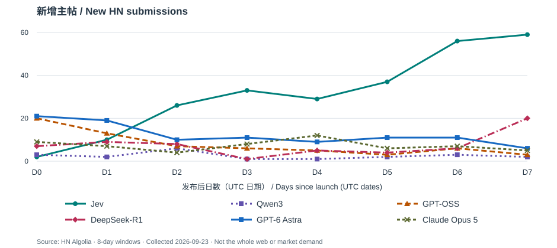
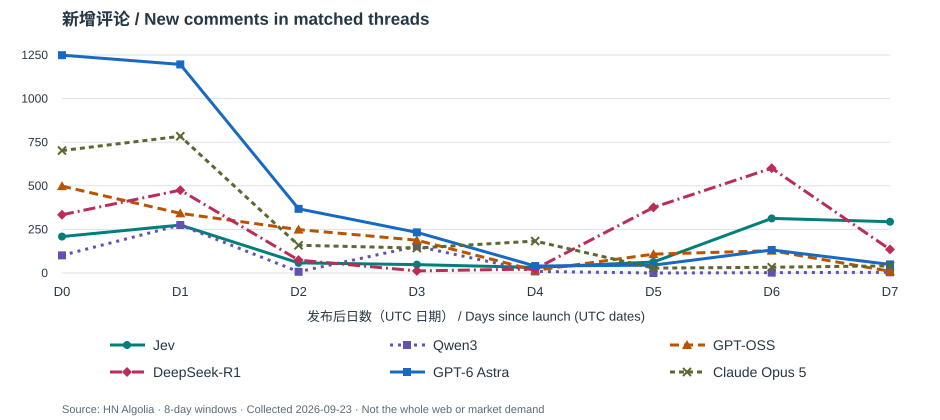
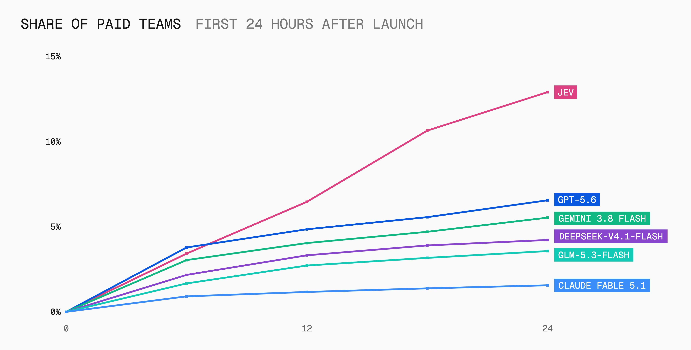

## #news 01 / News and Community :: 从 Jev 到 NanoJev、Laya：多种实现指向同一类需求 || Jev, NanoJev, and Laya Converge on a Shared Need

观察重点不只是又发布了一个小模型，而是“语义判断作为软件组件”正在出现多种产品和工程形式。先看这股变化，再抽象它要解决的共同问题；公开速度与能力等价仍需分开。[1][37][52] || The signal is not merely another small model: semantic judgment as a software component is taking several product and engineering forms. Start with this change, then abstract the shared problem; release speed still does not imply capability parity. [1][37][52]

:::accordion
::panel
### 四天内：从托管判断到本地运行时 || Four Days: From Hosted Judgments to Local Runtimes
以 Jev 发布日为起点：两天后出现 NanoJev 仓库，第三天 Laya 首发，第四天已有 Laya 的独立 MLX 运行时。以下标的是公开事件，不是研究开始时间。[1][60][61][62] || From Jev's launch: the NanoJev repository appears two calendar days later, Laya's first package on day three, and its independent MLX runtime on day four. These are public events, not research start dates. [1][60][61][62]

窄屏可左右滑动时间线 → || Swipe or scroll horizontally on narrow screens →

1. 起点 · 第 0 天 || Launch · Day 0 2026-09-15 Jev 官方模型 / 托管 API 发布 || Official model / hosted API launch TypeSafe 将结构化判断作为服务推出，提供有界答案与概率。[1] || TypeSafe launches structured judgment as a service, returning bounded answers and probabilities. [1]
2. +2 个日历日 || +2 calendar days 2026-09-17 NanoJev 独立模型 / GitHub 仓库创建 || Independent model / repository creation Qwen3-0.6B 决策头的开放实现路线；此日期按仓库创建记录。[37][62] || An open Qwen3-0.6B decision-head implementation; dated by the repository creation record. [37][62]
3. +3 个日历日 || +3 calendar days 2026-09-18 Laya 独立模型 / PyPI 0.1.0 首发 || Independent model / first PyPI 0.1.0 release 可安装包首次发布；作者同日发布介绍，GitHub 仓库也同日创建。[52][60][62] || First installable package; the author's introduction and GitHub repository appeared the same day. [52][60][62]
4. +4 个日历日 || +4 calendar days 2026-09-19 Laya-MLX 独立移植 / PyPI 0.1.0 发布 || Independent port / PyPI 0.1.0 release 社区将 Laya 接入 Apple Silicon 原生运行时；这是移植，不是新的模型家族。[55][61] || A community-native Apple Silicon runtime for Laya: a port, not another model family. [55][61]

同日支线：09-18 还有 NanoJev 的 MLX 4-bit 权重发布物，是量化包，不应再算一个独立模型。[45][46] || Parallel development: September 18 also saw the NanoJev MLX 4-bit weight artifact—a quantized package, not another independent model. [45][46]

日期口径：Jev 用公告日期，其余精确时间按 UTC；横轴按日历日间隔排列，不作小时级比较。包首发、仓库创建不等于权重首次公开或从零研发耗时，也不证明几天内复现了 Jev。 || Dates: Jev uses its announcement date; exact timestamps use UTC. Horizontal spacing follows calendar-day differences, not hour-level timing. Package release or repository creation is not first weight publication or development duration, nor proof of reproducing Jev within days.

::panel
### 不只看发布速度：话题是否继续扩散？ || Beyond Release Speed: Does Discussion Keep Spreading?
统一对齐各自发布日的 D0–D7：Jev 对比 DeepSeek-R1、GPT-6 Astra、Claude Opus 5、Qwen3 与 GPT-OSS，覆盖开放和闭源生成式模型。统计 HN 中的关键词主帖，不是全网话题量，也不是所有发布的随机样本。Jev 截至 2026-09-22 UTC 完整日。[63][66] || Align D0–D7 for each launch: Jev versus DeepSeek-R1, GPT-6 Astra, Claude Opus 5, Qwen3, and GPT-OSS, spanning open- and closed-weight generative models. These are HN keyword submissions, not whole-web volume or a random sample of launches. Jev runs through September 22, 2026 UTC. [63][66]



*六条曲线使用相同坐标与八日窗口，颜色、线型和标记区分模型；每日新增主帖，不是累计热度分或品牌总声量。 || Six series share axes and eight-date windows, distinguished by color, dash and marker. New submissions per day—not cumulative popularity or whole-brand attention.*

Jev 252 帖中有 181 帖在 D4–D7（71.8%）；但 DeepSeek-R1 也有 58.3% 的主帖出现在后半段，Opus 5 为 51.7%。新增强参照后，后续扩散不再能被解释为结构化决策模型独有的特征。重复投稿仍各算一帖。[63] || Of Jev's 252 posts, 181 fall on D4–D7 (71.8%). Yet DeepSeek-R1 also places 58.3% of posts in that later half, and Opus 5 places 51.7%. With broader baselines, sustained spread is not unique to structured decision models. Reposts still count separately. [63]

**拓展：逐日数值、检索口径与复算文件 || Extra: Daily Values, Retrieval Rules, and Recalculation**

各版本 D0 见下方对照表，均取八个完整 UTC 日期；D0 不是发布后满 24 小时。HN Algolia 关闭拼写容错与前缀扩展，检索标题、URL、主帖正文并本地复核别名，按主帖 ID 去重。Jev 不自动加入仅提 Laya/NanoJev 的帖子；DeepSeek-R1 也不自动加入只写 DeepSeek 品牌名的帖子。 || D0 dates are listed in the comparison table; each window covers eight complete UTC dates, not eight exact 24-hour periods since announcement. HN Algolia typo/prefix expansion is disabled; title, URL and story-body aliases are rechecked locally and deduplicated by story ID. Jev does not automatically add standalone Laya/NanoJev posts; R1 excludes generic DeepSeek-only mentions.

评论按索引当前所属主帖关联、按评论自身时间分日。GPT-6 有 7 条、Opus 5 有 1 条评论早于当前主帖时间，可能受合并/索引重关联影响；原样保留并单列，不调整时间。年份、品牌命名、平台增长及删帖偏差尚未控制。 || Comments use the index's current thread association and their own creation times. Seven GPT-6 and one Opus 5 comments predate their current thread timestamp, potentially reflecting merges/reassociation; they remain unchanged and separately counted. Year, naming, platform growth and deletion biases remain uncontrolled.

| 相对日 || Relative Day | Jev | Qwen3 | GPT-OSS | DeepSeek-R1 | GPT-6 Astra | Claude Opus 5 |
| --- | --- | --- | --- | --- | --- | --- |
| D0 | 2 / 209 | 3 / 101 | 20 / 498 | 7 / 334 | 21 / 1249 | 9 / 702 |
| D1 | 10 / 275 | 2 / 275 | 13 / 342 | 9 / 475 | 19 / 1196 | 7 / 784 |
| D2 | 26 / 58 | 6 / 7 | 7 / 249 | 8 / 74 | 10 / 368 | 4 / 159 |
| D3 | 33 / 48 | 1 / 153 | 6 / 188 | 1 / 12 | 11 / 233 | 8 / 143 |
| D4 | 29 / 32 | 1 / 9 | 5 / 15 | 5 / 23 | 9 / 40 | 12 / 183 |
| D5 | 37 / 63 | 2 / 0 | 3 / 108 | 4 / 376 | 11 / 45 | 6 / 28 |
| D6 | 56 / 313 | 3 / 2 | 6 / 128 | 6 / 601 | 11 / 132 | 7 / 33 |
| D7 | 59 / 294 | 2 / 4 | 3 / 10 | 20 / 135 | 6 / 49 | 5 / 41 |

每格为新增主帖 / 新增评论，均为计数。 || Each cell gives new submissions / new comments, both counts.

[下载统计摘要 || Download Summary](examples/demand/summary.json) · [下载主帖、评论时间戳和查询记录 || Download Posts, Comment Timestamps, and Query Receipts](examples/demand/observations.json)

参与热度用上述主帖内、观察窗口中实际创建的评论衡量，而不是把今天的总积分倒填成历史曲线。评论不必再次提及模型，也不等于正面评价；批评、争议和闲聊都可能产生热度。[63] || Participation counts comments actually created within each observation window on the matched threads, not today's cumulative points backfilled as history. Replies need not repeat the model name or express approval; criticism, controversy, and off-topic replies also generate activity. [63]



*同样八个日期、同样评论口径；年份和平台规模未校正，历史删帖及索引缺失可能影响结果。 || Same eight-date window and comment definition; years and platform growth are not adjusted, and historical deletions/index gaps may affect results.*

八日评论量：GPT-6 Astra 3,312、Opus 5 2,073、DeepSeek-R1 2,030，均高于 Jev 的 1,292。R1 在 D6 还有一轮明显高峰。Jev 的 252 帖中仍有 179 帖无评论：它的特点是投稿扩散，不是所有热度维度都压过热门生成模型。[63] || Eight-date comment totals: GPT-6 Astra 3,312, Opus 5 2,073 and DeepSeek-R1 2,030—all above Jev's 1,292. R1 also shows a substantial D6 peak. Of Jev's 252 threads, 179 have no comments: its distinction is submission spread, not dominance over popular generative models on every activity metric. [63]

同样的八日窗口，同时比较总量和 D4–D7 占本模型八日总量的比例。后段占比是讨论分布，不是用户留存；不能仅因曲线后段较高就断言需求更持久。[63][66] || Compare total counts and the share falling on D4–D7 within the same eight-date window. Later share measures discussion distribution, not user retention; a later peak alone does not prove durable demand. [63][66]

| 模型 / 版本 || Model / Version | D0（UTC） || D0 (UTC) | 主帖 || Posts | 评论 || Comments | 后段主帖占比 || Later Post Share | 后段评论占比 || Later Comment Share |
| --- | --- | --- | --- | --- | --- |
| Jev | 2026-09-15 | 252 | 1292 | 71.8% | 54.3% |
| DeepSeek-R1 | 2025-01-20 | 60 | 2030 | 58.3% | 55.9% |
| GPT-6 Astra | 2026-09-03 | 98 | 3312 | 37.8% | 8% |
| Claude Opus 5 | 2026-07-24 | 58 | 2073 | 51.7% | 13.7% |
| Qwen3 | 2025-04-28 | 20 | 551 | 40% | 2.7% |
| GPT-OSS | 2025-08-05 | 63 | 1538 | 27% | 17% |

版本选择：DeepSeek 取 R1；GPT-6 取 Astra；Claude 取 Opus 5。09-22 刚发布的 GPT-6 Sol/Luna 与 Opus 5.5 尚无完整八日数据，暂不纳入，不用零补齐。原 Qwen3/GPT-OSS 对照保留，避免用新基线替掉旧结果。[66] || Version choices: DeepSeek-R1, GPT-6 Astra, Claude Opus 5. GPT-6 Sol/Luna and Opus 5.5 launched September 22 and lack eight complete dates; they are omitted, not zero-filled. Original Qwen3/GPT-OSS baselines remain rather than being replaced. [66]

结论随参照扩展而收紧：Jev 的快速试用和投稿扩散值得关注；但 R1 同样后段发酵，热门生成模型的评论量更大。这仍是需求假设的证据，不是“结构化模型比 LLM 更受期待”的定论。 || The broader comparison narrows the claim: Jev’s rapid trials and submission spread matter, but R1 also builds later and popular generative models draw more comments. This supports a demand hypothesis, not a verdict that decision models are more eagerly awaited than LLMs.

::panel
### 更接近需求的信号：开发者是否真的调用？ || Closer to Demand: Do Developers Actually Try It?
Vercel 在 2026-09-18 公布了各模型上线 Gateway 后首 24 小时的采用曲线。其报告称：Jev 在 12 小时内超过图中其他模型，18 小时约达一成，24 小时接近 13%，约为 GPT-5.6 系列的两倍。下图是平台原图，不是本文推算的小时数据。[64] || Vercel's September 18, 2026 report compares the first 24 hours after each Gateway launch. It reports Jev overtaking the plotted models within 12 hours, reaching about one tenth by hour 18 and nearly 13% by hour 24—roughly twice the GPT-5.6 family. This is the original provider chart, not inferred hourly data. [64]



*来源：Vercel，首 24 小时采用率原图（英文）。横轴为上架后小时；纵轴为使用该模型的付费 Gateway 团队比例。点击图片可查看原图。 || Source: Vercel, original first-24-hour adoption chart. X: hours since Gateway launch. Y: share of paid Gateway teams using the model. Click the image to open the original.*

注意：付费团队不等于为 Jev 付费，Jev 当时免费促销至 09-25。该原图未给出 GPT-6/Opus 5 的采用曲线，本文不补画或把 HN 热度当采用率。平台未公开原始团队数和完整小时数据；推广与客户群不同，不能推断留存、付费意愿或生产 ROI。[64] || Paid teams need not pay for Jev, which was free until September 25. This original chart supplies no GPT-6/Opus 5 adoption curves; we do not invent them or substitute HN activity. Raw team counts/hourly data are unavailable and promotions/customer mix differ, so retention, willingness to pay and ROI remain unproven. [64]

::panel
### 从发布热度读出共性需求 || From Releases to a Recurring Need
短期内，托管服务、开放权重、专项训练、量化和独立运行时集中到类似接口：输入上下文与判定标准，输出软件可消费的选择、等级或概率。这些不同路径共同回应了一个通用需求——软件需要理解含义，但往往不需要生成一段话。[1][37][52][55] || Hosted services, open weights, specialization, quantization, and runtimes converge on a similar interface: context and criteria in, software-consumable choices, levels, or probabilities out. These approaches address a recurring need: software must understand meaning without always generating prose. [1][37][52][55]

- 需求层：工单分派、证据筛选、动作选择和审核都反复出现“有界语义判断”。 || Demand: routing, evidence filtering, action selection, and review repeatedly need bounded semantic judgments.
- 实现层：不同底座、训练与运行时说明有多条工程路径；这不是某一个品牌独有的需求。 || Implementation: different backbones, training, and runtimes offer multiple engineering paths for a need not owned by one brand.
- 行为层：本次 HN 样本显示后续话题扩散，Gateway 数据显示快速试用；二者比只有发布新闻更接近需求，但不是长期留存或付费意愿。[63][64] || Behavior: this HN sample shows continuing discussion and Gateway reports rapid trial adoption—closer to demand than announcements alone, but not retention or willingness to pay. [63][64]
- 历史痛点：一位开发者回顾 2024 年的数据清洗项目，需要反复标注、训练多个分类器；他把 Jev 视为减少这些支线工作的工具。这是需求早于产品的个人案例，不是代表性调查或等质量验收。[65] || Prior pain: a developer recalls repeated labeling and classifier training for a 2024 data-cleaning project and sees Jev as removing those side tasks. This is one account of a need predating the product, not a representative survey or matched-quality validation. [65]
- 当前判断：证据支持“长期存在的语义判断问题，遇到了让开发者迅速尝试的新接口”，尚不能证明“整个市场期盼已久且已被满足”。还需观察免费期后使用、7/30 日留存、真实付费及与现有分类器的净收益。 || Current judgment: evidence supports an old semantic-judgment problem meeting an interface developers rapidly try—not a proven market-wide, long-awaited need now satisfied. Next measure post-promotion usage, 7/30-day retention, real payment, and net gains over existing classifiers.
:::

## #positioning 02 / Category and Value :: 结构化决策模型：软件里的语义判断层 || Structured Decision Models: A Semantic Judgment Layer

先把模型名字拿掉：许多软件只需要“属于哪类、是否成立、哪个更相关”，却面对不能靠字符串匹配解决的含义。结构化决策模型尝试把这种高频、有界的语义判断变成可组合组件，而不是再造一个聊天助手。 || Remove the brand names first: software often needs a category, truth judgment, or relevance choice over meaning that string matching cannot resolve. Structured decision models package repeated, bounded semantic judgments into composable components rather than another chatbot.

:::accordion
::panel
### 抽象契约与选型边界 || The Contract and Its Boundaries
**上下文 → 判定标准 → 结果 → 程序政策 || Context → Criteria → Results → Software Policy**

本文把主要输出预定义判断、等级或分布，供软件直接组合使用的模型称为“结构化决策模型”。这是研究口径，不是已统一的行业分类；System One 是其中一套产品命名，不是必须采用的架构。 || We use structured decision models for models whose main output is predefined judgments, levels, or distributions consumed directly by software. This is an analytical scope, not a standardized taxonomy; System One is one product framing, not a required architecture.

| 组成 || Component | 抽象契约 || Abstract Contract |
| --- | --- |
| 上下文 || Context | 文本、记录、候选片段或已知环境状态 || Text, records, candidate passages, or observed state |
| 问题与边界 || Question and Bounds | 判定标准、候选项、有序等级；必要时允许未知/不适用 || Criteria, candidates, ordered levels; unknown/not-applicable when needed |
| 结果 || Result | 单选、多标签、是非概率或等级分布；不是任意解释文本 || A choice, multiple labels, binary probabilities, or level distributions—not arbitrary explanation |
| 后续处理 || Downstream Control | 代码检查一致性与权限，再执行、保留或升级复核 || Code checks consistency and authorization before acting, retaining, or escalating |

本文重点研究不以自由文本逐字解码为主要输出路径的实现。生成式 LLM 也能输出合法 JSON，但输出格式相同，不代表计算路径、训练目标或概率含义相同。 || We focus on implementations not centered on free-text token decoding. Generative LLMs can also return valid JSON; matching formats do not establish matching computation, objectives, or probability semantics.

**先找最简单的可用方案 || Start with the Simplest Adequate Approach**

| 方案 || Approach | 适合的工作 || Prefer For | 主要代价 || Main Cost |
| --- | --- | --- |
| 规则 / SQL || Rules / SQL | 金额、时间、权限等精确条件 || Exact amounts, dates, and permissions | 维护语义规则覆盖 || Maintaining semantic coverage |
| 监督分类器 || Supervised classifier | 固定标签、有训练数据 || Stable labels and labeled data | 标注、训练、漂移监控 || Labels, training, drift checks |
| 结构化决策模型 || Structured decision model | 有界但依赖上下文含义的判断 || Bounded, context-sensitive judgments | 领域质量、校准、运行时验收 || Domain quality, calibration, runtime validation |
| 生成式 LLM || Generative LLM | 开放规划、解释、文本和代码 || Open planning, explanations, text, code | 生成、验证和上下文成本 || Generation, validation, context costs |

分类任务并不新；这里关注把可配置的语义判断嵌入现代软件流程。这些工程选项并非互斥的学术分类：决策实现也可使用分类器。应问任务是否需要动态候选与语义泛化，以及更简单的方案是否已经足够。 || Classification is not new; the focus is configurable semantic judgment inside modern software workflows. These options are not disjoint academic categories: decision implementations may use classifiers. Ask whether dynamic candidates and semantic generalization are needed, or a simpler solution suffices.

::panel
### 定位与潜在收益 || Role and Potential Value
**程序掌握工作流，模型补足语义 || Code Owns the Workflow; Models Supply Semantic Judgments**

它更像软件中的语义判断层，而不是完整 Agent：程序提供状态与候选，模型补上难以穷举的语义关系，程序保留状态机、策略和执行权。 || It is a semantic judgment layer, not a complete agent: code supplies state and candidates, the model evaluates meaning that is hard to enumerate, and code retains workflow state, policy, and execution.

- 固定流程：判断一封信应进入哪个队列，而不是生成一篇客服分析再解析。 || Fixed workflows: select a queue for a message instead of generating and parsing a support essay.
- 检索与工具：从已知候选中判断相关性、证据支持或下一步动作；原文与工具权限仍由程序控制。 || Retrieval/tools: judge relevance, evidence support, or the next action among known candidates; code owns sources and tool permissions.
- 与 LLM 配合：大量局部判断交给可验证的轻量路径，开放式规划或表达仍交给生成模型；不是强制每轮先小模型、再大模型。 || With LLMs: delegate repeated local judgments to a validated lightweight path, retaining generation for open planning or expression—not mandatory small-then-large calls every turn.

**少生成、少搬运，但不能漏算返工 || Less Generation and Context, with Recovery Costs Counted**

潜在收益不是“小模型必然便宜”，而是减少不必要的生成、重复上下文与人工筛查，并让判断成为可测试、可追踪的接口。收益取决于任务分布和能真正省掉多少工作。 || Potential value is not that small models must be cheaper. It is avoiding unnecessary generation, repeated context, and manual filtering while making judgments testable and traceable. Benefits depend on the workload and work actually avoided.

- 延迟/吞吐：省去长文本解码、合并独立问题，但预处理、排队、重复编码和网络仍要计算。 || Latency/throughput: avoid long decoding and batch independent questions, while counting preprocessing, queues, repeated encoding, and networking.
- 工程可控性：有界输出便于组成流程、记录概率和复核原因；格式正确仍不等于语义正确。 || Control: bounded outputs simplify workflows and audits; schema validity still does not establish semantic correctness.
- 部署选择：可选托管或本地、通用或专项训练，换来不同的隐私、维护、数据与硬件成本。 || Deployment: hosted/local and general/specialized models offer different privacy, maintenance, data, and hardware trade-offs.

采用条件：在质量要求相同、成本口径一致时，被省掉的工作成本应大于新增判别、运维与误判返工成本。若每轮仍让同一 LLM 处理同样材料，hybrid 可能只是多一道开销。 || Adopt only when avoided work costs more than added judgment, operations, and error recovery under the same quality target and accounting scope. If the same LLM still processes the same material every turn, hybrid may merely add overhead.

::panel
### 市场信号及其证据边界 || Market Signals and Their Limits
**采用、API 使用和成本趋势：三种统计口径 || Adoption, API Use, and Cost Trends Have Different Denominators**

以下是相邻需求和成本环境的数据，不是结构化决策模型的市场份额或收入。保留统计年份、样本与分母，不能把“API 记录”换成“企业数量”。[56][57] || These figures describe adjacent demand and cost conditions, not this model category’s market share or revenue. Preserve dates, samples, and denominators; API records are not company counts. [56][57]

| 公开数据 || Public Observation | 统计口径 || Population / Period | 可支持的判断 || What It Supports |
| --- | --- | --- |
| 78% vs 55% [56] | Stanford AI Index 2025 汇总：2024/2023 调查组织自报使用 AI || AI Index 2025 synthesis: surveyed organizations reporting AI use in 2024/2023 | AI 已进入业务；不是所有企业渗透率，也不是决策模型份额 || Business adoption, not all-firm penetration or decision-model share |
| 77% [57] | 2025-08 的 100 万条 Claude 第一方 API 样本记录呈自动化模式 || Automation patterns in 1M sampled first-party Claude API records, August 2025 | 程序化任务委托有需求；不是 77% 企业已完成自动化 || Demand for programmatic delegation, not 77% of firms fully automated |
| >280 倍下降 [56] || >280-fold decline [56] | 2022-11 至 2024-10，达到 GPT-3.5 水平的系统推理成本 || Inference cost at GPT-3.5-level performance, Nov 2022–Oct 2024 | 小模型与部署更可行；同时优化 LLM 基线也在变便宜 || Deployment becomes more feasible; competing LLM baselines also get cheaper |

**把需求证据与收益证据分开 || Separate Evidence of Demand from Evidence of Gains**

Anthropic 的 API 数据来自约占其第一方使用量一半的客户池抽样，且只观察一家厂商；它不能代表所有行业。报告也提示，能力匹配、上下文可得性与任务经济价值，比单看低价格更能解释早期部署。[57] || Anthropic sampled a customer pool accounting for roughly half its first-party API usage, at one vendor; it is not all-industry evidence. The report also highlights capability fit, context availability, and task value rather than low price alone in early deployment. [57]

本轮未找到定义一致、足以独立估算“结构化决策模型”市场规模的可信数据，因此不引用通用 AI、Agent 或决策智能市场金额来冒充该类别的 TAM。开源涌现与相邻市场数据支持需求假设，不自动证明净收益。 || This review found no sufficiently reliable, consistently defined standalone market-size estimate for structured decision models. General AI, agent, or decision-intelligence revenue is not this category’s TAM. Community activity and adjacent market data support a demand hypothesis, not proven net gains.

结论：把高频语义判断做成软件原语，是值得验证的通用方向；是否采用某个模型，要看同题质量、覆盖率、端到端成本与维护负担。下面先比较三种实现，再分别展开。 || Conclusion: packaging repeated semantic judgments as software primitives is a general direction worth testing. Adoption depends on matched-task quality, coverage, end-to-end cost, and maintenance. Next compare three implementations, then examine each.

[查看统计口径与来源快照](examples/structured-decision-market-evidence.json) || [Inspect populations, dates, and source snapshots](examples/structured-decision-market-evidence.json)
:::

## #model-comparison 03 / Three-Model Comparison :: 先比较实现与证据，再决定测什么 || Compare Implementations and Evidence Before Ranking

三者回答相似形式的问题，不代表同源、同质量或可直接互换。先比较定位与工程约束，再进入各自详解。 || Similar question formats do not imply shared lineage, equal quality, or interchangeability. Compare roles and constraints before examining each model.

:::accordion
::panel
### 三种实现，一类接口需求 || Three Implementations, One Interface Need
**相似的判断契约，不同的训练与部署 || Similar Judgment Contracts, Different Training and Deployment**

| 维度 || Dimension | Jev | NanoJev | Laya |
| --- | --- | --- | --- |
| 实现关系 || Identity | 官方托管产品 || Hosted vendor product | 独立社区实现 || Independent community model | 独立开放模型系列 || Independent open model family |
| 底座 / 参数 || Backbone / Size | 完整结构与规模未披露 || Full architecture/size undisclosed | Qwen3-0.6B + 决策头 || Qwen3-0.6B + decision heads | ModernBERT/mmBERT；421M/322M || ModernBERT/mmBERT; 421M/322M |
| 主要运行路径 || Runtime | TypeSafe 或网关 API || TypeSafe or gateway API | 上游参考实现；本项目 MLX || Reference runtime; project MLX port | PyTorch；独立 MLX 移植 || PyTorch; independent MLX port |
| 适配方式 || Adaptation | 上下文、问法、候选与代码 || Context, criteria, candidates, code | 训练/微调与任务控制器 || Training/tuning and task controllers | 选检查点、领域微调、校准 || Checkpoint choice, domain tuning, calibration |

共同点是输出有界判断；不同点是训练分布、接口、上下文预算和概率含义。NanoJev 不是官方 Jev 的缩水权重，Laya 也不是同一模型的本地版。[1][2][37][52] || All return bounded judgments, but differ in training distribution, APIs, budgets, and probability semantics. NanoJev is not a smaller official Jev checkpoint; Laya is not its local edition. [1][2][37][52]

::panel
### 证据和采用条件 || Evidence and Adoption Conditions
**不拼接异质准确率排行榜 || Do Not Combine Incompatible Accuracy Leaderboards**

| 模型 || Model | 已有证据 || Available Evidence | 不能外推 || Not Established |
| --- | --- | --- |
| Jev | 官方工作流评测、API 文档、社区小样本 || Vendor workflows, API docs, small community studies | 任意领域校准与端到端收益 || Calibration or net gains in every domain |
| NanoJev | 专项游戏训练；本文同权重 MLX 验收与坦克消融 || Game-specific training; local same-weight MLX checks and arena ablations | 游戏成功等于中文售后/RAG 可靠 || Game success implies reliable Chinese support/RAG |
| Laya | 基础/微调对照、中文社区记录、独立 MLX 一致性 || Base/tuned comparisons, Chinese records, MLX parity | 76.6% 属于所有检查点或所有语言 || 76.6% applies to every checkpoint/language |

这里不拼接三者的准确率排行榜：官方共识标签、游戏胜率、单标签中文工单与移植数值一致性不是同一指标。本项目尚无三者同题、同口径的完整能力对照。[6][42][49][50][53][54] || There is no combined accuracy leaderboard: consensus-label agreement, game wins, single-label tickets, and numerical parity are different outcomes. This project has no complete matched-task, matched-scope comparison of all three. [6][42][49][50][53][54]

**同题、同口径，再比较增量 || Compare Incremental Value on Matched Tasks and Accounting**

- 先定任务：同一批输入、同一候选和输出语义；多意图不能强制单选，空白输入要有未知路径。 || Define the task: identical inputs, candidates, and output semantics; do not force multiple intents into one label or omit unknown outcomes.
- 再定部署：托管可用性、数据边界、本地硬件与维护各自核实；按实际检查点验收语言和领域。 || Choose deployment: verify hosted access, data boundaries, local hardware and maintenance; validate language/domain per checkpoint.
- 最后看增量：与相同规则、检索、缓存及优化 LLM 基线比较；把误判、弃答、冷启动和复核都计入。 || Measure incremental value against the same rules, retrieval, caching, and optimized LLM baseline; include errors, abstention, cold starts, and review.

后文按 Jev → NanoJev → Laya 展开：先看官方契约与服务边界，再看独立实现、训练与本地运行证据。 || The next chapters cover Jev → NanoJev → Laya: first the hosted contract and service boundaries, then independent implementations, training, and local-runtime evidence.
:::

## #jev 04 / Jev Deep Dive :: Jev：用托管 API 提供结构化判断 || Jev: Hosted APIs for Structured Judgments

这是该模型类别的一种产品实现，不是对整个类别的定义。先明确官方披露与未知信息，再分别查看契约、评测、运行约束和接入路径。[1][2][3] || Jev is one product implementation, not the definition of the category. Separate disclosures from unknowns, then examine its contract, evidence, operating constraints, and access paths. [1][2][3]

:::accordion
::panel
### 以 Jev 为例：已披露什么，尚未知什么 || Jev: Disclosures and Unknowns
TypeSafe AI 于 2026-09-15 开放 Jev 早期访问；截至核查日，官方列出的版本为 `jev-1.13.0`。[1][2] || TypeSafe AI opened early access on September 15, 2026. The documented version at the research cutoff is `jev-1.13.0`. [1][2]

- **厂商定义 || Vendor Definition** — System One 是厂商对快速结构化决策模型的命名，借用快思考概念；不能据此认定已形成统一行业模型分类。[1] || System One is the vendor's name for fast structured decision models, inspired by fast thinking. It is not evidence of a standardized industry taxonomy. [1]
- **训练与采样 || Training and Sampling** — RLCD 指 Reinforcement Learning for Calibrated Decisions，即面向校准决策的强化学习；官方同时宣称新架构与并行采样。[1][22] || RLCD means Reinforcement Learning for Calibrated Decisions. The vendor also describes a new architecture and parallel sampler. [1][22]
- **披露边界 || Disclosure Boundary** — 本次资料不足以重建参数规模、基础模型、损失函数、训练配方或权重；不能推定它就是 BERT、某款小 LLM，或一定不用 Transformer。 || Reviewed material does not establish parameter count, a base model, loss function, training recipe, or weights. Do not infer a BERT variant, a specific small LLM, or the absence of Transformers.

::panel
### 能力形态与软件边界 || Capability Shape and Software Boundaries
Jev 将 Choice、Score、Noul 作为托管判断接口：输入 state 与多个独立问题，输出答案、分布和 usage，而不是自由文本或思维链。其设计价值在于让调用方直接组合这些判断；权限、政策和动作执行不随答案移交给模型。[3][10] || Jev exposes Choice, Score, and Noul through a hosted interface: state and independent questions yield answers, distributions, and usage rather than prose or a reasoning trace. Callers compose judgments while retaining authorization, policy, and execution. [3][10]

官方强调共享状态与并行问题；这不意味着问题间统计独立，也不保证 P(A) 与 P(not A) 互补。下面分别说明输出契约、厂商评测、接入和限制。[4][5] || The vendor emphasizes shared state and parallel questions. This implies neither statistical independence nor complementary P(A)/P(not A). The following subsections cover contracts, vendor evidence, integration, and limits. [4][5]

::panel
### 访问渠道与当前验证状态 || Access Channels and Current Verification
| 渠道 || Channel | 接入边界 || Access Boundary |
| --- | --- |
| TypeSafe | 个人/组织 API key 与容量权限；模型 jev-1.13.0 [2][3] || Account API key and capacity entitlement; jev-1.13.0 [2][3] |
| Vercel Gateway | typesafe-ai/jev；鉴权、支付方式验证与模型权限须分别核实 [33] || typesafe-ai/jev; authentication, payment-method verification, and model entitlement are separate checks [33] |
| Cloudflare | typesafe/jev；可用 Cloudflare 管理凭据及预付费额度，无需个人 TypeSafe key；本项目未调用 [58][59] || typesafe/jev; managed credentials and prepaid credits can avoid a personal TypeSafe key; not invoked by this project [58][59] |

渠道文档可访问，不等于账户已获推理权限，也不等于免费或已验证 SLA。密钥留在后端；注册、支付、充值和真实调用必须由用户明确授权。当前 Playground 未加入 Cloudflare 适配。 || An accessible model page does not prove inference entitlement, free service, or an SLA. Keep keys server-side; registration, payments, credit purchases, and inference require explicit approval. Cloudflare is not yet a Playground provider.
:::

:::accordion
::panel
### 三种原语的输入与返回值 || Three Decision Primitives
原语是 API 的基本问题类型；这里以 Jev 的三种类型作对照。Choice 使用 criteria 映射，Score 使用有序等级列表；接口不生成任意 JSON、自由文本解释或思维链。[3] 本文建议审计保留输入证据与代码策略，事后解释不能视为 Jev 的真实推理。 || A primitive is a basic API question type; these three describe Jev. Choice uses a criteria map; Score uses ordered levels. No arbitrary JSON, free-text rationale, or reasoning trace is returned. [3] This report recommends retaining evidence and code policy; a later explanation is not the model's actual reasoning.

| 原语 || Primitive | 定义与输出 || Definition and Output | 常见误用 || Misuse to Avoid |
| --- | --- | --- |
| Noul | 是非判断 → `noul ∈ [0,1]`，无独立 confidence || Yes/no → `noul ∈ [0,1]`, no separate confidence | 0.5 表示是非不确定，不是中等严重度 || 0.5 is uncertainty, not medium severity |
| Choice | 候选映射 → choice、probabilities、confidence || Option map → choice, probabilities, confidence | 候选不全却没有 other / none || Incomplete options without other / none |
| Score | 有序等级 → score、legend、probabilities、confidence || Ordered levels → score, legend, probabilities, confidence | 把概率加权等级当作精确金额或数量 || Treating a probability-weighted level as an exact amount or count |

::panel
### 共享状态并行，不等于问题之间有依赖顺序 || Parallel Questions Do Not Form a Dependency Chain
所有问题看到同一个 state，分别求值；共享输入可减少重复传输和串行调用，但有依赖的判断仍需由代码安排。[10][11] || Questions share the same state and are evaluated separately. This reduces repeated input and serial calls; code still schedules dependent decisions. [10][11]

1. **可以合并 || Batch Together** — 同一工单的部门、急迫性与信息充足度，可在一个请求里分别询问。问题仍分别计入输入预算。[2][10] || Ask about team, urgency, and sufficiency for the same ticket in one request. Question text still counts toward input budgets. [2][10]
2. **需要分阶段 || Use Separate Stages** — 若第二个问题的候选必须由第一个答案决定，先返回结果、生成候选，再发第二个请求；或预先询问所有分支后由代码选择。 || If later candidates depend on an earlier answer, build them after the first response and call again; alternatively ask speculative branches and select in code.
3. **不保证逻辑恒等式 || Do Not Assume Logical Identities** — 独立求值不表示统计独立，也不保证不同问题互补。不要直接相乘概率，或假设 P(A) + P(not A) = 1。[5] || Separate evaluation does not imply statistical independence or complementary answers. Do not multiply probabilities or assume P(A) + P(not A) = 1. [5]

::panel
### 类型正确、概率校准与事实正确是三件事 || Type Safety Is Not Semantic Correctness
confidence 是概率分布形状的汇总值，不是本次判断正确的概率；校准则是预测概率与一组样本实际发生频率的对应关系。[4][19][22] || Confidence summarizes the shape of a probability distribution; it is not the probability that this decision is correct. Calibration concerns predicted probabilities versus observed frequencies across samples. [4][19][22]

- **类型约束 || Type Constraints** — 合法返回 billing 仍可能误分本应 technical 的工单。官方「零幻觉」应限定在预定义输出空间，不能扩展为零语义错误。[1][5] || A valid billing result can misroute a technical ticket. Limit the vendor's zero-hallucination claim to predefined outputs, not zero semantic error. [1][5]
- **校准需要本地数据 || Validate Calibration Locally** — 预测约 0.8 的一组样本应约 80% 为真，是群体性质。版本、语言、候选与问法变化后，都需重测阈值。[4][22] || Roughly 80% of cases assigned probability 0.8 should be positive. This is a group property. Revalidate after model, language, option, or wording changes. [4][22]
- **受约束 LLM 也是基线 || Compare Constrained LLMs** — 传统 LLM 可用原生 structured outputs。公平比较应包含这种模式及其拒答、重试和语义错误，不能只比较未约束 JSON。[17] || LLMs can use native structured outputs. Include this mode, refusals, retries, and semantic errors rather than comparing only unconstrained JSON. [17]
:::

:::accordion
::panel
### 四个工作流的等权平均值 || Equal-Weight Means Across Four Workflows
安全事件、Agent 轨迹、发票和客服各占同等权重。表中「一致率」沿用网页 accuracy 数字，但参考标签来自大模型共识，而非人工真值；价格、时间为网页舍入值。[6] || Security incidents, agent traces, invoices, and customer service have equal weight. Agreement uses the site's accuracy values against model-consensus labels, not human ground truth. Cost and time are rounded webpage values. [6]

| 模型 || Model | 参考一致率 || Agreement | 美元 / 案例 || USD / Case | 秒 / 案例 || Seconds / Case |
| --- | --- | --- | --- |
| Jev | 67.8% | $0.0004 | 0.4 |
| GPT-5.6 Terra | 67.9% | $0.0304 | 10.1 |
| GPT-5.6 Sol | 74.1% | $0.0836 | 23.3 |
| Claude Opus 5 | 73.1% | $0.1761 | 37.8 |

参考：GPT-6 Astra 与 Claude Fable 5.1 的高推理结果取平均；受测模型使用供应商默认推理设置。发票任务单项中 Jev 为 61.8%，Sol 为 79.1%，说明整体接近不代表各任务接近。[6] || Reference labels average GPT-6 Astra and Claude Fable 5.1 at high reasoning; evaluated models use provider defaults. On invoices alone, Jev scores 61.8% versus Sol's 79.1%, showing substantial task variation. [6]

::panel
### 如何解读 193.6 倍与 444.6 倍 || Interpreting the Headline Multipliers
首页宣传快 193.6 倍、便宜 444.6 倍，官方也称这些处于真实收益的较高端；不能当成任意调用的固定收益。[1] || The headline advertises 193.6× faster and 444.6× cheaper; the vendor says these are toward the high end of real-world gains, not constant per-call benefits. [1]

1. **保留比较条件 || Preserve Comparison Conditions** — LLM 经 System One Adapter 输出概率，比只给离散答案更慢、更贵。短输入演示也被官方注明有利于 Jev。[1][17] || The System One Adapter requests LLM probabilities, which cost more than discrete answers. The vendor also notes that short-input demos favor Jev. [1][17]
2. **按可见数据复算 || Recompute Visible Values** — 由舍入均值计算，Jev 对 Terra 约快 10.1/0.4 = 25.3 倍、便宜 0.0304/0.0004 = 76 倍；这不是首页倍数的复现。 || From rounded means, Jev versus Terra is about 10.1/0.4 = 25.3× faster and 0.0304/0.0004 = 76× cheaper. This does not reproduce the headline figures.
3. **不把转载算作复现 || Do Not Count Retelling as Replication** — DataCamp 解读沿用厂商数据；其示例字段与官方 API 不一致，且把 5,000 万 × $0.0004 写为约 $20，正确值为 $20,000。本报告不采纳这些示例。[3][20] || DataCamp retells vendor results. Its example fields differ from the official API, and 50 million × $0.0004 is $20,000, not its quoted $20. Those examples are not adopted here. [3][20]

::panel
### 按输入 Token 预算，按完整业务流程核算 || Budget Tokens and Measure the Whole Workflow
官方价格为每百万输入 token $0.042，输出免费。输入包括 state 和问题；免费输出不表示响应里没有 output_tokens 使用量字段。[2][3] || The documented price is $0.042 per million input tokens, with free output. Input includes state and questions; free output does not remove output_tokens from usage reporting. [2][3]

| 口径 || Basis | 计算 || Calculation | 边界 || Boundary |
| --- | --- | --- |
| 每次 2,000 输入 token || 2,000 input tokens per call | 2,000 / 1,000,000 × $0.042 = $0.000084 | 示例假设，不是实测平均长度 || Assumption, not a measured mean |
| 一百万次上述调用 || One million such calls | 1,000,000 × $0.000084 = $84 | 只计 Jev 推理；一次业务请求可能多次调用 || Jev inference only; business requests may need multiple calls |
| 总成本 || Total Cost | 预处理 + Jev + 升级 LLM + 人工 + 重试 + 运维 || Preprocessing + Jev + LLM escalation + review + retries + operations | OCR、检索、网络与人工不能忽略 || Include OCR, retrieval, networking, and human review |
:::

:::accordion
::panel
### 拓展：最小 HTTP 请求与模型版本 || Extra: Minimal HTTP Request and Version Pinning
在后端环境变量中设置 TYPESAFE_API_KEY；示例锁定版本。执行下列命令会发起计费请求，本报告未实际调用。[2][3] || Set TYPESAFE_API_KEY in the backend environment. This example pins the model. Running it makes a billable request; it was not executed for this report. [2][3]

```
curl --max-time 5 https://api.typesafe.ai/v1/systemone \
  -H "Authorization: Bearer $TYPESAFE_API_KEY" \
  -H "Content-Type: application/json" \
  -d '{
    "model": "jev-1.13.0",
    "state": {"request": "The integration fails with error 500."},
    "questions": {
      "urgent": {"type": "noul",
        "instructions": "Does the request express time sensitivity?"}
    }
  }'
```

读取 `answers.urgent.noul`。`jev-latest` 与 `jev-preview` 在核查时均指向该版本，但别名会移动；生产阈值应与明确版本绑定。[2] || Read `answers.urgent.noul`. At the cutoff, both `jev-latest` and `jev-preview` point to this version, but aliases move. Bind production thresholds to a versioned ID. [2]

::panel
### 拓展：Python：返回建议，失败时转复核 || Extra: Python: Advisory Results with Review Fallback
Python ≥ 3.10，安装 `typesafe-sdk`。下例与 [完整 triage.py](examples/triage.py) 配套：后者包含 other、信息充足度、示例阈值和错误复核，不执行任何业务写入。[7] || Use Python ≥ 3.10 and `typesafe-sdk`. The [complete triage.py](examples/triage.py) adds other, sufficiency, illustrative thresholds, and error review. It does not perform business writes. [7]

```
from typesafe_sdk import Noul, RetryPolicy, TypeSafeClient

with TypeSafeClient(
    model="jev-1.13.0", timeout=2.0,
    retry=RetryPolicy(max_retries=0),
) as client:
    result = client.system_one(
        state={"request": "The integration fails with error 500."},
        questions={"urgent": Noul(
            instructions="Does the request express time sensitivity?"
        )},
    )
print(result.nouls["urgent"].noul)
```

2 秒是示例 HTTP 操作超时，不是整条业务流程的时限保证。示例阈值 0.90 / 0.95 未经业务校准，不能直接作为生产准入标准。示例仅做离线契约检查，未验证线上质量。 || Two seconds is an illustrative HTTP operation timeout, not a workflow deadline. The full example's 0.90 / 0.95 thresholds are not calibrated production gates. Only offline contract checks were performed; live quality is untested.

::panel
### JavaScript 与 LangChain 的接入分工 || JavaScript and LangChain Integration
按运行环境选客户端，不为使用 Jev 额外引入完整 Agent 框架。浏览器端不能嵌入服务密钥。 || Choose a client for your runtime; adopting Jev does not require an agent framework. Never embed the service key in a browser.

| 技术栈 || Stack | 入口 || Entry Point | 注意事项 || Caveat |
| --- | --- | --- |
| Node.js ≥ 20 | `npm install @typesafe-ai/sdk`<br>`TypeSafeClient.systemOne` | 返回类型由问题推导；支持 ESM / CJS / TS。[8] || Types follow questions; ESM, CJS, and TS supported. [8] |
| LangChain | `pip install langchain-typesafe`<br>`TypeSafeClassifier.invoke` | 是 Runnable 分类器，不是 ChatModel；支持 batch 和 LangSmith 追踪。[9] || A Runnable classifier, not a ChatModel; supports batch and LangSmith traces. [9] |
| 实验中间件 || Experimental Middleware | `langchain-typesafe[experimental]` | ModelRouterMiddleware 与 AutoModeMiddleware 的 API 可能改变，需锁定依赖版本。[9] || ModelRouterMiddleware and AutoModeMiddleware APIs may change; pin dependencies. [9] |
:::

**接口配置与验证工具（Jev / NanoJev / Laya 共用） || API Configuration and Inspector (Shared by Jev / NanoJev / Laya)**

这是模型接入验证工具，不属于下方的两个业务演示。展开后可检查连接、请求与返回；只有手动点击运行才会推理。 || This is a model-integration inspector, not a third business demo. Expand to inspect connections, requests and responses; only Run triggers inference.

接口验证工具需要 JavaScript / The API inspector requires JavaScript.

**共享 Node 后端与 Copilot 配置 || Shared Node Gateway and Copilot Setup**

三种决策模型共用网页网关，但各自运行时和凭据不混用。Jev 使用托管渠道权限，NanoJev 与 Laya 使用独立本地进程；售后回答或在线坦克评分另需 Copilot 登录与明确授权。配置不会自动启动模型调用。 || The web gateway is shared, but runtimes and credentials are separate: Jev uses hosted access, NanoJev/Laya isolated local workers. Support replies or online arena scores additionally need Copilot login and explicit consent. Configuration never starts inference automatically.

:::accordion
::panel
### 上下文、候选数和速率的实际约束 || Context, Cardinality, and Rate Limits
满足单个限制不等于整个请求可接受；总输入与最长问题约束必须同时满足。[2] || Meeting one limit does not make a request valid; total input and longest-question limits both apply. [2]

| 项目 || Item | 当前公布值 || Documented Value | 工程含义 || Engineering Implication |
| --- | --- | --- |
| 输入模态 || Input | Text / JSON | 无图像、音频、视频；先 OCR 或转写。[2] || No image, audio, or video; preprocess first. [2] |
| 上下文 || Context | 64k total; 32k state + longest question | 总预算是 state 加全部问题，不能按 64k 填满 state。[2] || Total includes all questions; state alone cannot use 64k. [2] |
| Choice 候选 || Choice Options | ≤ 255 | 更多候选先检索或分层。[12] || Retrieve or use hierarchical selection for larger sets. [12] |
| 动态速率 || Dynamic Quotas | 250,000 tokens/s; 1,200 requests/min | 后者折算约 20 次/秒，仅为名义上限；并非持续吞吐保证。[2] || The latter is nominally 20 calls/s, not guaranteed sustained throughput. [2] |

::panel
### 准确率弱点与错误处理 || Accuracy Weaknesses and Error Handling
官方已列出字面理解、多跳推理、数值、日期、杂乱长状态、对抗内容和跨问题不一致等问题；英语是主要训练语言，中文表现需独立验证。[2][5] || Documented weaknesses include literal interpretation, multi-hop reasoning, numbers, dates, distracting long state, adversarial content, and inconsistent answers. English is the primary training language; validate Chinese separately. [2][5]

| 风险 || Risk | 处理方式 || Response |
| --- | --- |
| 数值 / 日期 / 计数 || Numbers / Dates / Counts | 解析后由代码计算；Score 不用于精确数值插值。[5] || Parse and compute in code; do not use Score for exact interpolation. [5] |
| 跨问题概率不互补 || Non-complementary Questions | 官方示例中 P(A)+P(not A)=1.19；不要跨 Noul/Choice 复用阈值。[5] || A documented example yields P(A)+P(not A)=1.19; do not transfer thresholds between Noul and Choice. [5] |
| 401 / 422 | 修复凭据或请求，避免盲目重试。[3] || Fix credentials or payload; avoid blind retries. [3] |
| 429 / 529 / timeout | 退避、尊重 Retry-After、限制重试并设总时限；写入路径复核。SDK 默认重试不等于业务时限保证。[3] || Back off, honor Retry-After, bound retries and total time; review write paths. SDK retries do not enforce business deadlines. [3] |

::panel
### 托管、数据留存和不可假定的部署能力 || Hosting, Retention, and Deployment Unknowns
不使用客户请求训练模型，不等于零留存。隐私政策说明服务在美国托管；企业零数据留存 ZDR 需另行联系约定。[2][15][16] || Not training on customer requests does not imply zero retention. The privacy policy states US hosting; enterprise zero data retention (ZDR) requires a separate arrangement. [2][15][16]

- **数据最小化 || Data Minimization** — 先脱敏再发送；对工具参数、对话和追踪日志一并审查。合同中确认留存、删除、跨境处理与服务商安排。 || Minimize and redact state, tool arguments, conversations, and traces. Confirm retention, deletion, cross-border processing, and service-provider arrangements.
- **模型定制限制 || Customization Limits** — 官方不提供客户数据微调或 LoRA；通过 state、instructions、criteria 与代码组合适配领域。[2] || The documented model does not offer customer fine-tuning or LoRA. Adapt through state, instructions, criteria, and code composition. [2]
- **部署与服务承诺 || Deployment and Service Terms** — SDK 可设置 BASE_URL 不证明权重开放或可私有部署。SLA、版本生命周期、区域与容量保障需核实，不能从低延迟演示推断。 || A configurable BASE_URL does not establish open weights or self-hosting. Verify SLA, version lifecycle, region, and capacity commitments separately.
:::

## #nanojev 05 / NanoJev Research :: NanoJev 实现了并行概率决策，尚不能视为 Jev 的等价替代 || NanoJev Implements Parallel Decisions, Not Proven Jev Equivalence

这里重点剖析创建于 2026-09-17 的 TianyuCodings/NanoJev 仓库：含 Qwen3-0.6B 骨干模型、决策头、训练流水线与可下载权重。本报告核查了代码提交 71a513bb0163 与模型快照 4a19595eada0；Qwen 属于该开源实现的技术选型，并不代表 TypeSafe Jev 官方骨干模型的披露。[37][41] || The focus is TianyuCodings/NanoJev, a repository created on September 17, 2026: a Qwen3-0.6B backbone, decision heads, training pipeline, and downloadable weights. This review pins source 71a513bb0163 and model snapshot 4a19595eada0. Qwen is this project's choice, not a disclosure of TypeSafe Jev's backbone. [37][41]

:::accordion
::panel
### 候选路径与决策头 || Decision Heads
源码把每条 state + question + candidate 编成独立路径，经一次骨干网络 forward 批量处理，再从末尾 EOS 表示读取决策；没有逐 Token 生成循环。[38] || Each state + question + candidate becomes a separate token path. One batched backbone forward produces the final EOS representations for decision heads, without an autoregressive generation loop. [38]

- **三个输出读法 || Three Readouts** — Choice 用共享标量头，可选集合注意力；Boolean 用单路径 logit 的 sigmoid；Score 对等级路径归一化后取 Σi·pᵢ。当前范围是 Choice 2–255 项、Score 2–10 级。[38][40] || Choice uses a shared scalar head and optional set attention. Boolean uses a single-path sigmoid; Score normalizes level logits and returns Σi·pᵢ. Limits are 2–255 Choice options and 2–10 Score levels. [38][40]
- **一次 forward 的边界 || One Forward Still Has a Cost** — 参考实现重复每条候选路径的 state 前缀，并未共享前缀计算；增加候选数与输入长度仍增加计算、填充和显存压力。一次函数调用不等于状态只算一次。[38][40] || The reference implementation repeats state prefixes across candidate paths. More candidates and longer inputs still increase compute, padding, and memory. One forward invocation is not one shared computation of the state. [38][40]
- **可复现的是公开实现 || A Reproducible Independent Design** — 代码可检查输入隔离、动态候选与分布读出。但官方 Jev 的结构和完整 RLCD 训练细节仍未在已核查资料中公开；不能从接口相似推出参数、训练或能力等价。[22][39] || Code exposes input isolation, dynamic candidates, and distribution readout. Reviewed sources do not disclose Jev's full architecture or RLCD recipe. Similar interfaces do not establish equivalent weights, training, or capabilities. [22][39]

::panel
### RLCD-inspired：配对奖励与 Brier 目标 || Paired Rewards and the Brier Objective
作者提出独立的 RLCD-inspired 候选方法，而非恢复官方配方。Brier 用预测概率向量与真实结果指示向量的平方距离评分；配对奖励从同一事件的多次预测与观察结果估计这一目标。[39] || This is an independent RLCD-inspired candidate, not a recovered recipe. Brier measures squared distance between predicted probabilities and a one-hot observed outcome. Paired rewards estimate that objective using multiple predictions of the same event. [39]

1. **目标是恢复事件概率 || Recover Event Probabilities** — 令 p 为预测分布、q 为事件真实条件分布。M≥2 个独立、有放回的预测样本，采用命中奖励减样本一致性惩罚，可得 E[R] = 2p·q − ｜p｜² = ｜q｜² − ｜p−q｜²，最优点是 p=q。[39] || For predicted p and true conditional q, M≥2 independent draws with replacement receive a hit reward minus an agreement penalty. E[R] = 2p·q − ｜p｜² = ｜q｜² − ｜p−q｜², maximized at p=q. [39]
2. **保留监督学习对照 || Retain Direct-Loss Controls** — 配对策略梯度（PG）在所列独立性条件下是预期 Brier 目标的无偏梯度估计；CE（交叉熵）和直接 Brier 也可学习 q。加入采样不自动更好，有限候选时直接计算可避免额外采样方差。[39] || Under the stated assumptions, paired policy gradients (PG) estimate the expected Brier gradient without bias. Cross-entropy (CE) and direct Brier can also learn q. Sampling is not automatically better; exact finite-set losses avoid extra sampling variance. [39]
3. **不要把事件与动作混同 || Separate Events from Actions** — 观察结果 Y 须在给定输入后独立于预测抽样；baseline 必须 stop-gradient 且不依赖当前样本。会改变世界结果的实际动作不满足这个简单前提。梯度结论也不等于有限样本或分布外校准保证。[39] || Given input, outcome Y must be independent of prediction draws. The baseline is detached and excludes the current draw. Actions that change the outcome do not satisfy this simple premise. A gradient identity is not a finite-sample or out-of-distribution calibration guarantee. [39]

::panel
### 评测要分清控制器、检查点与统计口径 || Separate Controllers, Checkpoints, and Metrics
表中数据取自项目作者公布的完整小地图对照（非本报告重跑）：4×4 test、6×6 OOD（分布外测试）各 20 张地图；每局最多 2×size² 步，只有一个训练检查点和一个采样种子。[42] || Author-reported results, not rerun here: 20 test maps at 4×4 and 20 out-of-distribution (OOD) maps at 6×6, with a 2×size² step horizon, one training checkpoint, and one sampling seed. [42]

| 系统 || System | 控制器 || Controller | Test | OOD |
| --- | --- | --- | --- |
| NanoJev | Greedy | 18/20 · 90% | 10/20 · 50% |
| Jev | Greedy | 20/20 · 100% | 16/20 · 80% |
| Qwen3-0.6B | Greedy | 6/20 · 30% | 1/20 · 5% |
| NanoJev | T=1 采样 || T=1 Sampling | 19/20 · 95% | 18/20 · 90% |
| Jev | T=1 采样 || T=1 Sampling | 20/20 · 100% | 19/20 · 95% |
| Qwen3-0.6B | T=1 采样 || T=1 Sampling | 7/20 · 35% | 3/20 · 15% |

NanoJev 用的是教师分布监督检查点，不能把成绩归功于配对奖励。Qwen 已预训练但未任务微调，只读原生头的 A–D 条件概率，也不生成长文本。头部、输入、训练均有差异；采样 90% OOD 不能掩盖 greedy 的 50%。[42] || NanoJev uses the teacher-distribution checkpoint, not paired-reward training. Pretrained Qwen is not task-tuned and reads A–D probabilities from its native head without generating long text. Heads, inputs, and training differ; 90% sampling OOD should not hide 50% greedy OOD. [42]

作者另以同一初始 NanoJev 检查点训练单步避碰事件：seed=17、100 步；test 364 题、OOD 128 题。下表是对模拟器已知 q 的平方 L2 距离 Σ(p−q)²，越低越好，不是准确率、ECE 或观察结果 Brier 分数。[39] || A separate one-step collision-safety experiment starts from the same NanoJev checkpoint: seed 17, 100 steps, 364 test and 128 OOD questions. Values are squared L2 distance Σ(p−q)² to simulator-known q, lower is better; not accuracy, ECE, or observed-outcome Brier. [39]

| 训练目标 || Training Objective | Test | OOD |
| --- | --- | --- |
| 观察结果 CE || Observed-Outcome CE | 0.124226 | 0.072497 |
| 直接 Brier || Direct Brier | 0.138445 | 0.067186 |
| 配对适当奖励 PG || Paired Proper-Reward PG | 0.118444 | 0.062022 |

这次配对法的 L2 较低，但直接 Brier 的 OOD NLL（负对数似然）更低；只有一个训练种子，而且 OOD 中 64 道 Snake 题全部 q(true)=1。不能推出它普遍优于监督学习。模型偏好的动作概率也不等于环境成功概率。[39] || Paired rewards have lower L2 here, while direct Brier has lower OOD negative log-likelihood (NLL). There is only one seed, and all 64 OOD Snake questions have q(true)=1. This does not establish general superiority over supervised losses. Action preference probabilities are not environment success probabilities. [39]
:::

:::accordion
::panel
### 硬件、检查点与许可 || Deployment Checks
分别核对 CUDA、权重用途与许可；0.6B 和文件体积都不是显存下限或 Mac 支持的证明。 || Check CUDA, checkpoint purpose, and licensing. Neither 0.6B nor file size establishes VRAM requirements or Mac support.

| 事项 || Item | 已核查事实 || Fact | 采用要求 || Requirement |
| --- | --- | --- |
| 设备与精度 || Device | 只支持 CUDA；FP32 参数、默认 BF16 autocast。[40] || CUDA only; FP32 weights, BF16 autocast by default. [40] | Mac / CPU 须移植并验证数值。A100 80GB 是实验环境，不是显存下限。 || Mac/CPU needs porting and numerical checks. A100 80GB is the test setup, not a VRAM minimum. |
| 权重选择 || Weights | 每份权重标注 2,385,039,280 bytes；各变体用途不同。[41] || Manifest: 2,385,039,280 bytes per weights file; variants differ. [41] | 只下载所需变体。文件体积不是总显存，root 也不对应所有演示。 || Download one variant. File size is not VRAM; root is not every demo's checkpoint. |
| 授权边界 || License | 代码 MIT，基础模型 Apache-2.0；HF 无独立许可标注。[37][41] || Code: MIT. Base: Apache-2.0. No separate HF license declaration. [37][41] | 商用前确认微调权重、数据和教师 API 条款，不能仅凭公开下载推断授权。 || Confirm fine-tuned weights, data, and teacher API terms. Public download alone is not authorization. |

::panel
### 拓展：真正运行模型：固定版本并调用本地接口 || Extra: Run the Model, Not a Replay
在具备兼容 CUDA 的独立环境准备源码和依赖。这里选择 local_atomic_seed17，只用于演示接入；训练域是局部迷宫判断，不代表业务分类已经达标。[41][43] || Prepare source and dependencies in an isolated, compatible CUDA environment. local_atomic_seed17 illustrates deployment; its local-maze training does not establish business classification quality. [41][43]

```
git clone https://github.com/TianyuCodings/NanoJev.git
cd NanoJev
git checkout 71a513bb0163b5634467842b523ee0c0ed6fb1c7
python -m pip install -r requirements-toy.txt
```

```
from pathlib import Path
from huggingface_hub import snapshot_download
root = snapshot_download(
    "C-Tianyu/NanoJev",
    revision="4a19595eada0857133c0d2be024f879a4077054b",
    allow_patterns=["variants/local_atomic_seed17/*"],
    token=False,  # Public snapshot; no account token needed.
)
print(Path(root) / "variants/local_atomic_seed17")
```

把 Python 输出目录用于下一条服务命令。下载会占用约 2.4 GB 权重空间，另有配置和 tokenizer；本报告只核查 manifest，未下载或校验权重本体。 || Use the printed path in the server command. Weights occupy about 2.4 GB, plus configuration and tokenizer files. This report inspected the manifest, not the weight bytes.

先将上一步目录设为 NANOJEV_CHECKPOINT，再运行。保存本站的示例请求为 nanojev-request.json；这是接口烟雾测试，不附带预设答案，也不是该检查点业务准确率的验证。[40][43] || Set NANOJEV_CHECKPOINT to the printed directory. Save this report's example as nanojev-request.json. It is an interface smoke test with no preset answer, not validation of this checkpoint's business accuracy. [40][43]

```
python scripts/serve_decisions.py \
  --checkpoint-dir "$NANOJEV_CHECKPOINT" \
  --web-root web --host 127.0.0.1 --port 8765
# In a second terminal:
curl http://127.0.0.1:8765/api/health
curl http://127.0.0.1:8765/api/evaluate \
  -H 'Content-Type: application/json' \
  --data-binary @nanojev-request.json
```

下载 NanoJev 原生请求：1 个状态、3 个问题 || Get a Native NanoJev Request: One State, Three Questions

检查 execution.forward_passes、candidate_paths 和 inference_call_index；静态 http.server 只播放录制数据，不能做模型推理。游戏视频按环境步同步，有代码规划和按结果筛选的展示案例，不是延迟或总体能力竞赛。[40][42] || Inspect execution.forward_passes, candidate_paths, and inference_call_index. A static http.server only serves recordings. Game videos synchronize environment steps, include code planning, and may show outcome-selected cases; they are not latency or general-capability contests. [40][42]

::panel
### 接入差异、同名项目与本次复核边界 || API Gaps, Naming, and Verification Scope
当前 HTTP 演示服务每请求最多 32 个状态、96 个问题、256 条候选路径；这些是该服务的保护值，不是 Jev 云 API 的规格。接入现有 Playground 前至少需完成四项契约映射。[40] || The local demo server limits each request to 32 states, 96 questions, and 256 candidate paths. These are local safeguards, not cloud Jev limits. At least four contract adaptations are needed before integrating it into this playground. [40]

| 差异 || Field | 适配要求 || Required Adaptation |
| --- | --- |
| 状态封装 || Shape | `states[{id,state,questions}]` 对应 states[].answers。需映射记录 ID，不是 /v1/systemone 请求体。 || `states[{id,state,questions}]` maps to states[].answers. Map IDs; this is not a /v1/systemone payload. |
| Boolean | `p_true` 映射到 Noul 肯定概率，不是拒答。Choice / Score 不返回原生 confidence，Score legend 取自请求，不冒充模型输出。 || Map `p_true` to Noul's yes probability, not abstention. Choice/Score lack native confidence; legend labels come from the request, not the model. |
| 编码与安全 || Encoding and Safety | instructions / criteria 要求文本；对象 state 用 Python str，改 JSON 会改变输入。生产还需鉴权、限额和路径脱敏。 || Text instructions/criteria; Python str for object state. JSON changes inputs. Add auth, quotas, and path redaction before public use. |

上述为上游 CUDA 服务契约。本报告另构建了 Apple Silicon MLX 服务并接入 Playground，采用更小的本地保护上限，不用游戏回放冒充推理（详见本地 MLX 运行章节）。[49] || The contract above describes the upstream CUDA service. A separate Apple Silicon MLX service is now integrated into the playground with tighter local limits—not game recordings presented as inference (see the Local MLX Runtime section). [49]

检索还发现 novvoo/nanojev；它与本报告重点剖析的 TianyuCodings/NanoJev 属于不同实现，不能混用二者的定义、设备支持或结果。[44] || novvoo/nanojev is a separate project. Do not mix its definitions, device support, or results with the primary implementation reviewed here. [44]

| 对象 || Scope | 关键事实 || Key Fact |
| --- | --- |
| `novvoo/nanojev` | README 的 Noul 是 K+1 拒答槽、Score 返回高斯均值 / 标准差，与官方 Noul=P(yes)、有序 Score 不同。核查提交 05acd4d5493d 未见 LICENSE。[44] || Its README defines Noul as a K+1 abstention slot and Score as a Gaussian mean/standard deviation, unlike official Noul=P(yes) and ordered Score. No LICENSE was found at 05acd4d5493d. [44] |
| 本报告实际执行 || Executed for This Report | 17 项上游标准库契约测试通过，使用字符 tokenizer 检查真实 prepare_examples；另枚举 K=2/3/5、M=2 的奖励与梯度恒等式。 || 17 upstream stdlib contract tests passed using a character tokenizer and the real prepare_examples. An independent K=2/3/5, M=2 enumeration checked reward and gradient identities. |
| 尚未验证 || Not Verified | 标准库检查本身不涉及 GPU；随后已用现有权重运行真实 tokenizer、MLX 推理及 PyTorch 数值对照。仍未重训、验证业务准确率或校准泛化，也未调用付费推理。[49] || The stdlib checks alone do not use a GPU. Later checks used existing weights, the real tokenizer, MLX inference, and PyTorch numerical comparisons. No retraining, business-accuracy/calibration validation, or paid inference was performed. [49] |

查看可离线运行的奖励恒等式枚举程序 || Inspect the Offline Reward-Identity Enumeration
:::

:::accordion
::panel
### 拓展：文件齐全：核验能证明什么 || Extra: What the File Audit Proves
最初只读审计针对 oMLX 实际模型目录，未加载模型。随后实现的独立运行时复用同一批文件，并验证原版 FP32 的 6 个必需文件；两个阶段都没有改名、覆盖权重或修改 oMLX.app。[47][49] || The initial read-only audit inspected oMLX's actual model directory without loading it. The later standalone runtime reuses those files and verifies six required original-FP32 files. Neither phase renames/overwrites weights or modifies oMLX.app. [47][49]

| 检查 || Check | 结果与边界 || Result and Limit |
| --- | --- |
| 发布文件 || Release Files | 9/9 大小和 Git / LFS 哈希匹配版本 b4e52f324264；完整审计记录可下载。[46][47] || 9/9 sizes and Git/LFS hashes match revision b4e52f324264; the audit record is available below. [46][47] |
| 权重文件 || Weights | `best.safetensors` 为 335,857,708 bytes（约 335.9 MB）；SHA-256 前缀 332d47eb23c8 与发布方一致，不是显存实测。 || `best.safetensors` is 335,857,708 bytes (~335.9 MB); SHA-256 starts 332d47eb23c8 and matches publication. This is not a VRAM measurement. |
| 张量与决策头 || Tensors and Heads | 716 个张量的字节范围完整；197 个 U32、519 个 F16。12 个决策头参数张量已经在文件里，不是缺头部权重。 || 716 valid tensor byte ranges: 197 U32 and 519 F16. All 12 decision-head parameter tensors are present; the head weights are not missing. |
| 质量与性能 || Quality and Speed | 作者的 99.17% argmax 一致性来自反量化回 FP32 的参考计算，不是本机原生 MLX / oMLX 实测，也不是业务准确率。[45] || The author's 99.17% argmax agreement uses dequantized FP32 reference execution—not native MLX/oMLX testing here or business accuracy. [45] |

[下载本地审计记录](examples/nanojev-mlx-local-audit.json) · [固定发布文件清单](examples/nanojev-mlx-reference.json)。哈希一致只证明文件完整，不证明推理语义、许可或准确率。 || [Local audit record](examples/nanojev-mlx-local-audit.json) · [Pinned release inventory](examples/nanojev-mlx-reference.json). Matching hashes establish file integrity, not inference semantics, licensing, or accuracy.

::panel
### 拓展：为何会报「找不到 safetensors」 || Extra: Why the Loader Reports Missing Weights
现有日志显示聊天引擎加载失败并缓存错误；只读源码核查对应 oMLX 0.5.3 / mlx-lm 0.31.3 / MLX 0.32.0。以下结论只针对该安装版本。[47][48] || Existing logs show a chat-engine load failure and cached rejection. Source inspection covers oMLX 0.5.3 / mlx-lm 0.31.3 / MLX 0.32.0; these findings are version-specific. [47][48]

| 环节 || Stage | 实际差异 || Observed Mismatch |
| --- | --- |
| 文件发现 || Discovery | oMLX 可用 `*.safetensors` 估算模型大小，但实际聊天加载器只找 `model*.safetensors`，因此看不到 `best.safetensors`。列表出现模型名不等于能加载。 || Discovery sees `*.safetensors`; the selected chat loader searches `model*.safetensors`, missing `best.safetensors`. Listing a model does not prove loadability. |
| 配置 / 分词器 || Config / Tokenizer | 根 config.json 是训练记录，缺 model_type 与量化配置；架构在 backbone_config/，分词器在 tokenizer/。训练记录里的作者数据路径不是推理时要补的文件。 || Root config.json is a training record without model_type or quantization settings. Architecture/tokenizer live in subfolders. The author's training paths are not missing inference dependencies. |
| 量化命名 || Quantization Keys | 文件使用 `backbone.*` 与 `.weight.scales/.weight.biases`；常规 MLX-LM 模块期待对应模块的 `.scales/.biases`。需映射与量化模块配置，而非盲目改名。 || Weights use `backbone.*` and `.weight.scales/.weight.biases`; standard modules expect module-level `.scales/.biases`. Adapt both keys and module configuration, not names alone. |

即使越过文件检查，套用普通 Qwen3 或忽略额外张量也不能得到正确 NanoJev 结果。[38][45][47] || Passing file checks does not make ordinary Qwen3 generation—or ignoring extra tensors—a correct NanoJev implementation. [38][45][47]

1. **恢复完整决策结构 || Implement Every Decision Head** — 需要 Qwen3 隐藏状态、末尾有效 EOS 读出、norm / scalar，以及带 log(K) 输入的集合注意力和 set_output。把这些参数用 strict=False 忽略，会丢掉模型的决策能力。 || Implement Qwen3 hidden states, final valid EOS readout, norm/scalar, set attention with log(K), and set_output. Ignoring these tensors with strict=False drops the decision function.
2. **保持输入与数值语义 || Preserve Encoding and Numerics** — 匹配上游逐段编码、候选分组、padding mask 与位置；不要套 chat_template。正确解释 4-bit / group 64，保持头部与规范化层精度，映射 RoPE 配置。 || Match segmented encoding, candidate groups, padding, and positions; do not apply the chat template. Interpret 4-bit/group-64 weights correctly, preserve head/norm precision, and map RoPE settings.
3. **返回决策而非词表采样 || Return Decisions, Not Vocabulary Samples** — 服务应输出 Choice / Boolean / Score 的分布与值，不能继续按 /v1/chat/completions 的逐 Token 生成调度。没有独立 lm_head 并不证明缺文件；Qwen 可以共享嵌入，但那不是这些决策头。 || Return Choice/Boolean/Score distributions and values, not chat-token decoding. No separate lm_head is not evidence of missing files—Qwen may tie embeddings—but it does not replace these decision heads.

::panel
### 已跑通：数值验收、真实响应与启动方法 || Working Runtime: Validation and Startup
在 Apple Silicon 上，用真实 tokenizer 与完整决策头对照未修改的上游 PyTorch DecisionModel：4 个状态、12 个问题、28 条路径，含中英文及结构化 state。验收预设为最大概率误差 ≤1e-4 且无 argmax 改变；这不是业务准确率。[49] || Real tokenizer and complete heads were compared on Apple Silicon with the unchanged upstream PyTorch DecisionModel: 4 states, 12 questions, 28 paths, including Chinese, English, and structured state. Acceptance: max probability error ≤1e-4 and zero argmax flips. This is not business accuracy. [49]

| 对照 || Check | 实测最大概率误差 / 首选项改变 || Measured Max Error / Argmax Flips |
| --- | --- |
| 4-bit | MLX 对同量化权重的反量化 PyTorch：3.73×10⁻⁶ / 0 || MLX vs PyTorch with the same dequantized weights: 3.73×10⁻⁶ / 0 |
| FP32 | 原版权重 MLX 对 PyTorch：1.67×10⁻⁶ / 0 || Original weights, MLX vs PyTorch: 1.67×10⁻⁶ / 0 |
| 批处理 || Batch | 批量对逐题推理：7.42×10⁻⁶ / 0 || Batched vs isolated inference: 7.42×10⁻⁶ / 0 |

下载版本、代码哈希与数值记录 || Download Versions, Code Hashes, and Numerical Results

4-bit 与原始 FP32 不是同一套数值权重：这 12 问的最大概率差为 0.212082，3 问首选项改变。这不属于同权重移植错误，也不能据此估计总体能力保持率。[49] || 4-bit and original FP32 are different numerical weights: max probability difference was 0.212082, with 3/12 argmax flips. This is not a same-weight porting error, nor enough to estimate general capability retention. [49]

> 根检查点主要面向导航训练，不是客服分类专用模型。HTTP 500 示例中，两份权重真实返回的 team 都是 other，不能为了展示成功而改成 technical。业务数据、标签、概率校准与门槛仍需另测。 || The root checkpoint was mainly trained for navigation, not support routing. Both real models returned team=other for the HTTP-500 example; results must not be changed to technical to make the demo look successful. Domain labels, calibration, and gates still need evaluation.

同一公开示例的第二次本地服务调用记录为 36.1 ms（4-bit）与 60.084 ms（FP32），仅是单次观察，不是 p50 / p95 或性能排名；没有云端调用费，不含设备、电力和维护成本。 || Second service calls for the same example took 36.1 ms (4-bit) and 60.084 ms (FP32): individual observations, not p50/p95 or a ranking. No cloud model charge; hardware, electricity, and maintenance are excluded.

查看未修饰的真实 HTTP 响应 || Inspect the Unaltered Real HTTP Results

拓展：本机启动与使用边界 || Extra: Start the Local Runtime

依赖放在独立环境，不写入 oMLX.app；从仓库目录分别启动模型与网站。完整安装、复现和停止方法见运行说明。[49] || Dependencies live in an isolated environment, not oMLX.app. Start model and website in separate terminals from the repository. See the runbook for installation, reproduction, and stopping. [49]

```
# Terminal 1
PY="$HOME/.cache/study-room/nanojev-mlx/bin/python"
"$PY" scripts/serve-nanojev-mlx.py \
  --variant fp32

# Terminal 2
node scripts/jev-playground-server.js \
  --port 8000
```

另开终端用 --variant 4bit 可启用量化对照。页面选择本地渠道后直接点击运行；不需要勾选、云 key 或信用卡。服务仅监听 loopback，私密连接令牌由后端读取，不贴入网页。每条候选路径最多 512 tokens，超限报错而非截断。 || Use --variant 4bit in another terminal for the quantized route. Select local inference and click Run; no checkbox, cloud key, or card is needed. Services bind to loopback; private tokens stay behind the backend. Candidate paths exceeding 512 tokens fail rather than truncate.

查看 MLX 运行与复现说明 || Read the MLX Runbook

::panel
### 补齐运行能力的最小路径 || Deployment Steps
本报告已按这三步路径补齐独立 MLX 服务并接入 Playground。oMLX 内置聊天加载器仍未改造；从它的聊天入口加载 NanoJev 仍会失败，不能把独立服务成功说成 oMLX 原生支持。[49] || The standalone MLX service and playground integration now implement this three-step path. The built-in oMLX chat loader remains unchanged and still cannot load NanoJev; standalone success is not native oMLX support. [49]

1. **权重映射与 forward || Weight Mapping and Forward Pass** — 依据本地张量实现完整 MLX 图。实际 q_proj 打包形状为 [2048,128]，scales 为 [2048,16]；README 示例把前者写成 [2048,16]，不能按这个笔误去改权重。 || Implement the full MLX graph. Actual packed q_proj is [2048,128], with scales [2048,16]. The README example gives the packed shape as [2048,16]; do not reshape weights to match that typo.
2. **数值与任务回归 || Numerical and Task Regression** — 先在固定输入上对比反量化参考与 MLX 的完整分布、argmax、TV / KL、Boolean 极性与 Score；再测本机耗时、峰值内存和业务样本。4-bit 小文件不保证更快。 || Compare full distributions, argmax, TV/KL, Boolean polarity, and Score against a dequantized reference on fixed inputs; then measure local latency, peak memory, and task quality. Smaller 4-bit files do not guarantee higher speed.
3. **独立服务或 oMLX 引擎 || Standalone Service or oMLX Engine** — 通过后提供有界 evaluate 接口，再接 Playground；若整合 oMLX，还需发现规则、专用引擎和服务协议适配。最后才清理加载失败缓存。重扫模型或换成 bf16 不会自动补出这些实现。 || After validation, expose a bounded evaluate API and connect the playground. oMLX integration also needs discovery, engine, and protocol support. Clear failed-load caches last; rescanning or switching to bf16 does not create those implementations.

可在仓库目录运行以下只读检查。它只读文件与张量头部，不导入 MLX、不加载模型，也不调用网络服务。 || Run this read-only check from the repository. It reads files and tensor headers without importing MLX, loading a model, or using the network.

```
python3 scripts/audit-nanojev-mlx.py \
  --model-dir "$HOME/.omlx/models/ZeroDegress/NanoJev-mlx-4bit"
```
:::

[打开共用接口验证工具 || Open the Shared API Inspector](#jev-model-lab) · [共享网关与 Copilot 配置 || Shared Gateway and Copilot Setup](#jev-shared-backend)

## #laya 06 / Laya Deep Dive · Added September 22, 2026 :: Laya：双向编码器、领域微调与本地 MLX || Laya: Bidirectional Encoders, Specialization, and Local MLX

Laya 用双向文本编码器与决策头实现本地判断。本节的作者报告与社区统计是 09-22 的文献记录；09-23 另接入本机已下载权重，完成六次有界本地接口验证。两类证据分开：接口跑通不等于中文业务可靠，也不构成三者同题排名。[52][53][54][55][67] || Laya uses bidirectional text encoders and decision heads. Author/community evidence below is the September 22 literature snapshot; a separate September 23 integration reused downloaded weights for six bounded local requests. Keep these distinct: working interfaces do not establish Chinese task accuracy or a matched three-model ranking. [52][53][54][55][67]

:::accordion
::panel
### 检查点与架构：先选对模型，再谈成绩 || Checkpoints and Architecture: Choose Before Comparing
**中文、多语言与专门微调不是同一个开关 || Language Coverage and Task Specialization Are Different**

Laya 输出 Choice、Score、Noul，不逐字生成答案。三个检查点的底座、训练与预算不同；中文优先考察 multilingual，而不是把英文专用版的成绩套过来。[52] || Laya returns Choice, Score, and Noul without token-by-token answer generation. Its three checkpoints differ in backbone, training, and budget. For Chinese, evaluate multilingual rather than borrowing the English specialist's scores. [52]

| 检查点 || Checkpoint | 底座 / 参数 || Backbone / Parameters | 默认序列 / 用途 || Default Sequence / Purpose |
| --- | --- | --- |
| laya | ModernBERT-large · 421M | 512 tokens · 英文 || 512 tokens · English |
| laya-multilingual | mmBERT-base · 322M | 1,024 tokens · 多语言 || 1,024 tokens · Multilingual |
| laya-typed-decisions | ModernBERT-large · 421M | 1,024 tokens · 专项微调 || 1,024 tokens · Task-tuned |

预算包含问题、选项与 state，不是全给正文。项目声明 Apache-2.0；本轮 Hugging Face 元数据访问超时，未独立完成具体权重清单与许可证文件核验。[52] || Budgets include questions, options, and state, not just the document. The project declares Apache-2.0. Hub metadata requests timed out during this review; specific weight inventories and license files were not independently verified. [52]

**专项训练收益，不是基础版零样本胜出 || Specialization Gains, Not Base-Model Zero-Shot Superiority**

作者 typed-decisions 报告包含 400 案例、2,000 判断。76.6% 来自使用该基准训练部分微调的专用版；基础版低于 46.1% 多数类基线。[53] || The author's typed-decisions report covers 400 cases and 2,000 judgments. The 76.6% result belongs to a checkpoint tuned on that benchmark's training split; base models fall below the 46.1% majority-class baseline. [53]

| 报告条件 || Reported Condition | Accuracy · 作者报告 || Accuracy · Author Report |
| --- | --- |
| 英文基础版 || English base | 36.1% |
| 多语言基础版 || Multilingual base | 34.2% |
| 专用微调版 || Task-tuned checkpoint | 76.6% |
| Jev · 引用外部基线，非同场复测 || Jev · Cited external baseline, not rerun alongside Laya | 72.7% |
| 多数类基线 || Majority-class baseline | 46.1% |

作者明确没有亲自重跑 Jev，外部数字的样本与提示条件并不完全一致。因此不能由这张表宣称 Laya 全面超过 Jev，更不能外推中文多意图或订单绑定能力。[53] || The author explicitly did not rerun Jev; the external figures differ in samples and prompts. This table establishes neither general superiority over Jev nor Chinese multi-intent or order-binding capability. [53]

::panel
### 社区中文对照：速度很快，质量仍需付出代价 || Chinese Community Comparison: Speed Has a Quality Trade-off
**第三方公开记录，不是本文新跑的模型 || Published Third-Party Records, Not New Inference Here**

yibie/laya-jev-lab 的两份文件含相同的 40 条中文工单与标签。本文复算其正确数和时间，不独立证明远程执行，也不把 NanoJev 的其他任务成绩拼入这张表。[54] || Two yibie/laya-jev-lab files contain the same 40 Chinese tickets and labels. We recomputed counts and timing, not independently attested remote execution. Unrelated NanoJev results are not added to this table. [54]

| 指标 || Metric | Jev API | Laya MLX |
| --- | --- | --- |
| 全部 40 条 || All 40 cases | 31/40 · 77.5% | 23/40 · 57.5% |
| 其中明确请求 20 条 || 20 clear requests | 20/20 | 15/20 |
| 记录耗时均值 || Mean recorded latency | 588.325 ms | 7.2925 ms |

Laya 多语言版在作者 M4 Max 上运行且不含加载；Jev 包含网络/API。样本小，多意图被迫单选、部分标签有争议；原始文件未保留返回模型版本。本表不是我们多标签＋订单关联任务的准确率。[54] || Laya multilingual ran on the author's M4 Max excluding model loading; Jev includes network/API time. The sample is small, multi-intent inputs are forced into one label, some labels are disputed, and returned model versions were not retained. This is not our multi-label/order-binding accuracy. [54]

同批记录扫描阈值 0.60，可回放得到 22/40 转 Jev、31/40 正确；这不是独立留出验证或新跑的线上混合系统。不要直接复制该阈值或宣传等质量加速。[54] || A threshold sweep on these same records yields 22/40 escalations and 31/40 correct at 0.60. This is neither held-out validation nor a newly run online cascade. Do not copy its threshold or claim established equal-quality acceleration. [54]

::panel
### 本地 MLX 与接入边界 || Local MLX and Integration Limits
**独立 MLX 运行时：作者测量与本项目接入分开 || Independent MLX Runtime: Author Measurements vs. Project Integration**

mizorewww/laya-mlx 提供 Apple Silicon 原生运行时。作者 M3 Max（40 GPU 核、128 GiB）报告 FP16 短单题端到端 P50：英文 13.42 ms、多语言 7.39 ms，不含模型加载。这不是我们的本机测量，也不能与 NanoJev 的 9/13 题批次直接相除。[55] || mizorewww/laya-mlx provides a native Apple Silicon runtime. Its author reports FP16 short-question end-to-end P50 of 13.42 ms for English and 7.39 ms for multilingual on an M3 Max (40 GPU cores, 128 GiB), excluding loading. These are not our measurements or a valid ratio against NanoJev's 9/13-question batches. [55]

作者的 378/378 是三个检查点、两种精度在 63 问上的答案选择一致性，不是 378 道业务题全对。移植保留每题编码，批处理不等于任意问题只编码一次共享 state。[55] || The reported 378/378 measures selected-answer agreement on 63 questions across three checkpoints and two precisions, not 378 correct business decisions. Each question is encoded separately; batching does not imply one shared state encoding across arbitrary questions. [55]

09-23 接入：两版 Laya 使用独立进程和现有权重，共享 Node 后端。初次六次本地接口验证另存；随后接通对手预测评分，每版 192 组纯分词检查和共四次 v1 真实规划请求通过，四次都未改变同侧纯搜索计划。当前 v3 在资源与地形策略上加入有成本的等待、护盾突击、火力速攻与队友支援，属于程序改进，不冒充模型学会战术；超预算仍直接拒绝。接口成功不等于策略收益或性能排名。[67] || September 23: isolated Laya workers reuse existing weights behind one gateway. The initial six-request smoke remains separate; follow-up planner adaptation passed 192 tokenizer-only inputs per checkpoint and four real v1 planning requests, none changing its same-side search plan. Current v3 extends application resource, threat-route and cover heuristics with bounded waits and resource-specific team roles, not learned model tactics. Oversized inputs still fail explicitly. Interface success is not tactical gain or a speed ranking. [67]

**截断、校准和消融是接入前提 || Budget Checks, Calibration, and Ablation Come First**

- 源码会缩短问题、候选描述并截断 state。接入前显式检查完整输入预算，不能悄悄丢掉否定句、后一个订单或反证。[52] || Source code shortens questions/options and truncates state. Check full input budgets explicitly; never silently drop negation, a later order, or counterevidence. [52]
- confidence 不等于答对概率。基础检查点存在过度自信；温度拟合与运行时 clamp 会改变分数，必须固定并记录，再用独立数据校准。[52][53] || Confidence is not correctness probability. Base checkpoints can be overconfident; temperature fitting and runtime clamps change scores. Pin and record them, then calibrate on separate data. [52][53]
- 同题比较规则、普通分类器、NanoJev、Laya 与可访问的官方 Jev；先测原生判断，不用 LLM 修答案。报告误判、弃答覆盖率和全阶段耗时，没有增量收益就不用这一层。 || Compare rules, ordinary classifiers, NanoJev, Laya, and accessible hosted Jev on identical tasks. Test raw judgments without LLM answer repair; report errors, abstention coverage, and full latency. Remove the layer if it adds no value.

查看来源版本、公开数值记录与复算口径 || Inspect source revisions, public numeric records, and recalculation scope
:::

**Laya 本地运行配置 || Laya Local Runtime Setup**

使用已核验的下载权重和独立环境，不通过 oMLX 聊天引擎加载。环境已存在时不要覆盖重建；下列服务分别在独立终端启动。安装依赖见仓库 scripts/laya-service/README.md，密钥与本地连接记录不发送到浏览器。 || Reuse audited downloads and an isolated environment, not the oMLX chat engine. Do not recreate a working environment; launch workers in separate terminals. See scripts/laya-service/README.md for dependencies. Credentials/private connection records stay out of the browser.

```
"$HOME/.cache/study-room/laya-mlx/bin/python" scripts/serve-laya-mlx.py --variant multilingual --port 8770
"$HOME/.cache/study-room/laya-mlx/bin/python" scripts/serve-laya-mlx.py --variant typed-decisions --port 8771
```

[共享网页后端与在线模型配置 || Shared Web Gateway and Online Model Setup](#jev-shared-backend) · [接口验证工具 || API Inspector](#jev-model-lab)

## #architectures 07 / Scenario Selection :: 优先放在高频、有界、可复核的语义判断点 || Start with Repeated, Bounded, Reviewable Decisions

适用前提是输出空间可定义、判断确实需要语义理解、数据允许进入所选运行环境，并且存在复核或降级路径。下面按三种运行结构比较用途；其后再用统一问题与 Playground 检查接口和结果。 || Use these models when the answer space is defined, semantic understanding is needed, data may enter the chosen runtime, and review or fallback exists. Compare use cases across three runtime patterns, then inspect interfaces and results with shared questions and the playground.

:::accordion
::panel
### 三种结构中的适用点与责任边界 || Three Integration Patterns
点击场景卡片查看详情、应用方案与失败处理。以下是本文的架构建议，不是任何单一模型已经实现的托管功能清单。 || Open a scenario card for details, an application plan, and failure handling. These are architectural recommendations, not managed features supplied by any one model.

- **客服与业务工单 || Support and Business Tickets** — 工单分派、邮件分类、资料完整性检查与异常分流。 || Ticket/email triage, information sufficiency, and exception handling.
- **模型、技能与工具协作 || Model, Skill and Tool Coordination** — 已知模型或技能选择、工具调用前风险筛查与运行轨迹复核。 || Known model/skill selection, pre-tool risk screening, and trace review.
- **知识检索与有界抽取 || Knowledge Retrieval and Bounded Extraction** — 候选相关性、矛盾与注入识别、引用支持性和原文候选选择。 || Relevance, contradictions/injection, citation support, and source-candidate selection.

::panel
### 采用与拒绝：用代价和失败方式做判断 || Adoption and Rejection Criteria
低模型单价不等于低系统成本；跨服务调用、人工复核和本地运行时维护都要计入。 || Low inference price is not low system cost. Include remote calls, review, and local-runtime maintenance.

1. **优先试点 || Prefer a Pilot** — 可撤销的分派与筛选，或大量重复文档判断：先影子运行，验证准确率、自动覆盖和尾延迟，再启用自动建议。 || Start with reversible routing/filtering or repeated document judgments. Shadow first; validate quality, automation coverage, and tail latency before acting.
2. **避免引入 || Avoid Unnecessary Models** — 规则可精确计算的任务直接用代码；必须生成任意文本、代码或复杂解释的任务保留生成式模型；不可逆高风险动作不能仅凭模型放行。 || Use code for exact rules, generative models for arbitrary text/code or complex explanations, and independent controls for irreversible high-risk actions.
3. **按部署约束选择 || Respect Deployment Constraints** — 数据不能外发时应评估本地模型，但先核对硬件、完整前向计算和许可；一个可下载的 MLX 文件不自动满足本地部署要求。 || For data that cannot leave the machine, consider local models—but verify hardware, the full forward implementation, and licensing first. A downloadable MLX file alone is insufficient.
:::

## #playground 08 / Interactive Scenarios :: 坦克对战与售后服务：两个交互场景 || Two Interactive Scenarios: Tank Arena and Support

选择模型后手动开始，比较实际执行、质量与完整耗时。配置说明见对应模型章节；设计取舍和实践记录从每个演示下方的备注卡片进入。 || Choose models and start explicitly to compare execution, quality and complete latency. Configuration belongs to the model chapters; open each demo's note card for design tradeoffs and practice records.

[坦克对战 || Tank Arena](#jev-arena) [售后服务 || Support Theater](#jev-benchmark)

此实验需要 JavaScript；下方研究正文仍可阅读。 || This experiment needs JavaScript; the research article remains readable.

:::sandbox { id: "jev-lab-before", title: "连接真实模型 || Connect to the Live Model", canvas: false, script: "./article-layout.js", style: "./playground.css" }
交互可调参数：调用渠道 || Provider RouteVercel AI Gateway · typesafe-ai/jevTypeSafe API · jev-1.13.0本地 MLX · NanoJev 原版 FP32 || Local MLX · Original NanoJev FP32本地 MLX · NanoJev 4-bit || Local MLX · NanoJev 4-bit、示例输入（不预设真实模型的答案） || Sample Input (No Preset Live Answer)、待判断文本（修改后需重新运行） || Text to Evaluate (Run Again After Editing)、我同意本页中手动发起的调用将输入发送到所选云端渠道，并承担可能产生的费用；刷新页面后重新确认。 || I approve sending inputs to this cloud route for calls I manually start on this page and accept possible charges. Approval resets on reload.。
:::

:::sandbox { id: "jev-arena", title: "坦克对战 · 模型指挥室 || Tank Arena · Model Command Center" }
默认使用对手预测联合规划、动作级指令与 v7 友伤规则，支持 NanoJev、Laya 和在线模型。原始地图仅保留作无预测辅助对照；纯搜索对照可隔离模型评分的增量。建议同步模式比较策略质量，实时模式观察延迟影响；默认不代表已证明最优。旧协议只用于历史记录复现。 || Default: opponent-rollout joint planning, one-attempt controls and v7 friendly fire, with NanoJev, Laya or online models. Raw-map input is an unassisted control; search-only isolates model-ranking contribution. Use sync for strategy quality and realtime for latency effects. Default is not proven optimal; legacy protocols remain for historical reproduction.
:::

实战备注 || Practice Notes

### 坦克对战：策略、验证与研究记录 || Tank Arena: Strategy, Validation and Research

查看任务契约、团队规划、死循环研究、指标口径与已验证／未验证的结论。 || Inspect task contracts, team planning, loop investigations, metrics and evidence limits.

打开实践说明 ↗ || Open Practice Notes ↗

:::sandbox { id: "jev-benchmark", title: "售后服务剧场 · 双方案聊天室 || After-Sales Theater · Two Architectures", canvas: false }
同一组随机合成客户，分别由所选本地决策模型＋LLM 和纯 LLM 接待。左侧可切换 NanoJev 或 Laya；两侧回答使用同一个 LLM。比较完整响应时间、全部阶段用量和动作质量，不把运行成功当判断准确，也不将本地输入 token 等同云端账单。 || The same synthetic customers visit the selected local decision model + LLM and an LLM-only desk. Switch NanoJev/Laya on the left; both use the same answering LLM. Compare complete latency, all-stage usage and action quality—not executability as accuracy or local input tokens as cloud billing.
:::

实战备注 || Practice Notes

### 售后服务：多意图、内部复核与成本口径 || Support: Multi-Intent, Internal Review and Cost Accounting

查看分支绑定、质量优先的复核流程、真实流式输出及公平比较边界。 || Inspect branch binding, quality-first review, real streaming and fair-comparison limits.

打开实践说明 ↗ || Open Practice Notes ↗

:::sandbox { id: "jev-lab-after", title: "输出详情与执行记录 || Output Details and Execution Record", canvas: false }
此处的分流建议由页面规则计算，不是模型原话。调整门槛不会重新运行模型；转人工复核也不表示推理失败。 || These suggestions are computed by page rules, not returned by the model. Changing gates does not rerun inference; requesting review does not mean inference failed.
:::

## #evaluation 09 / Enterprise Architecture and Adoption :: 将结构化决策模型纳入企业架构 || Integrate Structured Decision Models into Enterprise Architecture

本章讨论整个模型类别的采用方法，适用于托管服务、本地模型或自训练分类器，不预设供应商。目标是在已有系统中增加可验证、可撤销的语义判断能力，而非替换规则引擎、权限、主数据或事务系统。以下是本报告的架构建议与验收框架，不是产品功能清单、合规认证或已证明的收益。 || This chapter addresses the model category across hosted services, local models and trained classifiers, without presupposing a vendor. Add testable, reversible semantic decisions to existing systems; do not replace rules, authorization, master data or transactions. This is the article's architecture and acceptance framework, not a product feature list, compliance certification or proven ROI.

:::accordion
::panel
### 先定义企业决策点，再决定是否需要模型 || Define the Business Decision Before Choosing a Model
从现有流程登记决策点：谁发起、输入来自哪里、候选动作有哪些、动作能否撤销、错误由谁承担。适合候选有界但语义难穷举的分派、筛选和风险建议；金额、日期、资格与权限继续由可信记录和代码决定。开放式写作或规划仍需其他组件。 || Inventory decision points: requester, input provenance, allowed actions, reversibility and error owner. Bounded routing, filtering and risk advice may need semantic judgment; amounts, dates, eligibility and permissions stay with trusted records and code. Open-ended writing or planning needs other components.

- 价值基线：记录业务量、人工时、差错与申诉成本、处理时限；不要从低模型报价倒推需求。 || Value baseline: record volume, human effort, errors/appeals and deadlines; do not infer demand from low model prices.
- 风险分层：分别估计误放行与误拦截损失，明确弃答、人审容量、用户纠错及不可逆动作的批准要求。 || Risk tiers: distinguish false acceptance/rejection costs, abstention, review capacity, user correction and approval for irreversible actions.
- 不采用也是结论：规则、现有分类器或业务改造已能达标，就保留简单方案；关键少数类或复核路径未覆盖时暂缓。 || Not adopting is a valid outcome: keep simpler rules, classifiers or process redesign when sufficient; defer if critical groups or review paths remain unsupported.

::panel
### 嵌入现有业务链，判断不等于执行授权 || Fit Existing Workflows: Judgment Is Not Authorization
建议边界：业务入口 → 身份与输入校验 → 最小状态快照 → 决策服务／适配器 → 政策引擎 → 工作流／人审 → 受权执行器 → 结果与审计。保留已有 CRM、ERP、工单系统和事件总线；模型输出先成为建议，再由现有控制平面授权行动。 || Suggested boundary: ingress → identity/input checks → minimal state snapshot → decision service/adapter → policy engine → workflow/review → authorized executor → outcomes/audit. Retain existing CRM, ERP, ticketing and event systems. Model output is advice before the existing control plane authorizes action.

- 内部契约包含决策 ID、租户、证据版本、完整候选、输出语义、弃答／错误类型和审计关联 ID。适配器保留原始分数与来源，不把类别概率、标量判断、confidence 和 LLM 自评分混为一种概率。 || Internal contracts carry decision ID, tenant, evidence version, full candidates, output semantics, abstention/errors and audit correlation. Adapters preserve raw scores/provenance; class probabilities, scalar judgments, confidence and LLM self-scores are not interchangeable.
- 在线同步请求有截止与取消；批处理通过队列处理背压、优先级和隔离。传输重试受预算约束，业务写入另设幂等键，不能因模型重试重复退款或发货。 || Online synchronous calls need deadlines/cancellation; batch queues need backpressure, priority and isolation. Bound transport retries and give writes separate idempotency keys; a model retry must not duplicate refunds or shipments.
- 执行前重验状态版本与权限；缓存按租户、模型、问题、政策和证据版本隔离并失效。多标签关联和上下游依赖由工作流建模，不能用一个最高分替代。 || Recheck state versions/authorization before execution; isolate and invalidate caches by tenant, model, questions, policy and evidence. Workflows model multi-label bindings and dependencies, not one maximum score.

::panel
### 部署方式与数据治理必须一起选择 || Choose Deployment and Data Governance Together
| 运行方式 || Deployment | 需要核实的条件与责任 || Conditions and Responsibilities |
| --- | --- |
| 托管 API || Hosted API | 外发许可、区域、留存／删除、分包方、鉴权、配额、SLA、价格和退役通知；能访问模型页面不等于有推理权限。 || Egress permission, region, retention/deletion, subprocessors, authentication, quotas, SLA, pricing and deprecation notice; a public model page is not inference entitlement. |
| 自托管／本地 || Self-Hosted / Local | 容量、冷启动、运行时与补丁、权重许可、供应链校验、访问控制、监控及灾难恢复；数据不出机器仍需要安全治理，下载权重不等于生产可用。 || Capacity, cold starts, runtimes/patching, weight licenses, supply-chain verification, access control, monitoring and recovery. Local data still needs governance; downloaded weights are not production readiness. |
| 混合部署 || Hybrid | 跨模型／区域升级须获得数据外发、输出语义和总时限批准；本地失败不能静默转云。供应商退出计划须可迁移契约、评测与审计，而不只是更换 SDK。 || Cross-model/region escalation needs approved egress, output semantics and total deadlines; local failure must not silently switch to cloud. Exit plans must migrate contracts, evaluations and audit data, not merely an SDK. |

共同底线是数据最小化、租户隔离、密钥管理、日志访问与留存限制，以及注入和来源污染测试。模型说“低风险”不放宽沙箱或写入权限；法律和监管义务由对应负责人确认，本章不构成合规认证。 || Common safeguards include data minimization, tenant isolation, secret management, controlled log access/retention, and injection/source-contamination tests. Low model risk does not relax sandboxing or write permissions. Responsible specialists determine legal/regulatory obligations; this is not compliance certification.

::panel
### 明确责任、故障策略与持续反馈闭环 || Assign Ownership, Failure Policies and Feedback Loops
- 业务负责人定义收益和可接受损失；数据负责人负责标签、授权及留存；平台团队维护容量与 SLO；安全／风控审批高风险边界；人审团队必须有队列时限、处理能力和升级路径。不能让一枚模型分数承担组织责任。 || Business owners define benefit and acceptable loss; data owners manage labels, permissions and retention; platform teams own capacity/SLOs; security/risk approves high-risk boundaries; reviewers need capacity, deadlines and escalation. A score cannot own organizational accountability.
- 区分传输错误、输入超预算、语义不确定、状态过期和批准拒绝。按业务风险选择有界重试、弃答、规则降级、排队或转人工；不可逆动作默认不因错误放行。预先演练依赖故障、熔断、限流、背压与回滚，避免无限升级或重试。 || Separate transport failure, input overflow, semantic uncertainty, stale state and denied approval. Choose bounded retry, abstention, rule fallback, queueing or review by risk; errors must not release irreversible actions. Exercise dependency failure, circuit breakers, rate limits, backpressure and rollback; avoid unbounded retries/escalation.
- 监控真实业务结果、漂移、分群错误、弃答／人审比例和尾延迟；审计关联输入证据、原始评分、政策版本与实际动作。人工纠错先经复核形成标签，不自动回灌训练。版本、候选、政策或分布变化触发回归；保留 champion/challenger 和明确退出条件。 || Monitor real outcomes, drift, subgroup errors, abstention/review rates and tail latency. Link evidence, raw scores, policy versions and actions in audits. Review corrections before creating labels; do not auto-feed them into training. Version/candidate/policy/distribution changes trigger regression tests; maintain champion/challenger evaluation and explicit exit criteria.

::panel
### 数据与基线：避免只和昂贵大模型比较 || Data and Baselines Beyond Expensive LLMs
500–1,000 条人工标注样本可作为试点起点，不是安全认证；稀有高风险样本和中文样本必须单独分析。 || A pilot can start with 500–1,000 human-labeled cases; this is not safety certification. Analyze rare high-risk cases and Chinese inputs separately.

1. **分层并隔离测试集 || Stratify and Hold Out Test Data** — 覆盖中英文、缺字段、歧义、注入、长输入和关键少数类；阈值调优集与最终测试集分离。 || Cover languages, missing fields, ambiguity, injection, long input, and critical minority classes. Separate threshold tuning from final testing.
2. **选择实际替代方案 || Compare Real Alternatives** — 规则、现有分类器、专用 reranker 和优化后的结构化 LLM 都应按场景进入基线。保持输入、候选、质量目标及预算可比；另做相同工作流不加该模型的消融，不把相似 API 当作能力等价。 || Include rules, existing classifiers, specialist rerankers and optimized structured-output LLMs where appropriate. Match inputs, candidates, quality targets and budgets; ablate the same workflow without this model. Similar APIs do not imply equal capability.
3. **固定测量条件 || Fix Measurement Conditions** — 记录模型和 SDK 版本、输入信息、地区、并发、推理配置、超时及重试；不能给不同模型不同资料后把差异全归于模型。 || Record model/SDK versions, input information, region, concurrency, reasoning, timeouts, and retries. Do not attribute unequal inputs to model quality.

::panel
### 质量指标与阈值必须对应业务风险 || Match Thresholds and Metrics to Business Risk
概率校准应使用概率本身；对 confidence 可按区间统计实际正确率，但不能把它直接当作正确概率代入校准计算。[4][19] || Calibrate probabilities as probabilities. You can measure accuracy within confidence bins, but do not treat confidence itself as a correctness probability. [4][19]

| 指标组 || Metric Group | 具体记录 || What to Record |
| --- | --- |
| 分类质量 || Classification | 准确率、宏 F1、关键风险漏判；不均衡任务不能只报总体准确率 || Accuracy, macro F1, critical false negatives; overall accuracy alone is insufficient under imbalance |
| 概率与覆盖 || Probability and Coverage | Brier 均方概率误差、分箱可靠性和期望校准误差 ECE；自动覆盖率及自动区错误率 || Brier mean squared probability error, reliability bins, and expected calibration error (ECE); automation coverage and error rate |
| 运行质量 || Runtime | 完整请求的 p50 / p95 / p99 延迟、超时、重试率及每笔成功成本 || End-to-end p50/p95/p99 latency, timeouts, retries, and cost per successful case |

示例业务目标可以是「自动区错误率 ≤1%、覆盖 ≥60%」，这是待验证的准入条件，不是任何模型或供应商承诺。独立同分布的 n 条自动样本零错误时，95% 错误率上界粗略约 3/n；300 条零错也只支持约 1% 上界，关键分层还需单独统计。独立留出集、置信区间和真实业务结果不能由合法 JSON 或模型自评分代替。 || An illustrative gate is ≤1% error among automated cases with ≥60% coverage, not a model/vendor guarantee. With zero errors in n independent identically distributed automated cases, the approximate 95% upper bound is 3/n; n=300 still supports only about 1%. Estimate critical strata separately. Valid JSON or self-scores cannot replace held-out tests, uncertainty intervals and business outcomes.

::panel
### 总成本、尾延迟与逐步发布 || Total Cost, Tail Latency, and Staged Rollout
平均模型单价不能代表最终业务成本；升级路径还可能决定尾延迟。 || Average inference price is not total business cost, and escalation paths can dominate tail latency.

1. **核算完整路径 || Account for Every Path** — 每次业务请求成本 = Cpre + Cdecision + r×CLLM + h×Chuman + Cretry + Cops。Cdecision 是所选决策实现成本；r 与 h 是升级和人审比例，可重叠。Cops 包含标注／校准、集成与维护的分摊，避免重复计费；另看每笔成功业务成本和人工节省，不将本地 token 等同云端账单。 || Cost per request = Cpre + Cdecision + r×CLLM + h×Chuman + Cretry + Cops. Cdecision is the selected decision implementation; escalation r and review h may overlap. Amortize labeling/calibration, integration and maintenance in Cops without double counting; also measure cost per successful outcome and human effort saved. Local tokens are not cloud bills.
2. **从影子模式到低风险灰度 || Move from Shadow to Low-Risk Canary** — 先离线重放，再影子运行不执行；验证人审容量后对可撤销操作灰度。质量、覆盖率、总成本与尾延迟同时达标才扩大；高风险写入仍需独立批准，影子模式也须取得真实数据使用许可。 || Replay offline, then shadow without acting. Confirm review capacity before a reversible-action canary; expand only when quality, coverage, total cost and tail latency pass together. High-risk writes still need independent approval; shadow data use also requires permission.
3. **整体版本化与回滚 || Version and Roll Back the Whole Policy** — model_id、问题配置、候选集和阈值一起发布；留旧版本及回退路径。模型、政策、语言或数据分布变化后重新验收。 || Release model_id, questions, candidates, and thresholds together. Retain prior policy and fallback. Revalidate model, policy, language, or distribution changes.
:::

:::accordion
::panel
### 采用、暂缓或拒绝都要有可复核依据 || Make Adoption, Deferral and Rejection Reviewable
先说明结构化决策模型相对现有架构解决了什么问题，再选择实现。评审结论可以是采用、限定试点、暂缓或不采用；缺少业务增量、可靠回退或责任人时，不以演示能运行作为上线理由。 || Explain what structured decision models add to the existing architecture before choosing an implementation. Decide adopt, limited pilot, defer or reject. Without business benefit, reliable fallback or an accountable owner, a working demo is not a deployment rationale.

1. **读取与判断 || Read and Decide** — 写明决策目录、现状基线、目标收益、风险预算和不采用方案。对候选实现核实模型卡、接口语义、语言／领域、许可证与部署约束，不预设某厂商的分数或 API 是企业标准。 || Document decision inventory, baseline, expected value, risk budget and the no-adoption alternative. Check candidate model cards, semantics, language/domain, licenses and deployment constraints; no vendor score or API is automatically the enterprise standard.
2. **交付设计 || Deliver a Design** — 交付系统边界图、数据流与驻留说明、供应商无关的决策契约、政策／审批／执行分工、SLO 与失败矩阵、人员和成本预算、回滚及退出方案，并明确各责任人。 || Deliver system boundaries, dataflow/residency, a vendor-neutral decision contract, policy/approval/execution responsibilities, SLOs, failure matrix, staffing/cost budget, rollback and exit plans with named owners.
3. **提交验证计划 || Propose Validation** — 提交数据集划分、关键分群、基线／消融、质量与覆盖门槛、容量／故障演练、灰度规模、停止条件和复核日期。证据不达标就维持原流程；批准具体试点范围后才安装依赖、使用真实数据或调用计费 API。 || Specify splits, critical groups, baselines/ablations, quality/coverage gates, load/failure exercises, canary size, stop criteria and review date. Keep the old workflow when evidence fails; obtain approval for the concrete pilot scope before installs, real data or billable APIs.

::panel
### 拓展：审计字段与工具授权边界 || Extra: Audit Fields and Tool Authorization
SDK、供应商 Skill 和代码生成器只是实现工具，不是采用决策或执行授权。使用前审查来源、版本、依赖与权限；审计保留模型判断、政策结果和实际动作三层记录，不能把工具安装成功算作业务验收。 || SDKs, vendor skills and code generators are implementation tools, not adoption decisions or execution authorization. Review provenance, versions, dependencies and permissions. Audit model judgment, policy result and actual action separately; a successful install is not business acceptance.

| 记录类别 || Record | 最小字段 || Minimum Fields |
| --- | --- |
| 可重现配置 || Reproducible Configuration | `model_id, sdk_version, question_hash, policy_version, dataset_version` |
| 每次判断 || Per Decision | `request_id, probabilities, confidence, action, fallback_reason, input_tokens, latency` |
| 验收与更新 || Acceptance and Updates | 评测时间、区域、语言分层、通过门槛、回滚版本；问法/候选/版本变化后重评 || Evaluation date, region, language strata, gates, rollback version; re-evaluate wording/options/version changes |

保留必要审计信息，但最小化原始敏感数据；记录独立的追踪 ID、实际输出、策略版本、执行结果和人工改判依据。接口字段以所选实现的版本化文档为准，企业准入和授权仍由内部控制决定；文档、Skill 或研究摘要不能自动提升权限。 || Retain necessary audit evidence while minimizing sensitive raw inputs. Record trace IDs, actual outputs, policy versions, execution results and reviewed corrections. Versioned implementation documents define API fields; enterprise controls define acceptance and authorization. Documents, skills and research briefs cannot elevate permissions.
:::

## #references 10 / References :: 参考来源 || References

产品与接口事实以公开文档和代码为主，学术论文支撑校准概念；本项目的 MLX 与坦克实验单独标注条件和证据边界。第三方报道不自动等于独立评测。未进行付费性能基准或线上 SLA 验证；坦克实验仅公开汇总，不公开私有原始回执。 || Public documentation/code anchor product and API facts; academic work anchors calibration. Project MLX and arena experiments state their own conditions and evidence limits. External coverage is not independent testing. No paid performance benchmark or production SLA was verified; arena publication contains aggregates, not private raw receipts.

- [1] TypeSafe AI — https://typesafe.ai/blog/introducing-system-one-models-and-jev | 2026-09-15；发布、早期访问、RLCD 与性能宣传。厂商陈述，非独立评测。 || September 15, 2026; launch, early access, RLCD, and headline performance. Vendor claims, not independent testing.
- [2] TypeSafe Docs — https://docs.typesafe.ai/models | 版本、价格、上下文双限制、动态限流、语言和定制边界。规格快照。 || Model IDs, price, dual context limits, dynamic quotas, languages, and customization. Dated specification snapshot.
- [3] TypeSafe Docs — https://docs.typesafe.ai/api | HTTP 契约、criteria、响应类型、问题 ID 不参与推理、错误码。 || HTTP contract, criteria, responses, question-ID semantics, and errors.
- [4] TypeSafe Docs — https://docs.typesafe.ai/confidence | confidence 来自分布、Noul 无该字段；阈值依赖领域。 || Distribution-derived confidence, no Noul confidence, and domain-dependent thresholds.
