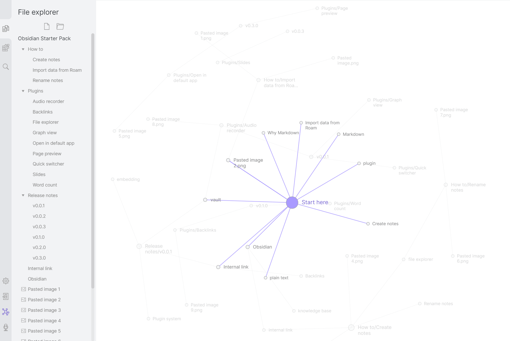
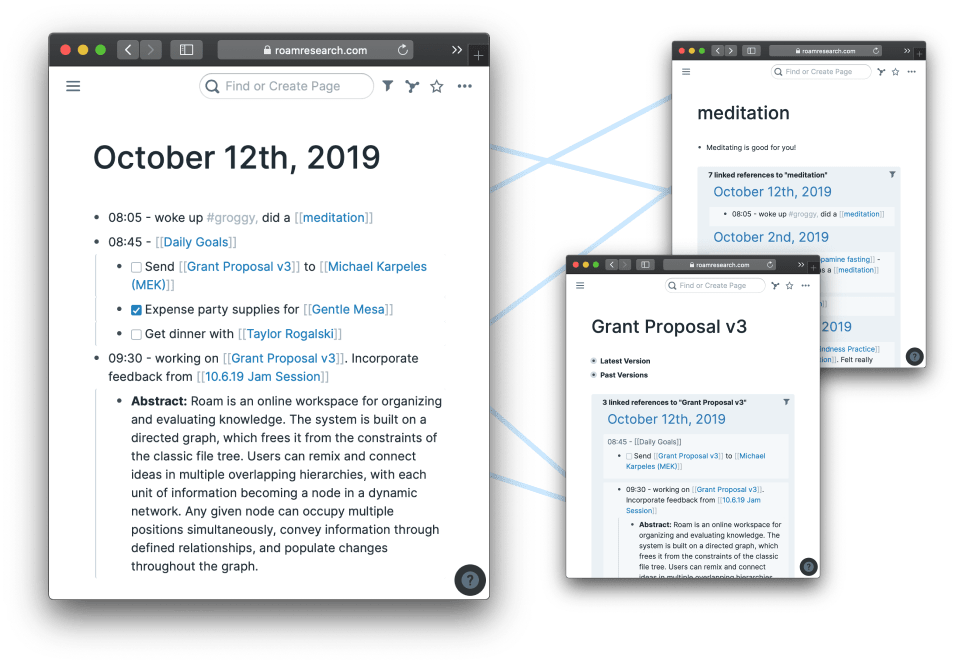
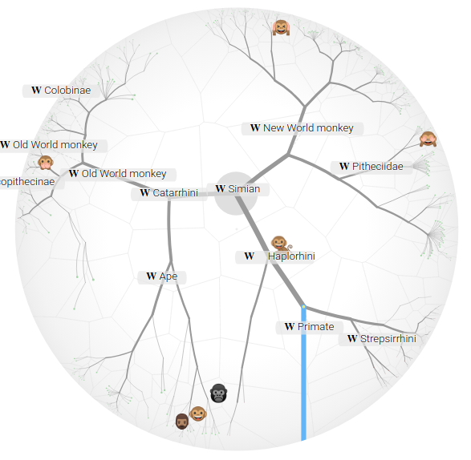

## #problem 01 / Problem Definition :: 问题定义：知识图谱为何需要更好的组织方式

Knowledge Hub 当前采用邻接表（adjacency list）+ 三种视觉布局（Galaxy / Cards / Infographic）的架构。随着知识节点从 25 个增长，以下挑战将逐步暴露。

:::flow
1. **层级扁平化问题** — 层级扁平化问题 当前 knowledgeTree 最大深度为 3（根→二级分组→文章），无法表达更精细的知识分类，如"模型→Function Calling→协议差异→厂商实现"。
2. **关联关系扁平化** — 关联关系扁平化 relations 字段仅存储 ID 列表，无法表达关系类型（依赖 / 对比 / 扩展 / 前置知识）、关系强度或方向性。
3. **检索仅依赖线性扫描** — 检索仅依赖线性扫描 无全文搜索、标签索引或语义相似度计算。随着文章数量增长到 100+，用户将难以在三种布局中定位目标知识。
4. **认知负荷上限** — 认知负荷上限 Miller's Law（7±2）限制了人类工作记忆容量。Galaxy 布局在 50+ 节点时视觉噪声将超过信息密度收益。
:::

## #foundations 02 / Theoretical Foundations :: 理论基础：信息组织的认知科学与图论

任何知识组织方案的设计都应扎根于认知科学、信息科学和图论的基本原理。以下四个理论为后续六种范式的评估提供判断框架。

:::accordion
::panel { open: true }
### Ausubel 有意义学习理论
David Ausubel（1968）提出：学习新知识最重要的单一因素是学习者已经知道什么。新知识必须与已有的认知结构（cognitive structure）建立实质性的、非任意的联系，才能被有意义地吸收。

**对知识图谱的启示：**好的知识组织应使节点间的语义关联显式化，帮助读者将新文章锚定到已有知识网络中。概念图（Concept Map）正是 Ausubel 学生 Joseph Novak 基于该理论在 1970 年代开发的工具。

**关键量化指标：**知识结构的"先行组织者"（Advance Organizer）有效性可通过 Nesbit & Adesope（2006）的元分析量化——概念图比阅读文本段落、听课和课堂讨论的学习效果分别高出 0.39 标准差（效应量 d=0.39, k=55 studies, N=5,818）。

::panel
### Miller's Law 与分块理论
George Miller（1956）发现人类短期记忆容量约为 7±2 个信息块（chunks）。这一限制直接约束了知识图谱的视觉呈现设计：

**设计约束：**每个视觉层级应展示 5–9 个信息块。当前 Galaxy 布局的 3 个根节点（5–8 个子节点/组）符合该约束。但当总节点数超过 50 时，需要引入层级折叠或焦点+上下文（Focus+Context）机制。

**分块策略：**将相关知识聚合为"超级节点"（如将 3 篇 Copilot Studio 文章折叠为一个主题卡片），可在不丢失信息的情况下降低视觉复杂度。Treemap 和 Hyperbolic Tree 均采用此策略。

::panel
### 图论：树、DAG 与一般图
知识的内在结构决定了数据模型的选择：

**树（Tree）：**严格层级，每个节点恰好有一个父节点。适合分类学（taxonomy）和文件系统。Knowledge Hub 当前的 knowledgeTree 即为树结构。限制：一篇文章只能属于一个分类。

**有向无环图（DAG）：**允许多父节点但禁止循环。适合知识点的多重归类（如 Function Calling 同时属于"模型"和"智能体"）。实现复杂度中等。

**一般图（Graph）：**允许任意边（含双向和循环）。适合表达"相关"、"对比"、"依赖"等丰富关系。实现和可视化复杂度最高，但信息表达能力最强。

**当前状态：**knowledgeTree 是一棵树（parentId 唯一）+ 弱关联列表（relations: string[]）。relations 是一般图的雏形，但缺乏关系类型和权重。

::panel
### Shneiderman 的信息可视化原则
Ben Shneiderman（1996）提出信息可视化的 Mantra：**"Overview first, zoom and filter, then details-on-demand."**

**七个任务：**概览（Overview）、缩放（Zoom）、过滤（Filter）、按需细节（Details-on-demand）、关联（Relate）、历史（History）、提取（Extract）。

**对 Knowledge Hub 的审计：**当前三种布局覆盖了概览（Galaxy/Infographic）和部分按需细节（点击进入文章）。缺失的关键能力：缩放（无语义缩放）、过滤（无标签/日期筛选）、关联（hover 线条仅是装饰性的）、历史（无浏览路径记录）。
:::

## #paradigms 03 / Six Paradigms :: 六种知识组织范式：从树到语义网络

基于理论框架和业界实践，梳理六种主要的知识组织与呈现范式，每种范式都有其理论根基、适用场景和代表案例。

Tree

### A. 层级树 / Mind Map

以单一中心概念为根，通过分支展开子主题。信息严格层级化，视觉清晰但关系表达受限。Knowledge Hub 的 Galaxy 布局即为径向树的变体。

Network

### B. 概念图 / Concept Map

基于 Novak (1972) 的有意义学习理论，允许多中心和自由形式连接。节点间关系带标注（如"导致"、"属于"），最适合表达复杂知识关联。

Zettelkasten

### C. Zettelkasten / 卡片盒

Luhmann (1952–) 建立的 90,000 张卡片系统。每张卡片是独立原子笔记，通过编号和交叉引用形成涌现结构。底层为 DAG，强调"意外发现"（serendipity）。

Spatial

### D. 空间映射 / Treemap

Shneiderman (1992) 发明，用嵌套矩形面积编码层级数据。空间利用率 100%，可在有限屏幕上展示 1000+ 节点。权衡：丢失拓扑关系。

Hyperbolic

### E. 双曲树 / Hyperbolic Tree

Lamping et al. (1995) 提出，利用双曲几何的指数增长特性：圆的周长随半径指数增长。中心焦点获得最大空间，外围节点渐进压缩。支持 Focus+Context 交互。

Semantic

### F. 语义知识图谱

基于实体-关系-实体三元组（Entity-Relation-Entity Triples），可携带类型化关系和属性。Google Knowledge Graph (2012) 和 GraphRAG (2024) 均采用此模型。

:::accordion
::panel
### A. 层级树 / Mind Map — 详细分析
**理论基础：**Tony Buzan（1974）推广，基于径向树（Radial Tree）结构。认知心理学依据：人类偏好层级分类（Rosch, 1975 的原型理论）。

**数据模型：**严格树（Tree），每个节点有且仅有一个父节点，层级无上限。

**实现逻辑：**根节点居中，一级子节点等角分布在同心圆上，二级节点围绕其父节点展开。节点间无交叉边。

**代表工具：**XMind、MindMeister、FreeMind、MindManager。

**量化数据：**Beel & Langer (2011) 分析 19,379 张思维导图：平均节点数 31，中位每节点 3 个词，最大单图 50,000 节点。

**优势：**① 认知负荷最低，层级一目了然；② 实现简单，CSS/SVG 即可渲染；③ 从任意节点都有唯一路径到根。

**劣势：**① 无法表达多归属（一篇文章属于多个主题）；② 横向关联不可见；③ 深层级时末端节点视觉权重过小。

**Knowledge Hub 匹配度：**当前架构 — knowledgeTree 即为此模型。Galaxy 布局是径向树的动画版，Cards 是缩进列表，Infographic 是弧形树。三种布局共享同一棵树，已充分利用此范式。

::panel
### B. 概念图 / Concept Map — 详细分析
**理论基础：**Joseph Novak (1972) 基于 Ausubel 的有意义学习理论开发。核心洞察："没有命题的概念是没有意义的"——节点间的关系必须有明确的语义标注。

**数据模型：**一般图（Graph），节点为概念，边为带标注的关系（如"是前置知识"、"对比"、"扩展"）。允许多中心、循环和双向关系。

**实现逻辑：**力导向布局（Force-directed layout）或约束布局（Constraint-based layout）。Spring-Embedder 算法：每条边模拟弹簧，节点间电荷斥力，迭代至平衡。

**代表工具：**CmapTools (IHMC)、Obsidian Graph View、TheBrain、Logseq。

**量化数据：**Nesbit & Adesope (2006) 元分析 55 项研究：概念图比传统学习方法效应量 d=0.39（p<0.001），但高能力学习者的收益低于低能力学习者。

**优势：**① 表达能力最强，可编码任何语义关系；② 鼓励发现意外关联；③ 多中心支持多视角理解。

**劣势：**① 50+ 节点时视觉混乱（"hairball" 问题）；② 布局算法不稳定，节点位置在不同渲染间变化；③ 关系标注增加内容创作负担。

**Knowledge Hub 匹配度：**高价值 — relations 字段是概念图的雏形。应升级为带类型和强度的关系，并在 Galaxy 布局的 hover 交互中显式化关系语义。

::panel
### C. Zettelkasten / 卡片盒 — 详细分析
**理论基础：**Niklas Luhmann 从 1952 年开始建立的 90,000 张卡片系统。核心理念：知识不应按主题归类，而应通过编号系统和交叉引用形成涌现结构。Luhmann 描述他的卡片盒为"交流伙伴"（Kommunikationspartner）。

**数据模型：**DAG + 交叉引用。每张卡片有唯一编号（分层编号如 1/2a/3b），通过引用链形成序列。同时通过关键词索引实现跨序列发现。

**实现逻辑：**原子笔记（每卡一个想法）+ 前向链接（这张卡片引用哪些卡片）+ 反向链接（哪些卡片引用了这张）+ 索引入口（提供主题入口点）。

**代表工具：**Obsidian、Roam Research、Logseq、Notion、TiddlyWiki。

**量化数据：**Luhmann 约 50 本著作和 550 篇文章的产出被归因于 Zettelkasten 系统。其 90,000 张卡片已于 2019 年数字化并上线（Bielefeld 大学）。

**优势：**① 原子笔记促进精确思考；② 双向链接使知识网络自然涌现；③ 扁平结构避免过早分类的约束；④ 高度适合持续增量写作。

**劣势：**① 无全局概览，需要"漫游"发现结构；② 初始创建成本高——每篇文章需拆解为原子笔记；③ 链接维护随规模增长的边际成本递增。

**Knowledge Hub 匹配度：**中等价值 — Knowledge Hub 的文章粒度已较大（非原子笔记），直接采用 Zettelkasten 需要改变内容创作方式。但其双向链接思想可用于增强 relations 机制（自动生成反向链接列表）。

::panel
### D. 空间映射 / Treemap — 详细分析
**理论基础：**Ben Shneiderman (1992) 在 Maryland HCIL 发明。利用空间填充算法将层级数据映射到 2D 矩形，面积编码权重，颜色编码第二维度。

**数据模型：**加权树，叶节点面积与某量化属性（文章字数、关联数、访问量）成正比。

**实现逻辑：**15 种矩形分割算法（Squarified 最常用：宽高比最优化, Bruls et al. 2000）。交互：点击矩形下钻（drill-down），面包屑导航回退。

**代表案例：**SmartMoney Map of the Market（1999，首个 Web Treemap），Newsmap（2004，新闻可视化），纽约时报预算可视化（2011）。

**量化数据：**Kong et al. (2010) 的感知研究：宽高比接近 1:1 时感知精度最高，超过 1:8 时面积估计误差 >30%。Squarified 算法将平均宽高比控制在 1:3 以内。

**优势：**① 空间利用率 100%，同屏可展示 1000+ 节点；② 权重直觉化——面积大=重要；③ 色块提供快速模式识别。

**劣势：**① 丢失拓扑/层级关系——相邻矩形未必有语义关系；② 深层级节点面积过小导致不可读；③ 不适合展示关联线。

**Knowledge Hub 匹配度：**中等价值 — 可作为第四种布局模式，用文章关联数或内容量作为面积权重。实现复杂度中等（Squarified 算法约 100 行 JS）。但与 Galaxy 的视觉风格差异大，融合需要设计工作。

::panel
### E. 双曲树 / Hyperbolic Tree — 详细分析
**理论基础：**Lamping, Rao & Pirolli (1995, Xerox PARC) 提出。利用双曲几何的核心特性：在双曲平面上，圆的周长随半径指数增长（vs 欧几里得空间中线性增长）。这使得指数级增长的树节点可以在有限空间中无重叠地布局。

**数据模型：**树结构的 Poincaré 圆盘投影。聚焦节点位于中心并获得最大空间，远离焦点的节点被非线性压缩到圆盘边缘，但始终可见。

**实现逻辑：**① 在双曲平面上等角铺排树节点；② 通过 Poincaré 圆盘模型映射到单位圆；③ 用户交互通过 Möbius 变换实现焦点平移——拖拽任意节点到中心，其邻域展开，其他区域压缩。

**代表案例：**d3-hypertree（MIT 开源 HTML5 实现），Hyperbolic Tree of Life（开放生命树可视化），Xerox InXight（商业产品，专利已过期）。

**优势：**① 完美实现 Focus+Context——全局始终可见，焦点区域细节丰富；② 支持 100,000+ 节点（Tree of Life 示例）；③ 交互流畅，拖拽即可改变焦点。

**劣势：**① 边缘节点极度变形，标签不可读；② 用户需要学习双曲空间的导航直觉；③ 只支持树结构，无法直接编码交叉关联。

**Knowledge Hub 匹配度：**高价值 — Galaxy 布局在概念上已接近双曲树（中心焦点 + 径向展开），升级为真正的双曲树可获得无限层级和 Focus+Context 能力。d3-hypertree 是 MIT 许可的现成实现，可直接集成。

::panel
### F. 语义知识图谱 — 详细分析
**理论基础：**源于语义网（Semantic Web, Tim Berners-Lee 2001）和知识表示（Knowledge Representation）。核心数据单元是三元组（Triple）：<主语, 谓词, 宾语>，如 <Function-Calling 文章, 是前置知识, Enterprise-Agent 文章>。

**数据模型：**属性图（Property Graph）或 RDF 图。节点有类型（Article / Topic / Concept），边有类型和属性（权重、创建时间），支持推理。

**实现逻辑：**① 定义本体（Ontology）：节点类型、关系类型、属性规格；② 将 knowledgeTree 转换为三元组集合；③ 使用力导向布局或层级布局可视化；④ 支持 SPARQL 类查询（如"找到所有从 Function Calling 可达的文章"）。

**代表系统：**Google Knowledge Graph（2012, 70B+ 实体），Wikidata（100M+ 项），Microsoft GraphRAG（2024, LLM 生成图 + RAG），Neo4j（图数据库）。

**优势：**① 表达能力最强——可编码任何关系和属性；② 支持推理（如传递性：A→B→C 推导出 A→C）；③ 天然支持全图搜索和路径查询；④ 与 LLM/RAG 技术的融合前景最佳。

**劣势：**① 开发和维护成本最高——需要定义本体、管理三元组；② 可视化"毛球"问题（50+ 节点）；③ 对静态站点来说过度工程（over-engineering）。

**Knowledge Hub 匹配度：**长期价值 — 当前静态站点无需完整语义图谱，但其设计思想（类型化关系、属性丰富的节点）可逐步引入 knowledgeTree。短期可为 relations 增加类型；中期可引入 tags 作为概念节点；长期可考虑 GraphRAG 驱动的智能导航。
:::

## #comparison 04 / Comparative Analysis :: 九维度对比矩阵

从组织、检索、呈现、认知负荷等九个维度对六种范式进行系统对比，评级基于理论分析和案例验证。

| 维度 | A. 层级树 | B. 概念图 | C. Zettelkasten | D. Treemap | E. 双曲树 | F. 语义图谱 |
| --- | --- | --- | --- | --- | --- | --- |
| 节点容量 | ~100 中 | ~50 低 | 90,000+ 极高 | 1,000+ 高 | 100,000+ 极高 | 10M+ 极高 |
| 关系表达力 | 仅父子 低 | 带标注任意关系 极高 | 双向链接 高 | 仅层级包含 低 | 仅父子 低 | 类型化三元组 极高 |
| 认知负荷 | 低 | 高 | 中 | 中 | 中 | 高 |
| 检索能力 | 路径遍历 中 | 关系遍历 高 | 全文+链接 高 | 面积扫描 低 | 焦点导航 中 | 图查询 极高 |
| 增量维护成本 | 低（append） 低 | 中（需画关系） 中 | 低（原子笔记） 低 | 低（auto-layout） 低 | 低（auto-layout） 低 | 高（维护本体） 高 |
| 静态站点适配 | 完美 | 较好 | 需工具 | 较好 | 较好 | 需后端 |
| Focus+Context | 无 低 | hover 高亮 中 | 局部图谱 中 | drill-down 中 | Möbius 变换 极高 | 子图展开 高 |
| 发现性（serendipity） | 低 低 | 高 高 | 极高 极高 | 中 中 | 中 中 | 高 高 |
| 实现复杂度 | ~200 行 低 | ~500 行 中 | ~1000 行 中 | ~300 行 低 | ~800 行 中 | ~2000+ 行 高 |

## #cases 05 / Case Studies :: 业界案例研究

以下四组案例覆盖了从个人知识管理到企业知识平台的完整光谱，为 Knowledge Hub 的演进提供实践参考。

:::accordion
::panel { open: true }
### 案例组 1：Obsidian Graph View — 双向链接 + 力导向图
**产品定位：**本地优先的 Markdown 个人知识库，以双向链接为核心。

**组织机制：**文件夹（可选层级）+ 双向链接（[[wikilink]]）+ 标签（#tag）+ YAML front matter 属性。

**可视化：**内置 Graph View 使用力导向布局（Force-directed），节点颜色编码所属文件夹，大小编码链接数。支持过滤（按路径、标签、已有链接）、分组、以及 Local Graph（单笔记的邻域图）。

**规模验证：**社区用户报告 5,000+ 笔记的 Graph View 仍可交互（但需 >8GB RAM）。1,000+ 笔记时 Local Graph 比 Global Graph 更实用。

**对 Knowledge Hub 的启示：**① Local Graph 思路可用于文章页内的"相关知识地图"；② 双向链接的自动反向索引可零成本实现（在 knowledgeTree 渲染时自动计算）；③ YAML front matter 类似 knowledgeTree 条目的元数据。

::panel
### 案例组 2：Roam Research — 日记驱动的块引用网络
**产品定位：**以日记为入口的网络化笔记系统，强调"先写后组织"。

**组织机制：**每日日记页（Daily Note）作为默认入口 + 块级双向链接（Block Reference）+ 侧边栏平行浏览 + 图查询（Query）。

**核心创新：**块引用（Block Reference）将链接粒度从"页面"降低到"段落"，使知识网络的密度远高于页面级链接。用户可将任意段落嵌入（embed）到其他页面中。

**对 Knowledge Hub 的启示：**① 块引用思路可用于文章 section 级别的交叉引用（如"参见 Enterprise Agent Architecture 第 3 节"）；② 日记驱动对 AI Radar 等定期刊物的组织有参考价值；③ 侧边栏平行浏览可转译为文章页的分屏对比功能。

::panel
### 案例组 3：Wikipedia / Wikidata — 超文本 + 结构化数据
**产品定位：**全球最大的免费知识库。Wikipedia 为人类可读文本，Wikidata 为机器可读结构化数据。

**组织机制：**分类树（Category Tree, 20 层+）+ 内联链接（超文本）+ Infobox（结构化元数据）+ Wikidata 实体图（100M+ 项，三元组模型）。

**可视化：**Wikipedia 本身不提供图形化导航。但 Wikidata 的 Graph Builder 和第三方工具（如 Reasonator）提供图查询和关系可视化。关键数据：Wikipedia 英文版 680 万+ 篇文章，170 万+ 分类，平均每篇 有 100+ 内部链接。

**对 Knowledge Hub 的启示：**① Category Tree 的多层嵌套机制对应 knowledgeTree 的 parentId 链，但 Wikipedia 允许一篇文章属于多个 Category（DAG vs Tree）；② Infobox 思路可用于文章 Hero 区域的结构化元数据（tags、date、relations）；③ 内联超文本链接是最自然的关联表达方式。

::panel
### 案例组 4：d3-hypertree — 开源双曲树实现
**产品定位：**MIT 许可的 HTML5 双曲树可视化库，基于 D3.js。

**技术规格：**使用 Poincaré 圆盘模型，支持 Canvas 和 SVG 渲染。内置 Möbius 变换实现焦点平滑过渡。支持标签渲染、节点着色、层级折叠。

**性能数据：**Hyperbolic Tree of Life 示例包含 2.3M+ 物种节点，在现代浏览器中可流畅交互。关键优化：仅渲染 Poincaré 圆盘内可见的节点（LOD, Level of Detail）。

**对 Knowledge Hub 的启示：**① 最契合 Galaxy 布局的升级路径——同为圆盘中心+径向展开，但双曲版本具备无限层级和 Focus+Context 能力；② MIT 许可兼容 CC BY 4.0；③ 无需引入 NPM，可直接 <script> 引入。

**风险评估：**① 双曲空间的导航直觉需要用户学习（约 2–3 次交互可掌握）；② 边缘节点标签的可读性需要专门处理（动态字号或 hover 放大）；③ 与现有 Galaxy 的动画风格需要视觉统一。
:::

## #fit-analysis 06 / Fit Analysis :: 与 Knowledge Hub 的匹配分析

基于项目约束（静态站点、零框架、CC BY 4.0、当前 25 节点）和发展目标（100→500→1000+ 节点），对六种范式进行匹配度评估。

:::accordion
::panel { open: true }
### 项目约束清单
**C1 — 零框架约束：**纯 vanilla JS + CSS，不引入 React/Vue/npm。可视化库必须支持 <script> 标签直接引入。

**C2 — 静态部署约束：**GitHub Pages，无后端、无数据库。所有数据在 knowledge-data.js 中硬编码。

**C3 — 单文件数据源约束：**knowledgeTree[] 是唯一数据源，所有布局从同一数组派生。新增布局不应要求独立的数据结构。

**C4 — 增量创作约束：**添加新文章应仅需 ① 创建 HTML 文件 ② 在 knowledgeTree 追加一条记录。不应需要重新标注关系或重建索引。

**C5 — 认知预算约束：**目标用户是技术研究者，但首次访问仍需在 5 秒内理解导航方式（Nielsen 的 10 秒规则的保守版本）。

::panel
### 各范式匹配度雷达
综合五个约束条件，对六种范式的匹配度进行评分（5 = 完全匹配，1 = 不兼容）：

| 范式 | C1 零框架 | C2 静态部署 | C3 单数据源 | C4 增量创作 | C5 认知预算 | 总分 /25 |
| --- | --- | --- | --- | --- | --- | --- |
| **A. 层级树** | 5 | 5 | 5 | 5 | 5 | 25 |
| **B. 概念图** | 4 | 5 | 4 | 3 | 3 | 19 |
| **C. Zettelkasten** | 3 | 4 | 3 | 2 | 2 | 14 |
| **D. Treemap** | 5 | 5 | 5 | 5 | 4 | 24 |
| **E. 双曲树** | 4 | 5 | 5 | 5 | 3 | 22 |
| **F. 语义图谱** | 2 | 2 | 2 | 2 | 2 | 10 |

**结论：**A（当前架构）和 D（Treemap）最契合现有约束；E（双曲树）在引入一个外部库后同样高度可行；B（概念图）的关系增强思想可叠加到任何布局上；C 和 F 的核心思想可作为长期设计方向但短期实现成本过高。

::panel
### 推荐策略：渐进式混合架构
不采用单一范式替换，而是**渐进式混合**——保留树结构作为骨架，逐步叠加其他范式的核心能力：

**骨架层（Tree）：**knowledgeTree 维持邻接表不变，保证 C3/C4 约束。

**关系层（Concept Map 思想）：**升级 relations 字段为带类型的对象数组 `[{target, type, weight}]`，在 Galaxy/Cards/Infographic 中显式化关系语义。

**呈现层（多布局）：**保留 Galaxy/Cards/Infographic 三种布局，逐步引入 Treemap 和/或 Hyperbolic Tree 作为第4/5种布局。

**检索层（标签索引）：**利用已有 tags 字段构建客户端搜索索引，支持标签筛选和模糊搜索。

**智能层（长期）：**当节点数突破 200 时，考虑引入 GraphRAG 思想——在构建时预计算知识社区（communities）和摘要。
:::

## #roadmap 07 / Evolution Roadmap :: Knowledge Hub 知识组织演进路线

基于匹配分析和渐进式混合策略，制定三阶段演进计划。每阶段有明确的节点规模触发条件和交付物。

Phase 1

### 关系增强 + 标签索引（25→50 节点）

在现有架构上做最小改动，获得最大信息密度提升。

- **升级 relations 数据模型**：从 `relations: ['id1','id2']` 升级为 `relations: [{target:'id1', type:'prerequisite', weight:0.8}]`。关系类型集：prerequisite（前置知识）、extends（扩展）、compares（对比）、implements（实现）、inspires（启发）。
- **自动反向链接**：渲染时自动计算 backlinks —— 如果 A→B 存在，B 的详情中也显示"被 A 引用"。零维护成本。
- **标签搜索面板**：在 Cards 布局顶部增加标签筛选栏，点击标签高亮匹配文章，多标签取交集。
- **Galaxy hover 增强**：hover 时显示关系类型标签（如"前置知识 ←"），取代当前无语义的连接线。

Phase 2

### 第四布局 + 客户端搜索（50→200 节点）

当三种布局的信息密度达到上限时，引入新的可视化范式。

- **Treemap 布局**：以文章关联数 × 标签覆盖度作为面积权重，颜色编码主题分类。实现 Squarified 算法（约 100 行 JS），支持点击下钻和面包屑导航。
- **或 Hyperbolic Tree 布局**：引入 d3-hypertree（MIT 许可），作为 Galaxy 的"深度模式"。用户可在 Galaxy（动画美感优先）和 Hyperbolic（层级导航优先）间切换。
- **客户端全文搜索**：基于 tags + title + summary 构建倒排索引（约 200 行 JS），支持模糊匹配和拼音搜索。无需后端。
- **文章页"知识邻域图"**：在每篇文章底部渲染 Local Graph——以当前文章为中心，展示 1-hop 和 2-hop 关联文章。参考 Obsidian Local Graph View。

Phase 3

### 知识社区 + 语义导航（200→1000+ 节点）

当节点密度超过人类直接浏览能力时，引入自动化知识结构发现。

- **知识社区检测**：在构建时对 knowledgeTree 的关系图运行 Louvain 社区检测算法，自动将文章聚合为知识社区（如"Client Architecture 社区"、"Agent Design 社区"）。社区可作为虚拟的"超级主题节点"。
- **阅读路线生成**：基于 prerequisite 关系的拓扑排序，自动生成"学习路径"（如"入门 Agent 开发：Enterprise Architecture → Function Calling → Agentic Skill Execution"）。
- **语义相似度引擎**：在构建时使用 TF-IDF 或嵌入模型（如 Web Worker 中运行 ONNX Runtime）计算文章间的语义相似度，补充显式 relations 之外的"潜在关联"。
- **个性化收藏与历史**：利用 localStorage 记录用户浏览历史，在首页高亮"最近浏览"和"推荐探索"区域。

## #references 08 / References :: 参考文献

- [1] Ausubel, D. | 有意义学习理论的原始文献，提出"影响学习最重要的因素是学习者已有知识"。
- [2] Novak, J.D.; Cañas, A.J. | 概念图的权威理论文档，阐述 Ausubel 理论到可视化工具的转化过程。
- [3] Miller, G.A. | 短期记忆容量上限，为知识图谱的视觉层级设计提供认知约束。
- [4] Shneiderman, B. | 信息可视化 Mantra "Overview first, zoom and filter, then details-on-demand" 的出处。
- [5] Shneiderman, B. | Treemap 算法的原始论文。
- [6] Lamping, J.; Rao, R.; Pirolli, P. | 双曲树的原始论文，提出利用 Poincaré 圆盘模型实现 Focus+Context。
- [7] Schmidt, J. | Luhmann Zettelkasten 的学术研究，分析 90,000 张卡片系统的组织原理。
- [8] Nesbit, J.C.; Adesope, O.O. | 55 项研究的元分析，量化概念图的学习效果（效应量 d=0.39）。
- [9] Beel, J.; Langer, S. | 分析 19,379 张思维导图的量化研究。
- [10] Kong, N.; Heer, J.; Agrawala, M. | Treemap 感知研究，提出宽高比对面积估计精度的影响量化数据。
- [11] Edge, D. et al. | Microsoft GraphRAG 论文，知识图谱与 LLM 融合的最新范式。
- [12] Hogan, A. et al. | 知识图谱的综合综述，覆盖定义、表示、构建和应用。
