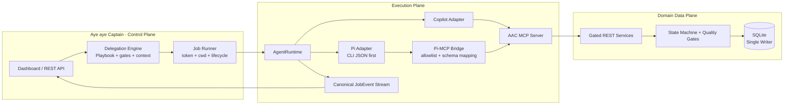

## #positioning 01 / Product Positioning :: Pi 是可扩展的 Agent 宿主，不是预设完整工作流的编码产品 || Pi Is an Extensible Agent Host, Not a Product with One Prescribed Workflow

官方把 Pi 定义为 minimal terminal coding harness：核心处理模型调用、工具循环、会话和终端交互；计划、审批、MCP、子代理等工作流能力不进入内核，而由 Extensions、Skills、Packages、外部 CLI、tmux 或容器补齐。[1][2][8][9] 这项边界决定了它的优势与学习成本。 || The official documentation defines Pi as a minimal terminal coding harness: the core handles model calls, the tool loop, sessions, and terminal interaction. Workflow features such as planning, approvals, MCP, and subagents stay outside the core and can be supplied by extensions, skills, packages, external CLIs, tmux, or containers.[1][2][8][9] This boundary determines both its strengths and its learning cost.

:::accordion
::panel { open: true }
### 1.1 四层架构各自可以独立使用 || 1.1 Each of the Four Architecture Layers Can Be Used Independently
Pi 不是一个不可拆分的 CLI；四个公开包把模型接入、Agent 循环、终端 UI 与成品 CLI 分开，允许只复用需要的层。[1][6] || Pi is not an indivisible CLI. Four public packages separate model access, the agent loop, the terminal UI, and the finished CLI, allowing consumers to reuse only the layers they need.[1][6]

- **pi-ai** — 统一 OpenAI、Anthropic、Google 等 Provider API，处理流式输出、推理内容、工具调用、成本与跨 Provider 上下文转换。 || Unifies OpenAI, Anthropic, Google, and other provider APIs while handling streaming, reasoning content, tool calls, cost, and cross-provider context conversion.
- **pi-agent-core** — 提供 Agent 循环、工具执行、状态管理、附件与消息队列，不绑定某一种用户界面。 || Provides the agent loop, tool execution, state management, attachments, and message queues without binding to one user interface.
- **pi-tui** — 采用保留终端 scrollback 的差分渲染方式，组件可以缓存并局部更新。 || Uses differential rendering while preserving terminal scrollback; components can cache output and update incrementally.
- **pi-coding-agent** — 把模型、Agent、TUI、会话与资源发现组合为可直接使用的终端编码 Agent。 || Combines models, the agent runtime, TUI, sessions, and resource discovery into the ready-to-use terminal coding agent.

::panel
### 1.2 默认 Agent 循环只有四个关键动作 || 1.2 The Default Agent Loop Has Four Essential Actions
默认工具集围绕 read、bash、edit、write 展开；grep、find、ls 可组成只读工具集。模型在产生不含工具调用的响应前持续循环，用户可以在运行中插入 steering 或 follow-up 消息。[2][6] || The default toolset centers on read, bash, edit, and write; grep, find, and ls can form a read-only set. The model continues looping until it produces a response without tool calls, while users can queue steering or follow-up messages during execution.[2][6]

1. **组装上下文 || Assemble Context** — 加载系统提示、AGENTS.md / CLAUDE.md、Skills 描述、有效工具和当前会话分支。 || Load the system prompt, AGENTS.md or CLAUDE.md, skill descriptions, active tools, and the current session branch.
2. **调用模型 || Call the Model** — Provider 适配层负责请求格式、流式事件、推理内容、缓存和使用量差异。 || The provider adapter handles request formats, streaming events, reasoning content, caching, and usage differences.
3. **执行并记录工具 || Execute and Record Tools** — 工具参数经 schema 验证后执行，结果写回会话；同一批工具可以并行运行。 || Tool arguments are schema-validated before execution, and results are written back to the session; tools in one batch can run in parallel.
4. **继续、转向或结束 || Continue, Steer, or Finish** — 有工具结果或 steering 消息时进入下一轮；无工具调用且队列为空时结束。 || Tool results or steering messages trigger another turn; the run ends when there are no tool calls and the queue is empty.

::panel
### 1.3 六类常见能力被有意留在内核之外 || 1.3 Six Common Capabilities Are Deliberately Kept Outside the Core
这些能力并未被内核禁止，只是不作为所有用户都必须承担的默认复杂度；官方 examples 已提供其中多项的扩展实现。[2][3] || These capabilities are kept out of the default kernel so every user does not pay their complexity cost. Official examples already provide extension implementations for several of them.[2][3]

- **权限弹窗 || Permission Prompts** — 可通过 tool_call 事件挂载拦截规则与人工确认；默认不启用逐次审批。 || Rules and confirmations can be attached through tool_call events; per-action approval is not enabled by default.
- **Plan Mode 与 Todo || Plan Mode and Todos** — 可用只读工具、文件或官方 plan-mode 扩展示例实现。 || They can be implemented with read-only tools, files, or the official plan-mode extension example.
- **MCP** — 内核不加载 MCP 工具清单；需要时可通过 CLI 包装器或扩展接入。 || The core does not load MCP tool catalogs; wrappers or extensions can add them when needed.
- **子代理 || Subagents** — 可由扩展或 pi --print 子进程生成，内核不规定编排方式。 || Extensions or pi --print subprocesses can create them; the core does not prescribe orchestration.
- **后台 Shell || Background Shell** — 官方建议用 tmux 管理 server、watcher、REPL 和调试器。 || The official recommendation is to use tmux for servers, watchers, REPLs, and debuggers.
- **进程内沙箱 || In-Process Sandbox** — 真实隔离交给 Docker、OpenShell、Gondolin 微型 VM 或其他 OS 边界。 || Real isolation is delegated to Docker, OpenShell, Gondolin micro-VMs, or another OS boundary.
:::

## #capabilities 02 / Capability Map :: 日常编码能力完整，差异集中在会话、模型与编程接口 || Daily Coding Is Complete; Sessions, Models, and APIs Create the Difference

Pi 可以读写项目、运行命令、处理图片、压缩上下文并恢复会话。它还将会话保存为可分支的 JSONL 树，支持在同一对话中回退到任意历史节点，并提供 TUI、一次性输出、JSON 事件流、RPC 和 Node.js SDK。[2][4][6] || Pi can read and write projects, run commands, process images, compact context, and resume sessions. It stores sessions as branchable JSONL trees so a conversation can return to any historical point. It also exposes a TUI, one-shot output, a JSON event stream, RPC, and a Node.js SDK.[2][4][6]

:::accordion
::panel { open: true }
### 2.1 交互式编码覆盖完整执行链路 || 2.1 Interactive Coding Covers the Full Execution Loop
从定位文件到修改与验证，Pi 的默认工具足以完成常见代码任务；TUI 还提供文件模糊搜索、路径补全、多行输入、图片粘贴、外部编辑器与 shell 快捷入口。[2] || From locating files through editing and verification, Pi's default tools cover common coding tasks. The TUI also provides fuzzy file search, path completion, multiline input, image paste, an external editor, and shell shortcuts.[2]

- **理解与定位 || Understand and Locate** — 读取文本或图片，通过 @ 选择文件；grep、find、ls 支持受限的只读分析。 || Read text or images and select files with @; grep, find, and ls support constrained read-only analysis.
- **修改与执行 || Modify and Execute** — 精确编辑、完整写入和 shell 执行串起代码修改与验证链路，工具调用过程与结果直接显示。 || Exact edits, full writes, and shell execution connect code changes with verification, while tool calls and results appear directly.
- **运行中干预 || Mid-Run Intervention** — Enter 发送 steering，在当前工具批次结束后改变方向；Alt+Enter 把补充任务排到整个 Agent 运行之后。 || Enter queues steering after the current tool batch; Alt+Enter queues a follow-up after the complete agent run.

::panel
### 2.2 树状会话支持保留多条探索路径 || 2.2 Tree Sessions Preserve Multiple Lines of Exploration
每条会话记录都有 id 与 parentId，当前活跃位置是一个 leaf；因此改变早期提示不会删除后续历史，而是形成新分支。[4] || Every session entry has an id and parentId, and the current position is an active leaf. Revising an earlier prompt therefore creates a new branch instead of deleting later history.[4]

/tree

**在一个会话文件内探索替代方案 || Explore Alternatives in One Session File**

- 跳到任意历史 entry 并从那里继续。 || Jump to any historical entry and continue from there.
- 可为离开的分支生成摘要并带入新路径。 || Optionally summarize the abandoned branch into the new path.
- 标签可标记重要检查点。 || Labels can mark important checkpoints.

/fork · /clone

**把选中的历史路径拆成新会话 || Split a Selected History Path into a New Session**

- fork 从较早的用户消息开始新文件。 || Fork starts a new file from an earlier user message.
- clone 复制当前活跃分支。 || Clone duplicates the current active branch.
- 适合隔离代码审查、替代实现或模型对比。 || Useful for isolated reviews, alternative implementations, or model comparisons.

::panel
### 2.3 Provider 抽象允许在会话中切换模型 || 2.3 Provider Abstraction Enables Mid-Session Model Switching
Pi 支持订阅 OAuth、API key、云平台、本地 llama.cpp 与 OpenAI-compatible endpoint；模型变化时尽力转换不同 Provider 的工具调用和推理内容格式，但这种交接受上游 API 差异限制。[7][10] || Pi supports subscription OAuth, API keys, cloud platforms, local llama.cpp, and OpenAI-compatible endpoints. When models change, it performs best-effort conversion across provider-specific tool-call and reasoning formats, but the handoff remains constrained by upstream API differences.[7][10]

| 接入类型 || Access Type | 代表选项 || Representative Options | 适用判断 || When It Fits |
| --- | --- | --- |
| 订阅登录 || Subscription Login | ChatGPT、Claude、GitHub Copilot、xAI || ChatGPT, Claude, GitHub Copilot, xAI | 已有个人订阅，希望减少密钥配置；具体计费仍按 Provider 规则。 || You already have a personal subscription and want less key setup; billing still follows provider rules. |
| API 与云平台 || APIs and Cloud Platforms | OpenAI、Anthropic、Google、Azure OpenAI、Bedrock、Vertex AI || OpenAI, Anthropic, Google, Azure OpenAI, Bedrock, Vertex AI | 需要固定账单、企业云身份或网关治理。 || You need controlled billing, enterprise cloud identity, or gateway governance. |
| 聚合网关 || Aggregator Gateways | OpenRouter · Cloudflare AI Gateway · Vercel AI Gateway | 希望从一个账户试用多家模型或统一转发。 || You want to test many models from one account or centralize routing. |
| 本地与自托管 || Local and Self-Hosted | llama.cpp · Ollama · LM Studio · vLLM | 数据位置、离线运行或推理成本比模型上限更重要。 || Data location, offline operation, or inference cost matters more than frontier capability. |

::panel
### 2.4 CLI、RPC 与 SDK 覆盖三种集成深度 || 2.4 CLI, RPC, and SDK Cover Three Integration Depths
同一运行时既可以被人直接操作，也可以作为子进程或 Node.js 库嵌入产品；选择标准是是否需要类型安全与进程内状态访问。[2][6] || The same runtime can be used directly by a person, embedded as a subprocess, or linked as a Node.js library. The deciding factor is whether type safety and in-process state access are required.[2][6]

- **TUI / Print** — 个人交互用默认 TUI；脚本中的单次任务用 pi -p，标准输入可直接并入提示。 || Use the default TUI for personal interaction and pi -p for one-shot scripts; standard input can be merged into the prompt.
- **JSON / RPC** — JSON 输出全部事件；RPC 通过 stdin/stdout JSONL 控制会话，适合非 Node.js 客户端与进程隔离。 || JSON emits every event; RPC controls sessions over stdin/stdout JSONL, fitting non-Node.js clients and process isolation.
- **Node.js SDK** — 直接访问 AgentSession、事件、模型、工具、会话树与资源加载器，适合自定义 UI、评测和自动化产品。 || Directly exposes AgentSession, events, models, tools, session trees, and resource loaders for custom UIs, evaluations, and automation products.
:::

## #sample 03 / Integration Sample :: Aye aye Captain 已把 Agent 限定在可替换的执行边界内 || Aye aye Captain Already Constrains the Agent to a Replaceable Execution Boundary

Aye aye Captain 是一个 local-first 项目操作系统。它把任务设计、状态机、质量门禁、人工审批和项目知识保存在本地控制面，只将单次 Playbook 的执行委派给 coding agent。当前内置 28 个 Playbook，MCP server 暴露 48 个结构化工具；Agent 无权直接写 SQLite，所有业务写入必须经过 REST API 与同一组门禁。[17] 这条边界让 Pi 可以替换现有 Copilot CLI，而不改变项目治理语义。 || Aye aye Captain is a local-first project operating system. Task design, state machines, quality gates, human approval, and project knowledge stay in its local control plane, while a coding agent executes only one playbook at a time. The system includes 28 built-in playbooks and exposes 48 structured tools through its MCP server. Agents cannot write SQLite directly; every domain mutation passes through the REST API and quality gates.[17] Pi can therefore replace the Copilot CLI without altering project governance.

:::accordion
::panel { open: true }
### 3.1 一次委派经过六个可审计边界 || 3.1 One Delegation Crosses Six Auditable Boundaries
控制面先决定任务和权限，再启动 Agent；Agent 的退出码只说明进程结束，不能越过交付门禁。这条链路可以在不改业务层的前提下更换执行器。 || The control plane decides the task and permissions before starting an agent. An exit code only proves that the process ended and cannot bypass the delivery gate. This path supports runtime replacement without changing the domain layer.

1. **Playbook 决定任务语义 || The Playbook Defines Task Semantics** — delegate(playbookKey, ...) 解析项目覆盖或全局版本，并执行 repo、设计和验证命令等前置检查。 || delegate(playbookKey, ...) resolves a project override or global version and runs repository, design, and validation-command preflight checks.
2. **引擎组合受约束上下文 || The Engine Composes Governed Context** — 项目原则、质量规则、ADR、架构锚点、产品意图和历史踩坑从数据库注入；输出语言与写作风格由中心指令统一追加。 || Project principles, quality rules, ADRs, architecture anchors, product intent, and prior failure notes are injected from the database, followed by centrally managed language and writing directives.
3. **每个作业获得一次性能力令牌 || Each Job Receives a One-Time Capability Token** — runJob 创建作业记录，签发 AAC_JOB_TOKEN，并把 job id、Playbook key 与 repo cwd 注入子进程；作业结束后立即撤销令牌。 || runJob creates the job record, issues AAC_JOB_TOKEN, and injects the job id, playbook key, and repository working directory into the child process; the token is revoked when the job ends.
4. **执行器只获得本次工具白名单 || The Runtime Receives Only the Job Tool Allowlist** — Playbook 的 mcp_tools 生成临时配置。读架构、修 Bug、回复话题分别获得不同工具，未授权工具不应进入模型上下文。 || The playbook's mcp_tools field produces a temporary configuration. Architecture analysis, bug fixing, and topic replies receive different tools, while unauthorized tools stay out of model context.
5. **MCP 只把调用转给 REST API || MCP Forwards Calls Only to the REST API** — 48 个工具共享同一个 server.mjs，调用时携带 job id 与令牌。API 验证项目、作业状态、Playbook 和来源，再由服务层写入。 || All 48 tools share one server.mjs. Calls carry the job id and token; the API verifies project, job status, playbook, and provenance before the service layer writes data.
6. **交付由平台事实判定 || Platform Facts Determine Delivery** — 需要 post_message 的任务只有在 messages 表出现关联 Agent 消息后才成功；进程即使 exit 0，缺少消息仍会被标为失败并留下系统说明。 || A job requiring post_message succeeds only after an associated agent message exists in the messages table. Even exit code 0 becomes a failure when delivery is missing, with a system explanation persisted for review.

::panel
### 3.2 Pi 只替换现有链路中的四项执行职责 || 3.2 Pi Replaces Only Four Execution Responsibilities in the Existing Path
现有引擎已经把 Agent 视为临时执行单元，因此接入 Pi 不需要迁移 Playbook 或数据库。替换范围集中在进程命令、模型接入、Agent loop 与事件解析。 || The existing engine already treats an agent as an ephemeral execution unit, so adopting Pi does not require migrating playbooks or the database. Replacement is limited to process invocation, model access, the agent loop, and event parsing.

| 当前职责 || Current Responsibility | Pi 对应能力 || Pi Capability | 处置 || Disposition |
| --- | --- | --- |
| `resolveCopilot + buildCommand` | CLI JSON、RPC 或 SDK 启动 AgentSession || Start AgentSession through CLI JSON, RPC, or SDK | 替换为 provider-neutral AgentRuntime 适配器。 || Replace with a provider-neutral AgentRuntime adapter. |
| Copilot 模型目录与登录 || Copilot Model Catalog and Authentication | Pi ModelRuntime、订阅 OAuth、API key 与自定义 Provider || Pi ModelRuntime, subscription OAuth, API keys, and custom providers | 替换模型接入；项目级凭据归属仍由平台控制。 || Replace model access while keeping project-scoped credential ownership in the platform. |
| CLI 内部 Agent loop || CLI-Internal Agent Loop | `pi-agent-core + AgentSession` | 替换；平台不再自建工具循环、重试和压缩机制。 || Replace it; the platform no longer builds its own tool loops, retries, and compaction. |
| `parseRun + parseUsage` | JSON 事件、工具生命周期与 usage / cost || JSON events, tool lifecycle, and usage or cost records | 替换文本正则，归一化为统一 JobEvent。 || Replace text regexes and normalize output into one JobEvent schema. |
| Playbook、上下文注入、状态机与质量门禁 || Playbooks, Context Injection, State Machines, and Quality Gates | Pi 不提供这些项目治理语义 || Pi Does Not Supply These Project-Governance Semantics | 完整保留，由 Aye aye Captain 继续作为单一事实来源。 || Retain in full, with Aye aye Captain remaining the source of truth. |
| MCP server、REST 服务与 SQLite 单写者 || MCP Server, REST Services, and the SQLite Single Writer | Pi 核心没有内置 MCP || Pi Core Has No Built-In MCP | 保留现有服务，并增加一个薄 Pi-MCP bridge。 || Retain the existing services and add a thin Pi-to-MCP bridge. |

::panel
### 3.3 两个失败样例证明门禁不依赖具体 Agent || 3.3 Two Failure Cases Show That Gates Do Not Depend on One Agent
现有自动化测试已经覆盖交付缺失与受保护来源两类失败。把 Copilot CLI 换成 Pi 后，这些 API 事实保持不变，因此可以继续作为验收判据。 || Existing automated tests already cover missing delivery and protected provenance. Those API facts remain unchanged when Pi replaces the Copilot CLI and can continue to serve as acceptance criteria.

失败样例 A || Failure Case A

**进程 exit 0，但没有提交对话消息 || The Process Exits 0 without Delivering a Conversation Message**

enforceJobDeliveryContract 查询 messages 表；若不存在与 job_id 关联的 Agent 消息，作业改为 failed，并写入可见的系统消息。换用 Pi 不会改变这个结果。 || enforceJobDeliveryContract queries the messages table. If no agent message is associated with the job id, the job becomes failed and a visible system message is persisted. Replacing the runtime with Pi does not change this outcome.

失败样例 B || Failure Case B

**Agent 伪造来源或使用过期令牌 || The Agent Forges Provenance or Uses an Expired Token**

逆向需求导入会核对 job、project、Playbook、running 状态与一次性令牌；payload 里的 origin 不被信任。Pi 扩展只能转发当前令牌，无法绕过 API 的来源校验。 || Reverse-engineered requirement imports verify the job, project, playbook, running status, and one-time token; origin supplied in the payload is not trusted. A Pi extension can forward the current token but cannot bypass API provenance checks.
:::

## #comparison 04 / Product Boundary :: Pi 与自研平台只在执行平面部分同质 || Pi and the Custom Platform Overlap Only in the Execution Plane

这里按三个稳定层级判断是否同质：控制面决定谁可以运行什么任务，执行平面完成模型与工具循环，领域数据面拥有业务对象与事务。《智能体平台设计理念》覆盖全部三层，Pi 主要覆盖执行平面。[18] 因此二者存在可替换组件，但承担的完整产品职责不同。 || This comparison evaluates three stable layers. The control plane decides who may run which task, the execution plane runs model and tool loops, and the domain data plane owns business objects and transactions. The Agent Platform Design Philosophy spans all three layers, whereas Pi mainly covers the execution plane.[18] The two share replaceable components but carry different product responsibilities.

:::accordion
::panel { open: true }
### 4.1 三层责任矩阵把重叠范围限定为 1 / 3 || 4.1 A Three-Layer Responsibility Matrix Limits Overlap to One of Three Planes
只有执行平面的主要职责能够由 Pi 直接承接；另外两层即使能用扩展拼出局部功能，也缺少平台级数据模型、权限边界和治理语义。 || Pi can directly assume the principal responsibilities of only the execution plane. Extensions may recreate isolated features in the other two planes, but they do not supply platform data models, authorization boundaries, or governance semantics.

| 层级 || Plane | 自研平台职责 || Custom Platform Responsibility | Pi 原生覆盖 || Native Pi Coverage | 同质判断 || Homogeneity Assessment |
| --- | --- | --- | --- |
| 控制面 || Control Plane | 项目与租户注册、Playbook 版本、RBAC、配额、质量门禁、审批、评测与演进提案。 || Project and tenant registration, playbook versions, RBAC, quotas, quality gates, approvals, evaluation, and evolution proposals. | 提供扩展、工具 allowlist 和会话钩子，但没有多租户控制面或项目状态机。 || Provides extensions, tool allowlists, and session hooks, but no multi-tenant control plane or project state machine. | 不属于同质产品；平台完整保留。 || Not homogeneous; retain the platform in full. |
| 执行平面 || Execution Plane | 模型接入、Agent loop、上下文组装、工具调用、重试、压缩、会话事件与运行时取消。 || Model access, agent loops, context assembly, tool calls, retries, compaction, session events, and runtime cancellation. | ModelRuntime、AgentSession、自定义工具、JSON / RPC、压缩、重试和生命周期事件覆盖主要职责。[3][6][7] || ModelRuntime, AgentSession, custom tools, JSON and RPC modes, compaction, retries, and lifecycle events cover the principal responsibilities.[3][6][7] | 部分同质；适合替换自研或单一厂商执行内核。 || Partially homogeneous; suitable for replacing a custom or single-vendor execution kernel. |
| 领域数据面 || Domain Data Plane | 业务工具、事务、ACL、长期记忆、业务数据库与审计事实。 || Domain tools, transactions, ACLs, long-term memory, business databases, and audit facts. | 内置文件和 shell 工具以宿主用户权限运行；Pi 不理解业务事务或领域 ACL。[5] || Built-in file and shell tools run with host-user permissions; Pi does not understand business transactions or domain ACLs.[5] | 不属于同质产品；继续通过项目 API / MCP 管理。 || Not homogeneous; continue governing this plane through project APIs and MCP. |

::panel
### 4.2 原平台八项目标中两项可下沉、四项可借力、两项仍由平台独立实现 || 4.2 Of Eight Platform Goals, Two Can Move into Pi, Four Can Reuse Pi, and Two Remain Platform-Only
平台目标不应按功能名称直接映射。每项目标需要判断 Pi 是否提供机制、平台是否仍负责策略，以及采用后应怎样修订原设计。 || Platform goals should not be mapped by feature name alone. Each goal requires three judgments: whether Pi supplies a mechanism, whether the platform still owns policy, and how adoption should revise the original design.

| 原设计目标 || Original Goal | Pi 可承担部分 || What Pi Can Supply | 平台保留部分 || What the Platform Retains | 建议修订 || Recommended Revision |
| --- | --- | --- | --- |
| Goal 01 · 业务无关 || Goal 01 · Domain Independence | Pi 核心不含项目业务概念。 || Pi core contains no project-domain concepts. | 项目隔离、工具目录与上下文来源。 || Project isolation, tool catalogs, and context provenance. | 把 Pi 作为固定版本依赖，禁止项目扩展反向进入平台公共层。 || Treat Pi as a pinned dependency and prevent project extensions from entering the shared platform layer. |
| Goal 02 · 多租户硬隔离 || Goal 02 · Strong Multi-Tenant Isolation | 无；Project Trust 不是运行隔离。 || None; Project Trust is not runtime isolation. | 身份、数据分区、凭据、网络、配额与审计。 || Identity, data partitions, credentials, network policy, quotas, and audit. | 每个作业使用隔离进程或容器、最小挂载和短期凭据。 || Run each job in an isolated process or container with minimal mounts and short-lived credentials. |
| Goal 03 · 可回放 || Goal 03 · Replayability | JSON 事件、会话树、工具参数、结果与 usage。 || JSON events, session trees, tool arguments, results, and usage. | 持久化、租户分区、关联业务结果与证据保留。 || Persistence, tenant partitioning, business-outcome linkage, and evidence retention. | 把目标拆成取证重建与重新执行比较；模型输出不能承诺确定性复现。 || Split the goal into forensic reconstruction and comparative re-execution; model output cannot promise deterministic reproduction. |
| Goal 04 · 可替换 || Goal 04 · Replaceability | 多 Provider、CLI / RPC / SDK 与公开工具接口。 || Multiple providers, CLI, RPC, SDK, and public tool interfaces. | 统一 AgentRuntime 接口、回退策略与验收基准。 || A canonical AgentRuntime interface, fallback policy, and acceptance baseline. | 先让 Copilot 与 Pi 双运行，禁止把 Pi 类型泄漏到业务服务。 || Run Copilot and Pi side by side first, without leaking Pi types into domain services. |
| Goal 05 · 单镜像可启动 || Goal 05 · Single-Image Startup | Pi 可作为固定二进制或 npm 包进入 worker 镜像。 || Pi can enter the worker image as a pinned binary or npm package. | API、数据库、队列、健康检查与扩缩容。 || API, database, queue, health checks, and scaling. | 把单镜像目标限定为 worker 制品，不再把完整平台压成一个进程。 || Apply the single-image goal to the worker artifact rather than compressing the entire platform into one process. |
| Goal 06 · BYOK | 运行时 key、OAuth、环境变量与自定义 CredentialStore。 || Runtime keys, OAuth, environment variables, and custom CredentialStore implementations. | 租户级密钥托管、轮换、审计与成本归属。 || Tenant-scoped secret custody, rotation, audit, and cost attribution. | 由平台按作业注入短期凭据，禁止共享全局 auth.json 作为生产来源。 || Inject short-lived credentials per job and prohibit a shared global auth.json as the production source. |
| Goal 07 · MCP 单通道 || Goal 07 · MCP as the Sole Channel | 无内置 MCP；扩展可以注册桥接工具。 || No built-in MCP; an extension can register bridged tools. | 业务工具发现、调用鉴权、来源校验与服务门禁。 || Domain-tool discovery, call authorization, provenance checks, and service gates. | 把目标改为业务副作用只经 MCP / API；模型请求、日志和控制信号不纳入该限制。 || Narrow the goal to domain side effects through MCP or APIs; model requests, logs, and control signals need not use MCP. |
| Goal 08 · 可演进 || Goal 08 · Governed Evolution | 扩展、Skills、Prompt Templates 与热加载机制。 || Extensions, skills, prompt templates, and reload mechanisms. | 提案、评测、shadow / canary、人审与回滚。 || Proposals, evaluation, shadow and canary stages, human review, and rollback. | Pi 只能执行或起草改动；生产资源仍通过平台提案门禁发布。 || Pi may execute or draft changes, while production resources continue through platform proposal gates. |

::panel
### 4.3 同类开源项目分布在运行时、编码产品和完整平台三个层级 || 4.3 Comparable Open-Source Projects Span Runtime, Coding Product, and Full-Platform Layers
开源项目需要按交付层级比较。Pi、LangGraph、OpenCode 和 Dify 都能运行 Agent，但它们分别交付 harness、workflow SDK、编码产品和应用平台，不能放进同一张功能总分榜。 || Open-source projects should be compared by delivery layer. Pi, LangGraph, OpenCode, and Dify can all run agents, but they deliver a harness, workflow SDK, coding product, and application platform respectively; one aggregate feature ranking would erase the relevant boundary.

| 代表项目 || Representative Project | 主要交付物 || Primary Deliverable | 与 Pi 的关系 || Relationship to Pi | 对自研平台的含义 || Implication for a Custom Platform |
| --- | --- | --- | --- |
| **Pi** | 可编程 coding harness、模型层、AgentSession、TUI、CLI / RPC / SDK。 || Programmable coding harness, model layer, AgentSession, TUI, and CLI, RPC, or SDK interfaces. | 本次候选执行内核。 || Candidate execution kernel in this assessment. | 以最少重写复用 Agent loop 与多模型接入。 || Reuse agent loops and multi-model access with the least platform rewrite. |
| **LangGraph / Microsoft Agent Framework** | Agent 与 workflow SDK，强调显式图、状态和宿主集成。[19][20] || Agent and workflow SDKs emphasizing explicit graphs, state, and host integration.[19][20] | 比 Pi 更靠近应用代码，需要自行组合模型、工具、会话与 UI。 || Closer to application code than Pi and requires more assembly of models, tools, sessions, and UI. | 强分支、确定性 workflow 优先保留；开放式 coding loop 可由 Pi 承担。 || Retain them for branch-heavy deterministic workflows; use Pi for open-ended coding loops. |
| **Claude Code / Codex CLI / OpenCode / Aider / Cline / Gemini CLI** | 面向开发者的完整编码产品，分别强调第一方模型集成、git / IDE 工作流、权限、MCP 或自动化能力。[11]-[16] || Complete developer coding products emphasizing different combinations of first-party model integration, git or IDE workflows, permissions, MCP, and automation.[11]-[16] | 与 Pi 同属执行产品层，但默认产品面更完整、内核边界更重。 || Share the execution-product layer with Pi, with broader default product surfaces and heavier runtime boundaries. | 适合直接提供给开发者；作为平台内部内核时升级耦合与 UI 冗余更高。 || Suitable for direct developer use; as internal platform kernels they create more upgrade coupling and redundant UI. |
| **Dify / Azure AI Foundry Agent Service** | 包含应用配置、知识、工作流、部署与运维入口的 Agent 平台。[21][22] || Agent platforms spanning application configuration, knowledge, workflows, deployment, and operations.[21][22] | 覆盖范围比 Pi 更接近《智能体平台设计理念》。 || Their coverage is closer than Pi to the Agent Platform Design Philosophy. | 可以替换更多自研控制面，但会改变数据驻留、租户、部署和供应商边界。 || Can replace more of the custom control plane, but changes data residency, tenancy, deployment, and vendor boundaries. |
:::

## #integration 05 / Integration Architecture :: 首个版本采用 CLI JSON 子进程，保留升级到 RPC 与独立 SDK worker 的路径 || The First Version Uses a CLI JSON Subprocess with Upgrade Paths to RPC and a Dedicated SDK Worker

当前 Aye aye Captain 以一个作业对应一个子进程，取消通过进程信号完成，日志按作业独立保存。Pi 的 JSON mode 与这套生命周期最接近，并且直接输出消息、工具、重试、压缩和 usage 事件。[24] RPC 适合后续实时 steering；SDK 适合独立 worker，但不应嵌入 API server，否则模型故障、扩展崩溃和内存压力会进入数据库单写者进程。 || Aye aye Captain currently maps one job to one child process, cancels through process signals, and stores logs per job. Pi's JSON mode most closely matches that lifecycle and directly emits message, tool, retry, compaction, and usage events.[24] RPC fits later live steering. The SDK fits a dedicated worker but should not be embedded in the API server, where model failures, extension crashes, and memory pressure would enter the database single-writer process.

:::accordion
::panel { open: true }
### 5.1 三种接入方式按交互深度逐级增加耦合 || 5.1 Three Integration Modes Add Coupling as Interaction Depth Increases
选择依据不是接口新旧，而是作业是否需要运行中双向控制、进程隔离和类型级状态访问。 || The selection criterion is not interface novelty. It is whether jobs require bidirectional mid-run control, process isolation, and typed access to runtime state.

| 方式 || Mode | 机制 || Mechanism | 收益 || Benefits | 代价 / 限制 || Cost or Limit | 决策 || Decision |
| --- | --- | --- | --- | --- |
| **CLI JSON** | `pi --mode json --no-session` | 一作业一进程、结构化 stdout、自然继承 cwd 与临时环境变量，最接近现有 Job runner。 || One process per job, structured stdout, and natural inheritance of cwd and temporary environment variables closely match the current job runner. | 运行中追加指令不方便；需要单独的 Pi-MCP bridge 扩展。 || Mid-run instructions are inconvenient, and a separate Pi-to-MCP bridge extension is required. | 首选。用于只读试点和第一版生产适配器。 || Preferred for the read-only pilot and first production adapter. |
| **RPC** | `pi --mode rpc --no-session` | stdin / stdout JSONL 支持 prompt、steer、follow_up、abort、状态查询和事件流。[23] || stdin and stdout JSONL support prompt, steer, follow_up, abort, state queries, and event streams.[23] | 需要常驻双向协议客户端、严格 LF framing 与 extension UI 响应处理。 || Requires a long-lived bidirectional client, strict LF framing, and extension-UI response handling. | 第二阶段。仅在平台支持运行中改令或追问时启用。 || Second phase, enabled only when the platform supports mid-run steering or follow-up messages. |
| **Node.js SDK** | `createAgentSession` | 类型安全，直接设置模型、工具、ResourceLoader、SettingsManager 和 SessionManager。[6] || Type-safe direct configuration of models, tools, ResourceLoader, SettingsManager, and SessionManager.[6] | 升级耦合最高；扩展和模型运行时与宿主共享崩溃、内存和依赖边界。 || Creates the strongest upgrade coupling, with extensions and model runtime sharing crash, memory, and dependency boundaries with the host. | 只用于独立 worker。禁止直接进入 API / SQLite 单写者进程。 || Use only in a dedicated worker; never embed it in the API or SQLite single-writer process. |

::panel
### 5.2 目标架构把 Pi 放在可回退的 AgentRuntime 适配层后面 || 5.2 The Target Architecture Places Pi behind a Fallback-Capable AgentRuntime Adapter
Delegation Engine 继续输出渲染后的 prompt、cwd、工具白名单、模型偏好和作业环境；AgentRuntime 只负责把这些中立输入翻译为具体执行器命令，并把原始输出归一化为 JobEvent。 || The Delegation Engine continues to produce the rendered prompt, cwd, tool allowlist, model preference, and job environment. AgentRuntime only translates those neutral inputs into a concrete runtime command and normalizes raw output into JobEvent records.

稳定接口 || Stable Interface

**`AgentRunSpec → JobEvent*`**

AgentRunSpec 只包含 prompt、cwd、env、model、read / write 能力和 domainTools。JobEvent 至少覆盖 started、text_delta、tool_started、tool_finished、retry、compaction、usage、settled 与 failed。 || AgentRunSpec contains only prompt, cwd, environment, model, read or write capability, and domainTools. JobEvent covers at least started, text_delta, tool_started, tool_finished, retry, compaction, usage, settled, and failed.

回退边界 || Fallback Boundary

**执行器故障可以回退，业务写入不能重放猜测 || Runtime Failures May Fall Back; Domain Writes Must Never Be Guessed or Replayed**

只有在首次业务副作用前发生的模型不可用、认证或启动失败可以自动改用另一执行器。任一 MCP 写工具成功后，平台必须停止自动回退，避免重复创建或重复状态迁移。 || Automatic runtime fallback is allowed only for model-unavailable, authentication, or startup failures before the first domain side effect. After any MCP write succeeds, the platform must stop automatic fallback to prevent duplicate creation or repeated state transitions.

::panel
### 5.3 Pi-MCP bridge 复用现有 48 个工具定义，并在启动阶段失败关闭 || 5.3 The Pi-to-MCP Bridge Reuses All 48 Tool Definitions and Fails Closed during Startup
Pi 核心没有 MCP，因此 bridge 是唯一新增的业务工具适配层。它不得复制 REST schema 或调用业务数据库；工具名称、描述和 inputSchema 仍来自现有 MCP server。 || Pi core has no MCP, so the bridge is the only new domain-tool adapter. It must not duplicate REST schemas or call the business database; tool names, descriptions, and inputSchema continue to come from the existing MCP server.

1. **引擎生成作业级工具清单 || The Engine Produces a Job-Scoped Tool List** — 继续从 Playbook.mcp_tools 计算白名单，并为 Bug 等系统强制合同补入必需工具；白名单作为 bridge 的显式启动参数。 || Continue deriving the allowlist from Playbook.mcp_tools and add mandatory tools for system-enforced contracts such as bug resolution; pass the result explicitly to the bridge.
2. **bridge 启动现有 stdio MCP server || The Bridge Starts the Existing stdio MCP Server** — MCP 子进程继承 AAC_API_BASE、AAC_JOB_ID、AAC_JOB_TOKEN 与 AAC_PLAYBOOK_KEY，继续由 API 验证每次调用。 || The MCP subprocess inherits AAC_API_BASE, AAC_JOB_ID, AAC_JOB_TOKEN, and AAC_PLAYBOOK_KEY, leaving per-call validation with the API.
3. **tools/list 与白名单取严格交集 || tools/list Is Strictly Intersected with the Allowlist** — 任何白名单工具缺失、重复或 schema 无法转换都在 agent_start 前终止作业。不能把 extension_error 只写日志后继续运行。 || Any missing or duplicate allowlisted tool, or any schema that cannot be converted, terminates the job before agent_start. An extension_error must not be logged and ignored while the agent continues.
4. **每个 MCP tool 动态注册为 Pi custom tool || Each MCP Tool Is Registered Dynamically as a Pi Custom Tool** — execute 原样转发 name 与 arguments，映射文本内容和 isError；工具审计仍由 MCP server 写入 tool_calls，避免双份业务日志。 || execute forwards name and arguments unchanged and maps text content plus isError. The MCP server remains responsible for tool_calls audit records, avoiding duplicate domain logs.
5. **会话结束关闭 MCP transport || Session Shutdown Closes the MCP Transport** — 无论成功、取消或模型错误，session_shutdown 都关闭 transport；Job runner 随后撤销令牌并执行原有交付门禁。 || On success, cancellation, or model failure, session_shutdown closes the transport. The job runner then revokes the token and applies the existing delivery gate.
:::

## #improvements 06 / Platform Improvements :: 平台应减少自研执行机制，并加强治理接口与隔离边界 || The Platform Should Reduce Custom Execution Mechanisms and Strengthen Governance Interfaces and Isolation Boundaries

原平台设计把模型路由、Agent workflow、工具桥、会话、telemetry 和演进机制都列为平台职责。[18] Pi 证明其中一部分已经有成熟的可编程实现。改进方向是让平台专注于租户、策略、业务状态和证据，把开放式 Agent loop 作为可替换依赖；确定性 workflow 与企业模型网关则按场景保留。 || The original platform design assigns model routing, agent workflows, tool bridging, sessions, telemetry, and evolution mechanisms to the platform.[18] Pi demonstrates that a programmable implementation already exists for part of that surface. The improved platform should focus on tenants, policy, business state, and evidence while treating open-ended agent loops as a replaceable dependency. Deterministic workflows and enterprise model gateways remain where their use cases require them.

:::accordion
::panel { open: true }
### 6.1 六项改造把平台从单一 CLI 绑定升级为可替换执行平面 || 6.1 Six Changes Turn a Single-CLI Dependency into a Replaceable Execution Plane
每项改造各收缩一个耦合面，并保留现有质量门禁。改造完成后，新增执行器只需对接 AgentRunSpec 与 JobEvent，不接触 Playbook、路由或数据库。 || Each change narrows one coupling surface while preserving existing quality gates. Once complete, a new runtime only needs to satisfy AgentRunSpec and JobEvent without touching playbooks, routes, or the database.

1. **抽出 AgentRuntime 接口 || Extract an AgentRuntime Interface** — 把 resolveCopilot、命令参数和供应商特有回退移出 Delegation Engine；引擎只生成中立的 AgentRunSpec。 || Move resolveCopilot, CLI arguments, and vendor-specific fallback out of the Delegation Engine; the engine produces only a neutral AgentRunSpec.
2. **建立统一 JobEvent schema || Define One Canonical JobEvent Schema** — Copilot 文本日志与 Pi JSON 事件都在后端归一化；前端不再识别某个 CLI 的字符格式，成本统计也不再依赖日志尾部正则。 || Normalize Copilot text logs and Pi JSON events in the backend. The frontend no longer recognizes one CLI's glyph format, and cost accounting no longer depends on regexes over a log footer.
3. **区分平台 Skill 与 Pi Skill || Separate Platform Skills from Pi Skills** — 平台 Skill manifest 继续拥有版本、工具白名单、模型偏好、评测集和发布状态；适配器把其中的运行字段翻译为 Pi prompt、tools 与 model，不能让 .pi 文件成为生产事实来源。 || The platform skill manifest continues to own version, tool allowlist, model preference, evaluation set, and release status. The adapter translates runtime fields into Pi prompts, tools, and models; project .pi files must not become the production source of truth.
4. **收窄 MCP 单通道目标 || Narrow the MCP-Only Goal** — 业务副作用必须经 MCP / API；模型请求、worker 控制、日志和指标走各自标准通道。这样仍保护单写者，又避免把基础设施通信强行包装成业务工具。 || Domain side effects must pass through MCP or APIs, while model requests, worker control, logs, and metrics use their standard channels. This preserves the single-writer rule without forcing infrastructure traffic into domain-tool wrappers.
5. **把执行器移入隔离 worker || Move Runtimes into Isolated Workers** — API server 只排队、签发能力和收集事件；Pi / Copilot 进程位于 worker 或容器，按作业挂载 repo 与短期凭据。生产环境不共享用户级 auth 或扩展目录。 || The API server only queues work, issues capabilities, and collects events. Pi and Copilot processes run in workers or containers with per-job repository mounts and short-lived credentials. Production does not share user-level auth or extension directories.
6. **固定依赖版本与兼容合同 || Pin Dependency Versions and Compatibility Contracts** — Pi 发布频率高，生产 worker 应固定版本与 SHA-256，并用 adapter contract tests 验证事件、工具 schema、取消和退出行为后再升级。当前核查版本 v0.82.1 提供平台二进制与 SHA256SUMS。[25] || Pi releases frequently. Production workers should pin a version and SHA-256 and run adapter contract tests over events, tool schemas, cancellation, and exit behavior before upgrades. The reviewed release, v0.82.1, provides platform binaries and SHA256SUMS.[25]

::panel
### 6.2 Pi 替代范围随平台规模而变化 || 6.2 Pi's Replacement Scope Changes with Platform Scale
Aye aye Captain 是本地单用户样本，可以让 Pi 直接承担更多模型接入职责；多租户企业平台仍需要中央网关、配额与凭据服务。相同组件在两种部署里不能给出同一处置。 || Aye aye Captain is a local single-user sample and can delegate more model-access responsibility directly to Pi. A multi-tenant enterprise platform still needs a central gateway, quotas, and credential services. The same component therefore receives different treatment across the two deployments.

| 能力 || Capability | Aye aye Captain | 多租户平台 || Multi-Tenant Platform |
| --- | --- | --- |
| 模型 Provider 适配 || Model-Provider Adapters | 可由 Pi ModelRuntime 取代当前 Copilot 专用模型目录与文本用量解析。 || Pi ModelRuntime can replace the Copilot-specific model catalog and text-based usage parsing. | Pi 连接企业 AI gateway；网关继续负责配额、数据策略、成本归集和区域控制。 || Pi connects through an enterprise AI gateway, which retains quotas, data policy, cost attribution, and regional controls. |
| Agent workflow || Agent Workflow | 开放式 coding、架构分析和会话回复可由 Pi AgentSession 执行。 || Pi AgentSession can execute open-ended coding, architecture analysis, and conversational replies. | 强分支、可预测步骤和补偿事务继续使用 LangGraph、Microsoft Agent Framework 或普通代码；Pi 只处理开放节点。 || Branch-heavy predictable steps and compensating transactions remain in LangGraph, Microsoft Agent Framework, or ordinary code; Pi handles only open-ended nodes. |
| 会话与 telemetry || Sessions and Telemetry | 作业可先使用 --no-session，平台持久化 JobEvent 和 tool_calls；需要分支研究时再保存 Pi session。 || Jobs can begin with --no-session while the platform persists JobEvent and tool_calls; Pi sessions are retained only for branch-oriented research. | Pi 事件作为 trace 输入；租户分区、保留期、检索和合规导出仍是平台职责。 || Pi events become trace inputs, while tenant partitioning, retention, retrieval, and compliance export remain platform responsibilities. |
| Skill 与 Supervisor || Skills and Supervisor | Playbook 继续是权威 SOP；Pi 只消费渲染结果，不自行发布项目扩展。 || Playbooks remain the authoritative SOPs; Pi consumes rendered results and does not publish project extensions autonomously. | 评测、shadow、canary、人审与回滚留在平台；Pi 可以起草补丁或执行候选版本。 || Evaluation, shadow, canary, human review, and rollback remain in the platform; Pi may draft patches or execute candidate versions. |

::panel
### 6.3 三条边界防止 Pi 反向侵入平台控制面 || 6.3 Three Boundaries Prevent Pi from Expanding Back into the Platform Control Plane
Pi 具有足够多的扩展点，平台很容易把控制面逻辑重新写进扩展。以下三条约束确保平台仍能替换执行器，并让策略接受独立测试。 || Pi exposes enough extension points that control-plane logic could easily drift back into extensions. The following constraints preserve runtime replaceability and keep policy independently testable.

- **生产事实不写入 .pi || Production Facts Stay outside .pi** — 模型、工具、Prompt 和 Skill 的生效版本来自平台数据库或签名制品；项目 .pi 目录只用于本地开发，不决定生产作业。 || Effective model, tool, prompt, and skill versions come from the platform database or signed artifacts. Project .pi directories support local development but do not decide production jobs.
- **领域服务不导入 Pi 类型 || Domain Services Do Not Import Pi Types** — Pi event、message 和 tool 类型只能存在于 adapter 包；进入 jobs、stats、routes 和前端前必须转换为平台 schema。 || Pi event, message, and tool types exist only inside the adapter package and must be converted into platform schemas before reaching jobs, stats, routes, or the frontend.
- **平台门禁只读取持久化事实 || Platform Gates Read Only Persisted Facts** — 退出码、Agent 自述和 Pi session 标签都不能完成工作项；状态迁移只根据 work_run、业务字段、消息和审批记录判定。 || Exit codes, agent claims, and Pi session labels cannot complete a work item. State transitions depend only on work runs, domain fields, messages, and approval records.
:::

## #pilot 07 / Controlled Pilot :: 试点从无文件写入的真实 Playbook 开始，并以平台事实验收 || The Pilot Starts with Real Playbooks That Cannot Write Files and Is Accepted through Platform Facts

本研究没有安装 Pi，也没有执行对照任务；以下阈值属于拟议决策标准，不是实测结果。试点应固定 Pi 版本、同一模型、同一仓库快照、同一 Playbook 和验收条件，让 harness 成为主要变量。任何阶段未通过，Copilot 继续作为默认执行器。 || This study did not install Pi or execute comparative tasks. The thresholds below are proposed decision criteria, not measured results. The pilot should pin the Pi version and use the same model, repository snapshot, playbook, and acceptance criteria so that the harness is the principal variable. Copilot remains the default runtime whenever a stage fails.

:::accordion
::panel { open: true }
### 7.1 四个阶段逐步扩大副作用范围 || 7.1 Four Stages Expand the Side-Effect Boundary Gradually
每一阶段都必须先通过自动门禁和人工抽检，再增加下一类副作用；不能因为只读任务表现良好就直接开放 repo 写入。 || Each stage must pass automated gates and human sampling before the next category of side effect is enabled. Strong read-only performance does not justify immediate repository writes.

1. **适配器合同测试：不调用模型 || Adapter Contract Tests without Model Calls** — 使用 fake Pi JSON 流与 fake MCP server 验证事件解析、工具交集、令牌继承、扩展错误、取消、退出码和 usage 写入。所有 Playbook 的现有命令构建测试继续通过。 || Use fake Pi JSON streams and a fake MCP server to verify event parsing, tool intersection, token inheritance, extension errors, cancellation, exit codes, and usage persistence. Existing command-construction tests for every playbook continue to pass.
2. **`conversation.reply` · 业务只写消息 || Domain Writes Limited to Messages** — 只开放 get_topic、项目上下文读取和 post_message。验证 20 次运行均产生关联 Agent 消息，静默退出必须失败，未授权工具在 Pi active tools 中为 0。 || Expose only get_topic, project-context reads, and post_message. Across 20 runs, every successful job must persist an associated agent message, silent exits must fail, and unauthorized Pi active tools must remain at zero.
3. **`project.init.architecture` · repo 只读、数据库结构化写入 || Read-Only Repository with Structured Database Writes** — 在一次性项目副本上运行 Copilot 与 Pi，同模型、同 prompt。人工抽检架构组件、关系、ADR 与重复率；repo 工作树必须保持不变。 || Run Copilot and Pi against disposable project copies with the same model and prompt. Human reviewers compare architecture components, relations, ADRs, and duplicate rates, while the repository worktree must remain unchanged.
4. **`bug.fix` · 一次性 repo 写入 || Disposable Repository Writes** — 只在前两阶段通过后启用 edit、write、bash。使用已知根因的小型 Bug，要求测试通过、root_cause 与 fix_summary 持久化、work_run 完整，并由人工审查最终 diff。 || Enable edit, write, and bash only after the prior stages pass. Use small bugs with known root causes, require passing tests, persisted root_cause and fix_summary, a complete work_run, and human review of the final diff.

::panel
### 7.2 六项指标分别测量合同、质量、效率与稳定性 || 7.2 Six Measures Cover Contracts, Quality, Efficiency, and Reliability
Harness 价值不能只看最终答案；同一结果可能以更高 token、更多人工纠正或更差的故障恢复换来。每次对照运行都记录以下六项。 || Harness value cannot be judged from the final answer alone. The same result may require more tokens, more human correction, or weaker failure recovery. Every comparative run records the following six measures.

| 指标 || Measure | 记录方式 || How It Is Recorded | 拟议晋级标准 || Proposed Promotion Criterion |
| --- | --- | --- |
| 工具范围完整性 || Tool-Scope Integrity | 比较 Playbook allowlist、MCP tools/list 与 Pi active tools；记录缺失和越权项。 || Compare the playbook allowlist, MCP tools/list, and Pi active tools; record missing and unauthorized entries. | 缺失 = 0；未授权 = 0。 || Zero missing tools and zero unauthorized tools. |
| 交付与门禁正确率 || Delivery and Gate Correctness | 成功任务核对 message、work_run、状态和必需业务字段；故意遗漏交付验证是否失败。 || For successful jobs, verify messages, work runs, status, and required domain fields; intentionally omit delivery to confirm failure behavior. | 20 / 20 正常运行符合合同；负向样例 100% 被拒绝。 || Twenty of twenty normal runs satisfy the contract; 100% of negative cases are rejected. |
| 事实与产物质量 || Factual and Artifact Quality | 同一评审表抽检架构事实、重复记录、错误关系、Bug 根因与 diff；模型身份对评审者隐藏。 || Use one blinded rubric to review architecture facts, duplicates, incorrect relations, bug root causes, and diffs. | 不得低于 Copilot 基线；任何高严重度事实错误阻断晋级。 || Must not underperform the Copilot baseline; any high-severity factual error blocks promotion. |
| 人工纠正 || Human Corrections | 记录 steering、补充 prompt、手工修复和重跑次数，并标记发生阶段。 || Record steering messages, supplemental prompts, manual fixes, and reruns, including the stage where each occurred. | 中位数不得高于 Copilot；P95 增幅 ≤ 1 次。 || Median no higher than Copilot; P95 increases by no more than one correction. |
| 时间与成本 || Time and Cost | 记录 wall-clock、input / output / cached tokens、模型费用和 adapter 开销。 || Record wall-clock time, input, output, and cached tokens, model cost, and adapter overhead. | 质量相当时，P50 完成时间或模型成本至少一项改善 ≥ 15%。 || At equivalent quality, either P50 completion time or model cost improves by at least 15%. |
| 运行时稳定性 || Runtime Reliability | 记录启动失败、认证失败、extension_error、模型重试、压缩失败、取消延迟和孤儿进程。 || Record startup failures, authentication failures, extension_error, model retries, compaction failures, cancellation latency, and orphan processes. | 孤儿进程 = 0；取消后令牌 100% 失效；适配器错误不得被误报为 succeeded。 || Zero orphan processes; tokens invalidated after 100% of cancellations; adapter errors never reported as succeeded. |

::panel
### 7.3 三条晋级门槛决定继续、保留专项或停止 || 7.3 Three Promotion Gates Decide Whether to Expand, Specialize, or Stop
晋级条件按优先级依次判断：合同与安全、结果质量、运营收益。前一项不通过时，后一项的成本改善不能抵消风险。 || Promotion is evaluated in priority order: contract and safety, result quality, then operational benefit. Cost improvements cannot compensate for failure in an earlier gate.

- **合同与安全门槛 || Contract and Safety Gate** — 工具越权、门禁漏判、令牌未撤销、孤儿进程或扩展错误误报成功任一发生，停止晋级并修复适配层。 || Any tool-scope violation, missed gate, unreleased token, orphan process, or adapter error reported as success stops promotion and requires an adapter fix.
- **质量门槛 || Quality Gate** — Pi 在盲评中不低于 Copilot，且没有高严重度事实错误，才可以从回复进入架构分析、再进入 repo 写入。 || Pi may progress from replies to architecture analysis and then repository writes only when blinded review shows no regression against Copilot and no high-severity factual errors.
- **运营收益门槛 || Operational Benefit Gate** — 质量相当且合同通过后，只有时间、模型成本、人工纠正或多 Provider 可用性中至少一项产生可量化改善，Pi 才成为默认执行器；否则保留为专项后备。 || After contract and quality gates pass, Pi becomes the default runtime only if time, model cost, human corrections, or provider availability improves measurably; otherwise it remains a specialized fallback.
:::

## #verdict 08 / Adoption Verdict :: 采用结论：把 Pi 作为可替换执行内核，不把它升级为平台控制面 || Adoption Verdict: Use Pi as a Replaceable Execution Kernel, Not as the Platform Control Plane

Pi 可以减少自研平台在模型适配、Agent loop、上下文压缩、会话事件和用量解析上的重复投入，并为多 Provider 与本地模型提供统一入口。它不能替代项目与租户治理、业务事务、质量门禁、审批、长期记忆和平台级可观测性。Aye aye Captain 的合理路径是引入 Pi 执行器并保留 Copilot 回退；原《智能体平台设计理念》则应将开放式运行时从自研核心下沉为外部依赖，同时保留确定性 workflow 与企业治理。 || Pi reduces duplicated custom work across model adapters, agent loops, context compaction, session events, and usage parsing. It also provides one entry point for multiple providers and local models. However, it cannot replace project and tenant governance, domain transactions, quality gates, approvals, long-term memory, or platform observability. Aye aye Captain should add Pi while keeping Copilot as a fallback, and the Agent Platform Design Philosophy should treat open-ended runtime mechanics as an external dependency.

:::accordion
::panel { open: true }
### 8.1 四类处置形成清晰的采用边界 || 8.1 Four Dispositions Define a Clear Adoption Boundary
每项职责只有一个权威所有者。Pi 提供执行机制，平台提供策略与事实；bridge 和 adapter 只做协议转换，不拥有业务语义。 || Every responsibility has one authoritative owner. Pi supplies execution mechanisms, the platform supplies policy and facts, and bridges or adapters perform protocol conversion without owning domain semantics.

| 处置 || Disposition | 范围 || Scope | 判据 || Criterion |
| --- | --- | --- |
| 保留 || Retain | Playbook、项目知识、状态机、质量门禁、审批、work_run、租户与业务数据。 || Playbooks, project knowledge, state machines, quality gates, approvals, work runs, tenants, and domain data. | 这些职责需要平台级持久化、授权或业务语义，Pi 不提供同等所有权。 || These responsibilities require platform persistence, authorization, or domain semantics that Pi does not own. |
| 替换 || Replace | Copilot 专用进程命令、模型目录、Agent loop、文本日志解析、上下文压缩和 usage 正则。 || Copilot-specific commands, model catalogs, agent loops, text-log parsing, context compaction, and usage regexes. | Pi 已提供公开接口和结构化事件，继续自研只会扩大维护面。 || Pi already provides public interfaces and structured events, so continued custom implementation enlarges the maintenance surface. |
| 新增 || Add | `AgentRuntime`、`AgentRunSpec`、`JobEvent`、Pi adapter 与 Pi-MCP bridge。 | 这些边界隔离第三方类型和协议，同时允许 Copilot 与 Pi 并存和回退。 || These boundaries isolate third-party types and protocols while allowing Copilot and Pi to coexist and fall back. |
| 暂缓 || Defer | 生产 repo 写入、API server 内嵌 SDK、Pi 自主发布扩展、Pi 子 Agent 与无人工复核的默认切换。 || Production repository writes, SDK embedding in the API server, autonomous extension publication, Pi subagents, and default switching without human review. | 这些动作扩大副作用、升级耦合或治理范围，必须等待分阶段试点证据。 || These actions expand side effects, upgrade coupling, or governance scope and require staged pilot evidence. |

::panel
### 8.2 Pi 适合开放式 Agent loop，不替代确定性 workflow || 8.2 Pi Fits Open-Ended Agent Loops and Does Not Replace Deterministic Workflows
任务的分支确定性和业务副作用决定运行时。能用普通代码清楚表达的流程不应改成开放式 Agent loop；需要探索代码库、动态选工具和多轮修正的任务才适合 Pi。 || Branch determinism and domain side effects determine the runtime. A workflow that ordinary code can express clearly should not become an open-ended agent loop. Pi fits tasks that require repository exploration, dynamic tool selection, and iterative correction.

采用 Pi || Use Pi

**开放式分析与编码任务 || Open-Ended Analysis and Coding Tasks**

- 代码库架构提取、审查、Bug 根因定位与实现。 || Repository architecture extraction, review, bug root-cause analysis, and implementation.
- 工具调用序列无法在运行前完整列出。 || The tool sequence cannot be enumerated fully before execution.
- 模型、成本或数据位置需要跨 Provider 选择。 || Model, cost, or data-location requirements call for provider choice.

保留 workflow / 代码 || Retain Workflow or Code

**强分支、事务与补偿流程 || Branch-Heavy, Transactional, and Compensating Processes**

- 审批、付款、订单状态和跨系统补偿事务。 || Approvals, payments, order states, and cross-system compensating transactions.
- 每个状态与下一步必须事先证明可达。 || Every state and transition must be provably reachable in advance.
- 失败需要确定性重试、幂等或人工接管。 || Failures require deterministic retry, idempotency, or human takeover.

::panel
### 8.3 默认执行器的切换必须由试点数据触发 || 8.3 Pilot Data Must Trigger Any Default-Runtime Switch
本轮只能批准接入设计与只读试点，不能据此批准生产切换。默认执行器只在合同、安全与质量门槛全部通过，并出现可量化运营收益后改变。 || This study supports an integration design and read-only pilot, not a production switch. The default runtime changes only after contract, safety, and quality gates all pass and measurable operational benefit appears.

- **试点不通过 || Pilot Fails** — 保留现有 Copilot 路径，删除或冻结 Pi adapter；平台改进中的 JobEvent 与 AgentRuntime 抽象仍可服务其他执行器。 || Retain the Copilot path and remove or freeze the Pi adapter. The JobEvent and AgentRuntime abstractions still benefit other runtimes.
- **合同通过但收益不足 || Contracts Pass but Benefits Are Insufficient** — 把 Pi 保留为本地模型、多 Provider 对照或特定架构分析的专项执行器，不承担默认流量。 || Keep Pi as a specialized runtime for local models, provider comparisons, or selected architecture analysis without default traffic.
- **合同、质量与收益全部通过 || Contracts, Quality, and Benefits All Pass** — 按 Playbook 分批把 Pi 设为默认，Copilot 保留为启动前故障回退；任何已有业务副作用的作业不自动跨执行器重放。 || Promote Pi by playbook while retaining Copilot for pre-start failures. Never replay a job automatically across runtimes after any domain side effect.

> **最终结论 || Final Verdict**
> Pi 不是自研智能体平台的同质替代品；它是执行平面的高价值候选依赖。采用它的目标是减少重复自研，同时让控制面、领域数据面与质量门禁保持独立和可验证。 || Pi is not a homogeneous replacement for a custom agent platform. It is a high-value candidate dependency for the execution plane. Adoption should reduce duplicated runtime engineering while keeping the control plane, domain data plane, and quality gates independent and verifiable.
:::

## #references 09 / References :: 参考资料与证据边界 || References and Evidence Boundaries

Pi 的能力与边界以官方文档和 v0.82.1 release 为主；Aye aye Captain 结论来自 2026-07-28 本地源码快照；平台与同类项目只引用各自官方文档、仓库或站内权威设计。本报告未安装 Pi，也未执行性能或质量对照实测，因此试点阈值均为拟议决策标准。 || Pi capabilities and boundaries rely on official documentation and the v0.82.1 release, while Aye aye Captain findings come from the 2026-07-28 local source snapshot. Platform and comparable-project claims cite official documentation, repositories, or the internal design baseline. Because this study did not install Pi or run comparative benchmarks, all pilot thresholds are proposed decision criteria.

- [1] Earendil Inc. & Contributors, 2026. — https://pi.dev/docs/latest | 支撑产品定义、四个核心包、安装入口、定制资源与编程接口总览。 || Supports the product definition, four core packages, installation, customization resources, and programmatic interfaces.
- [2] Earendil Inc. & Contributors, 2026. — https://pi.dev/docs/latest/usage | 支撑 TUI、消息队列、上下文文件、CLI 模式、工具 allowlist 与极简设计原则。 || Supports TUI behavior, message queues, context files, CLI modes, tool allowlists, and minimalist design principles.
- [3] Earendil Inc. & Contributors, 2026. — https://pi.dev/docs/latest/extensions | 支撑事件生命周期、自定义工具、Provider、UI、状态恢复、动态工具加载与官方扩展示例。 || Supports lifecycle events, custom tools, providers, UI, state restoration, dynamic tool loading, and official extension examples.
- [4] Earendil Inc. & Contributors, 2026. — https://pi.dev/docs/latest/sessions | 支撑 JSONL 树、/tree、/fork、/clone、标签、分支摘要与恢复行为。 || Supports JSONL trees, /tree, /fork, /clone, labels, branch summaries, and resume behavior.
- [5] Earendil Inc. & Contributors, 2026. — https://pi.dev/docs/latest/security | 支撑 Project Trust、无内置沙箱、宿主权限边界与不可信任务的隔离建议。 || Supports Project Trust, the absence of a built-in sandbox, host-permission boundaries, and isolation guidance for untrusted work.
- [6] Earendil Inc. & Contributors, 2026. — https://pi.dev/docs/latest/sdk | 支撑 AgentSession、事件、工具、ResourceLoader、SessionManager、运行模式与 RPC 的编程接口。 || Supports AgentSession, events, tools, ResourceLoader, SessionManager, run modes, and RPC APIs.
- [7] Earendil Inc. & Contributors, 2026. — https://pi.dev/docs/latest/providers | 支撑订阅、API key、云平台、llama.cpp、自定义 Provider 与凭据解析规则。 || Supports subscriptions, API keys, cloud platforms, llama.cpp, custom providers, and credential resolution.
- [8] Earendil Inc. & Contributors, 2026. — https://pi.dev/docs/latest/skills | 支撑 Agent Skills 规范、渐进加载、跨 harness 技能目录与 Skill Package 结构。 || Supports the Agent Skills specification, progressive loading, cross-harness skill directories, and skill package structure.
- [9] Earendil Inc. & Contributors, 2026. — https://pi.dev/docs/latest/packages | 支撑 Extensions、Skills、Prompt Templates 与 Themes 的 npm、git 和本地分发方式。 || Supports npm, git, and local distribution of extensions, skills, prompt templates, and themes.
