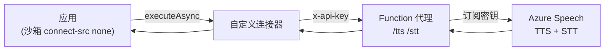
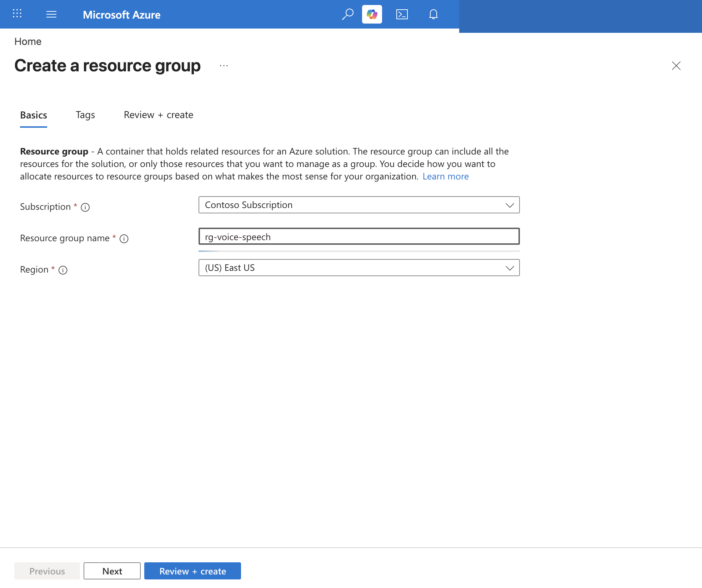
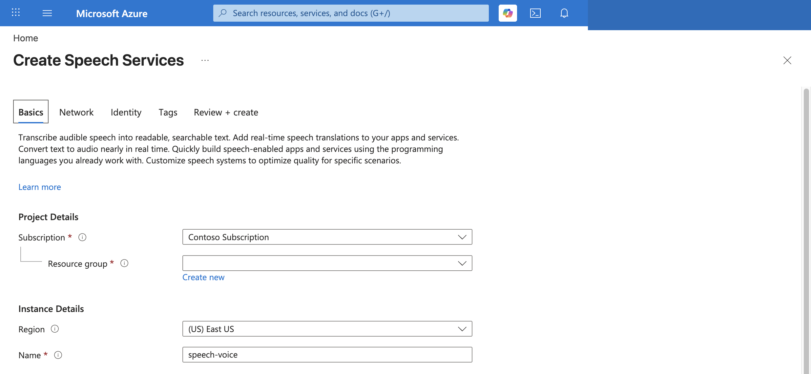
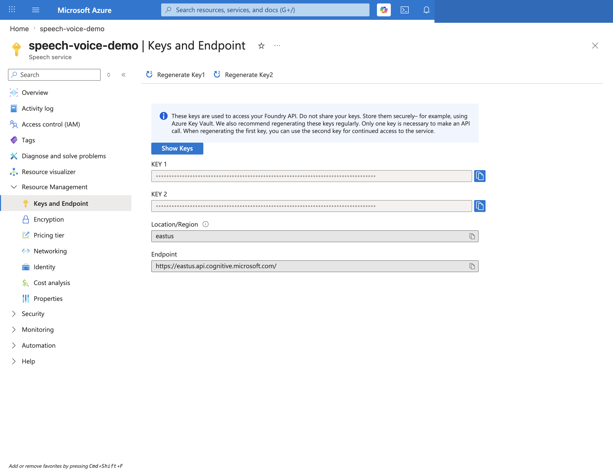
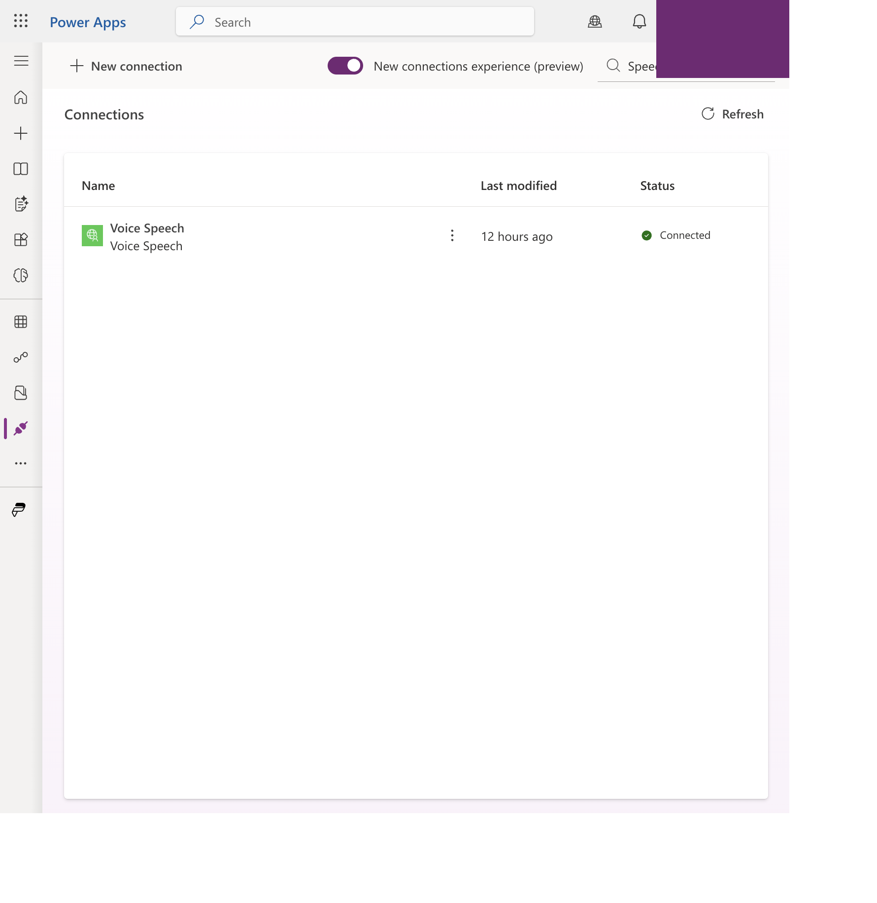

## #overview 01 / Overview and Prerequisites :: 搭建路线：五种资源、两处门户、一把密钥 || The Route: Five Resources, Two Portals, One Key

这套流程分两半：先在 Azure 建好语音服务（第 2–4 章），再到 Power Platform 导入我们提供的 Solution 并填两个值（第 5 章）。你会用到两个网站——Azure 门户 portal.azure.com、Power Platform 门户 make.powerapps.com，外加电脑上一个「终端」窗口跑几条命令。每一步都配了截图，照着点、照着填即可。 || This flow has two halves: first build the voice service in Azure (chapters 2–4), then import the solution we provide and enter two values in Power Platform (chapter 5). You will use two websites — the Azure portal (portal.azure.com) and the Power Platform portal (make.powerapps.com) — plus one terminal window on your computer for a few commands. Every step has a screenshot; just follow along, click, and type.

记住三条边界：① 订阅密钥只在 Function 应用设置里；② 共享密钥（x-api-key）由连接器发送、挡匿名滥用；③ 应用永远只认连接器逻辑名，从不直接见到 Function 地址或密钥。 || Three boundaries to remember: (1) the subscription key lives only in the Function app settings; (2) the shared secret (x-api-key) is sent by the connector and blocks anonymous abuse; (3) the app only ever knows the connector logical name, never the Function URL or the keys.

全篇最该记住的一张表。Azure 侧建好后，只有两个值要交到 Power Platform，各有唯一去处；Speech 订阅密钥留在 Function、绝不外传。后面的章节只是把这张表做实。 || The one table to remember. Once the Azure side is built, only two values cross into Power Platform, each with a single destination; the Speech subscription key stays in the Function and never leaves. The rest of the guide just makes this table concrete.

| Azure 产出的值 || Value Azure produces | 从哪拿 || Where to get it | 填到 Power Platform 的哪里 || Where it goes in Power Platform |
| --- | --- | --- |
| https://<func>.azurewebsites.net Function 地址 || Function URL | Function 概览页（§2 / §4） || The Function overview (§2 / §4) | 导入 Solution 时填环境变量 biz_VoiceFunctionHost；连接器 host 固定引用这个变量 || Enter it into the biz_VoiceFunctionHost environment variable during solution import; the connector host always references that variable |
| SPEECH_API_KEY 的值 || value 防滥用共享密钥 || Anti-abuse shared secret | §3 用 openssl 生成的那串 || The string minted with openssl in §3 | 新建连接时的 x-api-key 输入框（§5 步骤 3） || The x-api-key box when creating the connection (§5 step 3) |
| ❌ Speech 订阅密钥 + 区域 || ❌ Speech subscription key + region | §2 Keys and Endpoint | 不给 PP——只写进 Function 应用设置 SPEECH_KEY / SPEECH_REGION（§3） || Not for PP — only into the Function app settings SPEECH_KEY / SPEECH_REGION (§3) |

:::insight-grid { cols: 3 }
::card 01
### 一个 Azure 订阅 || An Azure subscription
能创建认知服务、Function、存储。免费额度足够起步（Speech F0）。 || Able to create Cognitive Services, a Function, and storage. The free tier is enough to start (Speech F0).

::card 02
### 命令行工具 || Command-line tools
Azure CLI（az）、Node.js、zip。装法：Mac 终端跑 brew install azure-cli node；Windows 到 aka.ms/installazurecliwindows 下载。装好后运行一次 az login 登录。第 3–4 章会用到。 || Azure CLI (az), Node.js, zip. To install: on Mac run brew install azure-cli node; on Windows download from aka.ms/installazurecliwindows. After installing, run az login once to sign in. Used in chapters 3–4.

::card 03
### 一个 Power Platform 环境 || A Power Platform environment
含 Dataverse，且允许自定义连接器（未被 DLP 策略拦截）。用于导入我们的 Solution 并建连接。 || With Dataverse, and where custom connectors are allowed (not blocked by a DLP policy). Used to import our solution and create the connection.
:::

## #resources 02 / Create the Azure Resources :: 资源组、Speech、存储、Function 四件套 || Resource Group, Speech, Storage, Function — the Four Pieces

先登录 Azure 门户：浏览器打开 portal.azure.com，用你的 Azure 账号登录。然后按顺序建 4 样东西（资源组、Speech、存储、Function）。每样都是同一套路：顶部搜索框搜名字 → 点 Create（新建） → 填几个框 → 点 Review + create。下面逐个照着做。 || First sign in to the Azure portal: open portal.azure.com in a browser and sign in with your Azure account. Then create 4 things in order (resource group, Speech, storage, Function). Each follows the same pattern: search the name in the top box → click Create → fill a few fields → click Review + create. Follow along below.

| 资源 || Resource | 示例名（通用） || Example name (generic) | 档位 / 备注 || Tier / note |
| --- | --- | --- |
| 资源组 || Resource group | rg-voice-speech | 装本指南全部资源 || Holds everything in this guide |
| Speech 资源 || Speech resource | speech-voice | F0 免费（生产 S0） || F0 free (S0 for production) |
| 存储账户 || Storage account | voicespeechst<唯一> | 全局唯一、全小写 || Globally unique, all lowercase |
| Function App | voice-speech-fn-<唯一> | 全局唯一 · Node 22 || Globally unique · Node 22 |

区域：示例用 East US。面向中国用户可选 East Asia 以降低延迟。Speech、Function、存储建议同区域。 || Region: the example uses East US. For users in China, East Asia can lower latency. Keep Speech, the Function, and storage in the same region.

档位：F0 是免费档，仅供开发 / 试用——有硬性限制（并发与月度事务受限、每订阅每区域仅 1 个、部分功能不可用）。正式项目 / 生产必须用 S0（标准档、按量计费）才有完整配额与并发。建 Speech 时按用途选定价层：开发填 F0、生产填 S0；后续也可在 Speech 资源的 Pricing tier 里升档，无需改 Function 或 app。 || Tier: F0 is the free tier, for development / trial only — it has hard limits (capped concurrency and monthly transactions, only one per region per subscription, some features unavailable). A real project / production must use S0 (Standard, pay-as-you-go) for full quota and concurrency. Pick the pricing tier by purpose when creating Speech: F0 for dev, S0 for production; you can also upgrade later in the Speech resource's Pricing tier, with no change to the Function or app.

:::flow
1. **1 · 新建资源组 || 1 · Create the resource group** — 门户搜索栏输入「Resource groups」→ Create → 选订阅 → 名称填 rg-voice-speech → 区域 East US → Review + create → Create。 || In the portal search bar type 'Resource groups' -> Create -> pick your subscription -> Name rg-voice-speech -> Region East US -> Review + create -> Create.； 图 02-1新建资源组的 Basics 表单：订阅、名称 rg-voice-speech、区域 (US) East US。 || Create a resource group Basics form: subscription, name rg-voice-speech, region (US) East US.
2. **2 · 新建 Speech 资源 || 2 · Create the Speech resource** — 搜索「Speech」（Azure AI services 下的 Speech service）→ Create → 资源组选 rg-voice-speech → 名称 speech-voice → 区域 East US → 定价层 Free F0 → Review + create。 || Search 'Speech' (the Speech service under Azure AI services) -> Create -> Resource group rg-voice-speech -> Name speech-voice -> Region East US -> Pricing tier Free F0 -> Review + create.； 图 02-2新建 Speech 资源：名称 speech-voice、区域 (US) East US、定价层选 Free F0（全新订阅会在下拉里出现 F0）。 || Create the Speech resource: name speech-voice, region (US) East US, pricing tier Free F0 (a fresh subscription shows F0 in the dropdown).
3. **3 · 记下 Speech 的密钥与终结点 || 3 · Note the Speech key and endpoint** — 进入 speech-voice → 左侧「Keys and Endpoint」→ 复制 KEY 1 与 Location/Region。这两样只在下一步写进 Function、之后就不再需要手动接触。 || Open speech-voice -> left menu 'Keys and Endpoint' -> copy KEY 1 and the Location/Region. You only need these to configure the Function in the next step; you never touch them by hand afterwards.； 图 02-3Keys and Endpoint 页：KEY 1/KEY 2 保持掩码（不要点 Show Keys），只需记下 Location=eastus 与终结点，下一步写进 Function。 || The Keys and Endpoint page: KEY 1 / KEY 2 stay masked (do not click Show Keys); you only note Location=eastus and the endpoint, then write them into the Function next.
4. **4 · 新建存储账户 || 4 · Create the storage account** — 搜索「Storage accounts」→ Create → 资源组 rg-voice-speech → 名称 voicespeechst<唯一>（全小写、全局唯一）→ 区域 East US → 冗余 LRS → Create。Function 运行需要它。 || Search 'Storage accounts' -> Create -> Resource group rg-voice-speech -> Name voicespeechst(lowercase, globally unique) -> Region East US -> Redundancy LRS -> Create. The Function needs it to run.
5. **5 · 新建 Function App（Node 22） || 5 · Create the Function App (Node 22)** — 搜索「Function App」→ Create → Consumption 计划 → 名称 voice-speech-fn-<唯一> → Runtime stack Node.js → 版本 22 LTS → 操作系统 Linux → 区域 East US → 存储选上一步的 voicespeechst<唯一>。⚠️ 不要选 Node 24（消费计划上起不来）。 || Search 'Function App' -> Create -> Consumption plan -> Name voice-speech-fn--> Runtime stack Node.js -> Version 22 LTS -> OS Linux -> Region East US -> Storage = the voicespeechstfrom the previous step. Do NOT pick Node 24 (it fails to start on Consumption).；$ az functionapp show -n voice-speech-fn-demo -g rg-voice-speech \ --query "{name:name, state:state, kind:kind, runtime:siteConfig.linuxFxVersion}" -o json { "name": "voice-speech-fn-demo", "state": "Running", "kind": "functionapp,linux", "runtime": "Node|22" } # App Service plan → EastUSLinuxDynamicPlan (Dynamic = Consumption) 图 02-4建好后用 az 核对运行时：runtime=Node|22、kind=functionapp,linux、Dynamic（消费）计划、状态 Running——正是向导里该选的组合。 || After creating it, verify the runtime with az: runtime=Node|22, kind=functionapp,linux, Dynamic (Consumption) plan, state Running — exactly the combination the wizard should produce.
:::

## #deploy 03 / Configure and Deploy the Function Code :: 写入密钥、生成防滥用密钥、上传代码 || Set the Keys, Mint the Anti-Abuse Secret, Upload the Code

资源建好后，这一步是命令行：把 Speech 密钥与区域写进 Function 应用设置，生成一把防滥用共享密钥，再用 run-from-package 把代理代码传上去。新建的 Linux 消费计划上 config-zip/OneDeploy 常报错，run-from-package 最稳。 || With the resources in place, this step is command-line: write the Speech key and region into the Function app settings, mint an anti-abuse shared secret, and upload the proxy code with run-from-package. On a fresh Linux Consumption app, config-zip / OneDeploy often fail, so run-from-package is the reliable method.

下面有两个代码块，用法不同。第一个是部署本身：把整段复制到终端一次运行（它按注释 1→2→3 依次写密钥、用 run-from-package 传代码、放开 CORS，不是分三次输入）。图 03-1 的第二个代码块是可选核对，部署完单独跑一次即可（$ 开头那行是命令，其余是应看到的输出）。命令里的名称先换成你自己的：RG=rg-voice-speech、FUNC=你的 Function 名、STORAGE=你的存储名、REGION=eastus；代理代码来自仓库的 azure/speech-token-broker 目录。 || There are two code blocks below with different uses. The first is the deployment itself: copy the whole block into the terminal and run it once (following comments 1→2→3 it writes the keys, uploads the code via run-from-package, and opens CORS — it is not three separate inputs). The second block (图 03-1) is an optional check you run once after deploying (the line starting with $ is the command, the rest is the expected output). Replace the names with your own first: RG=rg-voice-speech, FUNC=your Function name, STORAGE=your storage name, REGION=eastus; the proxy code is the repo's azure/speech-token-broker folder.

# ---- 1. Speech key + region + anti-abuse key into Function app settings ---- RG=rg-voice-speech FUNC=voice-speech-fn-XXXX # your globally-unique Function name STORAGE=voicespeechstXXXX # your globally-unique storage name REGION=eastus KEY=$(az cognitiveservices account keys list -n speech-voice -g $RG --query key1 -o tsv) APIKEY=$(openssl rand -hex 32) # anti-abuse shared secret (write this down) az functionapp config appsettings set -n $FUNC -g $RG \ --settings SPEECH_KEY="$KEY" SPEECH_REGION=$REGION SPEECH_API_KEY="$APIKEY" # ---- 2. Deploy the proxy code via run-from-package (from azure/speech-token-broker) ---- cd azure/speech-token-broker npm install --omit=dev zip -r -X /tmp/speech.zip host.json package.json src node_modules CONN=$(az storage account show-connection-string -n $STORAGE -g $RG --query connectionString -o tsv) az storage container create -n deploy --connection-string "$CONN" az storage blob upload -c deploy -n speech.zip -f /tmp/speech.zip --overwrite --connection-string "$CONN" EXPIRY=$(date -u -v+2y '+%Y-%m-%dT%H:%MZ') # Linux: date -u -d '+2 years' '+%Y-%m-%dT%H:%MZ' SAS=$(az storage blob generate-sas -c deploy -n speech.zip --permissions r --expiry "$EXPIRY" --connection-string "$CONN" --full-uri -o tsv) az functionapp config appsettings set -n $FUNC -g $RG --settings WEBSITE_RUN_FROM_PACKAGE="$SAS" az functionapp restart -n $FUNC -g $RG # ---- 3. Allow the Power Apps player / localhost to call it (dev-permissive CORS) ---- az functionapp cors add -n $FUNC -g $RG --allowed-origins "*"

# Verify the settings exist — names only, values are never printed $ az functionapp config appsettings list -n voice-speech-fn-demo -g rg-voice-speech \ --query "[].name" -o tsv | sort AzureWebJobsStorage FUNCTIONS_EXTENSION_VERSION FUNCTIONS_WORKER_RUNTIME SPEECH_API_KEY SPEECH_KEY SPEECH_REGION WEBSITE_CONTENTSHARE WEBSITE_RUN_FROM_PACKAGE

图 03-1

用 az 核对应用设置「存在」即可（只列名字、绝不打印值）：三个业务键 SPEECH_KEY / SPEECH_REGION / SPEECH_API_KEY，其余 FUNCTIONS_*、WEBSITE_RUN_FROM_PACKAGE 等是平台自带。 || Verify the app settings exist with az (names only, values never printed): the three business keys SPEECH_KEY / SPEECH_REGION / SPEECH_API_KEY; the rest (FUNCTIONS_*, WEBSITE_RUN_FROM_PACKAGE, …) are platform-managed.

坑：CLI 可能默认把 Function 建成 Node 24（称 20 已 EOL），但 Node 24 在 Linux 消费计划上起不来（持续 503）。用 Node 22 LTS；若已建在 24 上：az functionapp config set --linux-fx-version 'Node|22' 再重启。 || Trap: the CLI may default the Function to Node 24 (claiming 20 is EOL), but Node 24 fails to start on Linux Consumption (persistent 503). Use Node 22 LTS; if you already created it on 24: az functionapp config set --linux-fx-version 'Node|22' and restart.

坑 2（企业租户高发，比 Node 版本更隐蔽）：Function 的运行时状态与 run-from-package 代码包都要经「共享密钥 + 公网」读取存储账户。若贵司安全基线策略把该存储账户的 allowSharedKeyAccess 或 publicNetworkAccess 关掉，Function 连自己的存储都读不到 → 所有端点持续 503（重启无效）。排查：az storage account show -n $STORAGE -g $RG --query '{sharedKey:allowSharedKeyAccess,publicNet:publicNetworkAccess}'——两者须为 true / Enabled。恢复：az storage account update -n $STORAGE -g $RG --allow-shared-key-access true --public-network-access Enabled，再 az functionapp restart -n $FUNC -g $RG。若策略会自动重新锁定，需为该存储账户申请策略豁免，或改用 Elastic Premium 计划 + VNet 集成 + 私有终结点 + 托管标识 的合规架构。 || Trap 2 (common in enterprise tenants, subtler than the Node version): the Function reads both its runtime state and the run-from-package code from the storage account over shared key + public network. If your security-baseline policy disables that account's allowSharedKeyAccess or publicNetworkAccess, the Function cannot reach its own storage, so every endpoint returns persistent 503 (a restart does not help). Diagnose: az storage account show -n $STORAGE -g $RG --query '{sharedKey:allowSharedKeyAccess,publicNet:publicNetworkAccess}' — both must be true / Enabled. Restore: az storage account update -n $STORAGE -g $RG --allow-shared-key-access true --public-network-access Enabled, then az functionapp restart -n $FUNC -g $RG. If the policy re-locks it automatically, request a policy exemption for this storage account, or move to a compliant architecture: Elastic Premium plan + VNet integration + private endpoint + managed identity.

换合规做法有什么影响？app 端：零影响——应用只经连接器调 Function 端点，不关心 Function 怎么托管、怎么访问存储，无需改代码或重建。Function 端：只换托管方式、不改代码——要让存储保持锁定，就把 Function 从消费计划迁到 Elastic Premium（支持 VNet 集成）、给存储加私有终结点、AzureWebJobsStorage 与 run-from-package 改用托管标识；/tts、/stt 业务代码原样不动。代价：Premium 计划无免费档、按常驻实例计费，比消费计划贵。 || What does the compliant route affect? App side: zero impact — the app only calls the Function endpoint through the connector and does not care how the Function is hosted or how it reaches storage, so no code change or rebuild. Function side: hosting change only, no code change — to keep storage locked, move the Function from Consumption to Elastic Premium (which supports VNet integration), add a private endpoint to the storage, and switch AzureWebJobsStorage and run-from-package to managed identity; the /tts and /stt business code is unchanged. Cost: the Premium plan has no free tier and bills for always-on instances, so it is pricier than Consumption.

## #verify 04 / Verify the Backend :: 带上 x-api-key 头，两个端点都要通 || With the x-api-key Header, Both Endpoints Must Respond

部署完先用 curl 自测，确认「带密钥能调、不带密钥被挡」。这一步不进 Power Platform，纯验证 Function 本身。 || After deploying, self-test with curl to confirm 'with the key it works, without the key it is blocked'. This step does not touch Power Platform — it verifies the Function itself.

# TTS with the key -> base64 mp3 curl -s -X POST https://$FUNC.azurewebsites.net/api/tts \ -H "Content-Type: application/json" -H "x-api-key: $APIKEY" \ -d '{"text":"hello","locale":"en-US"}' | head -c 60 # expect: {"audio":"<base64 mp3>", ...} # STT route is live (empty body -> audio_required) curl -s -X POST https://$FUNC.azurewebsites.net/api/stt \ -H "Content-Type: application/json" -H "x-api-key: $APIKEY" \ -d '{}' | head -c 80 # expect: {"error":"audio_required", ...} # WITHOUT the key -> blocked curl -s -o /dev/null -w "%{http_code}\n" -X POST https://$FUNC.azurewebsites.net/api/tts \ -H "Content-Type: application/json" -d '{"text":"hi","locale":"en-US"}' # expect: 401

三条都符合预期，就说明：Function 通了、密钥生效了、匿名调用被挡了。可以进入 Power Platform 侧。 || If all three match, the Function works, the key is in force, and anonymous calls are blocked. You are ready for the Power Platform side.

## #import 05 / Import the Solution and Enter Two Values :: 连接器与应用随 Solution 一起进来，你只填 endpoint 和 api-key || The Connector and App Ship Inside the Solution; You Only Enter the Endpoint and api-key

Azure 后端建好后（第 2–4 章），Power Platform 这一侧无需你手建连接器、也无需改应用代码。我们提供一个 Managed Solution，里面已打包好应用、自定义连接器（host 绑定环境变量 biz_VoiceFunctionHost、API Key 鉴权）以及连接引用 biz_SalesCopilotSpeech。你只需导入它，并交出两个值：Function 地址填进环境变量、api-key 填进新建的连接。 || Once the Azure backend is built (chapters 2–4), the Power Platform side needs no hand-built connector and no app code change. We provide a Managed solution that already packages the app, the custom connector (host bound to the environment variable biz_VoiceFunctionHost, API-key auth), and the connection reference biz_SalesCopilotSpeech. You just import it and hand over two values: the Function URL into the environment variable, and the api-key into a new connection.

| 随 Managed Solution 一起进来（无需你建） || Ships inside the Managed solution (you build nothing) | 你要提供 / 操作 || You provide / do |
| --- | --- |
| 应用（已接好连接引用，无需重建） || The app (already wired to the connection reference, no rebuild) | 导入 Solution || Import the solution |
| 自定义连接器（host = 环境变量、API Key 鉴权） || The custom connector (host = env var, API-key auth) | 环境变量 biz_VoiceFunctionHost 填 Function 地址 || Set biz_VoiceFunctionHost to the Function URL |
| 连接引用 biz_SalesCopilotSpeech || The connection reference biz_SalesCopilotSpeech | 新建 Speech 连接、填 api-key，再把连接引用指向它 || Create the Speech connection with the api-key, then point the reference at it |

为什么连接要你自己建：连接器和连接引用是「定义」，随 Solution 分发；但「连接实例」持有 api-key 这类凭据、是环境专属的，绝不随包外传——所以每个环境都要自己新建一个连接、填自己的 api-key。 || Why you create the connection: the connector and connection reference are definitions and ship with the solution; but a connection instance holds credentials like the api-key and is environment-specific, so it never travels inside a package — each environment creates its own connection with its own api-key.

:::flow
1. **1 · 导入 Managed Solution || 1 · Import the Managed solution** — make.powerapps.com → 选目标环境 → 左侧 Solutions → Import solution → 上传我们提供的 .zip → Next。向导会让你为标准连接器（Dataverse、Copilot Studio）登录授权，并进入环境变量一步。 || make.powerapps.com -> pick the target environment -> Solutions -> Import solution -> upload the .zip we provide -> Next. The wizard asks you to sign in for the standard connectors (Dataverse, Copilot Studio) and then reaches the environment-variable step.
2. **2 · 环境变量 biz_VoiceFunctionHost 填 Function 地址 || 2 · Set biz_VoiceFunctionHost to the Function host** — 在向导的环境变量一步，把 biz_VoiceFunctionHost 填成你的 Function 主机名（只填 .azurewebsites.net，不带 https:// 和 /api）。连接器 host 固定引用这个变量，所以换环境只改这里、应用无需重建。 || At the environment-variable step, set biz_VoiceFunctionHost to your Function hostname (just .azurewebsites.net, no https:// and no /api). The connector host references this variable, so switching environments only changes this value and the app never needs a rebuild.
3. **3 · 导入完成后新建 Speech 连接、填 api-key || 3 · After import, create the Speech connection and enter the api-key** — 自定义连接器随包导入、在导入完成前尚不存在，所以向导不会当场让你为它建连接。导入完成后：左侧 Connections → + New connection → 搜到 Sales Copilot Speech → 因是 API Key 鉴权会弹输入框 → 填第 3 章生成的 api-key → Create（状态应为 Connected）。 || The custom connector ships inside the solution and does not exist until import finishes, so the wizard does not prompt you to create its connection during import. After import: Connections -> + New connection -> find Sales Copilot Speech -> because it uses API-key auth a box appears -> enter the api-key minted in chapter 3 -> Create (status should read Connected).； 图 05-1Connections 列表里 Sales Copilot Speech 连接显示 Connected（绿勾）；账号信息已打码。 || The Connections list shows the Sales Copilot Speech connection as Connected (green check); account details are masked.
4. **4 · 把连接引用指向这个连接 || 4 · Point the connection reference at that connection** — 打开导入进来的 Solution → Connection references → biz_SalesCopilotSpeech → 右侧把 Connection 选成上一步新建的那个 → Save。至此应用语音即可用：应用早已接好这个连接引用，无需任何代码改动或重建。 || Open the imported solution -> Connection references -> biz_SalesCopilotSpeech -> on the right, set Connection to the one you just created -> Save. Voice now works in the app: it is already wired to this connection reference, with no code change or rebuild.
:::

## #security 06 / Security and Next Steps :: 密钥、CORS、清理 || Keys, CORS, Cleanup

收尾三件事,首次部署都很快:护好防滥用密钥、上线前收紧 CORS、试用完删资源组。 || Three wrap-up items, all quick on a first deployment: protect the anti-abuse key, tighten CORS before go-live, and delete the resource group when done trialing.

:::insight-grid { cols: 3 }
::card 01
### 共享密钥挡匿名滥用 || The shared secret blocks anonymous abuse
端点匿名可达，但设了 SPEECH_API_KEY 后，每次调用必须带匹配的 x-api-key，否则 401。密钥只在服务端与连接里，不入前端、不入图。 || The endpoint is anonymously reachable, but once SPEECH_API_KEY is set, every call must carry a matching x-api-key or gets 401. The key lives only server-side and in the connection — never in the front end, never in a screenshot.

::card 02
### 上线前收紧 CORS 与限流 || Tighten CORS and add rate limiting before go-live
dev 期 CORS 用了 *；上线前收窄到具体 Power Apps 来源，并加每 IP/分钟限流。CORS 只挡浏览器，密钥才是真正的门。 || CORS uses * during dev; before go-live, narrow it to the exact Power Apps origins and add a per-IP / per-minute rate limit. CORS only guards the browser — the key is the real gate.

::card 03
### 试用完删资源组 || Delete the resource group after trialing
本指南所有资源都在 rg-voice-speech 里，删资源组即全清：az group delete -n rg-voice-speech --yes。免费档几乎无费用，但不用就删干净。 || Everything in this guide sits in rg-voice-speech; delete the group to remove it all: az group delete -n rg-voice-speech --yes. The free tier costs almost nothing, but clean up when done.
:::
